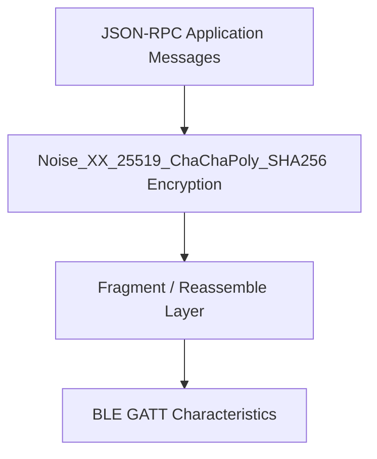
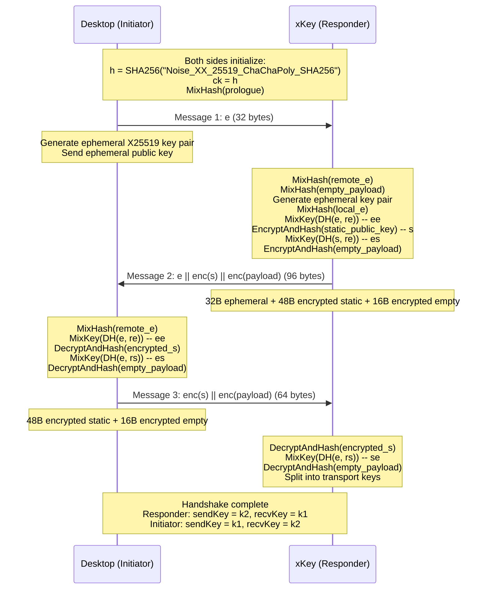
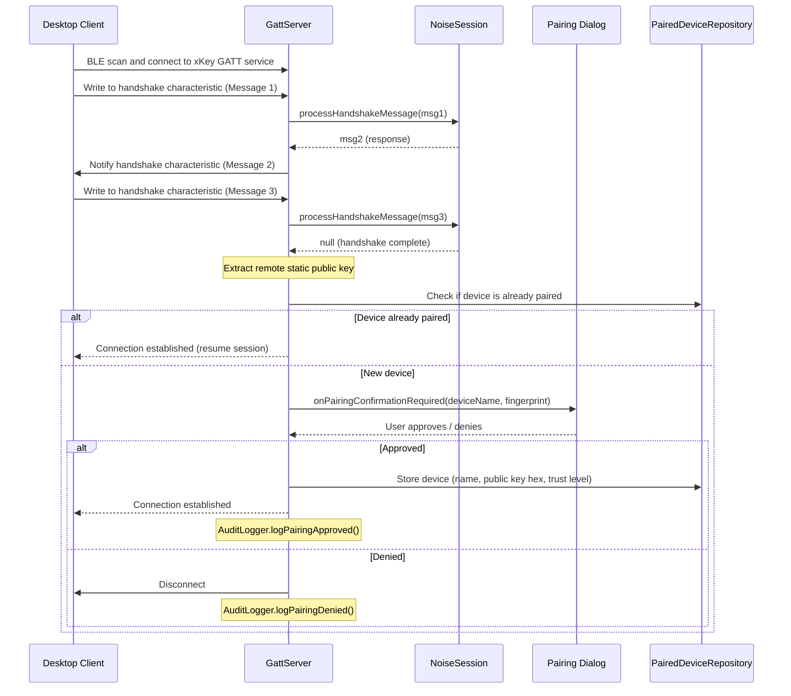
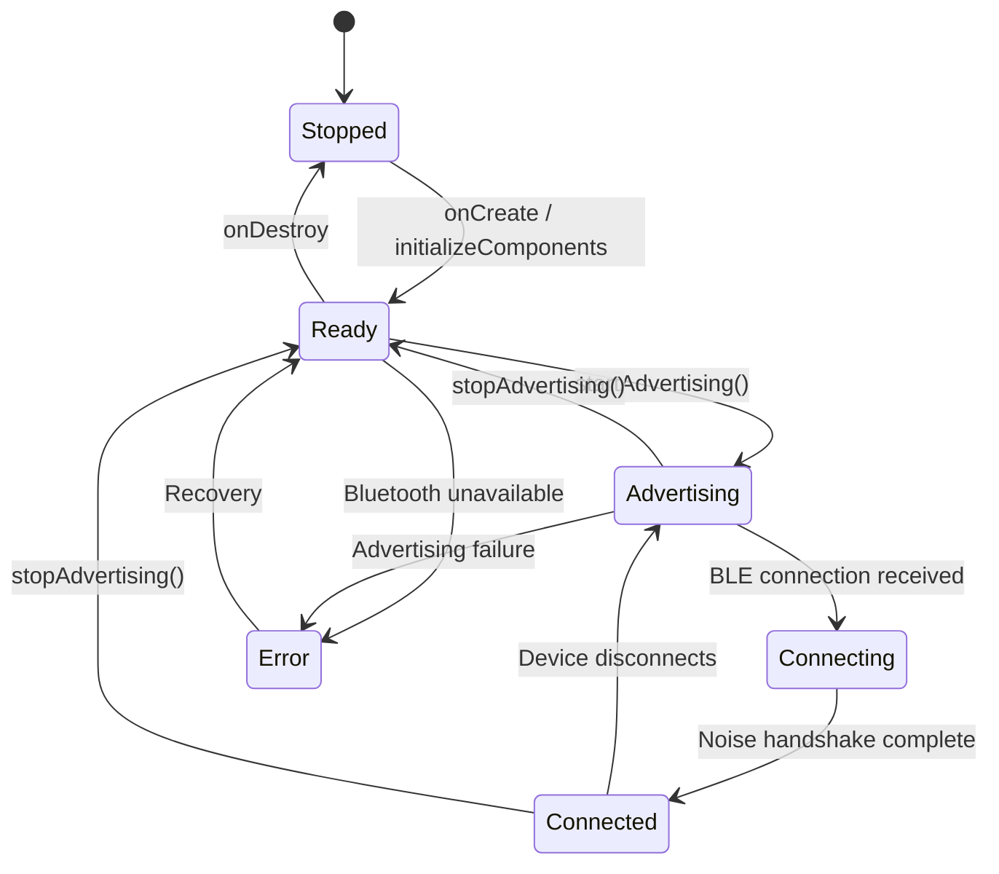

# BLE Protocol

This document describes the BLE communication protocol used between xKey
(Android authenticator) and desktop clients (go-xkms). The protocol
provides authenticated, encrypted, bidirectional communication for
cryptographic operations.

## Transport Stack



| Layer | Component | Responsibility |
|-------|-----------|---------------|
| Application | `RequestHandler`, `Messages` | JSON-RPC request/response dispatch |
| Encryption | `NoiseSession` | Noise_XX handshake and transport encryption |
| Framing | `FragmentReassembler`, `Fragmenter` | Message splitting for BLE MTU limits |
| Transport | `GattServer`, `BleClient` | BLE GATT characteristic read/write |

### Other transports

BLE is one of three transports carrying the same pairing protocol and JSON-RPC
surface. The stream transports share a single responder implementation so they
stay byte-identical with the go-xkms desktop initiator:

| Transport | Component | Framing |
|-----------|-----------|---------|
| BLE GATT | `GattServer` | 7-byte fragment header (see below) |
| USB (AOA) | `UsbAccessoryServer` -> `StreamPairingSession` | `StreamMessageFraming`, 2-byte big-endian length |
| TCP (loopback `:8444`, for ADB/emulator) | `TcpHsmServer` -> `StreamPairingSession` | `StreamMessageFraming`, 2-byte big-endian length |

All three perform the pre-handshake identity exchange before Noise_XX; the
desktop initiator always sends it.

## Noise_XX Handshake

xKey acts as the Noise **responder** (the desktop client is the initiator).
The handshake establishes mutual authentication and derives transport keys.

### Protocol: `Noise_XX_25519_ChaChaPoly_SHA256`

- **Key exchange**: X25519 (Curve25519 ECDH)
- **Symmetric cipher**: ChaCha20-Poly1305 (AEAD)
- **Hash**: SHA-256
- **Pattern**: XX (both sides transmit static keys, encrypted)

### Handshake Sequence



### Static Key Storage

Both sides persist their X25519 static key pair across sessions:

- **xKey (Android)**: Stored in `EncryptedSharedPreferences` (AES-256-GCM encrypted
  by Android Keystore master key). Raw 32-byte format.
- **Desktop**: Stored by go-xkms in the local keychain.

### Prologue Binding

The prologue is mixed into the handshake hash before any messages are exchanged.
It must match on both sides for the handshake to succeed. xKey uses the prologue
to bind the handshake to expected device fingerprints for trusted device pairing.

## Fragment Protocol

BLE GATT characteristics have a limited MTU (typically 20-512 bytes). Messages
larger than the negotiated MTU are split into fragments.

### Fragment Header Format (7 bytes, big-endian)

```
Offset  Size  Field       Description
0       1     flags       Bit 0 = first fragment, Bit 1 = last fragment
1       2     sequence    Fragment sequence number (0-based)
3       2     total       Total number of fragments in message
5       2     length      Payload length in this fragment
7       var   payload     Fragment payload data
```

### Constraints

| Parameter | Value |
|-----------|-------|
| Header size | 7 bytes |
| Default payload size | 237 bytes (MTU 247 - 3 ATT overhead - 7 header) |
| Maximum message size | 1 MB |
| Maximum fragments | 1000 |
| Reassembly timeout | 30 seconds |

### Fragmentation Example

A 600-byte message with default MTU would be split into 3 fragments:

```
Fragment 0: flags=0x01 seq=0 total=3 len=237 [237 bytes payload]
Fragment 1: flags=0x00 seq=1 total=3 len=237 [237 bytes payload]
Fragment 2: flags=0x02 seq=2 total=3 len=126 [126 bytes payload]
```

## Message Types

All application messages use a JSON-RPC style format:

```json
{
    "id": 1,
    "method": "local.sign",
    "params": { ... }
}
```

### Local Methods (handled by xKey)

Messages prefixed with `local.*` are processed by the phone's `RequestHandler`.

| Method | Description | Key Parameters |
|--------|-------------|----------------|
| `local.generateKey` | Generate a key (Keystore, or software when `exportable`) | `keyId`, `keyType`, `algorithm`, `requireUserVerification`, `preferStrongBox`, `exportable` |
| `local.sign` | Sign data with a key | `keyId`, `data` (base64), `algorithm` (optional override) |
| `local.getPublicKey` | Get public key (DER/PEM/SSH) | `keyId`, `format` |
| `local.deleteKey` | Delete a key | `keyId` |
| `local.listKeys` | List all managed keys | (none) |
| `local.symmetricEncrypt` | AES-GCM encrypt | `keyId`, `data`, `aad` |
| `local.symmetricDecrypt` | AES-GCM decrypt | `keyId`, `data`, `aad` |
| `local.ecdh` | ECDH key agreement | `keyId`, `peerPublicKey` |
| `local.hmac` | HMAC computation | `keyId`, `data` |
| `local.decrypt` | RSA-OAEP decrypt | `keyId`, `ciphertext` |
| `local.getCapabilities` | Device capabilities | (none) |
| `local.attestKey` | Key attestation | `keyId`, `nonce` |
| `local.attestDevice` | Device attestation | `nonce` |

`local.generateKey` returns `keyId`, `publicKeyDer` (omitted for symmetric and
software keys), optional `publicKeyCose`, `algorithm`, `keySizeBits`, and a
`securityLevel` of `software`, `strongbox`, or `tee`.

> Note: This document covers the original BLE method set. The full, authoritative
> wire contract — including the `local.*`/`remote.*` OATH, PIV, sync, backup, and
> key-sharing families, transports (BLE / USB-AOA / TCP), and framing — is in
> `go-xkms/xkey/pkg/pairing` and the platform contract doc
> `automatethethings/software/docs/03-sdk-integration-contracts.md`.

### Remote Methods (forwarded to desktop)

Messages prefixed with `remote.*` are forwarded through the
`BidirectionalMessageRouter` to the connected desktop client.

| Method | Description |
|--------|-------------|
| `remote.listKeys` | List keys on the desktop keychain |
| `remote.sign` | Request signing from desktop key |
| `remote.getPublicKey` | Get desktop public key |
| `remote.attestDevice` | Request device attestation from desktop |

### Co-Sign Extension

| Method | Description | Parameters |
|--------|-------------|------------|
| `cosign.request` | Request co-signature from connected device | `hash`, `hashAlgorithm`, `initiatorFingerprint` |
| `cosign.response` | Return co-signature to initiator | `signature` (base64), `keyFingerprint`, `signerName`, `algorithm` |

## Response Format

```json
{
    "id": 1,
    "result": { ... }
}
```

Error response:

```json
{
    "id": 1,
    "error": {
        "code": -32000,
        "message": "Key not found"
    }
}
```

## Pairing Flow



## Transport Encryption

After the Noise_XX handshake completes, all messages are encrypted with
ChaCha20-Poly1305 using the derived transport keys:

- **Responder (xKey)**: sends with `k2`, receives with `k1`
- **Initiator (Desktop)**: sends with `k1`, receives with `k2`

Each direction maintains an independent 64-bit nonce counter, starting at 0
and incrementing with each message. The 96-bit ChaCha20 nonce is formed as:

```
[4 bytes: 0x00000000] [8 bytes: little-endian counter]
```

## Service Configuration

| Property | Value |
|----------|-------|
| Foreground service type | `connectedDevice` |
| Notification channel | `XKeyApplication.NOTIFICATION_CHANNEL_ID` |
| Restart policy | `START_STICKY` |
| Wake lock | Partial, held while advertising |
| State observation | `StateFlow<ServiceState>` |

## Service States


