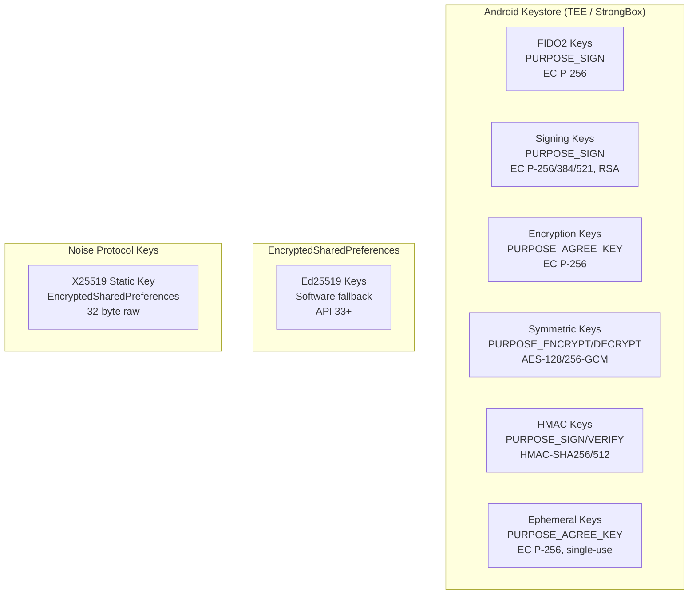
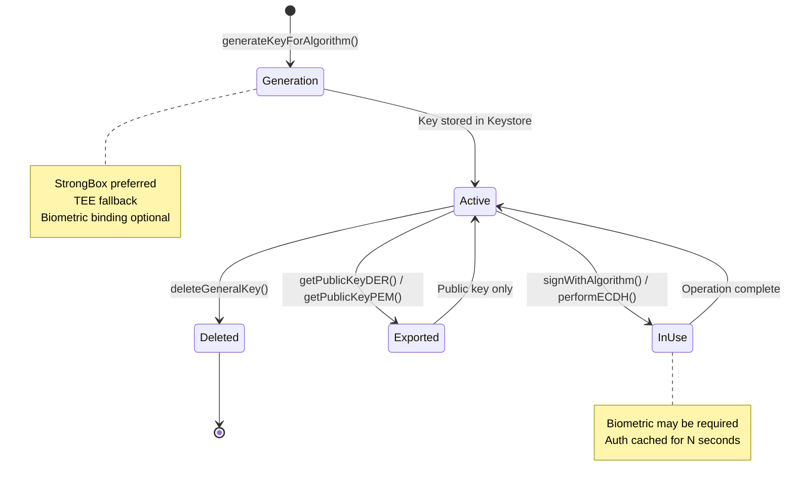
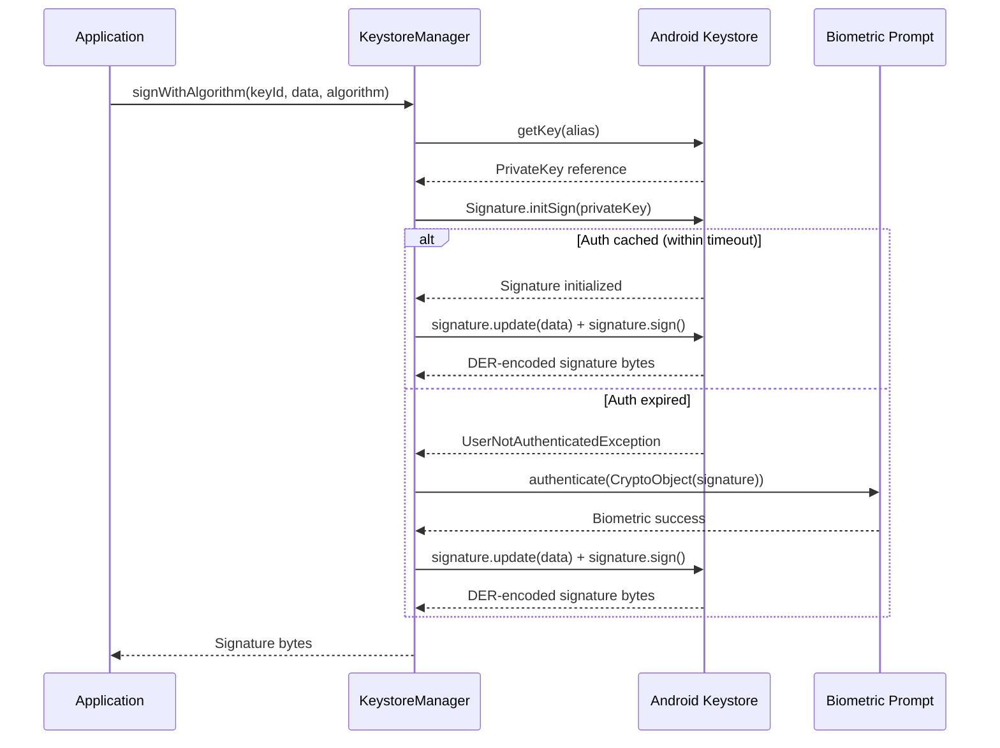
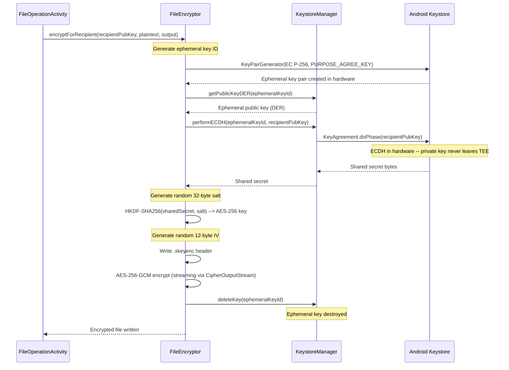
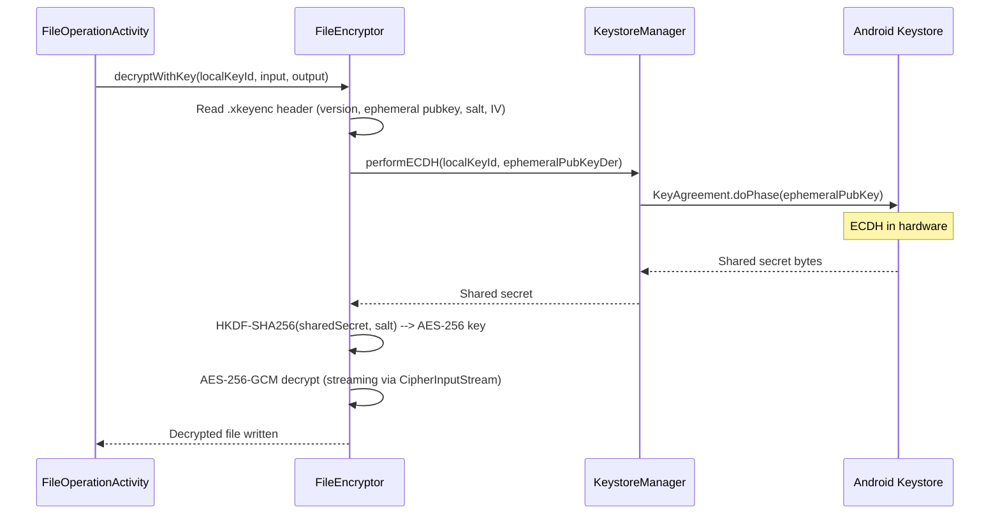
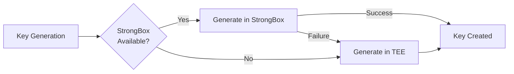

# Cryptography Architecture

> **Status: REFERENCE** · Last verified: 2026-10-09
> As-built description of xKey's hardware-backed key hierarchy, signing flows and file encryption.

This document describes the hardware-backed cryptography system in xKey, including
the key hierarchy, supported algorithms, key lifecycle, signing flows, and the
ECIES file encryption scheme.

## Design Principle

All asymmetric private key operations execute inside Android Keystore, which
delegates to TEE (Trusted Execution Environment) or StrongBox (dedicated secure
element) hardware. Private keys never leave the secure boundary. Derived
symmetric keys (e.g., from ECDH) are used in software only after the
hardware-protected key agreement step.

## Key Hierarchy



## Supported Algorithms

### Asymmetric Signing

| Algorithm | Curve / Size | JCA Algorithm | Key Purpose |
|-----------|-------------|---------------|-------------|
| ES256 | EC P-256 (secp256r1) | SHA256withECDSA | `PURPOSE_SIGN` |
| ES384 | EC P-384 (secp384r1) | SHA384withECDSA | `PURPOSE_SIGN` |
| ES512 | EC P-521 (secp521r1) | SHA512withECDSA | `PURPOSE_SIGN` |
| RS256 | RSA 2048 | SHA256withRSA | `PURPOSE_SIGN` |
| RS384 | RSA 3072 | SHA384withRSA | `PURPOSE_SIGN` |
| RS512 | RSA 4096 | SHA512withRSA | `PURPOSE_SIGN` |
| Ed25519 | Curve25519 | Ed25519 (JCE) | Software only |

### Symmetric Encryption

| Algorithm | Key Size | Mode | Key Purpose |
|-----------|----------|------|-------------|
| AES-128-GCM | 128-bit | GCM (NoPadding) | `PURPOSE_ENCRYPT \| PURPOSE_DECRYPT` |
| AES-256-GCM | 256-bit | GCM (NoPadding) | `PURPOSE_ENCRYPT \| PURPOSE_DECRYPT` |

### HMAC

| Algorithm | Output Size | Key Purpose |
|-----------|-------------|-------------|
| HMAC-SHA256 | 32 bytes | `PURPOSE_SIGN \| PURPOSE_VERIFY` |
| HMAC-SHA512 | 64 bytes | `PURPOSE_SIGN \| PURPOSE_VERIFY` |

### Key Agreement

| Algorithm | Curve | Key Purpose |
|-----------|-------|-------------|
| ECDH | EC P-256 | `PURPOSE_AGREE_KEY` |

### Noise Protocol

| Component | Algorithm |
|-----------|-----------|
| Key exchange | X25519 (Curve25519) |
| Symmetric cipher | ChaCha20-Poly1305 |
| Hash | SHA-256 |
| Pattern | Noise_XX |

## Key Lifecycle



## Authentication Duration

Keys support three authentication modes controlled by `authDurationSeconds`:

| Value | Behavior |
|-------|----------|
| `< 0` | No authentication required (key always usable) |
| `0` | Per-operation authentication (biometric every time) |
| `> 0` | Authentication cached for N seconds after biometric |

The default is 5 seconds, which prevents double-prompts during rapid sequential
requests (e.g., Chrome conditional UI discovery followed by actual authentication).

## Signing Flow



## File Encryption (ECIES) Flow

xKey uses an Elliptic Curve Integrated Encryption Scheme where the ECDH key
agreement happens entirely in hardware. The derived AES key is used in software
because Android Keystore does not support importing arbitrary derived keys.

### Encryption



### Decryption



## Key Purpose Reference

| Key Type | Purpose Flags | Operations |
|----------|---------------|------------|
| FIDO2 credential | `PURPOSE_SIGN` | WebAuthn registration/authentication |
| Signing key | `PURPOSE_SIGN` | File signing, media signing, co-signing |
| Encryption key | `PURPOSE_AGREE_KEY` | ECDH for file encryption/decryption |
| Ephemeral key | `PURPOSE_AGREE_KEY` | Single-use ECDH, deleted after use |
| AES symmetric | `PURPOSE_ENCRYPT \| PURPOSE_DECRYPT` | Direct AES-GCM encryption |
| RSA key | `PURPOSE_SIGN \| PURPOSE_DECRYPT` | Signing and RSA-OAEP decryption |
| HMAC key | `PURPOSE_SIGN \| PURPOSE_VERIFY` | Message authentication codes |

## StrongBox vs TEE

xKey prefers StrongBox when available, falling back to TEE. StrongBox provides
a dedicated secure element isolated from the main processor, offering stronger
protection against physical and side-channel attacks.



Detection is performed via `PackageManager.FEATURE_STRONGBOX_KEYSTORE` on API 28+.

## Ed25519 Software Fallback

Android Keystore does not support Ed25519 keys. When an Ed25519 key is requested
(API 33+), xKey generates it using the JCE `Ed25519` provider and stores the
private key in `EncryptedSharedPreferences` (AES-256-GCM encrypted by a Keystore
master key). This provides at-rest encryption but not the same hardware isolation
as Keystore-backed keys.

## HKDF Key Derivation

File encryption uses HKDF-SHA256 (via Bouncy Castle) to derive the AES-256 key
from the ECDH shared secret:

```
IKM  = ECDH shared secret (32 bytes from P-256)
Salt = random 32 bytes (stored in .xkeyenc header)
Info = "xkey-file-encryption-v1" (UTF-8)
OKM  = 32 bytes (AES-256 key)
```

## Alias Conventions

Keys in Android Keystore use the following alias prefixes:

| Prefix | Usage |
|--------|-------|
| `xkey_credential_` | FIDO2 credential keys |
| `xkey_key_` | General-purpose keys (signing, encryption, HMAC) |
| `xkey_attest_` | Ephemeral attestation keys (deleted after use) |
| `ephemeral_` | Ephemeral ECDH keys for file encryption (deleted after use) |
