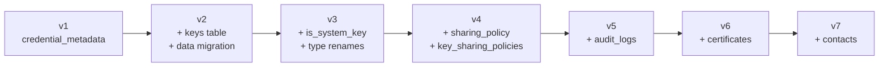

# Data Model

> **Status: REFERENCE** · Last verified: 2026-08-10
> As-built description of the xKey Room schema. STALE: the migration table stops at v7; `XKeyDatabase.kt` is at version 11. Read the code for v8-v11.

This document describes the Room database schema, migration history, DataStore
repositories, and indexing strategy used by the xKey Android application.

## Entity-Relationship Diagram

```mermaid
erDiagram
    KeyEntity {
        long id PK
        string key_id UK
        string key_type
        string algorithm
        string label
        blob public_key_der
        blob public_key_cose
        int key_size_bits
        boolean strongbox_backed
        boolean biometric_required
        int auth_duration_seconds
        boolean exportable
        boolean shareable
        string sharing_policy
        string source
        string remote_backend
        long use_count
        long created_at
        long last_used_at
        string rp_id
        string rp_name
        string user_id
        string user_name
        string user_display_name
        boolean is_discoverable
        long sign_count
        boolean is_system_key
    }

    CredentialMetadataEntity {
        long id PK
        string credential_id UK
        string rp_id
        string rp_name
        string user_id
        string user_name
        string user_display_name
        blob public_key_cose
        boolean is_discoverable
        long sign_count
        long created_at
        long last_used_at
    }

    KeySharingPolicy {
        string key_id PK_FK
        string peer_public_key_hex PK
        boolean allowed
        long created_at
    }

    AuditLogEntity {
        long id PK
        long timestamp
        string operation_type
        string key_id
        string key_label
        string key_type
        string device_id
        string device_name
        boolean success
        string error_message
        string details
        long duration_ms
    }

    CertificateEntity {
        long id PK
        string serial_number UK
        string subject_dn
        string issuer_dn
        long not_before
        long not_after
        string profile
        string fingerprint
        string certificate_pem
        string chain_pem
        string key_id
        string device_id
        boolean revoked
        long revoked_at
        int revoked_reason
        boolean is_ca
        long created_at
    }

    ContactEntity {
        long id PK
        string name
        blob public_key_der
        string public_key_fingerprint UK
        string algorithm
        long imported_at
        string source
        string notes
    }

    KeyEntity ||--o{ KeySharingPolicy : "has sharing policies"
    KeyEntity ||--o{ AuditLogEntity : "referenced in audit"
    KeyEntity ||--o{ CertificateEntity : "associated certificate"
    ContactEntity ||--o{ AuditLogEntity : "contact operations logged"
```

## Entity Details

### KeyEntity (`keys`)

Unified key metadata table for all key types managed by xKey. Actual
cryptographic key material remains in Android Keystore; this table stores
metadata, usage tracking, and policy configuration.

**Key types**: `fido2`, `tls`, `signing`, `encryption`, `secret`, `hmac`, `ca`, `attestation`

**Sources**: `local`, `remote_ble`, `remote_usb`, `xkmsd`

**Sharing policies**: `PRIVATE` (default), `ALL_PEERS`, `SELECTED_PEERS`

### CredentialMetadataEntity (`credential_metadata`)

Legacy FIDO2 credential table retained for backward compatibility with the
Credential Provider service. New FIDO2 credentials are also stored in `keys`.
Data was migrated from this table in MIGRATION_1_2.

### KeySharingPolicy (`key_sharing_policies`)

Per-key, per-peer sharing rules. Only consulted when `KeyEntity.sharingPolicy`
is `SELECTED_PEERS`. Uses a composite primary key of `(key_id, peer_public_key_hex)`.

### AuditLogEntity (`audit_logs`)

Comprehensive security event log with 35+ operation types covering key lifecycle,
cryptographic operations, FIDO2 events, connection events, certificate operations,
file/media operations, contact management, and co-signing.

### CertificateEntity (`certificates`)

X.509 certificates issued by the local Android CA. Tracks certificate lifecycle
including issuance, revocation, and expiration.

### ContactEntity (`contacts`)

Recipient public keys for file encryption and signature verification. Each
contact stores a DER-encoded public key with a SHA-256 fingerprint for
deduplication (unique index on `public_key_fingerprint`).

## Migration History



| Migration | Changes |
|-----------|---------|
| v1 -> v2 | Created unified `keys` table. Migrated `credential_metadata` rows into `keys` with `key_type = 'fido2'`. Added indices on `key_id`, `key_type`, `algorithm`, `source`, `rp_id`. |
| v2 -> v3 | Added `is_system_key` column (default `0`). Renamed `key_type` values: `ssh` -> `signing`, `symmetric` -> `secret`. Marked framework keys as system keys. |
| v3 -> v4 | Added `sharing_policy` column (default `PRIVATE`). Created `key_sharing_policies` table with composite PK and foreign key to `keys.key_id`. Migrated `shareable = true` to `ALL_PEERS`. |
| v4 -> v5 | Created `audit_logs` table with indices on `timestamp`, `operation_type`, `key_id`, `key_type`, `device_id`, `success`. |
| v5 -> v6 | Created `certificates` table with indices on `serial_number` (unique), `profile`, `key_id`, `revoked`, `not_after`, `is_ca`, `fingerprint`. |
| v6 -> v7 | Created `contacts` table with unique index on `public_key_fingerprint` and indices on `name` and `algorithm`. |

## Index Strategy

### keys

| Index | Columns | Unique | Purpose |
|-------|---------|--------|---------|
| `index_keys_key_id` | `key_id` | Yes | Primary lookup by key identifier |
| `index_keys_key_type` | `key_type` | No | Filter by key type (signing, encryption, etc.) |
| `index_keys_algorithm` | `algorithm` | No | Filter by algorithm (ES256, RS256, etc.) |
| `index_keys_source` | `source` | No | Filter by origin (local, remote_ble, etc.) |
| `index_keys_rp_id` | `rp_id` | No | FIDO2 credential lookup by relying party |

### audit_logs

| Index | Columns | Unique | Purpose |
|-------|---------|--------|---------|
| `index_audit_logs_timestamp` | `timestamp` | No | Chronological queries and recent activity |
| `index_audit_logs_operation_type` | `operation_type` | No | Filter by operation category |
| `index_audit_logs_key_id` | `key_id` | No | Audit trail for specific key |
| `index_audit_logs_key_type` | `key_type` | No | Aggregate by key type |
| `index_audit_logs_device_id` | `device_id` | No | Device-specific audit trail |
| `index_audit_logs_success` | `success` | No | Filter failures for alerting |

### contacts

| Index | Columns | Unique | Purpose |
|-------|---------|--------|---------|
| `index_contacts_public_key_fingerprint` | `public_key_fingerprint` | Yes | Deduplication and fingerprint lookup |
| `index_contacts_name` | `name` | No | Search by contact name |
| `index_contacts_algorithm` | `algorithm` | No | Filter by key algorithm |

### certificates

| Index | Columns | Unique | Purpose |
|-------|---------|--------|---------|
| `index_certificates_serial_number` | `serial_number` | Yes | Unique certificate lookup |
| `index_certificates_profile` | `profile` | No | Filter by certificate profile |
| `index_certificates_key_id` | `key_id` | No | Find certificates for a key |
| `index_certificates_revoked` | `revoked` | No | Filter active vs revoked |
| `index_certificates_not_after` | `not_after` | No | Expiration monitoring |
| `index_certificates_is_ca` | `is_ca` | No | Find CA certificates |
| `index_certificates_fingerprint` | `fingerprint` | No | Certificate fingerprint lookup |

### key_sharing_policies

| Index | Columns | Unique | Purpose |
|-------|---------|--------|---------|
| (primary key) | `key_id, peer_public_key_hex` | Yes | Composite key for policy lookup |
| `index_key_sharing_policies_key_id` | `key_id` | No | All policies for a key |
| `index_key_sharing_policies_peer_public_key_hex` | `peer_public_key_hex` | No | All keys shared with a peer |

## DataStore Repositories

| Repository | File | Key Settings |
|------------|------|--------------|
| `BiometricSettingsRepository` | `biometric_settings` | Auth mode, UV policy, attestation policy, session duration |
| `BootstrapSettingsRepository` | `bootstrap_settings` | Auto-bootstrap enable, bootstrap methods |
| `TrustedComputingSettingsRepository` | `trusted_computing_settings` | IDevID verification, remote attestation |
| `UsbHsmSettingsRepository` | `usb_hsm_settings` | Native USB enable, ADB TCP enable, port config |
| `MediaSigningSettingsRepository` | `media_signing_settings` | Auto-sign enable, signing key ID, photo/video toggles |
| `CredentialProviderSettingsRepository` | `credential_provider_settings` | Passkey provider enable/disable |
| `PairedDeviceRepository` | `paired_devices` | Device name, public key, attestation state, trust level |

## Database Access Pattern

The database uses a singleton pattern with `AtomicReference` and double-checked
locking. DAOs return `Flow<List<T>>` for reactive UI updates where needed
(e.g., `AuditLogDao.observeRecent(5)` for the home screen).

```kotlin
val database = XKeyDatabase.getInstance(context)
val keyDao = database.keyDao()
val contactDao = database.contactDao()
val auditLogDao = database.auditLogDao()
```

## Type Converters

| Converter | Type | Storage |
|-----------|------|---------|
| `AuditOperationTypeConverter` | `AuditOperationType` enum | String (enum name) |
