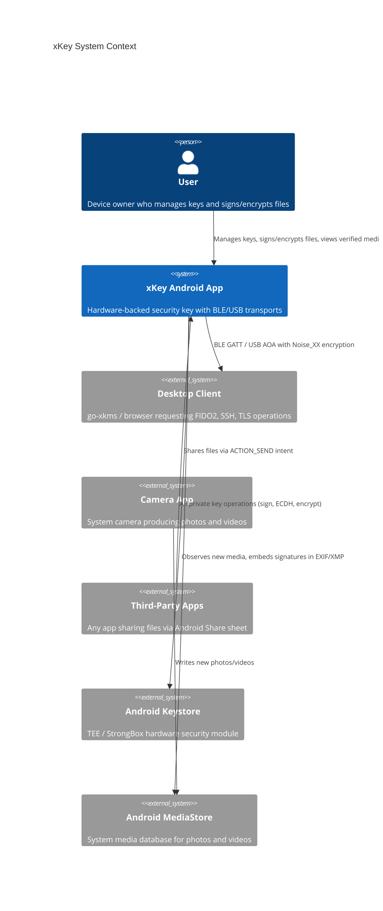
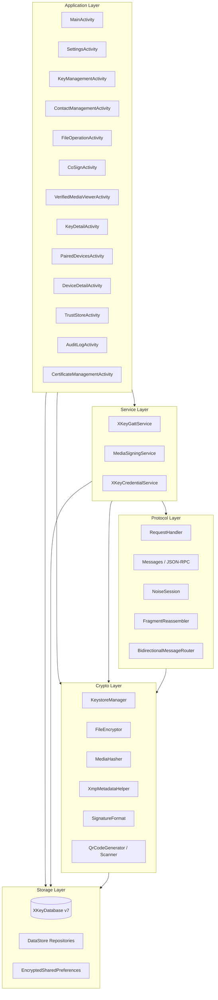

# xKey System Architecture Overview

> **Status: REFERENCE** · Last verified: 2026-10-09
> As-built description of the xKey Android application architecture.

This document describes the high-level architecture of the xKey Android application,
a hardware-backed security key that provides FIDO2/WebAuthn authentication, file
cryptography, media signing, and multi-party attestation over BLE and USB transports.

## System Context

xKey operates as a security key on an Android device, communicating with desktop
clients over BLE or USB to perform cryptographic operations. All private key
material remains inside Android Keystore (TEE/StrongBox) and never leaves the
secure hardware boundary.



## Layered Architecture

The application is organized into five layers. Each layer depends only on
layers below it.



## Application Layer

All activities use programmatic Material 3 UI built via `PremiumCardFactory`.
There are no traditional XML layout files for the main screens.

| Activity | Purpose |
|----------|---------|
| `MainActivity` | Home screen with BLE toggle, key summary, recent audit activity |
| `SettingsActivity` | Biometric policy, media signing, connectivity, device trust |
| `KeyManagementActivity` | List, create, and delete cryptographic keys |
| `KeyDetailActivity` | View key properties, export public key, manage sharing policy |
| `ContactManagementActivity` | Import, export, and manage recipient public keys |
| `FileOperationActivity` | Sign, verify, encrypt, decrypt files received via Share sheet |
| `CoSignActivity` | Multi-party co-signing via QR or BLE exchange |
| `VerifiedMediaViewerActivity` | Display media with signature verification badges |
| `PairedDevicesActivity` | List paired BLE/USB devices |
| `DeviceDetailActivity` | View device details and attestation status |
| `TrustStoreActivity` | Manage trusted CA certificates |
| `AuditLogActivity` | Browse security audit log |
| `CertificateManagementActivity` | Manage X.509 certificates issued by the local CA |

## Service Layer

### XKeyGattService

Foreground service managing BLE GATT server and USB AOA transport. Exposes a
`StateFlow<ServiceState>` for UI observation. Handles the full lifecycle of
advertising, connection, Noise_XX handshake, and encrypted JSON-RPC dispatch.

- Foreground service type: `connectedDevice`
- Wake lock: partial, held while advertising
- Restart policy: `START_STICKY` (auto-resumes advertising after system kill)

### MediaSigningService

Foreground service that monitors `MediaStore` via `ContentObserver` for new
photos and videos. When new media is detected, it computes a SHA-256 hash,
signs it with the configured key via `KeystoreManager.signWithAlgorithm()`,
and embeds the signature in EXIF/XMP metadata using `XmpMetadataHelper`.

- Foreground service type: `dataSync`
- Notification channel: `media_signing_channel`
- Controlled by `MediaSigningSettings.autoSignEnabled`

### XKeyCredentialService

Android Credential Provider service for FIDO2/WebAuthn passkey operations.
Handles `CreateCredentialRequest` and `GetCredentialRequest` from the system
credential manager.

## Protocol Layer

The protocol layer implements the communication stack between xKey and
desktop clients.

| Component | Responsibility |
|-----------|---------------|
| `RequestHandler` | Dispatches JSON-RPC requests to appropriate handlers |
| `Messages` | Request/Response data classes with JSON serialization |
| `NoiseSession` | Noise_XX_25519_ChaChaPoly_SHA256 encrypted channel |
| `FragmentReassembler` | Splits and reassembles messages for BLE MTU limits |
| `BidirectionalMessageRouter` | Routes `remote.*` requests to desktop, `local.*` to phone |

## Crypto Layer

| Component | Responsibility |
|-----------|---------------|
| `KeystoreManager` | All Android Keystore operations: key generation, signing, ECDH, AES-GCM, HMAC |
| `FileEncryptor` | Hardware-backed ECIES encryption/decryption for `.xkeyenc` files |
| `MediaHasher` | Streaming SHA-256 hash computation via `DigestInputStream` |
| `XmpMetadataHelper` | Read/write `ContentAuthenticityData` in EXIF, XMP, or sidecar files |
| `SignatureFormat` | `ContentAuthenticityData` and `SignatureEntry` data model with JSON serialization |
| `QrCodeGenerator` | QR code bitmap generation via ZXing |
| `QrCodeScannerHelper` | QR scanning via ML Kit + CameraX |

## Storage Layer

### Room Database (XKeyDatabase v7)

SQLite database `xkey_credentials.db` with six entities:

- `keys` -- unified key metadata for all key types
- `credential_metadata` -- legacy FIDO2 credential table
- `key_sharing_policies` -- per-key, per-peer sharing rules
- `audit_logs` -- comprehensive security event log
- `certificates` -- X.509 certificates issued by the local CA
- `contacts` -- recipient public keys for encryption and verification

### DataStore Repositories

Preference-based settings stored via Jetpack DataStore:

| Repository | Settings |
|------------|----------|
| `BiometricSettingsRepository` | Auth mode, UV policy, session duration |
| `BootstrapSettingsRepository` | Auto-bootstrap, bootstrap methods |
| `TrustedComputingSettingsRepository` | IDevID verification, attestation |
| `UsbHsmSettingsRepository` | Native USB, ADB TCP, port config |
| `MediaSigningSettingsRepository` | Auto-sign toggle, key selection, photo/video |
| `CredentialProviderSettingsRepository` | Passkey provider enable/disable |
| `PairedDeviceRepository` | Trusted device records with attestation state |

### EncryptedSharedPreferences

- Noise_XX static key pair (X25519)
- Ed25519 software-backed private keys (Keystore does not support Ed25519)

## Package Structure

```
com.automatethethings.xkey
  /audit          AuditLog, AuditLogger, AuditLogDao, AuditLogEntity
  /auth           BiometricHelper, SessionAuthManager, BiometricActivityLauncher
  /ble            XKeyGattService, GattServer, Advertiser, NoiseSession, FragmentReassembler
  /bootstrap      BootstrapClient, BootstrapSettings
  /ca             AndroidCA, CertificateEntity, CertificateDao, CertificateProfile
  /credential     XKeyCredentialService, CreateCredentialHandler, GetCredentialHandler
  /crypto         KeystoreManager, FileEncryptor, BiometricHelper, CborEncoder
  /keychain       KeychainService, LocalKeychainService, CertificateStore
  /media          MediaSigningService, MediaHasher, XmpMetadataHelper, SignatureFormat
  /protocol       RequestHandler, Messages, AttestationHelper
  /qr             QrCodeGenerator, QrCodeScannerHelper
  /remote         RemoteKeyClient, BidirectionalMessageRouter, RemoteKeySyncManager
  /settings       BiometricSettings, BootstrapSettings, MediaSigningSettings, ...
  /storage        XKeyDatabase, KeyEntity, ContactEntity, CredentialMetadataEntity, ...
  /truststore     TrustStoreRepository, CABundleFetcher, IDevIDVerifier
  /ui             All Activity classes, PremiumCardFactory, UIHelpers
  /usb            UsbAccessoryServer, TcpHsmServer, UsbHsmSettings
  /util           JsonExtensions
```

## Build Configuration

| Property | Value |
|----------|-------|
| `minSdk` | 28 (Android 9 Pie) |
| `targetSdk` | 34 (Android 14) |
| Database | Room v7 (`xkey_credentials.db`) |
| License | AGPL-3.0 / Commercial dual license |
| Package | `com.automatethethings.xkey` |
