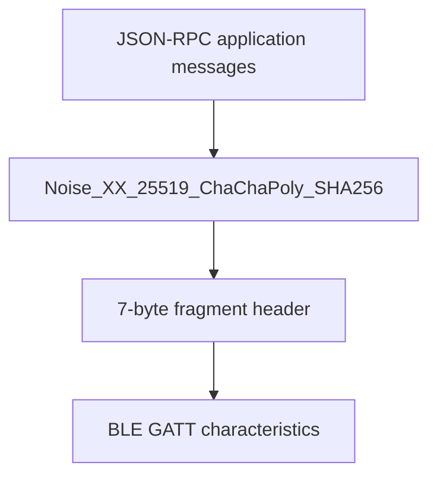
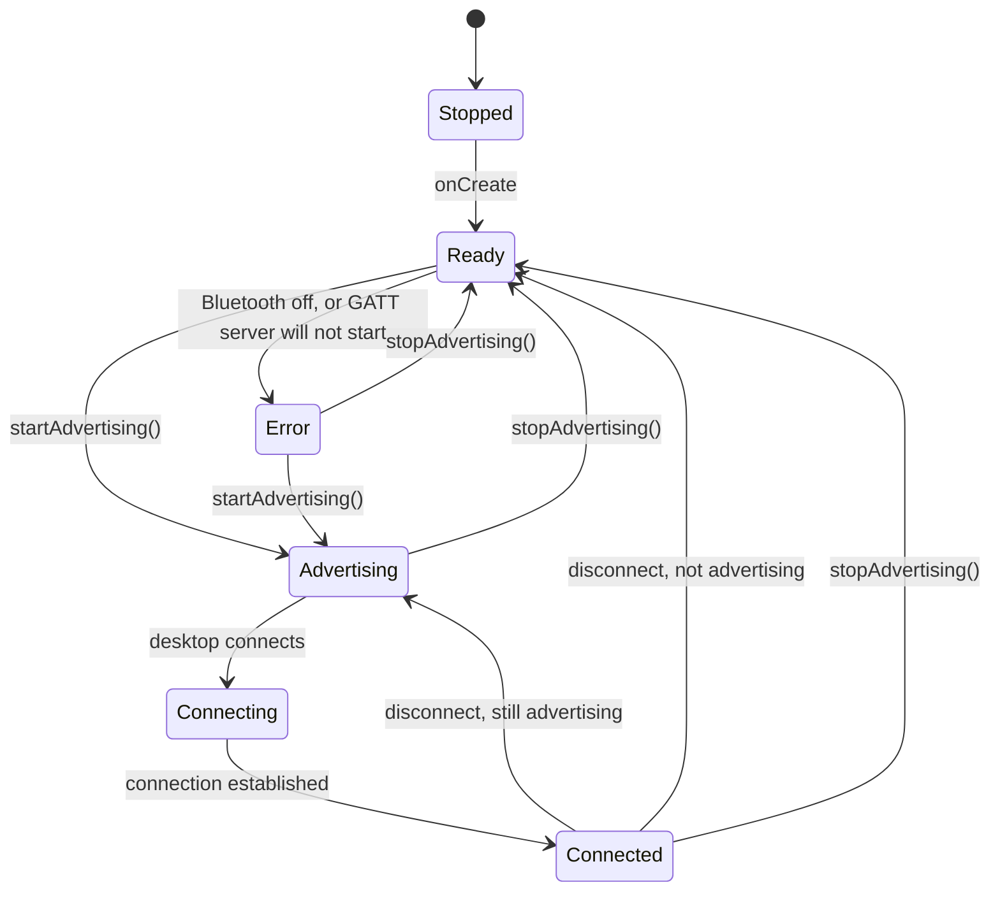

# BLE transport architecture

> **Status: REFERENCE** · Last verified: 2026-11-23
> How xKey carries the pairing protocol over Bluetooth LE. The wire contract lives in `go-xkms/xkey/pkg/pairing`.

The phone is a GATT peripheral. A desktop running go-xkms scans for the xkey
service, connects, and speaks the protocol in
[noise-pairing](../noise-pairing/architecture.md) over three
characteristics. Paths below are relative to
`app/src/main/kotlin/com/automatethethings/xkey/`.

## Requirements

The manifest declares `android.hardware.bluetooth_le` as required, so the app
installs only on phones with BLE. It asks for `BLUETOOTH_CONNECT`,
`BLUETOOTH_ADVERTISE` and `BLUETOOTH_SCAN` (flagged `neverForLocation`), plus
the legacy `BLUETOOTH` and `BLUETOOTH_ADMIN` for Android 9 to 11. The app's
`minSdk` is 28 (Android 9).

## Transport stack



| Layer | Component | Responsibility |
|-------|-----------|----------------|
| Application | `RequestHandler` (`protocol/Handler.kt`) | JSON-RPC dispatch |
| Encryption | `NoiseSession` (`ble/NoiseSession.kt`) | Noise_XX handshake and transport encryption |
| Framing | `Fragmenter`, `FragmentReassembler` (`ble/FragmentReassembler.kt`) | Split and rebuild messages for the MTU |
| GATT | `GattServer` (`ble/GattServer.kt`) | Characteristics, connections, identity exchange, `pairing.confirm` |
| Advertising | `Advertiser` (`ble/Advertiser.kt`) | Connectable advertisement of the service UUIDs |
| Service | `XKeyGattService` (`ble/XKeyGattService.kt`) | Foreground service that owns all of the above |

`ble/BleClient.kt` is the other direction: the phone as a GATT central that
connects to a desktop and runs the Noise initiator. It backs
[phone-initiated-pairing](../phone-initiated-pairing/architecture.md).

### Other transports

BLE is one of three transports for the same protocol. USB and TCP share one
responder:

| Transport | Component | Framing |
|-----------|-----------|---------|
| BLE GATT | `GattServer` | 7-byte fragment header (below) |
| USB accessory (AOA) | `UsbAccessoryServer` -> `StreamPairingSession` | `StreamMessageFraming`, 2-byte big-endian length |
| TCP loopback `:8444` | `TcpHsmServer` -> `StreamPairingSession` | `StreamMessageFraming`, 2-byte big-endian length |

All three run the pre-handshake identity exchange before Noise_XX.

## The xkey GATT service

| Characteristic | UUID | Properties | Use |
|----------------|------|------------|-----|
| Service | `f1d0f1d0-f1d0-f1d0-f1d0-f1d0f1d0f1d0` | primary | |
| Control point | `f1d0f1d0-f1d0-f1d0-f1d0-f1d0f1d00001` | write, write without response | Desktop writes identity, handshake and request frames |
| Response | `f1d0f1d0-f1d0-f1d0-f1d0-f1d0f1d00002` | notify, read | Phone notifies handshake and response frames |
| Status | `f1d0f1d0-f1d0-f1d0-f1d0-f1d0f1d00003` | read, notify | Status |

The characteristics use plain read and write permissions, not the encrypted
ones. Noise encrypts at the application layer; BLE link encryption would need
OS bonding, which breaks across app reinstalls and address rotation.

The phone sends only after the desktop has written the CCCD to enable
notifications. A send waits up to 5 seconds for that write and then gives up.

The advertisement is connectable, `ADVERTISE_MODE_BALANCED`, medium TX
power, with no timeout. It carries the 128-bit xkey service UUID and the
16-bit FIDO UUID `0xFFFD`; the device name and TX power go in the scan
response.

## Fragments

A message larger than one ATT write is split into fragments, each with a
7-byte big-endian header:

```
Offset  Size  Field       Description
0       1     flags       Bit 0 = first fragment, bit 1 = last fragment
1       2     sequence    Fragment number, from 0
3       2     total       Number of fragments in the message
5       2     length      Payload bytes in this fragment
7       var   payload
```

A message that fits in one fragment has flags `0x03`.

| Parameter | Value |
|-----------|-------|
| Payload per fragment | `min(MTU - 3, 512) - 7` |
| Default payload (`Fragmenter.DEFAULT_PAYLOAD_SIZE`) | 237 bytes (MTU 247) |
| Smallest payload | 20 bytes, so the MTU must be at least 30 |
| Largest message | 1 MB |
| Most fragments | 1000 |
| Reassembly timeout | 30 seconds |

The server tracks the MTU per connection. At the BLE default MTU of 23 there
are only 13 bytes per fragment, below the floor, so the server logs the
problem and sends nothing; the desktop must negotiate a larger MTU first.
`BleClient` asks for 517.

A 600-byte message at MTU 247 goes out as three fragments:

```
Fragment 0: flags=0x01 seq=0 total=3 len=237 [237 bytes payload]
Fragment 1: flags=0x00 seq=1 total=3 len=237 [237 bytes payload]
Fragment 2: flags=0x02 seq=2 total=3 len=126 [126 bytes payload]
```

The reassembler drops a half-built message when a new first fragment
arrives or when 30 seconds pass.

## FIDO GATT service (0xFFFD)

The phone is also a standard CTAP2 BLE authenticator (CTAP 2.1, Bluetooth
transport). It has its own `BluetoothGattServer` (`ble/fido/FidoGattServer.kt`),
so the xkey service's table, callbacks, queues and framing do not change.
`XKeyGattService` starts it after the xkey GATT server and stops it with that
server. It is best effort: the xkey service runs without it. Flags (3 bytes),
the 128-bit xkey UUID list (18) and the 16-bit list (4) fit the 31-byte
advertising PDU.

| Characteristic | UUID | Properties | Permissions | Value |
|----------------|------|------------|-------------|-------|
| fidoControlPoint | `F1D0FFF1-DEAF-ADDA-1234-56789ABCDEF0` | write | write, encrypted MITM | request frames, at most 512 bytes |
| fidoStatus | `F1D0FFF2-DEAF-ADDA-1234-56789ABCDEF0` | notify (CCCD read/write, encrypted MITM) | none | response frames |
| fidoControlPointLength | `F1D0FFF3-DEAF-ADDA-1234-56789ABCDEF0` | read | read, encrypted MITM | 512, 2 bytes big-endian |
| fidoServiceRevisionBitfield | `F1D0FFF4-DEAF-ADDA-1234-56789ABCDEF0` | read, write | read/write, encrypted MITM | 0x20 (FIDO2 only); a write of anything else is refused |

Unlike the xkey service, these need an authenticated, encrypted bond, so a
client pairs with the phone over Bluetooth first.

Framing (`ble/fido/FidoBleFraming.kt`) is CTAP's, not the 7-byte xkey header:
a CMD frame `CMD | HLEN | LLEN | DATA`, then CONT frames `SEQ | DATA` with SEQ
0..0x7F wrapping. The commands are PING 0x81 (echoed), KEEPALIVE 0x82, MSG
0x83, CANCEL 0xBE and ERROR 0xBF. `FidoBleReassembler` answers framing faults
with an ERROR frame:

- INVALID_SEQ for a CONT without a CMD, a wrong SEQ, or a new CMD mid-message;
- INVALID_LEN for a message over 1024 bytes, or a frame carrying more than its
  CMD declared;
- INVALID_CMD for an unknown command.

Each connected client gets one `FidoBleSession`. A MSG goes to
`Ctap2Authenticator` (see
[fido2-phone-backend](../fido2-phone-backend/architecture.md)). While it runs,
a KEEPALIVE goes out every 400 ms: PROCESSING, then UP_NEEDED once the phone
prompts the user. CANCEL stops the request, which answers
CTAP2_ERR_KEEPALIVE_CANCEL. A second MSG while one runs gets ERROR BUSY.
Replies are fragmented to the ATT MTU less 3 (20 bytes until the MTU changes)
and notified one at a time; the next frame goes out on `onNotificationSent`.
Frames go out only while the client has notifications on. A disconnect closes
the session and cancels its request.

## The foreground service

`XKeyGattService` is declared in the manifest with
`foregroundServiceType="connectedDevice"`. It also owns the USB accessory
server and the TCP server.

| Property | Value |
|----------|-------|
| Foreground service type | `connectedDevice` |
| Notification channel | `XKeyApplication.NOTIFICATION_CHANNEL_ID` |
| Restart policy | `START_STICKY`; a restart with no intent starts advertising again |
| Wake lock | Partial (`xKey:BLEService`), taken in `startAdvertising()` and released in `stopAdvertising()` and `onDestroy()` |
| State | `serviceState: StateFlow<ServiceState>` |

`startAdvertising()` checks that Bluetooth is on, starts the GATT server
(retrying once after 500 ms), starts the FIDO server, then starts
advertising. A `stopAdvertising()` that lands while a start is still waiting
on the Bluetooth stack wins, and the start publishes nothing.



A failed `startAdvertising` call on the advertiser is logged but does not
change the state, because the GATT server is still running.

## Activity and service

Activities bind to the service to reach it:

| Mechanism | Direction | Purpose |
|-----------|-----------|---------|
| `bindService()` | Activity -> service | Get the `LocalBinder` |
| `startService(ACTION_START_ADVERTISING)` | Activity -> service | Start BLE advertising |
| `startService(ACTION_STOP_ADVERTISING)` | Activity -> service | Stop BLE advertising |
| `serviceState` | Service -> activity | Observe state changes |
| `setActivity(activity)` | Activity -> service | Give the service an activity for biometric prompts |

`MainActivity` starts the service with `ACTION_START_ADVERTISING`, binds to
it, and passes itself to `setActivity` while it is in the foreground:

```kotlin
val connection = object : ServiceConnection {
    override fun onServiceConnected(name: ComponentName, service: IBinder) {
        val binder = service as XKeyGattService.LocalBinder
        gattService = binder.getService()
        gattService?.setActivity(this@MainActivity)
    }
}
bindService(intent, connection, BIND_AUTO_CREATE)

lifecycleScope.launch {
    gattService?.serviceState?.collect { state -> updateUI(state) }
}
```

Other screens (paired devices, device detail, desktop keys, OATH, PIV, key
sharing) bind the same way to reach the connected desktop.
