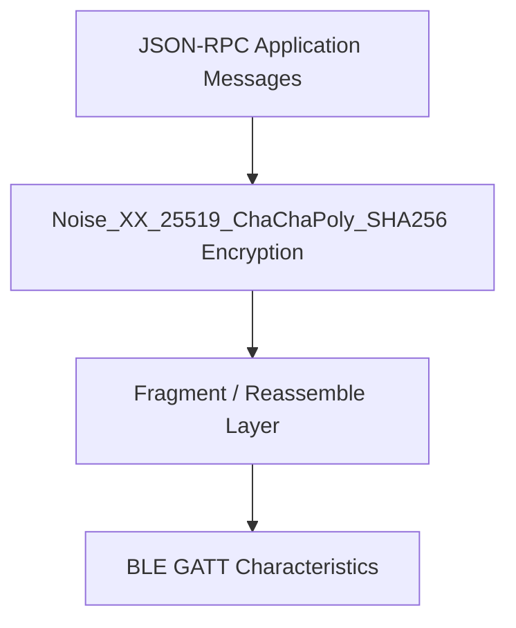
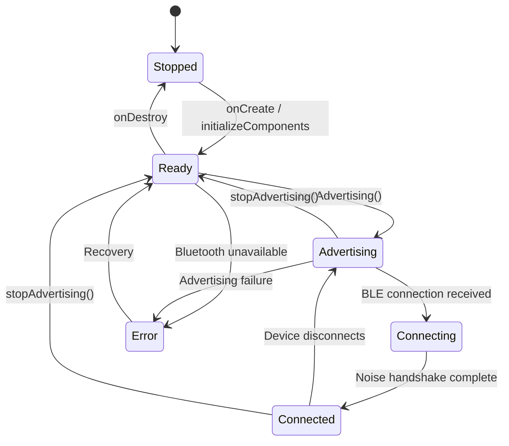

# BLE transport architecture

> **Status: REFERENCE** · Last verified: 2026-10-09
> As-built description of the BLE transport in xKey. The wire contract is `go-xkms/xkey/pkg/pairing`.

This document describes the BLE communication protocol used between xKey
(Android authenticator) and desktop clients (go-xkms). The protocol
provides authenticated, encrypted, bidirectional communication for
cryptographic operations.

## Transport Stack



| Layer | Component | Responsibility |
|-------|-----------|---------------|
| Application | `RequestHandler`, `Messages` | JSON-RPC request/response dispatch |
| Encryption | `NoiseSession` | Noise_XX handshake and transport encryption |
| Framing | `FragmentReassembler`, `Fragmenter` | Message splitting for BLE MTU limits |
| Transport | `GattServer`, `BleClient` | BLE GATT characteristic read/write |

### Other transports

BLE is one of three transports carrying the same pairing protocol and JSON-RPC
surface. The stream transports share a single responder implementation so they
stay byte-identical with the go-xkms desktop initiator:

| Transport | Component | Framing |
|-----------|-----------|---------|
| BLE GATT | `GattServer` | 7-byte fragment header (see below) |
| USB (AOA) | `UsbAccessoryServer` -> `StreamPairingSession` | `StreamMessageFraming`, 2-byte big-endian length |
| TCP (loopback `:8444`, for ADB/emulator) | `TcpHsmServer` -> `StreamPairingSession` | `StreamMessageFraming`, 2-byte big-endian length |

All three perform the pre-handshake identity exchange before Noise_XX; the
desktop initiator always sends it.

## Fragment Protocol

BLE GATT characteristics have a limited MTU (typically 20-512 bytes). Messages
larger than the negotiated MTU are split into fragments.

### Fragment Header Format (7 bytes, big-endian)

```
Offset  Size  Field       Description
0       1     flags       Bit 0 = first fragment, Bit 1 = last fragment
1       2     sequence    Fragment sequence number (0-based)
3       2     total       Total number of fragments in message
5       2     length      Payload length in this fragment
7       var   payload     Fragment payload data
```

### Constraints

| Parameter | Value |
|-----------|-------|
| Header size | 7 bytes |
| Default payload size | 237 bytes (MTU 247 - 3 ATT overhead - 7 header) |
| Maximum message size | 1 MB |
| Maximum fragments | 1000 |
| Reassembly timeout | 30 seconds |

### Fragmentation Example

A 600-byte message with default MTU would be split into 3 fragments:

```
Fragment 0: flags=0x01 seq=0 total=3 len=237 [237 bytes payload]
Fragment 1: flags=0x00 seq=1 total=3 len=237 [237 bytes payload]
Fragment 2: flags=0x02 seq=2 total=3 len=126 [126 bytes payload]
```

## Service Configuration

| Property | Value |
|----------|-------|
| Foreground service type | `connectedDevice` |
| Notification channel | `XKeyApplication.NOTIFICATION_CHANNEL_ID` |
| Restart policy | `START_STICKY` |
| Wake lock | Partial, held while advertising |
| State observation | `StateFlow<ServiceState>` |

## Service States



## Service Layer

### XKeyGattService

Foreground service managing BLE GATT server and USB AOA transport. Exposes a
`StateFlow<ServiceState>` for UI observation. Handles the full lifecycle of
advertising, connection, Noise_XX handshake, and encrypted JSON-RPC dispatch.

- Foreground service type: `connectedDevice`
- Wake lock: partial, held while advertising
- Restart policy: `START_STICKY` (auto-resumes advertising after system kill)

## Activity to Service Communication

### MainActivity to XKeyGattService

| Mechanism | Direction | Purpose |
|-----------|-----------|---------|
| `bindService()` | Activity -> Service | Get `LocalBinder` reference |
| `startService(ACTION_START_ADVERTISING)` | Activity -> Service | Start BLE advertising |
| `startService(ACTION_STOP_ADVERTISING)` | Activity -> Service | Stop BLE advertising |
| `StateFlow<ServiceState>` | Service -> Activity | Observe service state changes |
| `setActivity(activity)` | Activity -> Service | Provide activity for biometric prompts |

```kotlin
// Binding
val connection = object : ServiceConnection {
    override fun onServiceConnected(name: ComponentName, service: IBinder) {
        val binder = service as XKeyGattService.LocalBinder
        gattService = binder.getService()
        gattService.setActivity(this@MainActivity)
    }
}
bindService(intent, connection, BIND_AUTO_CREATE)

// State observation
lifecycleScope.launch {
    gattService.serviceState.collect { state ->
        updateUI(state)
    }
}
```
