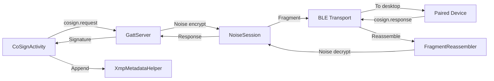
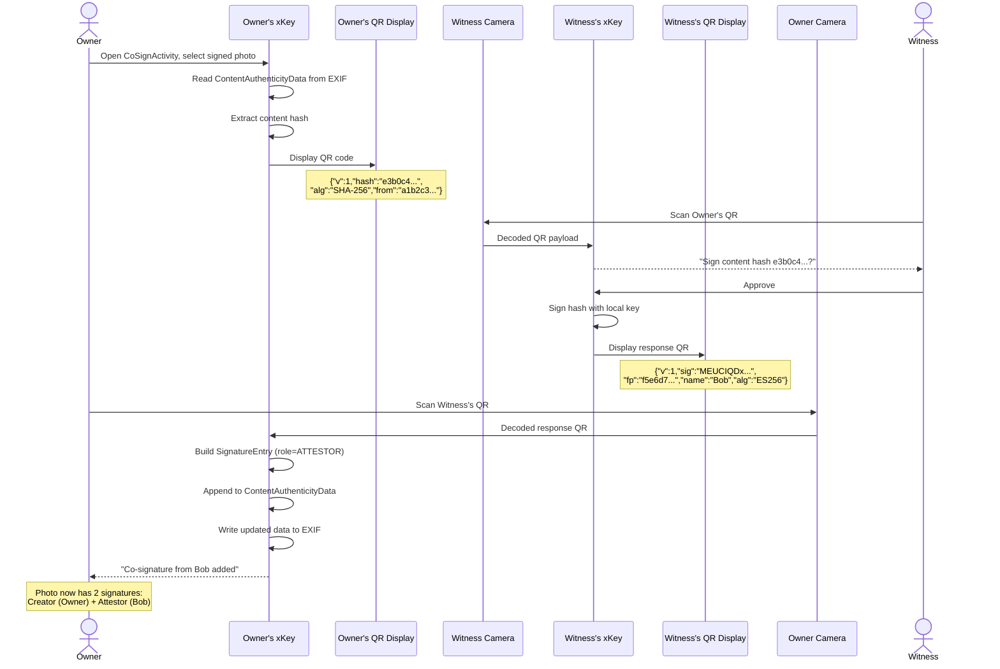

# Co-signing architecture

> **Status: REFERENCE** · Last verified: 2026-10-09
> As-built description of the co-sign message extension and the co-sign flows in xKey.

## Message Types

### Co-Sign Extension

| Method | Description | Parameters |
|--------|-------------|------------|
| `cosign.request` | Request co-signature from connected device | `hash`, `hashAlgorithm`, `initiatorFingerprint` |
| `cosign.response` | Return co-signature to initiator | `signature` (base64), `keyFingerprint`, `signerName`, `algorithm` |

## Data Flow: Co-Sign via BLE

## Co-Sign a Photo via QR

Two people are at the same location. The photo owner wants the witness to
co-sign the photo to attest they were both present.

