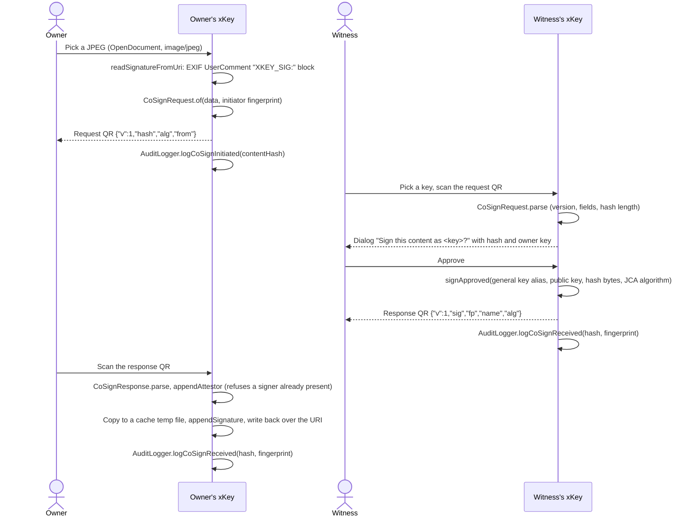

# Co-signing architecture

> **Status: REFERENCE** · Last verified: 2026-11-23
> How xKey adds a second signature to a signed photo: the QR exchange in `CoSignActivity` and the `cosign.request` handler that answers a paired peer.

Co-signing adds an `ATTESTOR` entry to the signature block of a JPEG that
already carries one (see [media signing](../media-signing/architecture.md)).
The phone has two parts:

| Part | Where | Job |
|------|-------|-----|
| `CoSignActivity` | `ui/` | Phone-to-phone exchange by QR code: the owner shows a request, a witness signs it, the owner scans the answer back |
| `RequestHandler.handleCosignRequest` | `protocol/Handler.kt` | Answers `cosign.request` from a paired peer such as the desktop |
| `CoSignRequest`, `CoSignResponse`, `appendAttestor` | `media/CoSignPayload.kt` | QR payload parsing and the duplicate-signer check |
| `XmpMetadataHelper.appendSignature` | `media/` | Adds a `SignatureEntry` to the EXIF `UserComment` block |
| `CosignApprovalPrompts` | `protocol/` | The owner's biometric approval for a `cosign.request` |

The phone never sends `cosign.request`. `CoSignActivity` works only by QR, and
the protocol handler only answers requests that arrive from a peer.

## Co-sign a photo by QR

`CoSignActivity` is not exported; it opens from the main screen. It has two
sections: "Request Co-Signatures" for the photo owner and "Co-Sign Media" for
the witness.

Things that follow from the code:

- The photo must be a JPEG that xKey has already signed. The picker accepts
  only `image/jpeg`, and the request comes from the existing signature block,
  so an unsigned photo cannot start a co-sign.
- The owner's picker takes a persistable read and write grant, because the
  new signature is written back over the same document (`openOutputStream`
  in `rwt` mode). The temporary copy in `cacheDir` is deleted whether the
  write works or not.
- The witness signs the hash from the QR. It does not see the photo, so it
  vouches for whatever hash the owner shows.
- The witness's approval is a confirmation dialog, not a biometric prompt.
- The witness can pick any non-system key of type `signing`, `fido2`, `tls`
  or `ssh`. Signing always uses the general key alias, so a key stored under
  another alias fails. A FIDO2 credential is stored under
  `credentialAlias`, not the general alias, so it cannot co-sign here.
- The owner's phone does not check the witness signature when it appends
  it. The check happens when someone verifies the file.
- Scanning goes through `QrScannerActivity` with the co-sign payload kind.

## Answering `cosign.request`

| Method | Parameters | Result |
|--------|------------|--------|
| `cosign.request` | `hash` (hex), `hashAlgorithm` (default `SHA-256`), `keyId` (optional) | `signature` (base64), `keyFingerprint`, `algorithm`, `signerName` |
| `cosign.response` | `signature`, `keyFingerprint` | `{"status":"received"}` |

`cosign.request` is in the shared dispatch map, so every transport reaches the
same handler. It signs only after these checks, in this order:

1. **Paired peer.** The session must belong to a paired peer. Otherwise the
   answer is `OPERATION_DENIED`.
2. **Whole digest.** `hashAlgorithm` must be `SHA-256`, `SHA-384` or
   `SHA-512` (any case), and `hash` must decode to exactly that digest length:
   32, 48 or 64 bytes. A truncated or padded value is refused.
3. **Signing keys only.** A named `keyId` must be a `signing` key. Any other
   type, a FIDO2 credential included, is refused. Without `keyId` the phone
   takes the first stored `signing` key.
4. **Owner approval.** The phone shows a biometric prompt titled "Co-sign
   request" whose subtitle names the first 8 hex characters of the hash, with
   a notification when the screen is locked. Every co-signature prompts; there
   is no session cache. The prompt waits its turn in the process-wide queue
   (`PromptOwnership`) that FIDO2, attestation and signing prompts share, and
   it settles on the owner's answer, a 60 s timeout, or the caller going
   away. A request withdrawn before its prompt appears never shows.
5. **The approved key signs.** The phone records the key's row and its
   public key before the prompt and checks both again after approval. A key
   deleted meanwhile gives `KEY_NOT_FOUND`; one changed or replaced under its
   ID or alias gives `OPERATION_DENIED`.
6. **Per-use keys sign in the prompt.** A key with `authDurationSeconds` 0
   signs through a `CryptoObject` in the prompt itself. The phone returns the
   signature only if it verifies under the approved public key; otherwise the
   answer is `OPERATION_DENIED`.
7. **One alias from approval to signature.** Signing goes through
   `KeystoreManager.signApproved` under the general key alias that the
   approval read. It holds `KeystoreManager.withAliasGate` for that alias
   while it checks, reads and signs, and key generation and deletion take the
   same gate, so the key cannot be swapped between the check and the
   signature. The gate entry for an alias is dropped once no thread holds or
   waits on it.

After signing, the handler calls `AuditLogger.logCoSignReceived` and returns
the result. `signerName` is the key's label, or its ID when it has none.

| Condition | Error |
|-----------|-------|
| No params, or empty `hash` | `INVALID_PARAMS` |
| Session is not a paired peer | `OPERATION_DENIED` |
| Unknown `hashAlgorithm`, `hash` not hex, or wrong digest length | `INVALID_PARAMS` |
| Named `keyId` not found, or no stored signing key | `KEY_NOT_FOUND` |
| Named `keyId` is not a `signing` key | `OPERATION_DENIED` |
| No approval prompt available, owner cancels, or authentication fails | `BIOMETRIC_FAILED` |
| Keystore signing fails after approval | `SIGNING_FAILED` |

`cosign.response` on the phone only checks that `signature` and
`keyFingerprint` are present and acknowledges. It stores nothing and touches
no file.
