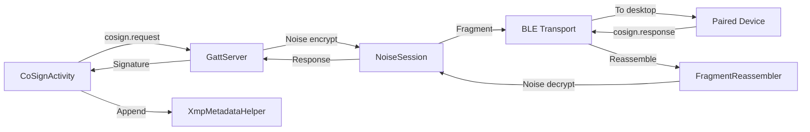
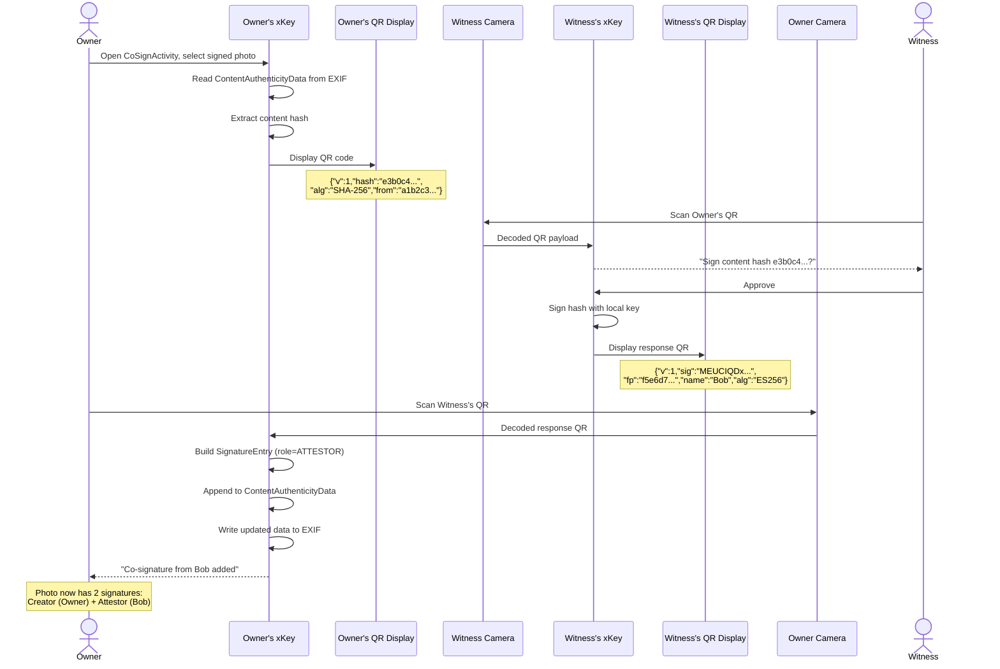

# Co-signing architecture

> **Status: REFERENCE** · Last verified: 2026-11-12
> As-built description of the co-sign message extension and the co-sign flows in xKey.

## Message Types

### Co-Sign Extension

| Method | Description | Parameters |
|--------|-------------|------------|
| `cosign.request` | Request co-signature from connected device | `hash` (hex), `hashAlgorithm` (default `SHA-256`), `keyId` (optional), `from` |
| `cosign.response` | Return co-signature to initiator | `signature` (base64), `keyFingerprint`, `signerName`, `algorithm` |

### Handling `cosign.request` on the phone

`cosign.request` is in the shared dispatch map, so every transport reaches the
same handler (`RequestHandler.handleCosignRequest`). It signs only after these
checks, in this order:

1. **Confirmed peer.** The session must have a confirmed peer identity; an
   anonymous session cannot ask the owner to vouch for anything.
2. **Whole digest.** `hashAlgorithm` must be `SHA-256`, `SHA-384` or
   `SHA-512`, and `hash` must decode to exactly its digest length (32, 48 or
   64 bytes). A truncated or padded value is refused, never signed as
   whatever it decodes to.
3. **Signing keys only.** A named `keyId` must be a `signing` key; any other
   type, a FIDO2 credential included, is refused. Without `keyId` the phone
   takes the first stored `signing` key and never falls back to a FIDO2 key.
4. **Owner approval.** The phone shows a biometric prompt (with a
   notification when the screen is locked) whose subtitle names the first 8
   hex characters of the hash. It signs only when the owner approves; every
   co-signature prompts, with no session cache. The prompt is an entry in
   the one process-wide prompt queue (`PromptOwnership`) that FIDO2,
   attestation and signing prompts share: it waits its turn, shows only
   while its key is ACTIVE, and hands the screen on when it settles, by
   the owner's answer, by its 60 s timeout, or because the caller went away.
   A request withdrawn before its prompt appears never shows; one withdrawn
   with its prompt up (its timeout, a caller gone) has that prompt taken
   down before the next prompt's turn starts.
5. **The approved key signs.** The phone records the key's row and the
   public key under its keystore alias before the prompt, and rechecks both
   after the approval, holding the key's lock (which key creation and
   `local.deleteKey` take) until the signature is made: a key deleted
   meanwhile is `KEY_NOT_FOUND`, and one changed or replaced under its id or
   alias is `OPERATION_DENIED`.
6. **Per-operation keys sign in the prompt.** A key that needs the owner
   for every use (`authDurationSeconds` 0) signs in the prompt itself: its
   `BiometricPrompt` holds a `CryptoObject` over the key, which signs exactly
   the requested hash once the owner authenticates. The phone answers only a
   signature that verifies under the approved public key over that hash;
   any other is `OPERATION_DENIED`.
7. **The key approved is the key signed with.** The approval snapshot reads
   the public key under one Keystore alias, the general key alias the signer
   uses, and keeps that alias. Every signature after an approval goes through
   `KeystoreManager.signApproved` under that alias, which refuses
   (`OPERATION_DENIED`) when the key there is no longer the approved one. No
   resolving lookup (such as a FIDO2 alias of the same id) can name one key
   while another signs. The witness QR path in `CoSignActivity` names and
   signs with the same alias. `signApproved` checks, reads and signs while
   holding `KeystoreManager.withAliasGate` for the alias, and every keystore
   delete and key generation under an alias takes the same gate, so a key
   cannot be replaced between the check and the signature. The gate registry
   is reference-counted: an alias keeps an entry only while a thread holds or
   waits on its lock, so per-file and caller-named aliases do not accumulate.

The success result is unchanged: `signature` (base64), `keyFingerprint`,
`algorithm` and `signerName`.

| Condition | Error |
|-----------|-------|
| No params, or empty `hash` | `INVALID_PARAMS` |
| No confirmed peer for the session | `OPERATION_DENIED` |
| Unknown `hashAlgorithm`, `hash` not hex, or wrong digest length | `INVALID_PARAMS` |
| Named `keyId` not found, or no stored signing key | `KEY_NOT_FOUND` |
| Named `keyId` is not a `signing` key (FIDO2 included) | `OPERATION_DENIED` |
| No approval prompt available, owner cancels, or authentication fails | `BIOMETRIC_FAILED` |
| Keystore signing fails after approval | `SIGNING_FAILED` |

## Data Flow: Co-Sign via BLE

## Co-Sign a Photo via QR

Two people are at the same location. The photo owner wants the witness to
co-sign the photo to attest they were both present.

