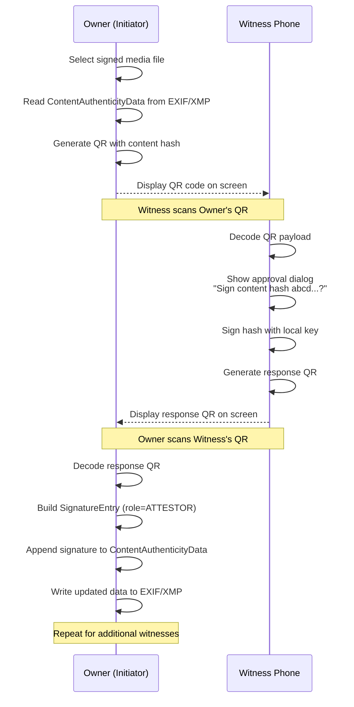
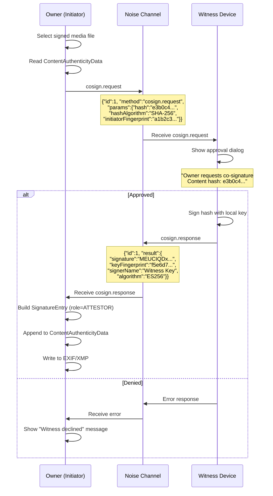
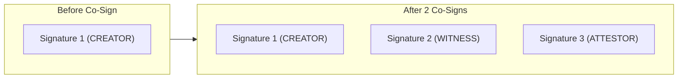
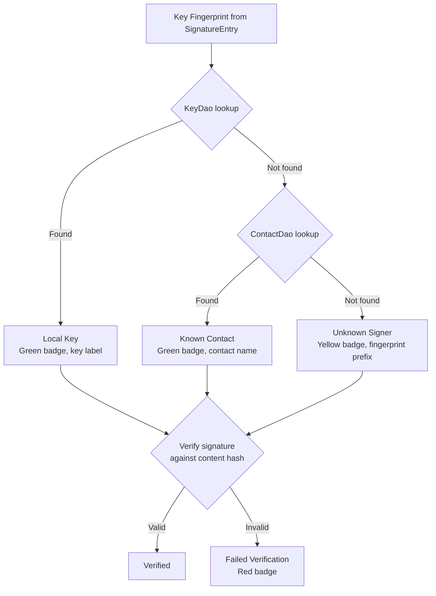

# Multi-Party Co-Signing Protocol

> **Status: REFERENCE** · Last verified: 2026-10-09
> As-built description of xKey's multi-party attestation of media.

This document describes the multi-party attestation system in xKey, which allows
multiple people to cryptographically attest to a photo or video. This serves as
an anti-deepfake and anti-forgery mechanism: if a photo has signatures from
several independent devices, it is far more difficult to fabricate.

## Use Cases

- **Anti-deepfake**: Multiple people present at an event each sign the same photo,
  making it provably non-synthetic.
- **Anti-forgery**: Witnesses attest that a document photo was taken at a specific
  time and place.
- **Chain of custody**: Sequential attestors sign media as it passes through a
  verification pipeline.
- **Group photos**: Everyone in a photo co-signs to prove they were present.

## Roles

| Role | Description | When |
|------|-------------|------|
| `CREATOR` | Original signer who captured or first signed the media | At capture time (auto-sign or manual) |
| `WITNESS` | Person present at the time of capture | During or shortly after capture |
| `ATTESTOR` | Person who co-signs after the fact | Any time after original signing |

Roles are stored in the `SignatureEntry.role` field and are informational. All
signatures are cryptographically equivalent regardless of role.

## QR Code Exchange Protocol

The QR protocol enables co-signing without requiring a BLE connection. The
initiator (photo owner) and witness exchange data by displaying and scanning
QR codes on their respective devices.

### Sequence



### QR Request Payload

Displayed by the initiator for witnesses to scan:

```json
{
    "v": 1,
    "hash": "e3b0c44298fc1c149afbf4c8996fb92427ae41e4649b934ca495991b7852b855",
    "alg": "SHA-256",
    "from": "a1b2c3d4e5f67890abcdef1234567890abcdef1234567890abcdef1234567890"
}
```

| Field | Type | Description |
|-------|------|-------------|
| `v` | int | Protocol version (currently `1`) |
| `hash` | string | Hex-encoded SHA-256 of the media content |
| `alg` | string | Hash algorithm used |
| `from` | string | Key fingerprint (SHA-256 hex) of the initiator |

### QR Response Payload

Displayed by the witness for the initiator to scan:

```json
{
    "v": 1,
    "sig": "MEUCIQDxE9vVU3r7KnYm+B8r8r5w...",
    "fp": "f5e6d7c8b9a01234567890abcdef1234567890abcdef1234567890abcdef1234",
    "name": "Bob's xKey",
    "alg": "ES256"
}
```

| Field | Type | Description |
|-------|------|-------------|
| `v` | int | Protocol version (currently `1`) |
| `sig` | string | Base64-encoded signature over the content hash |
| `fp` | string | Key fingerprint (SHA-256 hex) of the witness's public key |
| `name` | string | Human-readable signer name |
| `alg` | string | Signing algorithm used |

## BLE Exchange Protocol

The BLE protocol enables co-signing over an existing Noise-encrypted channel
between paired devices. This is faster than QR exchange but requires the
devices to be within BLE range and already paired.

### Protocol Messages

Two new message types extend the JSON-RPC protocol:

| Method | Direction | Description |
|--------|-----------|-------------|
| `cosign.request` | Initiator -> Witness | Request co-signature for content hash |
| `cosign.response` | Witness -> Initiator | Return co-signature |

### Sequence



### cosign.request Parameters

```json
{
    "hash": "e3b0c44298fc1c149afbf4c8996fb924...",
    "hashAlgorithm": "SHA-256",
    "initiatorFingerprint": "a1b2c3d4e5f67890..."
}
```

### cosign.response Result

```json
{
    "signature": "MEUCIQDxE9vVU3r7...",
    "keyFingerprint": "f5e6d7c8b9a01234...",
    "signerName": "Witness Key",
    "algorithm": "ES256"
}
```

## Signature Aggregation

Multiple signatures are stored in the `signatures` array of
`ContentAuthenticityData`. Each co-signer's signature is appended via
`XmpMetadataHelper.appendSignature()`, which reads the existing data,
adds the new `SignatureEntry`, and writes the updated structure back.



All signatures sign the same content hash. The content hash is computed once
from the original media bytes (before any metadata modification). Since
signatures are stored in metadata (EXIF/XMP), the content itself is not
modified, and the hash remains valid for all signers.

## Trust Model

When verifying co-signed media, the `VerifiedMediaViewerActivity` resolves
each signer's identity through the following chain:



### Trust Levels

| Badge | Meaning |
|-------|---------|
| Green checkmark | Signature valid, signer identity known (local key or contact) |
| Yellow question mark | Signature valid, but signer identity unknown |
| Red X | Signature verification failed (tampered content or invalid signature) |
| Grey dash | No signatures found |

## CoSignActivity UI

`CoSignActivity` provides a tabbed interface for choosing the exchange method:

1. **QR Tab**: Camera viewfinder for scanning + QR display area
2. **BLE Tab**: List of connected/paired devices with co-sign request buttons

The activity receives a media file URI via intent and reads the existing
`ContentAuthenticityData` to display current signers and allow adding more.

## Security Considerations

- Each co-signer independently computes or verifies the content hash. The
  witness does not blindly sign the hash provided by the initiator in
  production workflows (though QR exchange trusts the displayed hash).
- BLE co-signing occurs over the Noise_XX encrypted channel, preventing
  man-in-the-middle attacks on the signature exchange.
- Ephemeral QR codes are displayed only on-screen and are not persisted.
- The content hash covers the raw media bytes, not the metadata. Adding
  signatures to EXIF/XMP does not invalidate existing signatures.
