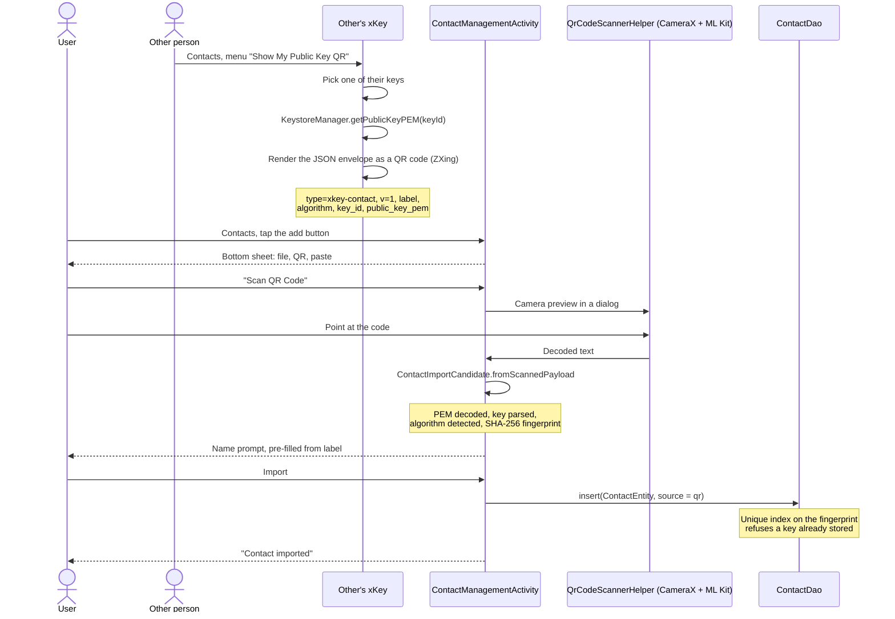

# Contacts architecture

> **Status: REFERENCE** · Last verified: 2026-11-24
> The `contacts` table and how a contact gets into it. The table is in the
> xKey Room schema (`XKeyDatabase.kt`, version 13); `MIGRATION_6_7` added it.
> The full schema and migration history are in
> [hardware-backed-keys](../hardware-backed-keys/architecture.md#migration-history).

A contact is someone else's public key. The phone uses it to encrypt files
for that person and to put a name on their signatures. There are four ways
in: scan their QR code, pick a key file, paste a PEM key, or have a paired
desktop push one with `local.sharePublicKey`.

## Importing a contact by QR

## The entity

### ContactEntity (`contacts`)

| Column | Type | Notes |
|--------|------|-------|
| `id` | INTEGER | Primary key, auto-generated |
| `name` | TEXT | |
| `public_key_der` | BLOB | DER-encoded SubjectPublicKeyInfo |
| `public_key_fingerprint` | TEXT | Lowercase hex SHA-256 of `public_key_der`, unique |
| `algorithm` | TEXT | `ES256`, `ES384`, `ES512` or `RS256` for keys imported in the app |
| `imported_at` | INTEGER | Epoch milliseconds |
| `source` | TEXT | `file`, `qr`, `paste` or `shared` |
| `notes` | TEXT | Nullable; only a desktop push fills it (its `backend`) |

## Indexes

| Index | Columns | Unique | Purpose |
|-------|---------|--------|---------|
| `index_contacts_public_key_fingerprint` | `public_key_fingerprint` | Yes | No duplicates; signer lookup |
| `index_contacts_name` | `name` | No | Name search |
| `index_contacts_algorithm` | `algorithm` | No | Filter by algorithm |
