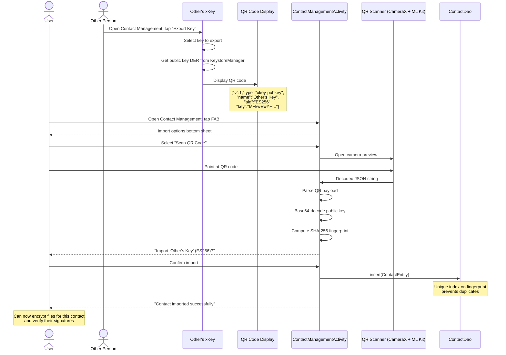

# Contacts architecture

> **Status: REFERENCE** · Last verified: 2026-10-09
> As-built description of the contact table and the contact import flow in xKey.

## Import a Contact via QR

A user scans another person's QR code to import their public key as a contact,
enabling file encryption and signature verification for that person.

## Entity Details

> **Status: REFERENCE** · Last verified: 2026-08-10
> As-built description of the xKey Room schema. STALE: the migration table stops at v7; `XKeyDatabase.kt` is at version 11. Read the code for v8-v11.

### ContactEntity (`contacts`)

Recipient public keys for file encryption and signature verification. Each
contact stores a DER-encoded public key with a SHA-256 fingerprint for
deduplication (unique index on `public_key_fingerprint`).

## Index Strategy

### contacts

| Index | Columns | Unique | Purpose |
|-------|---------|--------|---------|
| `index_contacts_public_key_fingerprint` | `public_key_fingerprint` | Yes | Deduplication and fingerprint lookup |
| `index_contacts_name` | `name` | No | Search by contact name |
| `index_contacts_algorithm` | `algorithm` | No | Filter by key algorithm |
