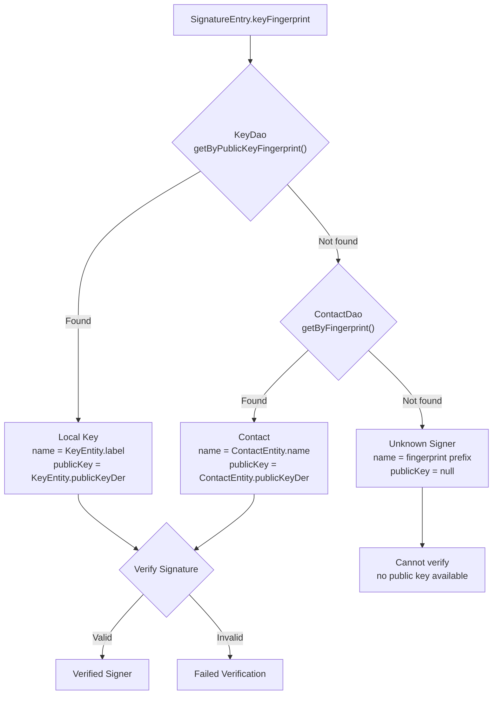

# Contact Management

> **Status: REFERENCE** · Last verified: 2026-10-09
> As-built description of xKey's contact/recipient key management.

This document describes the contact/recipient key management system used by
xKey for file encryption and signature verification.

## Overview

Contacts store public keys of other people or devices. They are used to:

- **Encrypt files for a recipient**: Select a contact's public key as the
  encryption target in `FileOperationActivity`.
- **Verify signatures**: Resolve a key fingerprint to a known contact name
  in `VerifiedMediaViewerActivity`.
- **Co-signing identity**: Display signer names for known contacts.

## ContactEntity Schema

```kotlin
@Entity(tableName = "contacts", indices = [
    Index(value = ["public_key_fingerprint"], unique = true),
    Index(value = ["name"]),
    Index(value = ["algorithm"])
])
data class ContactEntity(
    @PrimaryKey(autoGenerate = true) val id: Long = 0,
    val name: String,
    @ColumnInfo(name = "public_key_der") val publicKeyDer: ByteArray,
    @ColumnInfo(name = "public_key_fingerprint") val publicKeyFingerprint: String,
    val algorithm: String,
    @ColumnInfo(name = "imported_at") val importedAt: Long,
    val source: String,
    val notes: String? = null
)
```

| Column | Type | Description |
|--------|------|-------------|
| `id` | Long | Auto-generated primary key |
| `name` | String | Human-readable contact name |
| `public_key_der` | ByteArray | DER-encoded public key (X.509 SubjectPublicKeyInfo) |
| `public_key_fingerprint` | String | SHA-256 hex digest of `public_key_der` |
| `algorithm` | String | Key algorithm: `ES256`, `ES384`, `RS256`, etc. |
| `imported_at` | Long | Unix timestamp (ms) of import time |
| `source` | String | Import method: `file`, `qr`, `ble`, `paste` |
| `notes` | String? | Optional user notes |

## Fingerprint Computation

The fingerprint uniquely identifies a public key and is computed as:

```
fingerprint = lowercase_hex(SHA-256(public_key_der_bytes))
```

This produces a 64-character hex string. Example:

```
a1b2c3d4e5f67890abcdef1234567890abcdef1234567890abcdef1234567890
```

The fingerprint is used for:

- **Deduplication**: Unique index on `public_key_fingerprint` prevents
  importing the same key twice.
- **Signer resolution**: `ContactDao.getByFingerprint()` maps a fingerprint
  from a `SignatureEntry` to a contact name.
- **Display**: Abbreviated fingerprint shown in verification badges.

Computation is performed by `MediaHasher.hashBytes()`:

```kotlin
fun hashBytes(data: ByteArray): String {
    val digest = MessageDigest.getInstance("SHA-256")
    return digest.digest(data).joinToString("") { "%02x".format(it) }
}
```

## Import Methods

### File Import (DER/PEM)

1. User taps FAB in `ContactManagementActivity`, selects "Import from File"
2. `ActivityResultContracts.OpenDocument("*/*")` opens system file picker
3. File is read via `ContentResolver.openInputStream()`
4. Parse as DER (raw bytes) or PEM (Base64 between header/footer)
5. Detect algorithm from the parsed `PublicKey` type (EC curve, RSA size)
6. Prompt for contact name
7. Compute fingerprint, insert into Room

### QR Code Scan

1. User selects "Scan QR Code" from the import bottom sheet
2. `QrCodeScannerHelper` opens CameraX preview with ML Kit barcode scanner
3. Decoded QR string is parsed as JSON

**QR Payload Format**:

```json
{
    "v": 1,
    "type": "xkey-pubkey",
    "name": "Alice's Key",
    "alg": "ES256",
    "key": "MFkwEwYHKoZIzj0CAQYIKoZIzj0DAQcDQgAE..."
}
```

| Field | Type | Description |
|-------|------|-------------|
| `v` | int | Payload version (currently `1`) |
| `type` | string | Always `"xkey-pubkey"` |
| `name` | string | Suggested contact name |
| `alg` | string | Algorithm identifier |
| `key` | string | Base64-encoded DER public key |

4. Base64-decode the `key` field to get DER bytes
5. Prompt for name (pre-filled from QR `name` field)
6. Compute fingerprint, insert into Room

### Manual Paste (PEM)

1. User selects "Paste PEM Key" from the import bottom sheet
2. Dialog with `EditText` is shown
3. User pastes PEM-encoded public key
4. Parse PEM: strip `-----BEGIN PUBLIC KEY-----` / `-----END PUBLIC KEY-----`
   headers, Base64-decode the body
5. Detect algorithm, prompt for name
6. Compute fingerprint, insert into Room

### BLE Exchange

When paired devices exchange public keys during a co-sign session or manual
key share, the received public key can be imported as a contact.

## Export

Users can export their own public key as a QR code for others to scan:

1. Toolbar action in `ContactManagementActivity`
2. User selects which of their keys to export
3. `KeystoreManager.getPublicKeyDER(keyId)` retrieves the DER public key
4. Build QR payload JSON with name, algorithm, and Base64 key
5. `QrCodeGenerator` renders QR bitmap from the JSON string
6. Display QR in a dialog for the other party to scan

## Deduplication

The unique index on `public_key_fingerprint` prevents duplicate imports:

```sql
CREATE UNIQUE INDEX index_contacts_public_key_fingerprint
    ON contacts (public_key_fingerprint)
```

If a user attempts to import a key that already exists (same DER bytes produce
the same SHA-256 fingerprint), the Room insert will throw a `SQLiteConstraintException`.
The UI catches this and shows a "Contact already exists" message.

## Key Resolution Flow

When verifying a signature, xKey resolves the signer's key fingerprint to
a known identity:



Note: For unknown signers, verification cannot be performed because the public
key is not available. The UI shows a yellow badge indicating the signature
exists but the signer is not recognized.

## ContactDao Operations

```kotlin
@Dao
interface ContactDao {
    @Insert
    suspend fun insert(contact: ContactEntity)

    @Query("SELECT * FROM contacts ORDER BY name ASC")
    suspend fun getAll(): List<ContactEntity>

    @Query("SELECT * FROM contacts ORDER BY name ASC")
    fun observeAll(): Flow<List<ContactEntity>>

    @Query("SELECT * FROM contacts WHERE public_key_fingerprint = :fingerprint")
    suspend fun getByFingerprint(fingerprint: String): ContactEntity?

    @Query("SELECT * FROM contacts WHERE name LIKE '%' || :query || '%'")
    suspend fun searchByName(query: String): List<ContactEntity>

    @Query("DELETE FROM contacts WHERE public_key_fingerprint = :fingerprint")
    suspend fun deleteByFingerprint(fingerprint: String)

    @Query("DELETE FROM contacts WHERE id = :id")
    suspend fun deleteById(id: Long)

    @Query("SELECT COUNT(*) FROM contacts")
    suspend fun countAll(): Int
}
```

## UI Design

`ContactManagementActivity` follows the `KeyManagementActivity` pattern:

- **Gradient header** with icon and title
- **Summary card** showing total contact count
- **RecyclerView** list with contact cards (name, algorithm, fingerprint prefix)
- **FAB** opening a bottom sheet with import options
- **Toolbar action** for exporting own public key as QR

Tapping a contact opens a detail dialog showing:

- Full name
- Algorithm
- Full fingerprint (selectable for copy)
- Import date and source
- Notes (if any)
- Delete button
