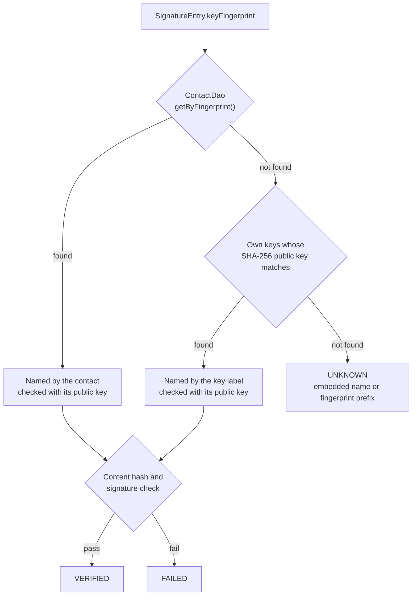

# Contacts

> **Status: REFERENCE** · Last verified: 2026-11-24
> How the phone stores other people's public keys and where it uses them.
> The table itself is in [architecture.md](architecture.md).

A contact is a public key with a name on it. The app reads contacts in two
places:

- `FileOperationActivity` lists them as encryption recipients, next to your
  own encryption keys.
- `VerifiedMediaViewerActivity` and `FileOperationActivity` look up a
  signature's key fingerprint in contacts to name the signer and check the
  signature (see [signer lookup](#signer-lookup)).

The screen is `ContactManagementActivity`.

## Parsing a key

Every import in the app goes through `ContactKeyParser` (in `crypto/`, plain
JVM, unit-tested). It takes DER or PEM bytes and returns the key's DER
encoding, an algorithm and a fingerprint, or nothing.

- DER is tried first; if that fails the bytes are read as PEM text. The
  `-----` header and footer lines are dropped and the Base64 body may wrap.
- EC keys are named by curve: P-256 is `ES256`, P-384 is `ES384`, P-521 is
  `ES512`. The curve is matched on its full parameters, not its size, so a
  256-bit curve like secp256k1 is refused.
- RSA keys of any size are `RS256`.
- Anything else is refused.

The algorithm stored is always the one detected from the key. A QR payload
can carry an `algorithm` field, and `ContactKeyParser.resolveAlgorithm`
ignores it.

The fingerprint is the lowercase hex SHA-256 of the DER bytes, 64 characters
(`ContactKeyParser.fingerprint`). The screen shows it as uppercase pairs
joined by colons, cut short in the list and in full in the detail dialog.

## Ways in

The add button opens a bottom sheet with three choices. Each one ends in the
same name prompt and the same insert (`insertContact`), which also records a
`CONTACT_IMPORTED` audit entry.

**Import from File.** A system file picker (`OpenDocument`, any type). The
file's bytes go to `ContactKeyParser`. Source `file`.

**Scan QR Code.** Asks for the camera permission, then opens a camera preview
in a dialog (`QrCodeScannerHelper`: CameraX with ML Kit). The decoded text is
handled by `ContactImportCandidate.fromScannedPayload`. Text starting with `{`
is read as an xKey contact envelope; anything else is read as PEM. A payload
with no usable key shows `contact_qr_invalid`. Source `qr`.

**Paste Public Key.** A text box for a PEM key. Source `paste`.

A paired desktop can also push a key with `local.sharePublicKey`. That path
lives in `RequestHandler`, skips the name prompt (the name is the sent
`label`, else the `key_id`), stores whatever `algorithm` the desktop sent
(`unknown` if none), and uses source `shared`. A key already in contacts is
left alone and records nothing.

### The QR envelope

```json
{
    "type": "xkey-contact",
    "v": 1,
    "label": "Alice's Key",
    "algorithm": "ES256",
    "key_id": "key-1234",
    "public_key_pem": "-----BEGIN PUBLIC KEY-----\nMFkwEwYHKoZIzj0CAQ...\n-----END PUBLIC KEY-----\n"
}
```

The field names match the `local.sharePublicKey` parameters.

| Field | Type | Use on import |
|-------|------|---------------|
| `type` | string | Must be `xkey-contact` or the envelope is not recognised |
| `v` | int | This build writes `1`; any value is accepted |
| `label` | string | Pre-fills the name prompt |
| `algorithm` | string | Ignored; the key decides |
| `key_id` | string | Ignored |
| `public_key_pem` | string | The key. The only field an importer needs |

## Showing your own key

The screen's menu has "Show My Public Key QR". It lists your keys that the
Android Keystore can return a public key for (`loadOwnPublicKeys`, via
`KeystoreManager.getPublicKeyPEM`), so symmetric keys and keys held on a
paired desktop are left out. With no such key, a dialog says so. The chosen
key is written into the envelope above and drawn with ZXing's
`QRCodeWriter`, on a white square that does not follow the dark theme,
because scanners want dark modules on a light background. The dialog also
shows the algorithm and fingerprint so the other person can compare.

## Duplicates

`public_key_fingerprint` has a unique index and `ContactDao.insert` uses
`OnConflictStrategy.ABORT`. Importing a key that is already stored throws
`SQLiteConstraintException`, which the screen turns into "Contact with this
key already exists". The same DER bytes always give the same fingerprint, so
the same key cannot be stored twice under two names.

## Signer lookup

`SignerVerification.verify` (in `media/`) is the one rule both the media
viewer and the file screen use for each signature entry:



Contacts are checked first. Own keys only match on the hash of the public key
the phone holds, never on a key id from the file. If the file's content hash
does not match, every signer fails, known or not. When a matched signer's
embedded name differs from the contact or key name, the row is named by the
stored name, and the media viewer adds a line with the embedded name as a
claim.

## ContactDao

| Method | Query |
|--------|-------|
| `insert(contact): Long` | Insert, abort on conflict |
| `getAll()` / `observeAll()` | All contacts, ordered by name |
| `getByFingerprint(fp)` | One contact or null |
| `searchByName(query)` | Case-insensitive substring match, ordered by name |
| `deleteByFingerprint(fp): Int` | Delete by fingerprint |
| `deleteById(id): Int` | Delete by id |
| `countAll(): Long` / `observeCount()` | Row count |

## The screen

`ContactManagementActivity` builds its views in code. From the top: a header,
a summary card with the contact count, the list (or an empty state when there
are none), and the add button, which hides while you scroll.

Each list card shows the name, algorithm, the start of the fingerprint and
the import date. Tapping one opens a dialog with the full fingerprint, the
algorithm, the source and the import date, plus a delete button. Delete asks
again, then removes the row by fingerprint and records `CONTACT_DELETED`.
