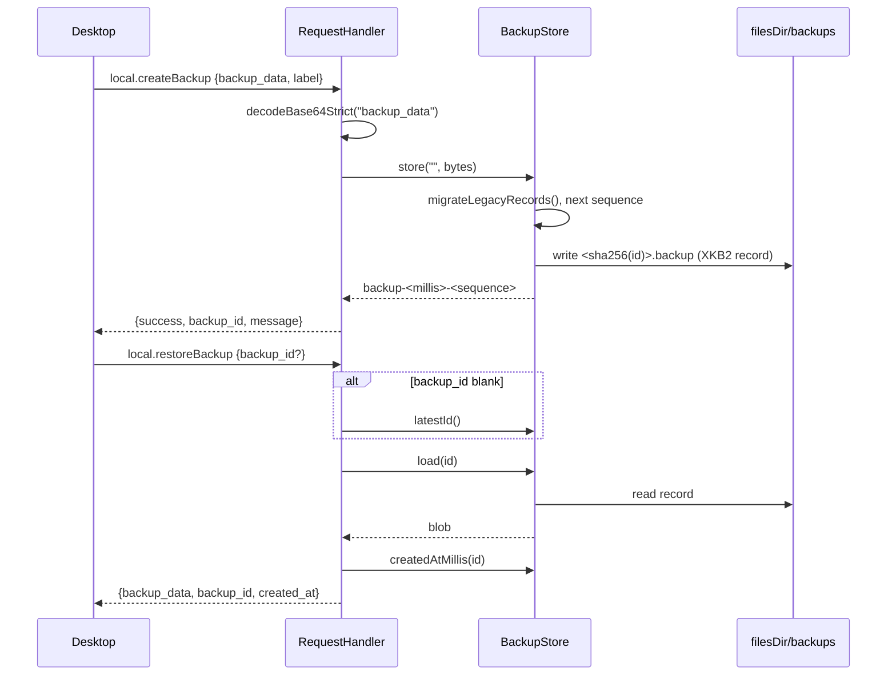

# Desktop backup store architecture

> **Status: REFERENCE** · Last verified: 2026-11-12
> As-built description of how xKey holds a paired desktop's encrypted backups and hands them back.

## Summary

A paired desktop can push an already-encrypted backup blob to the phone with
`local.createBackup` and fetch it back with `local.restoreBackup`. The phone
treats each blob as opaque: it never inspects or decrypts it. `BackupStore`
keeps the blobs as files in the app's private storage. The same store also
keeps the envelopes the phone fetches itself with `remote.createBackup` (see
[remote-backup-password](../remote-backup-password/architecture.md)).

## Components

| Class | File | Role |
|-------|------|------|
| `BackupStore` | `app/src/main/kotlin/com/automatethethings/xkey/backup/BackupStore.kt` | `store`, `load`, `latestId`, `createdAtMillis`; id generation, on-disk record format and legacy migration |
| `RequestHandler` | `app/src/main/kotlin/com/automatethethings/xkey/protocol/Handler.kt` | `handleCreateBackup`, `handleRestoreBackup`; `decodeBase64Strict` checks the payload |
| `MethodNames` | `app/src/main/kotlin/com/automatethethings/xkey/protocol/Messages.kt` | `LOCAL_CREATE_BACKUP`, `LOCAL_RESTORE_BACKUP` |
| `XKeyGattService` | `app/src/main/kotlin/com/automatethethings/xkey/ble/XKeyGattService.kt` | `latestStoredBackupId()`, and `createDesktopBackup` / `restoreDesktopBackup`, which store and load envelopes in `BackupStore` |
| `SyncCodec` | `app/src/main/kotlin/com/automatethethings/xkey/crypto/SyncCodec.kt` | `sha256Hex` for file names, `toRfc3339` for `created_at` |

## Wire methods

| Method | Params | Result |
|--------|--------|--------|
| `local.createBackup` | `backup_data` (base64, required), `label` (optional) | `success: true`, `backup_id`, and `message` ("stored backup '<label>'") when a label was given |
| `local.restoreBackup` | `backup_id` (optional; the most recent backup when blank) | `backup_data` (base64), `backup_id`, `created_at` (RFC 3339) |

The shapes match `pkg/pairingproto/protocol_backup.go` in go-xkms
`xkey/v0.64.2-alpha` (`LocalCreateBackupParams`, `LocalCreateBackupResult`,
`LocalRestoreBackupParams`, `LocalRestoreBackupResult`). `backup_data` is a Go
`[]byte`, so it travels as standard, padded base64 both ways; the phone decodes
and encodes it with `java.util.Base64`.

`handleCreateBackup` always calls `BackupStore.store("", bytes)`, so the phone
generates the id; the `label` is only echoed in the message.

## Audit

Each successful call writes one audit log entry: `local.createBackup` a
`BACKUP_CREATED` entry (`AuditLogger.logBackupCreated`), `local.restoreBackup`
a `BACKUP_RESTORED` entry (`AuditLogger.logBackupRestored`). The entry names
the requesting device as `local.sign` does: `deviceId` is the connected
peer's Noise static key hex and `deviceName` its name in
`PairedDeviceRepository`. `details` holds `backupId` and `sizeBytes` only;
the backup bytes, their base64 and the desktop's `label` never enter the log.
A failed call (missing or invalid `backup_data`, no backup stored, an unknown
id) writes no entry. Backups `XKeyGattService` stores directly are not
audited here.

## Backup ids

A generated id is `backup-<creation unix millis>-<sequence>`. The sequence is
one more than the highest sequence of any record in `backups/`, read under a
process-wide lock, so two backups stored in the same millisecond get distinct
ids and neither overwrites the other. If a file for the generated id already
exists, the sequence is bumped until it does not. A caller that passes its own
id (`XKeyGattService` does) replaces any backup under that id.

## Storage format

Each backup is one file under `filesDir/backups/`, named
`<sha256-hex-of-id>.backup`. Hashing the id keeps the name free of path
separators and makes it injective. Records written by this build are:

```
"XKB2" | sequence (8 bytes) | created-at unix millis (8 bytes)
       | id length (4 bytes) | id (UTF-8) | blob        (big endian)
```

so `latestId()` returns the id as it was stored, and `createdAtMillis()` is
the creation time kept in the record; a later change to the file's
modification time does not move it.

`XKB1` records from earlier builds (`"XKB1" | id length | id | blob`) are read
as they are and never rewritten. Their sequence is 0 and their creation time
is the file's modification time.

Files written by still older builds (a bare blob under a sanitised file name)
are migrated on first access in each `BackupStore` instance
(`migrateLegacyRecords`): the file name becomes the id, the file is rewritten
as an `XKB2` record with sequence 0 and its modification time as the creation
time, and the old file is deleted.

## Latest backup

`latestId()` reads each record's header and picks the highest sequence, then
the newest creation time. It does not use file modification times for `XKB2`
records, whose granularity can be a whole second. Every backup stored by this
build has a sequence of at least 1, so it is later than any `XKB1` record or
migrated legacy file. Storing an existing id again gives it a new sequence and
makes it the latest.

## Main flow



## Errors and refusals

| Condition | Answer |
|-----------|--------|
| `local.createBackup` with no params | `ErrorCodes.INVALID_PARAMS`, "Missing params" |
| `backup_data` missing or empty | `ErrorCodes.INVALID_PARAMS`, "Missing backup_data" |
| `backup_data` not valid base64 | `ErrorCodes.INVALID_PARAMS`, "Field 'backup_data' is not valid base64" |
| The write fails | `ErrorCodes.INTERNAL_ERROR`, "createBackup failed: ..." |
| `local.restoreBackup` with no id and no stored backup | `ErrorCodes.INVALID_PARAMS`, "No backup available" |
| No backup under the id | `ErrorCodes.INVALID_PARAMS`, "Backup not found: <id>" |
| A read failure | `ErrorCodes.INTERNAL_ERROR`, "restoreBackup failed: ..." |

## Tests

| Test class | Covers |
|------------|--------|
| `BackupStoreIdTest` (`app/src/test/.../backup/`) | Unique generated ids (same millisecond, two instances), latest order with equal or reversed mtimes, creation time, `XKB1` and legacy records |
| `BackupHandlerWireTest` (`app/src/test/.../protocol/`) | `local.*` backup params and results against the go-xkms structs: padded base64, `success`/`backup_id`, RFC 3339 `created_at`, latest when no id, INVALID_PARAMS cases |
| `BackupStoreTest` (`app/src/androidTest/.../backup/`) | Store and load, generated ids for blank ids |
| `BackupStoreIdentityTest` (`app/src/androidTest/.../backup/`) | Id-to-file mapping; nothing written outside `backups/` |
| `ProtocolIntegrationTest.backupRoundtrip` (`app/src/androidTest/.../e2e/`) | Create then restore over the protocol |
| `RequestHandlerPinAndDataFamilyTest` (`app/src/androidTest/.../protocol/`) | Missing payload, restore of the latest backup, label message |
| `RequestHandlerRefusalDetailTest` (`app/src/androidTest/.../protocol/`) | A payload that is not base64 |
| `RequestHandlerErrorPathTest` (`app/src/androidTest/.../protocol/`) | Restore of an unknown backup |
| `ProtocolConstantsTest` (`app/src/test/.../protocol/`) | Method name spelling |

## Related features

- [remote-backup-password](../remote-backup-password/architecture.md): the phone-initiated backup whose envelopes this store keeps
- [store-sync](../store-sync/architecture.md): the other way the desktop and phone exchange store contents
- [noise-pairing](../noise-pairing/architecture.md): the paired session these methods run on
