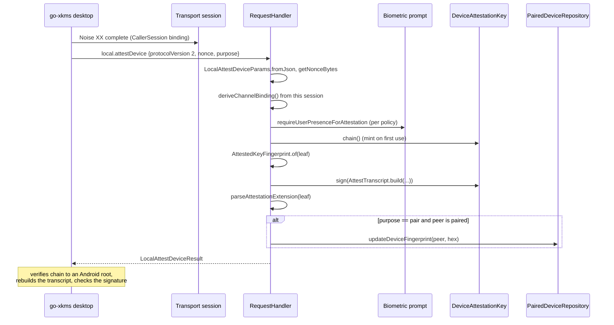

# Device attestation architecture

> **Status: REFERENCE** · Last verified: 2026-11-12
> As-built description of device attestation protocol version 2: the phone proves to a paired desktop, through `local.attestDevice`, that it is the same hardware-backed handset and that it is present on this Noise session now.

## Summary

The phone holds one persistent **Device Attestation Key** (DAK), an EC P-256
Keystore key minted once under the fixed `AttestTranscript.GENESIS_CHALLENGE`
(`"xkey-device-attestation-v1"`), StrongBox first, TEE as fallback. Its
attestation chain proves once that the key is hardware-backed on a
verified-boot device. Freshness comes from a live ECDSA signature by the same
key over a transcript that commits to the desktop's nonce, the purpose, a
channel binding the phone derives from its own Noise session, and the device
fingerprint. The fingerprint is `SHA-256` of the DAK leaf's
SubjectPublicKeyInfo (`AttestedKeyFingerprint`), so it moves only when the key
is replaced. On `purpose = "pair"` the phone stores that fingerprint with the
paired desktop, and the stream transports echo it in the identity ack on every
reconnect (see [usb-transport](../usb-transport/architecture.md)).

## Components

| Component | File | Role |
|-----------|------|------|
| `DeviceAttestationKey` | `app/src/main/kotlin/com/automatethethings/xkey/crypto/DeviceAttestationKey.kt` | Alias `xkey_device_attestation_key`; `chain()` (mints on first call, refuses a chain shorter than 2), `sign()` (`SHA256withECDSA`, ASN.1 DER), `fingerprint()`, `fingerprintHex()`, `rotate()`; `WIRE_SIGNATURE_ALGORITHM = "ES256"` |
| `AttestTranscript` | `app/src/main/kotlin/com/automatethethings/xkey/protocol/AttestTranscript.kt` | Pure byte layouts: `PROTOCOL_VERSION = 2`, `PURPOSE_PAIR`, `PURPOSE_REATTEST`, `PURPOSE_VERIFY_USER`, `build`, `channelBinding`, `shortAuthString`, `formatShortAuthString` |
| `AttestedKeyFingerprint` | `app/src/main/kotlin/com/automatethethings/xkey/protocol/AttestedKeyFingerprint.kt` | `of` / `hexOf`: SHA-256 of the leaf SPKI |
| `RequestHandler.handleLocalAttestDevice` | `app/src/main/kotlin/com/automatethethings/xkey/protocol/Handler.kt` | The prover; helpers `deriveChannelBinding`, `requireUserPresenceForAttestation`, `parseAttestationExtension`, `bindFingerprintAtPairing`, `attestingPeerPublicKeyHex` |
| `LocalAttestDeviceParams`, `LocalAttestDeviceResult` | `app/src/main/kotlin/com/automatethethings/xkey/protocol/Messages.kt` | Request and response bodies |
| `PairedDeviceRepository.updateDeviceFingerprint` | `app/src/main/kotlin/com/automatethethings/xkey/settings/PairedDeviceRepository.kt` | Stores the fingerprint hex as the paired device's `deviceFingerprint` |
| `AttestationBiometricPolicy` | `app/src/main/kotlin/com/automatethethings/xkey/settings/BiometricSettings.kt` | `ALWAYS` (default), `NEVER`, `PAIRED_DEVICES_SKIP` |

Transcript bytes (`AttestTranscript.build`):

```
"xkey-attest-transcript-v1" | len8(purpose) | purpose | nonce(32) | channelBinding(32) | deviceFingerprint(32)
```

Channel binding (`AttestTranscript.channelBinding`), initiator = desktop,
responder = phone:

```
SHA-256("xkey-attest-channel-v1" | 0x20 | initiatorStatic | 0x20 | responderStatic | len8(prologue) | prologue)
```

The prologue is empty on a first pairing and
`SHA-256(initiatorStatic || deviceFingerprint || "xkey-v1")` on a reconnect.
The pairing SAS shown on both ends is `formatShortAuthString` of the same
channel binding (`NNNN-NNNN-NNNN`).

## Wire methods served

- `local.attestDevice` (`MethodNames.LOCAL_ATTEST_DEVICE`). Params:
  `protocolVersion` (must be `2`), `nonce` (base64, 32 bytes), `purpose`
  (`pair` or `reattest`). Result (`LocalAttestDeviceResult`): `protocolVersion`,
  `format = "android-keystore"`, `certificateChain` (base64 DER, leaf first),
  `securityLevel`, `nonce`, `purpose`, `signature` (base64), `signatureAlgorithm`,
  `bootState`, `deviceLocked`, `verifiedBootKey`, `verifiedBootHash`.
- Served on every transport that reaches `RequestHandler`: BLE GATT, TCP, USB,
  and the sessions the phone opens (see
  [phone-initiated-pairing](../phone-initiated-pairing/architecture.md)).

## Main flow



## Errors and refusals

- `protocolVersion` absent or not `2`: `ErrorCodes.ATTEST_PROTOCOL_DOWNGRADE`
  (-32037).
- Missing params, `purpose` or `nonce`, an unknown purpose, or a nonce that is
  not 32 bytes: `ErrorCodes.INVALID_PARAMS` (-32602).
- No Noise session binding on the request's `CallerSession`, a phone-initiated
  session with no peer key, a device with no attestation chain, or a failed
  signature: `ErrorCodes.ATTESTATION_FAILED` (-32023).
- The prompt is skipped when the policy does not require it
  (`NEVER`, or `PAIRED_DEVICES_SKIP` for a paired peer) or when the UV policy
  is `DISABLED`.
- The fingerprint is written only for `purpose = "pair"` and only for a peer the
  repository already knows; `reattest` never overwrites it.
- `DeviceAttestationKey.rotate()` exists, but no caller in the app code was
  found, so how a user rotates the key was not determined from the code.

## Tests

- JVM: `AttestTranscriptTest` (cross-repo vectors), `AttestedKeyFingerprintTest`,
  `ShortAuthStringTest`, `AttestationPolicyCallerPeerTest`,
  `ProtocolConstantsTest` (`app/src/test/kotlin/com/automatethethings/xkey/protocol/`);
  `BleClientPhoneInitiatedAttestTest` (`app/src/test/kotlin/com/automatethethings/xkey/ble/`).
- Instrumented: `DeviceAttestationKeyTest`
  (`app/src/androidTest/kotlin/com/automatethethings/xkey/crypto/`);
  `RequestHandlerAttestationTest`, `RequestHandlerAttestationParsingTest`,
  `RequestHandlerBiometricGateTest`
  (`app/src/androidTest/kotlin/com/automatethethings/xkey/protocol/`);
  `ProtocolIntegrationTest` (`app/src/androidTest/kotlin/com/automatethethings/xkey/e2e/`).

## Related features

- [usb-transport](../usb-transport/architecture.md) and [tcp-pairing](../tcp-pairing/architecture.md): the identity ack that echoes the stored fingerprint.
- [phone-initiated-pairing](../phone-initiated-pairing/architecture.md): `local.attestDevice` on sessions the phone opens.
- [request-generation-echo](../request-generation-echo/architecture.md): the `generation` the response carries.
