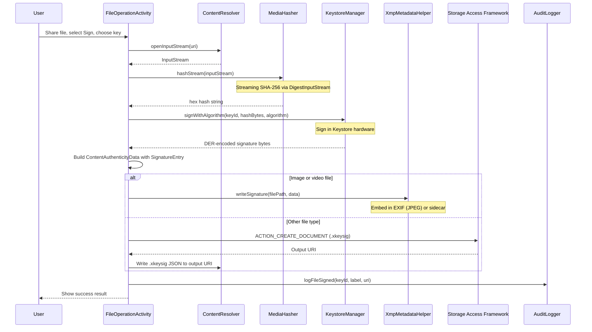
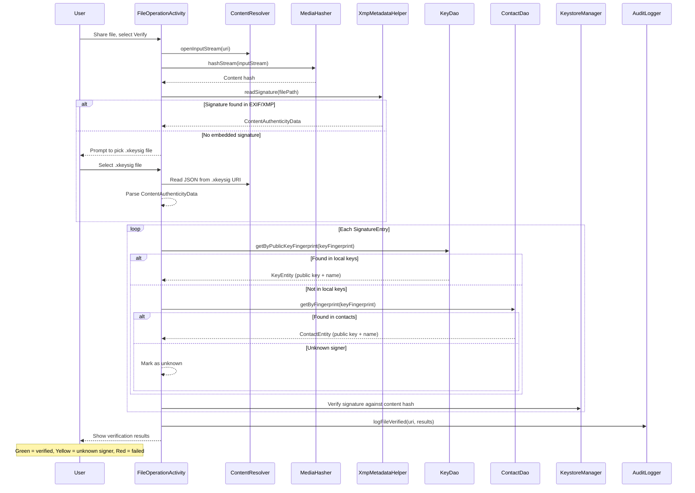
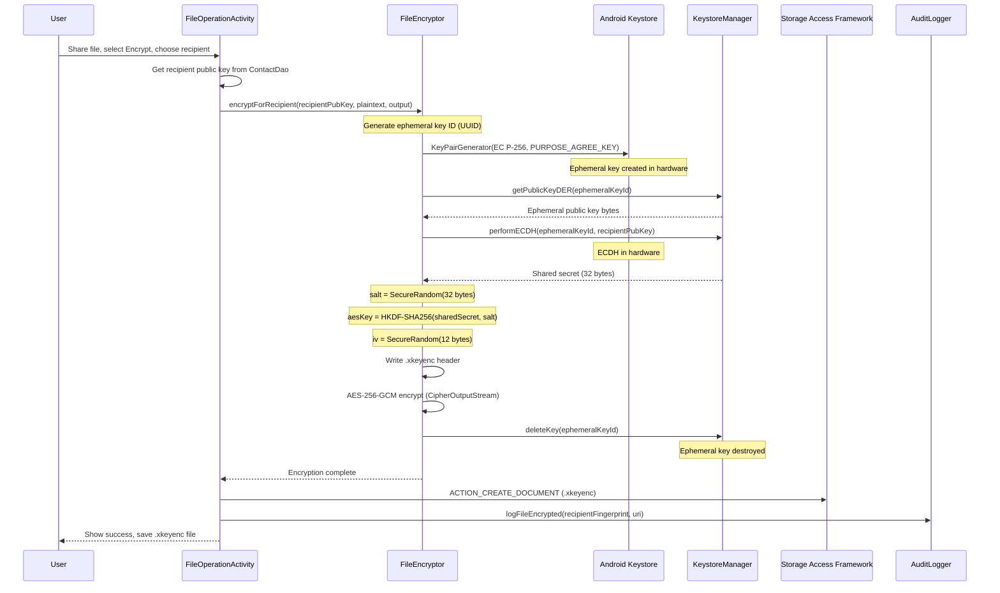
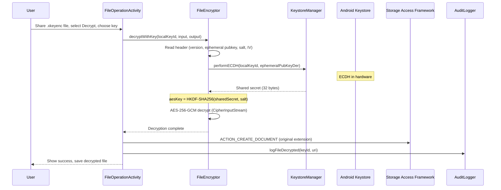

# File Operations

> **Status: REFERENCE** · Last verified: 2026-10-09
> As-built description of file sign, verify, encrypt and decrypt via `FileOperationActivity`.

This document describes the file sign, verify, encrypt, and decrypt features
exposed through the Android Share sheet via `FileOperationActivity`.

## Share Sheet Integration

`FileOperationActivity` is registered as a handler for `ACTION_SEND` and
`ACTION_SEND_MULTIPLE` intents with `mimeType="*/*"`. This makes xKey appear
in the system Share sheet when any app shares a file.

```xml
<activity android:name=".ui.FileOperationActivity" android:exported="true">
    <intent-filter>
        <action android:name="android.intent.action.SEND" />
        <category android:name="android.intent.category.DEFAULT" />
        <data android:mimeType="*/*" />
    </intent-filter>
    <intent-filter>
        <action android:name="android.intent.action.SEND_MULTIPLE" />
        <category android:name="android.intent.category.DEFAULT" />
        <data android:mimeType="*/*" />
    </intent-filter>
</activity>
```

The activity receives file URIs via `intent.getParcelableExtra(EXTRA_STREAM)`,
reads file metadata from `ContentResolver`, and presents a Material 3 UI with:

1. File info card (name, size, MIME type)
2. Operation selector: Sign, Verify, Encrypt, Decrypt
3. Key selector (filtered by operation type)
4. Recipient selector (for Encrypt only, from `ContactDao`)
5. Process button with progress indicator and result card

## Sign Flow



## Verify Flow



## Encrypt Flow (Hardware-Backed ECIES)

All EC private key operations happen inside Android Keystore hardware.



## Decrypt Flow



## `.xkeyenc` Binary Format

The encrypted file format is a compact binary layout.

```
Offset  Size        Field               Description
0       1           version             Format version (0x01)
1       2           ephemeral_len       Ephemeral public key length (big-endian)
3       var         ephemeral_pubkey    DER-encoded ephemeral EC public key
var     32          salt                Random salt for HKDF
var+32  12          iv                  AES-256-GCM initialization vector
var+44  var         ciphertext          Encrypted file content
tail    16          tag                 AES-GCM authentication tag (appended by GCM)
```

### Typical sizes

| Field | Typical Size | Notes |
|-------|-------------|-------|
| Version | 1 byte | Always `0x01` |
| Ephemeral key length | 2 bytes | Big-endian uint16 |
| Ephemeral public key | 91 bytes | P-256 SubjectPublicKeyInfo DER |
| Salt | 32 bytes | Random, for HKDF |
| IV | 12 bytes | Random, for AES-GCM |
| Header total | ~138 bytes | Before ciphertext |
| Auth tag | 16 bytes | 128-bit GCM tag, at end of ciphertext |

### Security Properties

- **Confidentiality**: AES-256-GCM with unique random IV
- **Integrity**: 128-bit GCM authentication tag
- **Forward secrecy**: Ephemeral ECDH key deleted after encryption
- **Key protection**: ECDH private key operation executes in TEE/StrongBox

## `.xkeysig` JSON Format

Detached signature files use JSON format, suitable for non-media files where
EXIF/XMP embedding is not appropriate.

```json
{
    "version": 1,
    "contentHash": "a1b2c3d4e5f6...64-character-hex-sha256",
    "hashAlgorithm": "SHA-256",
    "signatures": [
        {
            "keyFingerprint": "f1e2d3c4b5a6...64-character-hex-sha256",
            "signerName": "My Signing Key",
            "algorithm": "ES256",
            "value": "MEUCIQDx...base64-encoded-signature",
            "timestamp": "2025-07-15T10:30:00Z",
            "role": "CREATOR"
        }
    ]
}
```

### Fields

| Field | Type | Description |
|-------|------|-------------|
| `version` | int | Format version (currently `1`) |
| `contentHash` | string | Hex-encoded SHA-256 of the original file content |
| `hashAlgorithm` | string | Hash algorithm used (always `SHA-256`) |
| `signatures` | array | List of `SignatureEntry` objects |
| `signatures[].keyFingerprint` | string | SHA-256 hex of signer's DER-encoded public key |
| `signatures[].signerName` | string? | Human-readable signer name (nullable) |
| `signatures[].algorithm` | string | Signing algorithm (e.g., `ES256`, `RS256`) |
| `signatures[].value` | string | Base64-encoded signature bytes |
| `signatures[].timestamp` | string | ISO 8601 timestamp |
| `signatures[].role` | string | `CREATOR`, `WITNESS`, or `ATTESTOR` |

## SAF Integration

Output files are saved using the Storage Access Framework via
`ACTION_CREATE_DOCUMENT`. This lets the user choose the save location and
filename through the system file picker without requiring broad storage
permissions.

```kotlin
val intent = Intent(Intent.ACTION_CREATE_DOCUMENT).apply {
    addCategory(Intent.CATEGORY_OPENABLE)
    type = "application/octet-stream"
    putExtra(Intent.EXTRA_TITLE, "document.xkeyenc")
}
startActivityForResult(intent, REQUEST_SAVE_FILE)
```

## Key Selection Logic

The key selector filters available keys based on the selected operation:

| Operation | Key Filter |
|-----------|-----------|
| Sign | Keys with `key_type` in `signing`, `fido2` and algorithm in `ES*`, `RS*` |
| Verify | No key needed (uses public key from signature or contacts) |
| Encrypt | Keys with `PURPOSE_AGREE_KEY` (encryption-type EC keys) |
| Decrypt | Keys with `PURPOSE_AGREE_KEY` (user's own encryption keys) |
