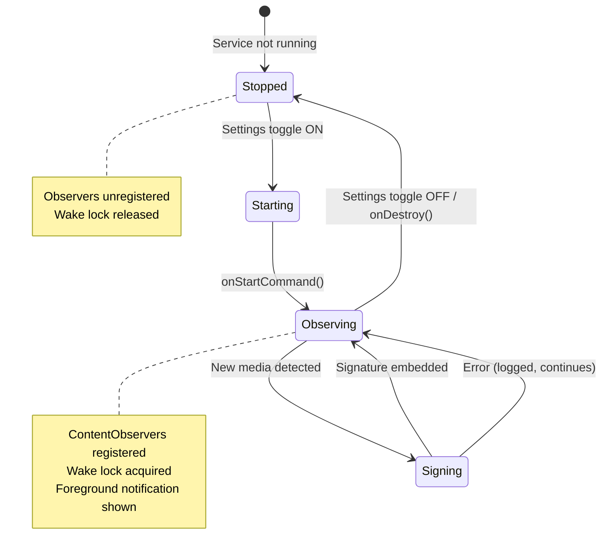
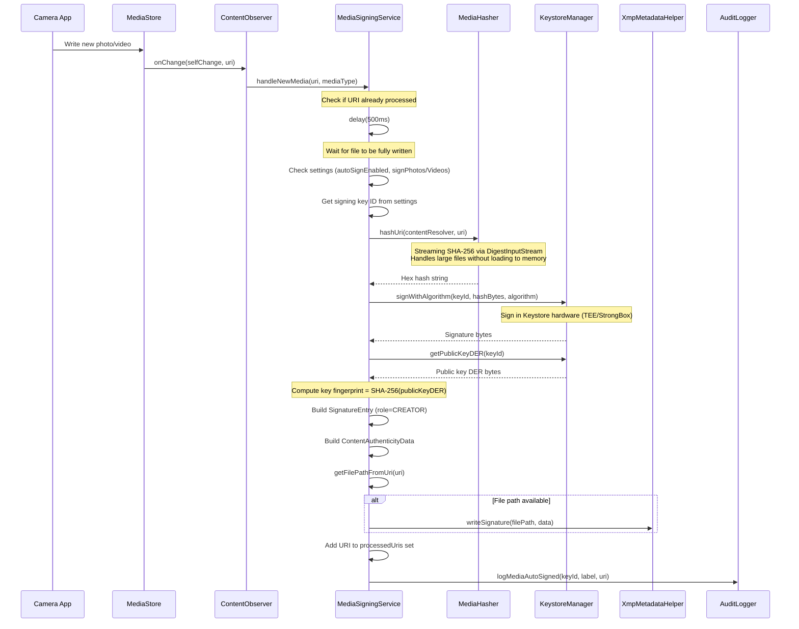

# Media Auto-Signing

This document describes the `MediaSigningService`, which automatically signs
photos and videos as they are captured, embedding cryptographic signatures in
the file metadata for later verification.

## Service Lifecycle



## Architecture

`MediaSigningService` is a foreground service that follows the same pattern as
`XKeyGattService`: foreground notification, wake lock, `START_STICKY` restart
policy, and `CoroutineScope(SupervisorJob() + Dispatchers.IO)` for async work.

### Components

| Component | Role |
|-----------|------|
| `MediaSigningService` | Foreground service lifecycle, ContentObserver registration |
| `ContentObserver` (image) | Observes `MediaStore.Images.Media.EXTERNAL_CONTENT_URI` |
| `ContentObserver` (video) | Observes `MediaStore.Video.Media.EXTERNAL_CONTENT_URI` |
| `MediaHasher` | Streaming SHA-256 hash of media content |
| `KeystoreManager` | Hardware-backed signing via `signWithAlgorithm()` |
| `XmpMetadataHelper` | Signature embedding in EXIF/XMP or sidecar file |
| `MediaSigningSettingsRepository` | DataStore-backed settings |
| `AuditLogger` | Logs `MEDIA_AUTO_SIGNED` events |

## ContentObserver Flow



### Deduplication

The service maintains an in-memory `Set<String>` of processed URIs to prevent
re-signing when `ContentObserver` fires multiple times for the same file.
The set is bounded to 1000 entries; when full, the oldest 500 are evicted.

### Debounce

A 500ms delay is applied after receiving a `ContentObserver` callback to ensure
the media file is fully written to disk before hashing. Without this delay,
the hash could be computed on an incomplete file.

## EXIF/XMP Embedding Strategy

Signature data is stored differently depending on the media format:

### JPEG

```
Method:  ExifInterface.setAttribute(TAG_USER_COMMENT, jsonString)
Format:  "XKEY_SIG:" + JSON-encoded ContentAuthenticityData
API:     ExifInterface (API 28+, reliable for TAG_USER_COMMENT)
```

The `TAG_USER_COMMENT` field supports arbitrary string data. A compact JSON
signature is approximately 500 bytes for a single signer and 5KB for 10
co-signers, well within EXIF limits.

The `XKEY_SIG:` prefix allows xKey to identify its own metadata and distinguish
it from other applications that may use the same EXIF field.

### PNG / WebP

```
Method:  Sidecar file (.xkeysig)
Format:  JSON file alongside the media file
Path:    <original_path>.xkeysig
```

The `ExifInterface` on Android does not reliably write to PNG or WebP metadata.
A sidecar JSON file is used instead.

### Video (MP4, MKV, MOV)

```
Method:  Sidecar file (.xkeysig)
Format:  JSON file alongside the video file
Path:    <original_path>.xkeysig
```

Video containers do not support EXIF metadata. A sidecar file is always used.

### Read Priority

When reading signatures, `XmpMetadataHelper.readSignature()` checks in order:

1. EXIF `TAG_USER_COMMENT` (for JPEG)
2. Sidecar `.xkeysig` file (fallback for all formats)

## ContentAuthenticityData Schema

```json
{
    "version": 1,
    "contentHash": "e3b0c44298fc1c149afbf4c8996fb92427ae41e4649b934ca495991b7852b855",
    "hashAlgorithm": "SHA-256",
    "signatures": [
        {
            "keyFingerprint": "a1b2c3d4e5f67890abcdef1234567890abcdef1234567890abcdef1234567890",
            "signerName": "My Photo Signing Key",
            "algorithm": "ES256",
            "value": "MEUCIQDxE9vVU3r7KnYm+B8r8r5w...",
            "timestamp": "2025-07-15T14:30:00.000Z",
            "role": "CREATOR"
        }
    ]
}
```

### Example: Multi-Signer (after co-signing)

```json
{
    "version": 1,
    "contentHash": "e3b0c44298fc1c149afbf4c8996fb924...",
    "hashAlgorithm": "SHA-256",
    "signatures": [
        {
            "keyFingerprint": "a1b2c3d4...",
            "signerName": "Alice (Camera Owner)",
            "algorithm": "ES256",
            "value": "MEUCIQD...",
            "timestamp": "2025-07-15T14:30:00.000Z",
            "role": "CREATOR"
        },
        {
            "keyFingerprint": "f5e6d7c8...",
            "signerName": "Bob",
            "algorithm": "ES384",
            "value": "MGQCMAE...",
            "timestamp": "2025-07-15T14:31:15.000Z",
            "role": "WITNESS"
        },
        {
            "keyFingerprint": "1a2b3c4d...",
            "signerName": null,
            "algorithm": "ES256",
            "value": "MEUCIBn...",
            "timestamp": "2025-07-15T15:00:00.000Z",
            "role": "ATTESTOR"
        }
    ]
}
```

## Settings Integration

`MediaSigningSettings` is managed via a DataStore repository following the
same pattern as `UsbHsmSettingsRepository`.

```kotlin
data class MediaSigningSettingsData(
    val autoSignEnabled: Boolean = false,
    val signingKeyId: String? = null,
    val signPhotos: Boolean = true,
    val signVideos: Boolean = true
)
```

### SettingsActivity Integration

The media signing section is built programmatically in `buildMediaSigningSection()`
within `SettingsActivity`, positioned between the Device Trust and Connectivity
sections. It includes:

- **Auto-sign toggle** (MaterialSwitch): Starts/stops `MediaSigningService`
- **Signing key selector** (Spinner): Populated from `KeyDao`, filtered to signing keys
- **Sign photos toggle**: Enable/disable photo auto-signing
- **Sign videos toggle**: Enable/disable video auto-signing

## Permissions

```xml
<uses-permission android:name="android.permission.READ_MEDIA_IMAGES" />
<uses-permission android:name="android.permission.READ_MEDIA_VIDEO" />
<uses-permission android:name="android.permission.READ_EXTERNAL_STORAGE"
    android:maxSdkVersion="32" />
<uses-permission android:name="android.permission.FOREGROUND_SERVICE_DATA_SYNC" />
```

## Service Declaration

```xml
<service android:name=".media.MediaSigningService"
    android:foregroundServiceType="dataSync"
    android:exported="false" />
```

## Notification

The service shows a persistent low-priority notification:

| Property | Value |
|----------|-------|
| Channel ID | `media_signing_channel` |
| Channel name | "xKey Media Signing" |
| Title | "xKey Media Signing" |
| Text | "Auto-signing active" |
| Priority | Low |
| Ongoing | Yes |
