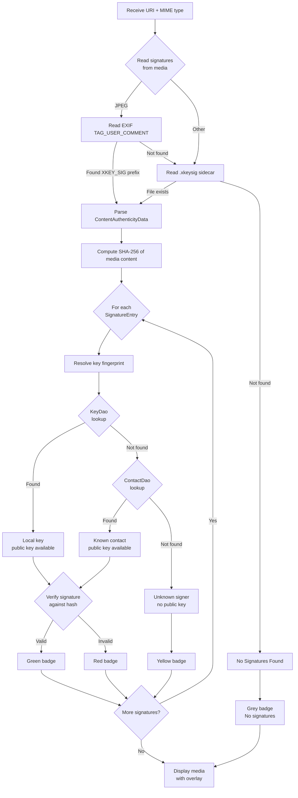
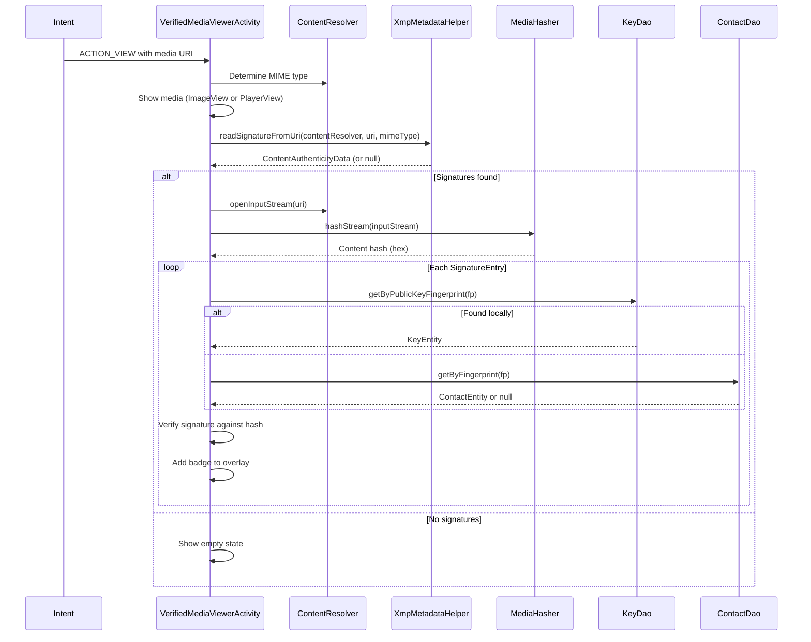

# Verified Media Viewer

> **Status: REFERENCE** · Last verified: 2026-10-09
> As-built description of `VerifiedMediaViewerActivity`.

This document describes the `VerifiedMediaViewerActivity`, which displays
images and videos with cryptographic signature verification badges, allowing
users to confirm the authenticity and provenance of media files.

## Intent Handling

`VerifiedMediaViewerActivity` registers as a handler for `ACTION_VIEW` on
image and video MIME types:

```xml
<activity android:name=".ui.VerifiedMediaViewerActivity" android:exported="true">
    <intent-filter>
        <action android:name="android.intent.action.VIEW" />
        <category android:name="android.intent.category.DEFAULT" />
        <data android:mimeType="image/*" />
    </intent-filter>
    <intent-filter>
        <action android:name="android.intent.action.VIEW" />
        <category android:name="android.intent.category.DEFAULT" />
        <data android:mimeType="video/*" />
    </intent-filter>
</activity>
```

The activity receives the media URI via `intent.data` and the MIME type via
`intent.type`. It can also be launched directly from within xKey (e.g., from
the file operations result screen or the co-sign activity).

## Verification Pipeline



## Badge States

| State | Color | Icon | Meaning |
|-------|-------|------|---------|
| Verified | Green | Checkmark | Signature valid, signer identity known |
| Unknown Signer | Yellow | Question mark | Signature present but signer not in keys or contacts |
| Failed | Red | X mark | Signature verification failed (content may be tampered) |
| No Signatures | Grey | Dash | No signature data found in media |

Each badge in the overlay displays:

- Signer name (or truncated fingerprint for unknown signers)
- Role: `Creator`, `Witness`, or `Attestor`
- Algorithm (e.g., `ES256`)
- Timestamp (formatted from ISO 8601)

## Image Rendering

Images are loaded with memory-conscious sampling to prevent `OutOfMemoryError`
on high-resolution camera photos:

```kotlin
// First pass: decode bounds only
val options = BitmapFactory.Options().apply {
    inJustDecodeBounds = true
}
BitmapFactory.decodeStream(inputStream, null, options)

// Calculate inSampleSize based on target display dimensions
val targetWidth = displayMetrics.widthPixels
val targetHeight = displayMetrics.heightPixels
options.inSampleSize = calculateInSampleSize(options, targetWidth, targetHeight)

// Second pass: decode with sampling
options.inJustDecodeBounds = false
val bitmap = BitmapFactory.decodeStream(inputStream, null, options)
imageView.setImageBitmap(bitmap)
```

### `calculateInSampleSize`

The sample size is the largest power of 2 that keeps the image dimensions
at or above the target display dimensions. For example, a 4000x3000 image
displayed on a 1080x1920 screen would use `inSampleSize = 2`, decoding at
2000x1500.

## Video Rendering

Videos are rendered using Media3 ExoPlayer with a `PlayerView`:

```kotlin
val player = ExoPlayer.Builder(this).build()
playerView.player = player

val mediaItem = MediaItem.fromUri(uri)
player.setMediaItem(mediaItem)
player.prepare()
player.playWhenReady = false  // Don't auto-play
```

The player includes standard controls (play/pause, seek bar, fullscreen).
The verification overlay is positioned above the player controls.

## UI Overlay Design

The verification overlay is a bottom sheet card that slides up from the bottom
of the screen, overlaying the media content.

```
+---------------------------------------+
|                                       |
|                                       |
|           Media Content               |
|       (Image or Video Player)         |
|                                       |
|                                       |
+---------------------------------------+
|  Verification Results                 |
|                                       |
|  [green] Alice (Creator)              |
|          ES256 | 2025-07-15 14:30    |
|                                       |
|  [green] Bob (Witness)                |
|          ES384 | 2025-07-15 14:31    |
|                                       |
|  [yellow] a1b2c3d4... (Attestor)     |
|           ES256 | 2025-07-15 15:00   |
|                                       |
+---------------------------------------+
```

### Empty State

When no signatures are found:

```
+---------------------------------------+
|                                       |
|           Media Content               |
|                                       |
+---------------------------------------+
|  [grey] No signatures found           |
|                                       |
|  This media has not been signed with  |
|  xKey. Authenticity cannot be         |
|  verified.                            |
+---------------------------------------+
```

## Layout

The activity uses a minimal XML layout as a scaffold for programmatic UI:

```xml
<FrameLayout>
    <!-- Full-screen media display -->
    <ImageView android:id="@+id/imageView"
        android:visibility="gone" />
    <androidx.media3.ui.PlayerView android:id="@+id/playerView"
        android:visibility="gone" />

    <!-- Verification overlay at bottom -->
    <LinearLayout android:id="@+id/verificationOverlay"
        android:layout_gravity="bottom" />
</FrameLayout>
```

The appropriate media view (`ImageView` or `PlayerView`) is made visible
based on the MIME type, and the verification overlay is populated
programmatically with badge views.

## Data Flow



## Dependencies

| Library | Usage |
|---------|-------|
| `androidx.media3:media3-exoplayer` | Video playback engine |
| `androidx.media3:media3-ui` | `PlayerView` with built-in controls |
| `androidx.exifinterface` | EXIF reading for JPEG signature extraction |
