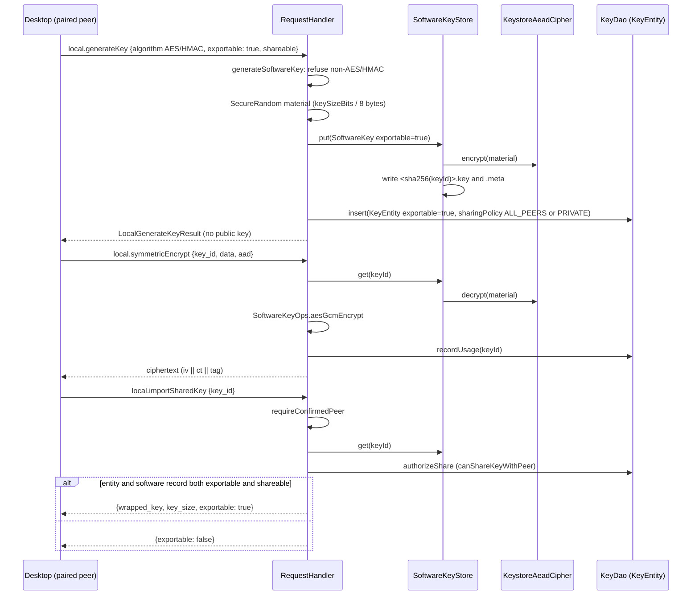

# Exportable symmetric keys architecture

> **Status: REFERENCE** · Last verified: 2026-11-12
> As-built description of software-backed (exportable) AES and HMAC keys: how `local.generateKey` with `exportable` creates them, where their material lives, and when it may leave the phone.

## Summary

Keys made in the Android Keystore never expose their material. A caller that
needs a symmetric key it can share or sync passes `exportable: true` to
`local.generateKey`. The phone then generates random AES or HMAC material in
software, stores it encrypted at rest in `SoftwareKeyStore`, and mirrors a row
into the unified key table (`KeyEntity`, `exportable = true`, `strongBoxBacked =
false`, `source = "local"`). An exportable asymmetric key is refused: asymmetric
keys stay hardware-backed.

The material leaves the phone only through `local.importSharedKey`, to a
confirmed peer whose key sharing policy admits it, and only when both the key
table row and the software store record mark the key exportable and shareable.
Material received from a peer through `local.shareSymmetric` is stored
non-exportable and non-shareable.

## Components

| Component | File | Role |
|-----------|------|------|
| `RequestHandler` (`handleLocalGenerateKey`, `generateSoftwareKey`) | `app/src/main/kotlin/com/automatethethings/xkey/protocol/Handler.kt` | Routes `exportable` requests to `generateSoftwareKey`; refuses asymmetric algorithms; writes the software record and the `KeyEntity` row |
| `RequestHandler` (`handleLocalSymmetricEncrypt`, `handleLocalSymmetricDecrypt`, `handleLocalHMAC`) | same | Look the key up in `SoftwareKeyStore` first and, when found, operate with `SoftwareKeyOps` instead of the Keystore |
| `RequestHandler` (`handleImportSharedKey`, `handleShareSymmetric`, `authorizeShare`, `requireConfirmedPeer`) | same | Export to and import from a paired peer |
| `LocalGenerateKeyParams` (`exportable`, default `false`) | `app/src/main/kotlin/com/automatethethings/xkey/protocol/Messages.kt` | Wire parameter parsing |
| `SoftwareKey`, `SoftwareKeyStore` | `app/src/main/kotlin/com/automatethethings/xkey/crypto/SoftwareKeyStore.kt` | File-backed store under `filesDir/software_keys/`; material encrypted with `KeystoreAeadCipher`, metadata as JSON; files named by the SHA-256 of the key id, with a one-time migration of older sanitised names |
| `SoftwareKeyOps` | `app/src/main/kotlin/com/automatethethings/xkey/crypto/SoftwareKeyOps.kt` | `aesGcmEncrypt` / `aesGcmDecrypt` (12-byte random IV prepended, 128-bit tag, same layout as the Keystore path) and `hmac` (`HmacSHA256`, or `HmacSHA512` when the algorithm names 512) |
| `KeyEntity` (`exportable`, `shareable`, `sharingPolicy`) | `app/src/main/kotlin/com/automatethethings/xkey/storage/entity/KeyEntity.kt` | Unified key table row used for display, policy and the export check |

## Wire methods served

| Method | Constant | Effect for exportable keys |
|--------|----------|----------------------------|
| `local.generateKey` | `MethodNames.LOCAL_GENERATE_KEY` | `exportable: true` makes a software AES-128, AES-256, HMAC-256 or HMAC-512 key (size taken from the algorithm name) |
| `local.symmetricEncrypt`, `local.symmetricDecrypt` | `LOCAL_SYMMETRIC_ENCRYPT`, `LOCAL_SYMMETRIC_DECRYPT` | AES-GCM with the software material |
| `local.hmac` | `LOCAL_HMAC` | HMAC with the software material |
| `local.deleteKey` | `LOCAL_DELETE_KEY` | Deletes from both the Keystore and `SoftwareKeyStore` (only one holds the key) |
| `local.importSharedKey` | `LOCAL_IMPORT_SHARED_KEY` | Returns `wrapped_key` (base64 material), `key_size` and `exportable: true` when export is allowed; otherwise `exportable: false` and no material |
| `local.shareSymmetric` | `LOCAL_SHARE_SYMMETRIC` | Stores peer material as a `SoftwareKey` with `exportable = false`, `shareable = false` |

The desktop side of the contract is `go-xkms/xkey/pkg/pairing` (per the SPEC
row; not in this repository). Material crosses the Noise-encrypted pairing
channel as-is, with no extra wrapping layer (comment in `Handler.kt`).

## Main flow

## Errors and refusals

| Condition | Result |
|-----------|--------|
| `exportable: true` with an asymmetric algorithm | `ProtocolException`, `ErrorCodes.INVALID_PARAMS`: "Exportable asymmetric keys are not supported; ..." (never downgraded silently) |
| `local.importSharedKey` / `local.shareSymmetric` with no confirmed peer | `ErrorCodes.OPERATION_DENIED` ("... requires a confirmed peer identity") |
| `local.importSharedKey` for an unknown key | `ErrorCodes.KEY_NOT_FOUND` |
| Key has no `KeyEntity` row, or its sharing policy does not admit the peer | `ErrorCodes.OPERATION_DENIED` ("Key is not shareable with this peer") |
| Software key not marked exportable and shareable in both stores | Success with `exportable: false` and no material |
| `local.shareSymmetric` for an id already in either store | `ErrorCodes.KEY_EXISTS`; a peer cannot replace local material |
| Missing `wrapped_key` / `key_id` | `ErrorCodes.INVALID_PARAMS` |

Hardware (Keystore) keys returned by `local.importSharedKey` carry
`public_key_pem` only and `exportable: false`.

## Tests

- Unit (`app/src/test`): `SoftwareKeyOpsTest`, `SoftwareKeyTest`, `LocalMessagesTest`, `KeyEntityValueSemanticsTest`.
- Instrumented (`app/src/androidTest`): `SoftwareKeyStoreCoverageTest`, `SoftwareKeyStoreNamingTest`, `RequestHandlerLocalKeyFamilyTest` (`hmacUsesTheSoftwareMaterialForAnExportableKey`, `anExportableSha512HmacKeyCarries512BitsOfMaterial`), `RequestHandlerErrorPathTest` (`exportableAsymmetricKeyIsRefused`, `shareableButNonExportableSoftwareKeyYieldsNoMaterial`), `RequestHandlerPinAndDataFamilyTest`, and `ProtocolIntegrationTest` (`softwareExportableAesRoundtrip`, `exportableAsymmetricKeyIsRefused`, `shareSymmetricStoresKeyButDoesNotMakeItReExportable`).

## Related features

- [Key sharing](../key-sharing/) — sharing policies and the peer check used by `local.importSharedKey`.
- [Hardware-backed keys](../hardware-backed-keys/) — the non-exportable Keystore path.
- [Noise pairing](../noise-pairing/) — the encrypted channel the material crosses.
- [Protected memory](../protected-memory/architecture.md)
