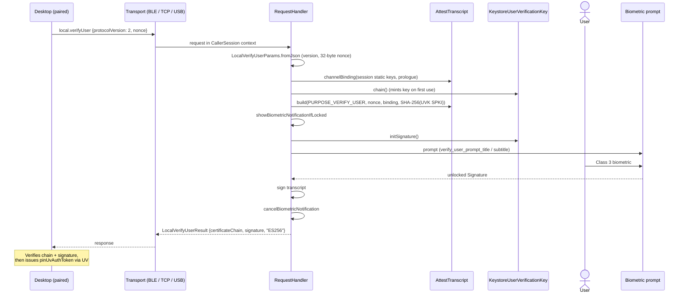

# FIDO2 built-in UV architecture

> **Status: REFERENCE** · Last verified: 2026-11-12
> As-built description of `local.verifyUser`: the biometric-gated, verifiable "verify user" RPC a paired desktop calls before it issues a CTAP 2.1 `pinUvAuthToken` through UV.

## Summary

A paired desktop sends `local.verifyUser` with a fresh 32-byte nonce. The phone
always raises a Class 3 biometric prompt and, once the user passes it, signs a
transcript with its **User Verification Key** (UVK): an AndroidKeyStore EC key
(StrongBox when available, TEE otherwise) that Keystore unlocks only for one
signature behind a strong biometric. The answer carries the UVK's attestation
chain and the signature, so the desktop can check both the key's authorization
list and that the user was present for this nonce on this Noise session.

The signed transcript is:

```
"xkey-attest-transcript-v1" || 0x0b || "verify-user" || nonce || channelBinding || SHA-256(UVK SPKI)
```

The UVK is separate from the Device Attestation Key (DAK): the DAK never
prompts, and the UVK never signs an attest or reattest transcript.

## Components

| Class | File | Role |
|-------|------|------|
| `RequestHandler` (`handleLocalVerifyUser`, `signVerifyUser`, `promptWithUserVerificationKey`, `deriveChannelBinding`) | `app/src/main/kotlin/com/automatethethings/xkey/protocol/Handler.kt` | Serves the RPC: parses params, derives the channel binding, builds the transcript, prompts, signs, retries once on key invalidation |
| `LocalVerifyUserParams`, `LocalVerifyUserResult` | `app/src/main/kotlin/com/automatethethings/xkey/protocol/Messages.kt` | Wire request and result; `MethodNames.LOCAL_VERIFY_USER = "local.verifyUser"` |
| `AttestTranscript` | `app/src/main/kotlin/com/automatethethings/xkey/protocol/AttestTranscript.kt` | Pure transcript and channel-binding layouts; `PURPOSE_VERIFY_USER = "verify-user"`, `PROTOCOL_VERSION = 2`, `BINDING_SIZE = 32`, `USER_VERIFICATION_CHALLENGE` |
| `UserVerificationKey` (interface), `KeystoreUserVerificationKey` | `app/src/main/kotlin/com/automatethethings/xkey/crypto/UserVerificationKey.kt` | The UVK: `chain()`, `fingerprint()`, `regenerate()`, `initSignature()`; minted with `setUserAuthenticationRequired(true)`, `setInvalidatedByBiometricEnrollment(true)` and, on API 30+, `AUTH_BIOMETRIC_STRONG` per use |
| `UserVerificationPrompt` (fun interface) | `app/src/main/kotlin/com/automatethethings/xkey/crypto/UserVerificationKey.kt` | Injectable prompt seam that returns the UVK signature; used by tests |

When no `UserVerificationPrompt` is injected, `promptWithUserVerificationKey`
uses the activity launcher (`requestCryptoSignature` with
`KeystoreUserVerificationKey.ALIAS`) when one is set, otherwise the in-activity
biometric helper with a `BiometricPrompt.CryptoObject` wrapping the UVK
`Signature`. See [user-verification](../user-verification/architecture.md) for
how the service raises the prompt from the background.

## Wire methods served

| Method | Params | Result |
|--------|--------|--------|
| `local.verifyUser` | `protocolVersion` (must be 2), `nonce` (base64, 32 bytes) | `protocolVersion`, `certificateChain` (base64 X.509, leaf first), `signature` (base64 DER ECDSA), `signatureAlgorithm` (`"ES256"`) |

The request carries no channel binding and no purpose: the binding comes from
the Noise session the request arrived on (`CallerSession`), and the purpose is
fixed. BLE, TCP and USB share one `RequestHandler`; each request binds only its
own connection's session.

## Main flow



## Errors and refusals

| Condition | Outcome |
|-----------|---------|
| Missing params, `protocolVersion` not 2, missing `nonce`, nonce not base64 or not 32 bytes | `ProtocolException`, `ErrorCodes.INVALID_PARAMS` |
| No Noise session bound to the request | `ProtocolException`, `ErrorCodes.ATTESTATION_FAILED` |
| UVK invalidated by a new biometric enrollment (`KeyInvalidatedException`) | Key is regenerated and the prompt asked once more; a second invalidation becomes `SigningException` |
| No Class 3 biometric enrolled when the key must be minted | `BiometricUnavailableException` |
| User cancels, biometric lockout | `UserCancelledException`, `BiometricLockoutException`; never turned into a result |
| No activity and no launcher for the prompt | `ProtocolException`, `ErrorCodes.INTERNAL_ERROR` |
| Signing fails after the prompt | `SigningException` |

The attestation and UV policies do not apply: the RPC always prompts. A pairing
record is neither read nor written.

## Tests

| Test | Covers |
|------|--------|
| `app/src/test/kotlin/com/automatethethings/xkey/protocol/VerifyUserHandlerTest.kt` | Handler behaviour of `local.verifyUser` |
| `app/src/test/kotlin/com/automatethethings/xkey/protocol/LocalVerifyUserMessagesTest.kt` | Param and result parsing |
| `app/src/test/kotlin/com/automatethethings/xkey/protocol/AttestTranscriptTest.kt` | Transcript layout, cross-repo vectors |
| `app/src/test/kotlin/com/automatethethings/xkey/transport/VerifyUserPerConnectionTest.kt` | Concurrent BLE and TCP requests each sign over their own connection's binding |
| `app/src/androidTest/kotlin/com/automatethethings/xkey/crypto/UserVerificationKeyDeviceTest.kt` | UVK minting on a device |
| `app/src/androidTest/kotlin/com/automatethethings/xkey/ui/CryptoSigningActivityUserVerificationKeyTest.kt` | UVK signature through the activity prompt path |

## Related features

- [user-verification](../user-verification/architecture.md): how the BLE service raises the biometric prompt
- [noise-pairing](../noise-pairing/architecture.md): the session the channel binding is derived from
- [ble-transport](../ble-transport/architecture.md): one of the transports that carries the RPC
- [fido2-phone-backend](../fido2-phone-backend/architecture.md): phone-held FIDO2 credentials over BLE
