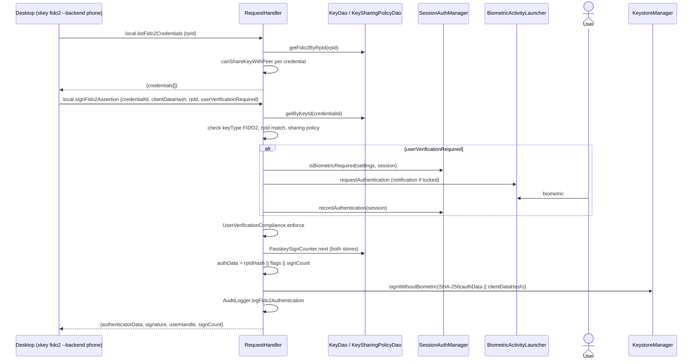

# FIDO2 phone backend architecture

> **Status: REFERENCE** · Last verified: 2026-11-17
> As-built description of how a paired desktop (`xkey fido2 --backend phone`) discovers and uses passkeys held on the phone, and of the phone's CTAP2 BLE authenticator.

## Summary

The desktop authenticator speaks CTAP2 to the browser; the phone does not parse
CTAP2 frames. For the phone backend it serves two JSON-RPC methods over the
paired, Noise-encrypted session (the same `RequestHandler` serves BLE, TCP and
USB): `local.listFido2Credentials` to discover which passkeys the desktop may
use for a relying party, and `local.signFido2Assertion` to produce a WebAuthn
assertion with one of them. Each credential's sharing policy decides whether the
connected desktop may see and use it. When the request asks for user
verification, the phone raises a biometric prompt before signing, and the UV
flag in the signed authenticator data reports only verification that actually
happened.

The phone is also a standard CTAP2 authenticator over BLE (#281): the FIDO
GATT service 0xFFFD (see [ble-transport](../ble-transport/architecture.md))
carries authenticatorGetInfo, authenticatorGetAssertion and
authenticatorMakeCredential to `Ctap2Authenticator`, over the same passkey
store, sign counter, sharing policy and user verification rules. See
[CTAP2 over BLE](#ctap2-over-ble). It has not yet been verified on a device
against a CTAP2 BLE client.

## Components

| Class | File | Role |
|-------|------|------|
| `RequestHandler` (`handleLocalListFido2Credentials`, `handleLocalSignFido2Assertion`, `canShareKeyWithPeer`) | `app/src/main/kotlin/com/automatethethings/xkey/protocol/Handler.kt` | Serves both RPCs; applies the sharing policy; builds and signs authenticator data |
| `LocalListFido2CredentialsParams`, `Fido2CredentialInfo`, `LocalListFido2CredentialsResult`, `LocalSignFido2AssertionParams`, `LocalSignFido2AssertionResult` | `app/src/main/kotlin/com/automatethethings/xkey/protocol/Messages.kt` | Wire params and results; `MethodNames.LOCAL_LIST_FIDO2_CREDENTIALS`, `MethodNames.LOCAL_SIGN_FIDO2_ASSERTION` |
| `KeyDao` (`getFido2ByRpId`, `getByKeyId`, `updateSignCount`) | `app/src/main/kotlin/com/automatethethings/xkey/storage/dao/KeyDao.kt` | Credential lookup and signature counter |
| `KeySharingPolicyDao` (`isKeySharedWithPeer`) | `app/src/main/kotlin/com/automatethethings/xkey/storage/dao/KeySharingPolicyDao.kt` | Per-peer grants for `SELECTED_PEERS` credentials |
| `SessionAuthManager` (`isBiometricRequired`, `recordAuthentication`) | `app/src/main/kotlin/com/automatethethings/xkey/auth/SessionAuthManager.kt` | Decides whether this session needs a fresh biometric |
| `BiometricActivityLauncher` (`requestAuthentication`) | `app/src/main/kotlin/com/automatethethings/xkey/auth/BiometricActivityLauncher.kt` | Raises the biometric prompt from the service |
| `UserVerificationCompliance` (`enforce`, `flags`) | `app/src/main/kotlin/com/automatethethings/xkey/credential/UserVerificationCompliance.kt` | Refuses a required-UV ceremony that did not verify; computes the authenticator-data flags |
| `KeystoreManager` (`signWithoutBiometric`) | `app/src/main/kotlin/com/automatethethings/xkey/crypto/KeystoreManager.kt` | Signs with the credential key |
| `AuditLogger` (`logFido2Authentication`) | `app/src/main/kotlin/com/automatethethings/xkey/audit/AuditLogger.kt` | Records `AuditOperationType.FIDO2_AUTHENTICATION` |

## Wire methods served

| Method | Params | Result |
|--------|--------|--------|
| `local.listFido2Credentials` | `rpId` | `credentials[]`: `credentialId`, `rpId`, `rpName`?, `userId`?, `userName`?, `userDisplayName`?, `isDiscoverable`, `createdAt` |
| `local.signFido2Assertion` | `credentialId`, `clientDataHash` (base64), `rpId`, `userVerificationRequired` (default `true`) | `authenticatorData` (base64), `signature` (base64), `userHandle`?, `signCount` |

Sharing policy (`KeyEntity.sharingPolicy`), applied by `canShareKeyWithPeer` to
both methods:

| `SharingPolicyType` | Visible to the connected desktop |
|---------------------|----------------------------------|
| `PRIVATE` | Never |
| `ALL_PEERS` | Always |
| `SELECTED_PEERS` | Only if `KeySharingPolicyDao.isKeySharedWithPeer` grants the connected device's public key; refused when that key is unknown |

The authenticator data is 37 bytes: `SHA-256(rpId)` (32) `|| flags` (1)
`|| signCount` (4, big-endian). The signature is over
`SHA-256(authenticatorData || clientDataHash)`. UP is always set, AT never.

The passkey provider serves the same passkeys, so both paths take the
counter from one `PasskeySignCounter`
(`app/src/main/kotlin/com/automatethethings/xkey/credential/PasskeySignCounter.kt`).
`next(credentialId)` holds a per-credential mutex shared across the process,
reads `keys.sign_count` and `credential_metadata.sign_count`, and writes
max + 1 to both before it returns the value. Stores that disagree continue
from the larger value. The counter advances before signing, so a failed
signature leaves a gap. A relying party accepts a gap, and no value is ever
signed twice. The handler no longer writes `sign_count` itself.

## Main flow

## Errors and refusals

| Condition | Outcome |
|-----------|---------|
| Missing params, `rpId`, `credentialId` or `clientDataHash` | `ProtocolException`, `ErrorCodes.INVALID_PARAMS` |
| Unknown credential | `ProtocolException`, `ErrorCodes.KEY_NOT_FOUND` |
| Key is not `KeyTypes.FIDO2`; stored `rpId` differs from the request | `ProtocolException`, `ErrorCodes.INVALID_PARAMS` |
| Sharing policy refuses this peer | `ProtocolException`, `ErrorCodes.OPERATION_DENIED` (list omits the credential instead) |
| UV required but not performed, with strict user verification on | `UserVerificationRequiredException` from `UserVerificationCompliance.enforce`; `RequestHandler.dispatch` answers `ErrorCodes.BIOMETRIC_FAILED` (-32003) with the exception's message |

When the relying party requires user verification and none was performed, both
`local.listFido2Credentials` and `local.signFido2Assertion` return
`ErrorCodes.BIOMETRIC_FAILED`, through the one mapping in
[`UserVerificationWireError.kt`](../../app/src/main/kotlin/com/automatethethings/xkey/protocol/UserVerificationWireError.kt)
(only the sign path calls `enforce` today).

If UV is required but `SessionAuthManager` reports no fresh biometric is needed,
or no `BiometricActivityLauncher` is set, no prompt is shown and the UV flag is
clear; whether the ceremony then proceeds depends on `strictUserVerification`.

## CTAP2 over BLE

### Components

| Class | File | Role |
|-------|------|------|
| `FidoGattServer`, `BiometricFidoUserPrompt` | `app/src/main/kotlin/com/automatethethings/xkey/ble/fido/FidoGattServer.kt` | The 0xFFFD GATT service; the phone's biometric or device-credential prompt |
| `FidoBleSession` | `app/src/main/kotlin/com/automatethethings/xkey/ble/fido/FidoBleSession.kt` | One client's request loop: PING, MSG, CANCEL, KEEPALIVE |
| `FidoBle`, `FidoBleReassembler` | `app/src/main/kotlin/com/automatethethings/xkey/ble/fido/FidoBleFraming.kt` | CMD/CONT framing |
| `Ctap2Authenticator` | `app/src/main/kotlin/com/automatethethings/xkey/ble/fido/Ctap2Authenticator.kt` | The one choke point: parses the three commands, refuses, prompts, builds authenticator data |
| `AndroidFidoCredentialBackend` | `app/src/main/kotlin/com/automatethethings/xkey/ble/fido/AndroidFidoCredentialBackend.kt` | Passkeys by sharing policy, `PasskeySignCounter`, Keystore signing and key creation |
| `CborEncoder.encode`, `CborDecoder` | `app/src/main/kotlin/com/automatethethings/xkey/crypto/CborEncoder.kt` | Canonical CTAP2 CBOR; the decoder refuses indefinite lengths, tags, duplicate keys, trailing bytes, nesting over 8 and invalid UTF-8 |

### Commands

| Command | Behaviour |
|---------|-----------|
| authenticatorGetInfo (0x04) | versions `FIDO_2_0`; AAGUID all zeros (as the passkey provider); options `rk`, `up`, `uv` (a strong biometric is enrolled: the prompt accepts nothing else), `plat` false, no `clientPin`; maxMsgSize 1024; transports `ble`; algorithms ES256 |
| authenticatorGetAssertion (0x02) | the first passkey in the allowList, or without one the first discoverable passkey, among those the sharing policy shows; prompt; counter from `PasskeySignCounter`; `authData \|\| clientDataHash` signed once with SHA256withECDSA in Keystore (never pre-hashed); a per-operation passkey signs behind a prompt bound to that signature; returns credential, authData, signature, user id |
| authenticatorMakeCredential (0x01) | ES256 only; prompt; a new Keystore P-256 key (not auth-bound, as on the JSON-RPC path, since the prompt gates every use); stored in `keys`, then `credential_metadata`, with sign count 0; any failure or cancellation deletes the metadata, the key row and the Keystore key; attestation `none` with AT set |

The BLE client is not a paired desktop and has no Noise static key, so
`SharePermission.canShare(entity, null)` decides: `ALL_PEERS` passkeys are
offered, `PRIVATE` and `SELECTED_PEERS` never. The policy is read again just
before signing, so a passkey made private while its prompt was open is
refused (CTAP2_ERR_NO_CREDENTIALS) before the counter moves. A passkey made
over BLE is stored as `ALL_PEERS` so that client can use it again; paired
desktops see it too.

Every GetAssertion and MakeCredential prompts on the phone, so UP and UV are
set only by a prompt the user passed. On a locked phone both prompts take the
path the JSON-RPC approvals take: shown over the lock screen, with a
notification that opens that request's own prompt, taken down when it ends.
The sharing policy is checked once more after every signature and before it
is released: a passkey made private, narrowed or deleted while its prompt was
up answers CTAP2_ERR_OPERATION_DENIED.

fidoControlPointLength is per client: min(512, ATT MTU − 3), 20 until the
client negotiates a larger MTU; longer control point writes are refused.
Every outgoing message (MSG, PING, ERROR, KEEPALIVE) is queued whole under
one lock, and the keepalive is joined before the MSG response. A session stays
busy until its request has sent its response and cleaned up, so a MSG during
a cancelled request's unwind answers ERR_BUSY. No private key leaves Keystore; the
response carries only the public COSE key and signatures.

### Refusals

| Condition | Status |
|-----------|--------|
| No passkey the policy shows matches | CTAP2_ERR_NO_CREDENTIALS (0x2E), before any prompt |
| User declines, cancels or is locked out | CTAP2_ERR_OPERATION_DENIED (0x27) |
| No prompt possible, `uv` requested, strict user verification on | CTAP2_ERR_PIN_REQUIRED (0x36), from `UserVerificationCompliance.enforce` |
| No prompt possible otherwise | CTAP2_ERR_OPERATION_DENIED: nothing shows a person is there |
| `pinUvAuthParam` present (no clientPin) | CTAP2_ERR_PIN_AUTH_INVALID (0x33) |
| GetAssertion with `up` false | CTAP2_ERR_UNSUPPORTED_OPTION (0x2B) |
| MakeCredential with `up` false | CTAP2_ERR_INVALID_OPTION (0x2C) |
| MakeCredential without ES256 | CTAP2_ERR_UNSUPPORTED_ALGORITHM (0x26) |
| excludeList names a passkey the client may see | CTAP2_ERR_CREDENTIAL_EXCLUDED (0x19), after the prompt |
| Malformed CBOR / wrong types / missing parameters | CTAP2_ERR_INVALID_CBOR, CBOR_UNEXPECTED_TYPE, MISSING_PARAMETER |
| Client sends CANCEL, even before the request starts | CTAP2_ERR_KEEPALIVE_CANCEL (0x2D), exactly one response per MSG |
| Request fails unexpectedly | CTAP2_ERR_OTHER (0x7F) |
| Per-operation passkey with no prompt, or its prompt declined | CTAP2_ERR_OPERATION_DENIED |
| Passkey no longer shared (or gone) once it has signed | CTAP2_ERR_OPERATION_DENIED, signature dropped |
| MSG while another, even a cancelled one still unwinding, is in flight | BLE ERROR frame (ERR_BUSY) |
| Client lets 96 notification frames queue unsent | BLE ERROR frame (ERR_OTHER), queue dropped, session closed |
| Any other command | CTAP1_ERR_INVALID_COMMAND |

Not implemented: clientPin, authenticatorGetNextAssertion,
credential management, extensions, U2F, and silent (`up` false)
assertions.

## Tests

| Test | Covers |
|------|--------|
| `app/src/test/kotlin/com/automatethethings/xkey/ble/fido/FidoBleFramingTest.kt` | Fragment and reassembly, SEQ wrap, every framing fault |
| `app/src/test/kotlin/com/automatethethings/xkey/ble/fido/CborCodecTest.kt` | Canonical encoding, decoding, every decoder refusal |
| `app/src/test/kotlin/com/automatethethings/xkey/ble/fido/Ctap2AuthenticatorTest.kt` | The three commands end to end over CBOR bytes with a fake backend, signature verified, counter, every refusal including UV |
| `app/src/test/kotlin/com/automatethethings/xkey/ble/fido/FidoBleSessionTest.kt` | PING, MSG, keepalive, CANCEL (also before start), handler failure, BUSY, framing errors, close |
| `app/src/test/kotlin/com/automatethethings/xkey/ble/fido/AndroidFidoCredentialBackendTest.kt` | Sharing policy on list and sign, shared counter, one Keystore signature over unhashed data, per-operation passkeys, rollback of a failed MakeCredential |
| `app/src/test/kotlin/com/automatethethings/xkey/ble/fido/BiometricFidoUserPromptTest.kt` | `uv` only with a strong biometric; both prompts over the lock screen with their own notification |
| `app/src/test/kotlin/com/automatethethings/xkey/ble/fido/FidoGattServerTest.kt` | Control point write to fidoStatus notification, permissions, revision, MTU, subscription, the bounded queue |
| `app/src/androidTest/kotlin/com/automatethethings/xkey/protocol/RequestHandlerFido2AndCosignTest.kt` | Discovery metadata, sharing policies, rpId scoping, verifiable assertion, counter persistence, every refusal |
| `app/src/androidTest/kotlin/com/automatethethings/xkey/e2e/ProtocolIntegrationTest.kt` | `local.listFido2Credentials` end to end |
| `app/src/test/kotlin/com/automatethethings/xkey/protocol/ProtocolConstantsTest.kt` | Method name constants |
| `app/src/test/kotlin/com/automatethethings/xkey/protocol/UserVerificationWireErrorTest.kt` | Missing user verification answers `BIOMETRIC_FAILED` on both methods |

## Related features

- [passkey-provider](../passkey-provider/architecture.md): how passkeys are created on the phone
- [key-sharing](../key-sharing/architecture.md): per-key sharing policies
- [fido2-built-in-uv](../fido2-built-in-uv/architecture.md): `local.verifyUser` for the desktop's pinUvAuthToken
- [user-verification](../user-verification/architecture.md): how the service raises the biometric prompt
- [noise-pairing](../noise-pairing/architecture.md), [ble-transport](../ble-transport/architecture.md): the session the RPCs travel on
