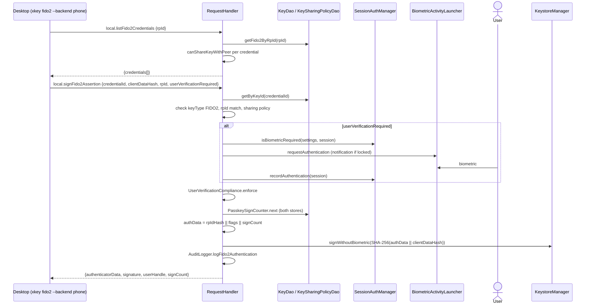

# FIDO2 phone backend architecture

> **Status: REFERENCE** · Last verified: 2026-11-12
> As-built description of how a paired desktop (`xkey fido2 --backend phone`) discovers and uses passkeys held on the phone.

## Summary

The desktop authenticator speaks CTAP2 to the browser; the phone does not parse
CTAP2 frames. For the phone backend it serves two JSON-RPC methods over the
paired, Noise-encrypted session (the same `RequestHandler` serves BLE, TCP and
USB): `local.listFido2Credentials` to discover which passkeys the desktop may
use for a relying party, and `local.signFido2Assertion` to produce a WebAuthn
assertion with one of them. Each credential's sharing policy decides whether the
connected desktop may see and use it. When the request asks for user
verification, the phone raises a biometric prompt before signing, and the UV
flag in the signed authenticator data reports only verification that actually
happened.

## Components

| Class | File | Role |
|-------|------|------|
| `RequestHandler` (`handleLocalListFido2Credentials`, `handleLocalSignFido2Assertion`, `canShareKeyWithPeer`) | `app/src/main/kotlin/com/automatethethings/xkey/protocol/Handler.kt` | Serves both RPCs; applies the sharing policy; builds and signs authenticator data |
| `LocalListFido2CredentialsParams`, `Fido2CredentialInfo`, `LocalListFido2CredentialsResult`, `LocalSignFido2AssertionParams`, `LocalSignFido2AssertionResult` | `app/src/main/kotlin/com/automatethethings/xkey/protocol/Messages.kt` | Wire params and results; `MethodNames.LOCAL_LIST_FIDO2_CREDENTIALS`, `MethodNames.LOCAL_SIGN_FIDO2_ASSERTION` |
| `KeyDao` (`getFido2ByRpId`, `getByKeyId`, `updateSignCount`) | `app/src/main/kotlin/com/automatethethings/xkey/storage/dao/KeyDao.kt` | Credential lookup and signature counter |
| `KeySharingPolicyDao` (`isKeySharedWithPeer`) | `app/src/main/kotlin/com/automatethethings/xkey/storage/dao/KeySharingPolicyDao.kt` | Per-peer grants for `SELECTED_PEERS` credentials |
| `SessionAuthManager` (`isBiometricRequired`, `recordAuthentication`) | `app/src/main/kotlin/com/automatethethings/xkey/auth/SessionAuthManager.kt` | Decides whether this session needs a fresh biometric |
| `BiometricActivityLauncher` (`requestAuthentication`) | `app/src/main/kotlin/com/automatethethings/xkey/auth/BiometricActivityLauncher.kt` | Raises the biometric prompt from the service |
| `UserVerificationCompliance` (`enforce`, `flags`) | `app/src/main/kotlin/com/automatethethings/xkey/credential/UserVerificationCompliance.kt` | Refuses a required-UV ceremony that did not verify; computes the authenticator-data flags |
| `KeystoreManager` (`signWithoutBiometric`) | `app/src/main/kotlin/com/automatethethings/xkey/crypto/KeystoreManager.kt` | Signs with the credential key |
| `AuditLogger` (`logFido2Authentication`) | `app/src/main/kotlin/com/automatethethings/xkey/audit/AuditLogger.kt` | Records `AuditOperationType.FIDO2_AUTHENTICATION` |

## Wire methods served

| Method | Params | Result |
|--------|--------|--------|
| `local.listFido2Credentials` | `rpId` | `credentials[]`: `credentialId`, `rpId`, `rpName`?, `userId`?, `userName`?, `userDisplayName`?, `isDiscoverable`, `createdAt` |
| `local.signFido2Assertion` | `credentialId`, `clientDataHash` (base64), `rpId`, `userVerificationRequired` (default `true`) | `authenticatorData` (base64), `signature` (base64), `userHandle`?, `signCount` |

Sharing policy (`KeyEntity.sharingPolicy`), applied by `canShareKeyWithPeer` to
both methods:

| `SharingPolicyType` | Visible to the connected desktop |
|---------------------|----------------------------------|
| `PRIVATE` | Never |
| `ALL_PEERS` | Always |
| `SELECTED_PEERS` | Only if `KeySharingPolicyDao.isKeySharedWithPeer` grants the connected device's public key; refused when that key is unknown |

The authenticator data is 37 bytes: `SHA-256(rpId)` (32) `|| flags` (1)
`|| signCount` (4, big-endian). The signature is over
`SHA-256(authenticatorData || clientDataHash)`. UP is always set, AT never.

The passkey provider serves the same passkeys, so both paths take the
counter from one `PasskeySignCounter`
(`app/src/main/kotlin/com/automatethethings/xkey/credential/PasskeySignCounter.kt`).
`next(credentialId)` holds a per-credential mutex shared across the process,
reads `keys.sign_count` and `credential_metadata.sign_count`, and writes
max + 1 to both before it returns the value. Stores that disagree continue
from the larger value. The counter advances before signing, so a failed
signature leaves a gap. A relying party accepts a gap, and no value is ever
signed twice. The handler no longer writes `sign_count` itself.

## Main flow

## Errors and refusals

| Condition | Outcome |
|-----------|---------|
| Missing params, `rpId`, `credentialId` or `clientDataHash` | `ProtocolException`, `ErrorCodes.INVALID_PARAMS` |
| Unknown credential | `ProtocolException`, `ErrorCodes.KEY_NOT_FOUND` |
| Key is not `KeyTypes.FIDO2`; stored `rpId` differs from the request | `ProtocolException`, `ErrorCodes.INVALID_PARAMS` |
| Sharing policy refuses this peer | `ProtocolException`, `ErrorCodes.OPERATION_DENIED` (list omits the credential instead) |
| UV required but not performed, with strict user verification on | `UserVerificationRequiredException` from `UserVerificationCompliance.enforce`; `RequestHandler.dispatch` answers `ErrorCodes.BIOMETRIC_FAILED` (-32003) with the exception's message |

When the relying party requires user verification and none was performed, both
`local.listFido2Credentials` and `local.signFido2Assertion` return
`ErrorCodes.BIOMETRIC_FAILED`, through the one mapping in
[`UserVerificationWireError.kt`](../../app/src/main/kotlin/com/automatethethings/xkey/protocol/UserVerificationWireError.kt)
(only the sign path calls `enforce` today).

If UV is required but `SessionAuthManager` reports no fresh biometric is needed,
or no `BiometricActivityLauncher` is set, no prompt is shown and the UV flag is
clear; whether the ceremony then proceeds depends on `strictUserVerification`.

## Tests

| Test | Covers |
|------|--------|
| `app/src/androidTest/kotlin/com/automatethethings/xkey/protocol/RequestHandlerFido2AndCosignTest.kt` | Discovery metadata, sharing policies, rpId scoping, verifiable assertion, counter persistence, every refusal |
| `app/src/androidTest/kotlin/com/automatethethings/xkey/e2e/ProtocolIntegrationTest.kt` | `local.listFido2Credentials` end to end |
| `app/src/test/kotlin/com/automatethethings/xkey/protocol/ProtocolConstantsTest.kt` | Method name constants |
| `app/src/test/kotlin/com/automatethethings/xkey/protocol/UserVerificationWireErrorTest.kt` | Missing user verification answers `BIOMETRIC_FAILED` on both methods |

## Related features

- [passkey-provider](../passkey-provider/architecture.md): how passkeys are created on the phone
- [key-sharing](../key-sharing/architecture.md): per-key sharing policies
- [fido2-built-in-uv](../fido2-built-in-uv/architecture.md): `local.verifyUser` for the desktop's pinUvAuthToken
- [user-verification](../user-verification/architecture.md): how the service raises the biometric prompt
- [noise-pairing](../noise-pairing/architecture.md), [ble-transport](../ble-transport/architecture.md): the session the RPCs travel on
