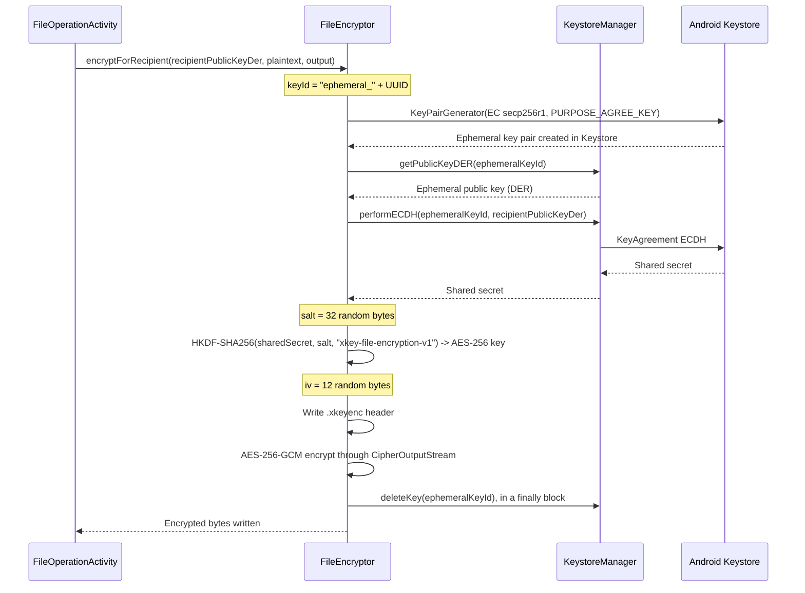
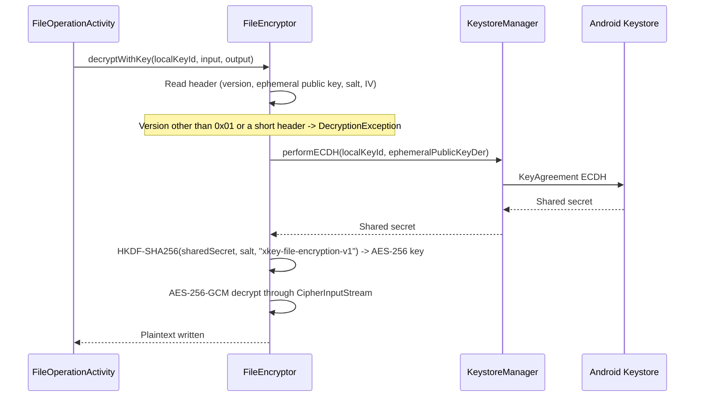
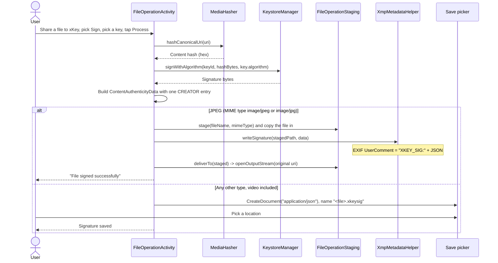
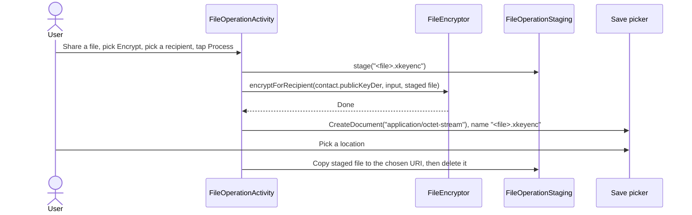
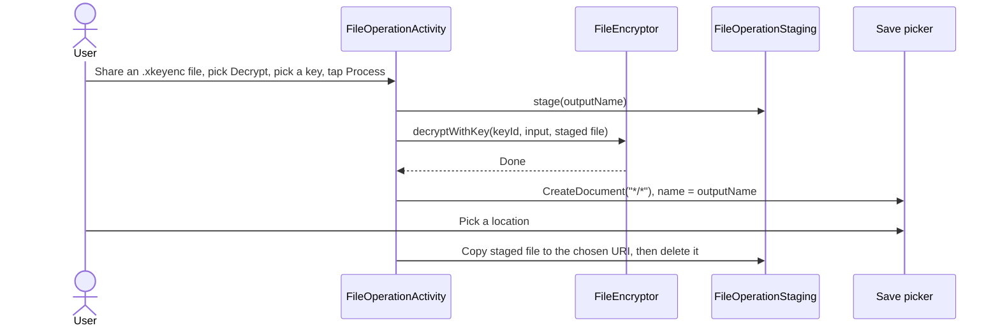

# File operations architecture

> **Status: REFERENCE** · Last verified: 2026-11-23
> How xKey signs, verifies, encrypts and decrypts a file shared to it from another app.

All four operations start in `FileOperationActivity` (`ui/`), which other apps
reach through the Android share sheet. The pieces it calls:

| Class | Package | Job |
|-------|---------|-----|
| `FileEncryptor` | `crypto/` | ECIES encrypt and decrypt in the `.xkeyenc` format |
| `KeystoreManager` | `crypto/` | Signing and ECDH with keys held in Android Keystore |
| `MediaHasher` | `media/` | SHA-256 content hashes, including the canonical JPEG hash |
| `XmpMetadataHelper` | `media/` | Reads and writes the signature block in a JPEG's EXIF |
| `SignerVerification`, `SignatureVerifier` | `media/` | The per-signer verify decision and the signature check |
| `FileOperationStaging` | `ui/` | Owns the temporary files each operation writes |
| `AuditLogger` | `audit/` | Records each operation in the audit log |

Only the first file of a share is processed. The activity accepts
`ACTION_SEND_MULTIPLE`, but every operation works on `fileUris.first()`.

## File encryption (ECIES)

The ECDH step runs inside Android Keystore, so neither the ephemeral private
key nor the recipient-side private key is ever in app memory. The AES key that
comes out of HKDF is used in software: Keystore cannot import a key derived
outside it.

ECDH needs keys created with `PURPOSE_AGREE_KEY`, which Keystore supports
from Android 12 (API 31). The app installs on Android 9 (minSdk 28), but
encrypt and decrypt fail below Android 12, and an EC key generated before the
device reached API 31 cannot decrypt. `KeystoreManager.performECDH` throws an
`ECDHException` that says so.

### Encryption

The ephemeral key is generated without a user-authentication requirement and
without a StrongBox request, so it lives in the TEE. Its Keystore alias is
`xkey_key_ephemeral_<UUID>`. It is deleted in a `finally` block, so a failed
encryption does not leave it behind. The delete goes through
`SharePermissionLedger.revoking` (in `remote/RemoteShareClient.kt`), which also refuses any later share of that
key ID.

### Decryption

## Sign a file

A JPEG is signed in place: the signed copy is written back over the shared
URI, so the sharing app must grant write access. Every other file, videos
included, gets a detached `.xkeysig` file the user saves through the system
picker. The hash is the canonical one (see
[media signing](../media-signing/architecture.md)): for a JPEG it skips the
metadata segments, so writing the signature into the EXIF does not change
the hash it covers.

## Encrypt a file for a recipient

The recipient is a contact (`ContactEntity`), and the contact's
`publicKeyDer` is the key the file is encrypted to. There is no key picker
for Encrypt.

## Decrypt a file

The user shares an `.xkeyenc` file and picks Decrypt by hand; the screen does
not pre-select it from the extension.

The suggested output name is the input name with `.xkeyenc` removed, or
`decrypted_<name>` when the input does not end in `.xkeyenc`.

## Staging files

Sign (JPEG in place), encrypt and decrypt write their output to a staging
file before it is copied to its target. `FileOperationStaging` owns these
files:

- They live in `<cacheDir>/file-ops-staging/` and nowhere else.
- Each name is generated (`stage-<random>.<ext>`). The shared file's display
  name lends only its extension, and only when it is 1 to 10 letters or
  digits, so a `../` in a display name cannot move the file, and two
  operations never share a path. When the caller passes the content's MIME
  type, the extension is the one that content requires instead: JPEG content
  stages as `.jpg` whatever its display name, so the EXIF write lands in the
  staged file and not in a sidecar beside it.
- Anything a helper writes beside a staged file, named
  `<staged name>.<suffix>` (the XMP helper's `<staged>.xkeysig` sidecar),
  belongs to that file and is deleted with it at every point below.
- A staging file is deleted when its write step throws, once it is copied to
  the target (whether the copy succeeds or throws), when the user cancels the
  save picker, and when the activity finishes.
- `onCreate` sweeps the staging directory first, so files left by a process
  death or an activity recreation go at the next start. The sweep touches
  nothing outside that directory.

## Verify a file

Verify reads the embedded signature block from a JPEG's EXIF. For any other
file, or a JPEG without a block, it opens the system picker to choose a
`.xkeysig` file. Each signer's result comes from `SignerVerification.verify`
(in `media/`), the same rule the verified-media viewer uses:

1. The stored content hash must match the file first: the canonical hash for
   an embedded block, the canonical or whole-file hash for a `.xkeysig` file
   (`MediaHasher.contentHashMatchesUri`). On a mismatch every signer fails,
   so a signature block copied onto another file never verifies.
2. The signature is checked against a public key the app holds: the contact
   whose fingerprint equals the entry's `keyFingerprint`, or, when no contact
   matches, the local key whose public key hashes to that fingerprint.
3. No such public key means the signer is unknown, never verified. A local
   key row without public key material never matches by key ID, because the
   fingerprint comes from the file being checked.

`SignatureVerifier` checks ES256, ES384, ES512, RS256, RS384 and RS512. Any
other algorithm name fails.
