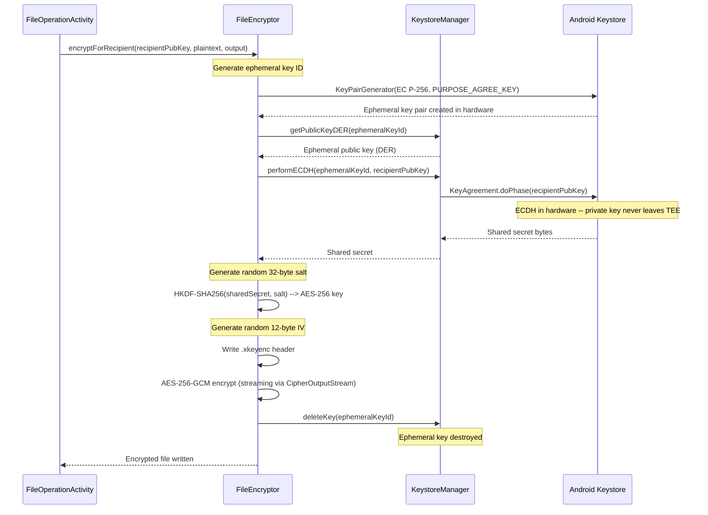
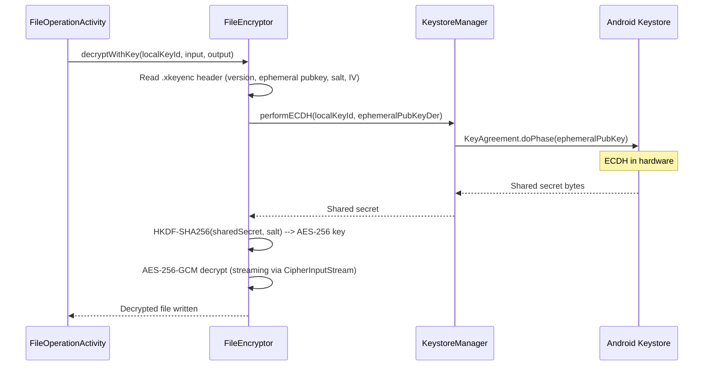
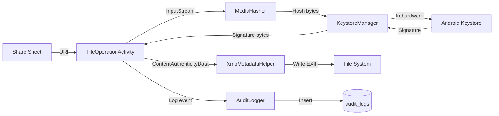
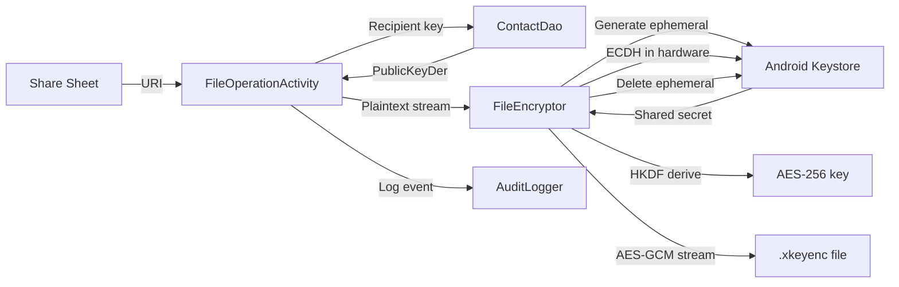
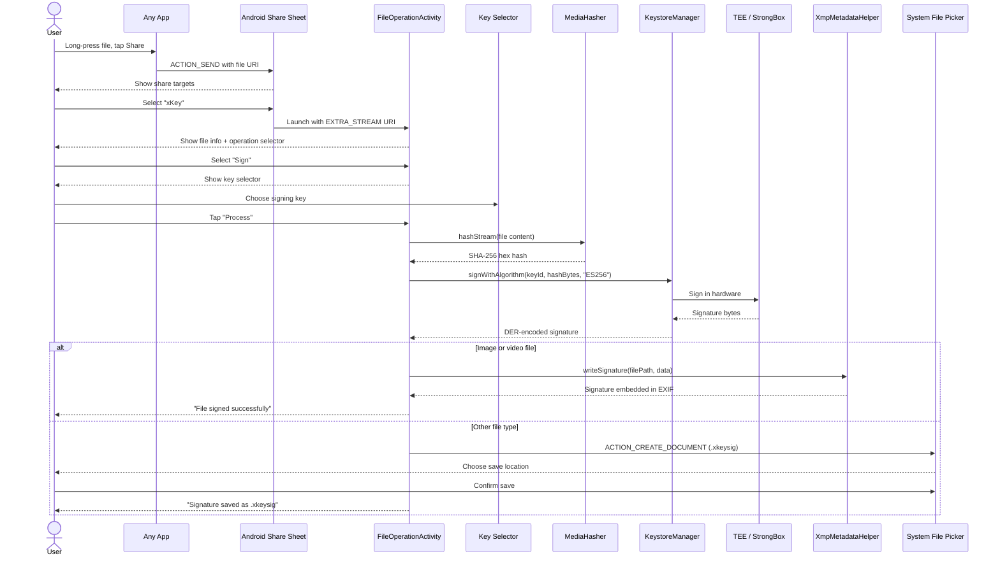
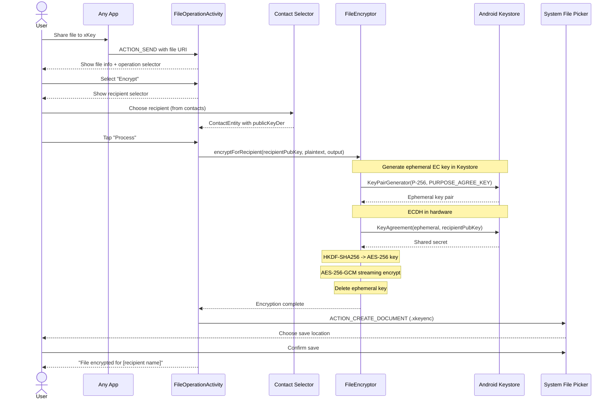
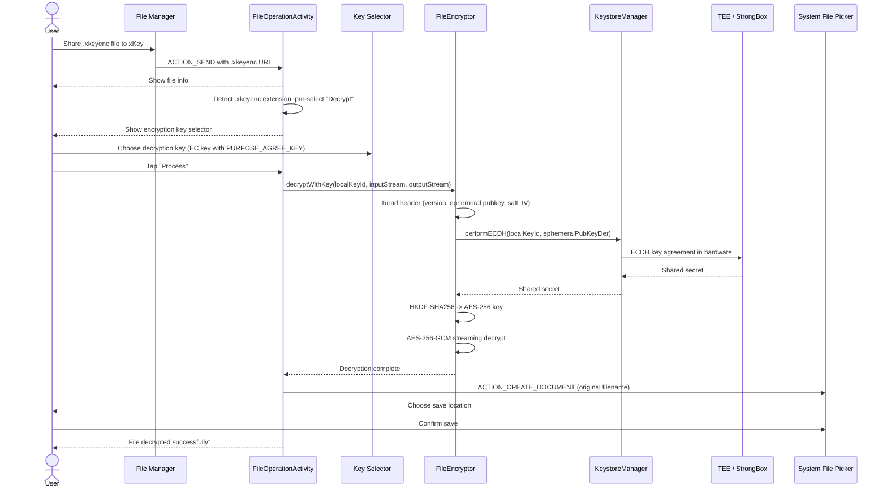

# File operations architecture

> **Status: REFERENCE** · Last verified: 2026-10-09
> As-built description of xKey's file encryption (ECIES) and the file sign, encrypt and decrypt flows.

## File Encryption (ECIES) Flow

xKey uses an Elliptic Curve Integrated Encryption Scheme where the ECDH key
agreement happens entirely in hardware. The derived AES key is used in software
because Android Keystore does not support importing arbitrary derived keys.

### Encryption

### Decryption

## Data Flow: Sign a File

## Data Flow: Encrypt a File

This document provides end-to-end user flow diagrams for the major operations
in xKey, from user intent through system interaction to final result.

## Sign a File via Share Sheet

A user shares a document from any app (e.g., a file manager, email client,
or browser) and signs it with their xKey key.

## Encrypt a File for a Recipient

A user encrypts a file so that only a specific recipient (whose public key
is stored as a contact) can decrypt it.

## Decrypt a File

A user receives an encrypted `.xkeyenc` file and decrypts it using their
encryption key.

