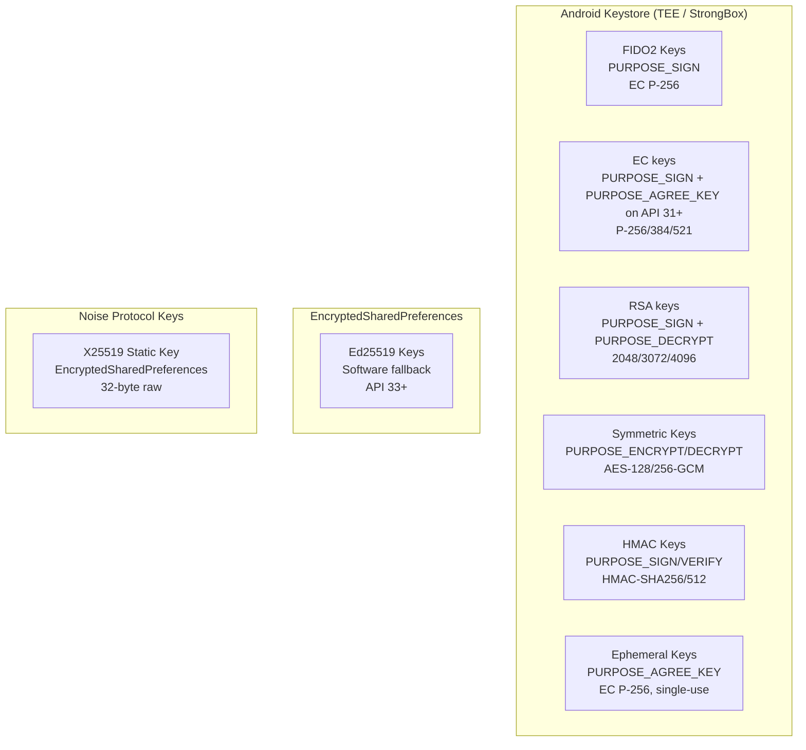
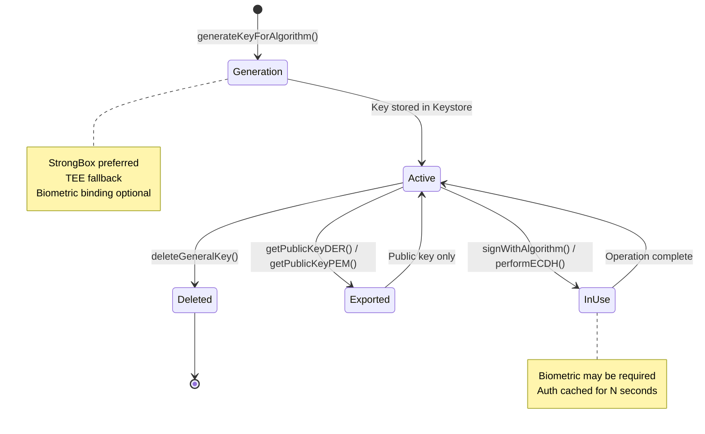
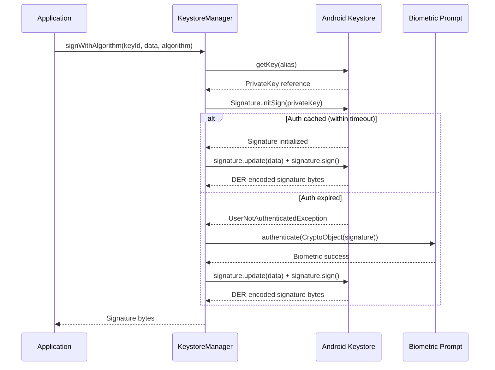
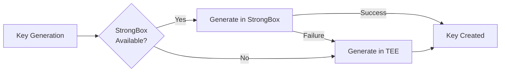
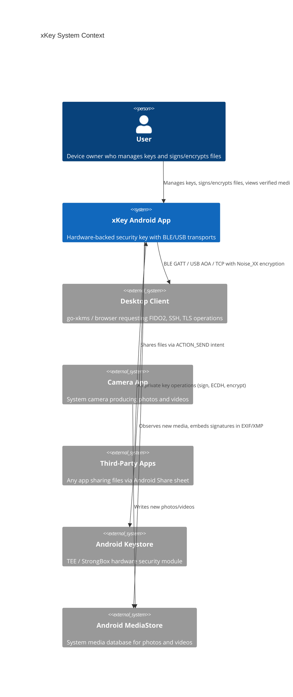
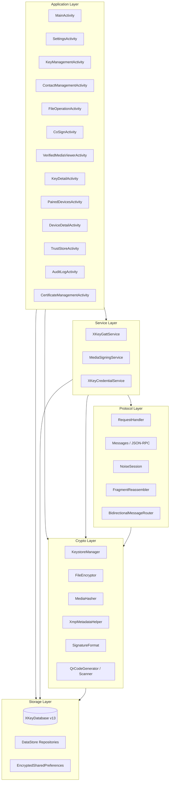

```mermaid
graph TB
    subgraph Activities["Activities"]
        MA[MainActivity]
        SA[SettingsActivity]
        KMA[KeyManagementActivity]
        CMA[ContactManagementActivity]
        FOA[FileOperationActivity]
        CSA[CoSignActivity]
        VMA[VerifiedMediaViewerActivity]
        PDA[PairedDevicesActivity]
        ALA[AuditLogActivity]
    end

    subgraph Services["Services"]
        GATT[XKeyGattService]
        MSS[MediaSigningService]
        CRED[XKeyCredentialService]
    end

    subgraph Protocol["Protocol"]
        RH[RequestHandler]
        BMR[BidirectionalMessageRouter]
        NS[NoiseSession]
        FR[FragmentReassembler]
    end

    subgraph Crypto["Crypto"]
        KM[KeystoreManager]
        FE[FileEncryptor]
        MH[MediaHasher]
        XMP[XmpMetadataHelper]
    end

    subgraph Storage["Storage"]
        DB[(XKeyDatabase)]
        DS[DataStore]
        AL[AuditLogger]
    end

    subgraph External["External"]
        KS[Android Keystore]
        MSDB[MediaStore]
        BIO[BiometricPrompt]
    end

    %% Activity -> Service bindings
    MA -->|bindService / startService| GATT
    SA -->|startService / stopService| MSS
    MA -->|observe StateFlow| GATT

    %% Activity -> Crypto
    FOA --> KM
    FOA --> FE
    FOA --> MH
    FOA --> XMP
    CSA --> KM
    CSA --> MH
    VMA --> MH
    VMA --> XMP
    KMA --> KM

    %% Activity -> Storage
    FOA --> DB
    CSA --> DB
    VMA --> DB
    KMA --> DB
    CMA --> DB
    ALA --> DB
    PDA --> DS

    %% Activity -> AuditLogger
    FOA --> AL
    CSA --> AL
    CMA --> AL

    %% Service -> Protocol
    GATT --> RH
    GATT --> BMR
    GATT --> NS
    GATT --> FR

    %% Service -> Crypto
    GATT --> KM
    MSS --> KM
    MSS --> MH
    MSS --> XMP
    CRED --> KM

    %% Service -> Storage
    GATT --> DS
    MSS --> DB
    MSS --> DS
    CRED --> DB

    %% Protocol -> Crypto
    RH --> KM

    %% Crypto -> External
    KM --> KS
    KM --> BIO
    FE --> KM

    %% Service -> External
    MSS --> MSDB

    %% Service -> AuditLogger
    GATT --> AL
    MSS --> AL
    RH --> AL
```

# Hardware-backed keys architecture

> **Status: REFERENCE** · Last verified: 2026-11-23
> As-built description of xKey's key hierarchy and signing flows, followed by the app's component map and Room schema, which the key code depends on.

This document covers the keys xKey holds: which algorithms it supports, where
each key lives, how a key is generated, used and deleted, and the `local.*`
RPCs a paired desktop uses to drive them. The second half maps the app's
activities, services and storage.

## Design principle

Asymmetric private keys are generated and used inside Android Keystore, which
puts them in the TEE (Trusted Execution Environment) or in StrongBox (a
separate secure element) when the device has one. The private key never
leaves that boundary. There are three exceptions, all stored encrypted at rest
in app storage rather than in Keystore: Ed25519 keys, which Keystore cannot
create; exportable symmetric keys (see `docs/exportable-symmetric-keys/`); and
the Noise static key. Symmetric keys derived from an ECDH agreement, such as
the file encryption key, are used in software after the agreement runs in
Keystore.

## Key hierarchy



## Supported algorithms

### Asymmetric signing

| Algorithm | Curve / Size | JCA Algorithm | Key Purpose |
|-----------|-------------|---------------|-------------|
| ES256 | EC P-256 (secp256r1) | SHA256withECDSA | `PURPOSE_SIGN` |
| ES384 | EC P-384 (secp384r1) | SHA384withECDSA | `PURPOSE_SIGN` |
| ES512 | EC P-521 (secp521r1) | SHA512withECDSA | `PURPOSE_SIGN` |
| RS256 | RSA 2048 | SHA256withRSA | `PURPOSE_SIGN` |
| RS384 | RSA 3072 | SHA384withRSA | `PURPOSE_SIGN` |
| RS512 | RSA 4096 | SHA512withRSA | `PURPOSE_SIGN` |
| Ed25519 | Curve25519 | Ed25519 (JCE) | Software only |
| ML-DSA-44 | FIPS 204, COSE -48 | Pure ML-DSA (Bouncy Castle, or the Keystore backend) | Software (Keystore-wrapped) or hardware where reported |
| ML-DSA-65 | FIPS 204, COSE -49 | Pure ML-DSA (Bouncy Castle, or the Keystore backend) | Software (Keystore-wrapped) or hardware where reported |
| ML-DSA-87 | FIPS 204, COSE -50 | Pure ML-DSA (Bouncy Castle, or the Keystore backend) | Software (Keystore-wrapped) or hardware where reported |

ML-DSA keys and their two backings are described in
[../pqc-keys/architecture.md](../pqc-keys/architecture.md).

### Symmetric encryption

| Algorithm | Key Size | Mode | Key Purpose |
|-----------|----------|------|-------------|
| AES-128-GCM | 128-bit | GCM (NoPadding) | `PURPOSE_ENCRYPT \| PURPOSE_DECRYPT` |
| AES-256-GCM | 256-bit | GCM (NoPadding) | `PURPOSE_ENCRYPT \| PURPOSE_DECRYPT` |

### HMAC

| Algorithm | Output Size | Key Purpose |
|-----------|-------------|-------------|
| HMAC-SHA256 | 32 bytes | `PURPOSE_SIGN \| PURPOSE_VERIFY` |
| HMAC-SHA512 | 64 bytes | `PURPOSE_SIGN \| PURPOSE_VERIFY` |

### Key agreement

| Algorithm | Curve | Key Purpose |
|-----------|-------|-------------|
| ECDH | EC P-256 | `PURPOSE_AGREE_KEY` |

ECDH has an API floor of 31 (Android 12): Android Keystore has no
`PURPOSE_AGREE_KEY` below it, although minSdk is 28. `KeystoreCapabilities`
holds the decision. On API 28-30 `local.getCapabilities` answers
`supportsECDH: false` and `local.ecdh` refuses with `ECDH_FAILED` ("requires
Android 12 (API 31)") without calling `KeyAgreement`. An EC key generated
before the device was upgraded to API 31 has no agree purpose either;
`local.ecdh` on it answers `ECDH_FAILED` saying the key was not generated
with `PURPOSE_AGREE_KEY`. Ed25519 is not advertised in `supportedAlgorithms`:
`local.generateKey` cannot parse the name yet.

## Key lifecycle



## Authentication duration

`authDurationSeconds` sets how a key is unlocked:

| Value | Behavior |
|-------|----------|
| `< 0` | No authentication required (key always usable) |
| `0` | Per-operation authentication (biometric every time) |
| `> 0` | Authentication cached for N seconds after biometric |

`generateKeyForAlgorithm` defaults to 5 seconds for EC, RSA and Ed25519 keys,
so two requests in quick succession (Chrome's conditional UI lookup followed
by the real sign-in, for example) need one prompt, not two.
`generateSymmetricKey` defaults to -1 (no authentication). HMAC keys are
always created without user authentication.

## Signing flow

Every prompted signature goes through `KeystoreManager.signWithPrompt`. A key
with a time window (`authDurationSeconds > 0`) cannot be bound to a
`CryptoObject`, so the user authenticates first and a fresh `Signature` is
initialised inside the new window. A per-operation key (0) is initialised
first and the prompt unlocks that `Signature` through its `CryptoObject`.

Devices refuse an auth-bound key in two ways. Most throw
`UserNotAuthenticatedException` from `initSign`; some accept the init and fail
only at `sign()` with a `KeyStoreException` whose error code is
`ERROR_USER_AUTHENTICATION_REQUIRED` (API 33+). `requiresUserAuthentication`
recognises both, and either one leads to the prompt rather than an error.
The diagram shows the common case.



## Key purposes

| Key type | Purpose flags | Used for |
|----------|---------------|----------|
| FIDO2 credential | `PURPOSE_SIGN` | WebAuthn registration and authentication |
| EC general key | `PURPOSE_SIGN`, plus `PURPOSE_AGREE_KEY` on API 31+ | Signing (files, media, co-signing), ECDH, decrypting `.xkeyenc` files |
| Ephemeral file key | `PURPOSE_AGREE_KEY` | One ECDH for one file encryption, deleted afterwards |
| RSA general key | `PURPOSE_SIGN \| PURPOSE_DECRYPT` | PKCS#1 signing and RSA-OAEP decryption |
| AES key | `PURPOSE_ENCRYPT \| PURPOSE_DECRYPT` | AES-GCM encryption |
| HMAC key | `PURPOSE_SIGN \| PURPOSE_VERIFY` | Message authentication codes |

## StrongBox and TEE

xKey asks for StrongBox when the device has it and falls back to the TEE.
StrongBox is a separate secure element with its own processor and memory,
which makes physical and side-channel attacks harder than on the TEE.



`KeystoreManager.isStrongBoxAvailable` checks
`PackageManager.FEATURE_STRONGBOX_KEYSTORE`. Only EC and RSA general keys and
FIDO2 credentials ask for StrongBox, and the fallback catches any generation
failure. Android only requires StrongBox to support P-256 and RSA-2048, so
the other curves and sizes usually end up in the TEE. AES and HMAC keys never ask for
StrongBox.

The `securityLevel` that `generateKey` and `local.generateKey` report, and the
`strongBoxBacked` flag those handlers store with the key, come from the
generated key's own `KeyInfo`, not from whether the device has StrongBox. Each
handler reads the exact alias it just generated: `generateKey` its credential
(`KeystoreManager.credentialSecurityLevel`), `local.generateKey` its general
key (`KeystoreManager.generalKeySecurityLevel`), never a credential that
shares the general key's id. Both results carry `securityLevel`; the
`generateKey` result keeps `strongBoxBacked` for older clients. A `KeyInfo`
read that fails is an error (`KeyInfoUnavailableException`): the key is
discarded and nothing is reported or stored as `software`. A key generated
with `preferStrongBox = false`, a StrongBox request that fell back to the TEE,
and every AES or HMAC key therefore report `tee` on a StrongBox device.

| API | KeyInfo | Reported |
|-----|---------|----------|
| 31+ | `securityLevel` STRONGBOX | `strongbox` |
| 31+ | `securityLevel` TRUSTED_ENVIRONMENT or UNKNOWN_SECURE | `tee` |
| 31+ | `securityLevel` SOFTWARE | `software` |
| 28-30 | `isInsideSecureHardware` and the StrongBox spec succeeded | `strongbox` |
| 28-30 | `isInsideSecureHardware` only | `tee` |
| 28-30 | not inside secure hardware | `software` |

Before API 31 `KeyInfo` cannot tell StrongBox from the TEE, so the key
generators record, per process, each alias whose StrongBox spec succeeded
(`markStrongBoxSpec`). After a restart such a key reads `tee`: an
under-claim, never an over-claim. Exportable keys and Ed25519 keys live
outside Keystore and report `software`.

Passkeys created through the Android Credential Manager are the exception:
`CreateCredentialHandler` stores `strongBoxBacked` from
`isStrongBoxAvailable()`, so on a StrongBox device that flag says what the
device has, not where the key landed.\n\nThose are the only backends: StrongBox, the TEE, and encrypted app storage
for the software keys named above.

## Ed25519 software keys

Android Keystore cannot create Ed25519 keys. `generateKeyForAlgorithm` with
`Ed25519` (API 33+) generates the pair with the JCE `Ed25519` provider and
stores the private key in the `xkey_ed25519_keys` `EncryptedSharedPreferences`
file, encrypted under a Keystore AES-256-GCM master key. The key is encrypted
at rest but is not isolated in hardware. `local.generateKey` cannot create one
yet: it parses algorithm names through `CoseAlgorithms.fromName`, which has no
Ed25519.

## HKDF key derivation

`FileEncryptor` uses HKDF-SHA256 (Bouncy Castle) to derive the AES-256 key
from the ECDH shared secret:

```
IKM  = ECDH shared secret (32 bytes from P-256)
Salt = random 32 bytes (stored in .xkeyenc header)
Info = "xkey-file-encryption-v1" (UTF-8)
OKM  = 32 bytes (AES-256 key)
```

## Keystore aliases

| Alias | Holds |
|-------|-------|
| `xkey_credential_<id>` | FIDO2 credential keys |
| `xkey_key_<keyId>` | General keys made by `local.generateKey` and the key screens (signing, ECDH, AES, HMAC) |
| `xkey_attest_<keyId>_<nanos>` | Temporary key for `getKeyAttestationWithChallenge`, deleted after use |
| `xkey_key_ephemeral_<uuid>` | Ephemeral ECDH key for one file encryption (`FileEncryptor.EPHEMERAL_KEY_PREFIX`), deleted after use |
| `xkey_piv_<slot>` | PIV slot keys |
| `xkey_device_attestation_key` | Device Attestation Key (see `docs/device-attestation/`) |
| `xkey_user_verification_key` | Key that signs `local.verifyUser` answers (see `docs/fido2-built-in-uv/`) |
| `xkey_root_ca`, `xkey_intermediate_ca` | Local CA keys (see `docs/certificate-authority/`) |
| `xkey_device_identity_<...>` | Device identity keys issued by the local CA |
| `xkey_oath_secret_encryption_key`, `xkey_password_encryption_key`, `xkey_seal_store_key`, `xkey_software_key_store` | AES keys that encrypt OATH secrets, vault entries, sealed blobs and exportable key material in the database |

## The local.* key RPCs

A paired desktop drives these keys over the Noise session with the methods in
`protocol/Messages.kt` (`MethodNames`), handled by `RequestHandler` in
`protocol/Handler.kt`:

| Method | Does |
|--------|------|
| `local.generateKey` | Creates an EC, RSA, AES, HMAC or ML-DSA key (ML-DSA takes an optional `keyBacking`: `hardware` or `software`), or an exportable software key; returns `publicKeyDer` and `securityLevel` |
| `local.sign` | Signs with an EC, RSA or ML-DSA key (pure ML-DSA) |
| `local.decrypt` | RSA-OAEP decryption |
| `local.symmetricEncrypt`, `local.symmetricDecrypt` | AES-GCM with an AES key |
| `local.hmac` | HMAC-SHA256 or HMAC-SHA512 |
| `local.ecdh` | ECDH with an EC key (API 31+) |
| `local.getPublicKey` | Public key as DER, PEM, SSH or COSE (ML-DSA: DER or PEM only) |
| `local.listKeys`, `local.getKeyInfo` | Key metadata |
| `local.deleteKey` | Deletes the key and its row |
| `local.setKeyPolicy` | Opens or closes a key to peers (below) |
| `local.attestKey` | Keystore attestation chain for a key |
| `local.attestDevice` | Device attestation (see `docs/device-attestation/`) |
| `local.getCapabilities` | Algorithms, the hardware-backed ML-DSA sets (`hardwareAlgorithms`), StrongBox, biometrics, ECDH, export formats and key count |

The base protocol also keeps the original `generateKey`, `sign`,
`deleteKey`, `listKeys` and `getInfo` methods for FIDO2 credentials.
`local.getCapabilities` lists the algorithms from
`KeystoreCapabilities.supportedAlgorithms`: ES256, ES384, ES512, RS256,
RS384, RS512, AES128, AES256, HMAC-SHA256 and HMAC-SHA512, then ML-DSA-44,
ML-DSA-65 and ML-DSA-87 (held in software on every device).

# Application architecture

The rest of this document describes the xKey app as a whole: a hardware-backed
security key for FIDO2/WebAuthn, file cryptography, media signing and
multi-party signing, reached over BLE, USB and TCP.

## System context

xKey runs on an Android phone and answers desktop clients over BLE, USB or
TCP. Private keys stay in Android Keystore apart from the software keys
listed under the design principle.



## Layers

The app has five layers. The diagram lists the main classes in each; the
full list of screens is in the next table.



## Screens

The screens build their Material 3 views in code, mostly through
`PremiumCardFactory`, rather than from XML layouts. Every activity below is in
`ui/` unless a package is given, and is declared in
`app/src/main/AndroidManifest.xml`.

| Activity | Purpose |
|----------|---------|
| `MainActivity` | Home screen: BLE toggle, key summary, recent audit activity |
| `SettingsActivity` | Biometric policy, media signing, connectivity, device trust |
| `KeyManagementActivity` | List, create and delete keys |
| `KeyDetailActivity` | Key properties, public key export, sharing policy |
| `PasskeysActivity`, `PasskeyDetailActivity` | Passkeys and their details |
| `OathActivity` | TOTP and HOTP codes |
| `PasswordManagementActivity` | Password vault |
| `PinManagementActivity` | Device PIN |
| `PivActivity`, `PivSlotDetailActivity` | PIV slots |
| `ContactManagementActivity` | Import, export and manage recipient public keys |
| `FileOperationActivity` | Sign, verify, encrypt and decrypt files received from the share sheet |
| `CoSignActivity` | Multi-party co-signing by QR or BLE |
| `VerifiedMediaViewerActivity` | Media with signature verification badges |
| `PairedDevicesActivity` | Paired desktops |
| `DeviceDetailActivity` | One paired desktop: details and attestation state |
| `DesktopKeysActivity` | Keys held by the paired desktop's xkmsd backends, opened from the device detail screen |
| `TrustStoreActivity` | Trusted CA certificates |
| `CertificateManagementActivity`, `CertificateDetailActivity` | Certificates issued by the local CA |
| `AuditLogActivity` | Security audit log |
| `QrScannerActivity` | Camera QR scanner |
| `TransparentBiometricActivity` | Shows a biometric prompt for a background service |
| `CryptoSigningActivity` | Runs a biometric prompt bound to a signature for a background service |
| `credential/ui/CredentialSelectorActivity` | Passkey picker for the Android Credential Manager |

## Crypto layer

| Component | Responsibility |
|-----------|---------------|
| `KeystoreManager` | All Android Keystore operations: key generation, signing, ECDH, AES-GCM, HMAC |
| `FileEncryptor` | Hardware-backed ECIES encryption/decryption for `.xkeyenc` files |
| `MediaHasher` | Streaming SHA-256 hash computation via `DigestInputStream` |
| `XmpMetadataHelper` | Read/write `ContentAuthenticityData` in EXIF, XMP, or sidecar files |
| `SignatureFormat` | `ContentAuthenticityData` and `SignatureEntry` data model with JSON serialization |
| `QrCodeGenerator` | QR code bitmap generation via ZXing |
| `QrCodeScannerHelper` | QR scanning via ML Kit + CameraX |

## Storage layer

### Room database (XKeyDatabase v13)

The SQLite database `xkey_credentials.db` has nine entities:

- `keys` -- unified key metadata for all key types
- `credential_metadata` -- legacy FIDO2 credential table
- `key_sharing_policies` -- per-key, per-peer sharing rules
- `audit_logs` -- security event log
- `certificates` -- X.509 certificates issued by the local CA
- `contacts` -- recipient public keys for encryption and verification
- `oath_credentials` -- TOTP/HOTP credentials with encrypted secrets
- `piv_slots` -- PIV smart card key slots
- `passwords` -- password manager entries with encrypted values

### DataStore repositories

Settings kept in Jetpack DataStore:

| Repository | Settings |
|------------|----------|
| `BiometricSettingsRepository` | Auth mode, UV policy, session duration |
| `BootstrapSettingsRepository` | Auto-bootstrap, bootstrap methods |
| `TrustedComputingSettingsRepository` | IDevID verification, attestation |
| `UsbHsmSettingsRepository` | Native USB, ADB TCP, port config |
| `MediaSigningSettingsRepository` | Auto-sign toggle, key selection, photo/video |
| `CredentialProviderSettingsRepository` | Passkey provider enable/disable |
| `PinSettingsRepository` | Device PIN state |
| `SyncStateRepository` | Store sync state |

### EncryptedSharedPreferences

- Noise_XX static key pair (X25519), file `xkey_noise_keys`
- Ed25519 private keys, file `xkey_ed25519_keys`
- Paired desktops (`PairedDeviceRepository`), file `xkey_paired_devices`
- Local CA state (`xkey_ca`), device identities (`xkey_device_identity`) and enrolled devices (`xkey_enrolled_devices`)

## Packages

```
com.automatethethings.xkey
  /audit          AuditLog, AuditLogger, AuditLogDao
  /auth           SessionAuthManager, BiometricActivityLauncher, BiometricNotificationHelper, PromptOwnership
  /backup         BackupStore
  /ble            XKeyGattService, GattServer, Advertiser, NoiseSession, FragmentReassembler
  /ble/fido       FidoGattServer, Ctap2Authenticator, AndroidFidoCredentialBackend
  /bootstrap      BootstrapClient, DaneTlsa
  /ca             AndroidCA, CertificateEntity, CertificateDao, CertificateProfile, DeviceIdentity, SSHCertificateAuthority
  /credential     XKeyCredentialService, handler/CreateCredentialHandler, handler/GetCredentialHandler
  /crypto         KeystoreManager, KeystoreCapabilities, FileEncryptor, BiometricHelper, CborEncoder, DeviceAttestationKey, UserVerificationKey, SoftwareKeyStore
  /media          MediaSigningService, MediaHasher, XmpMetadataHelper, SignatureFormat
  /oath           OATH credentials and codes
  /password       Password vault
  /pin            Device PIN
  /piv            PIV slots
  /protocol       RequestHandler (Handler.kt), Messages, AttestationHelper
  /qr             QrCodeGenerator, QrCodeScannerHelper
  /remote         RemoteKeyClient, BidirectionalMessageRouter, RemoteShareClient, RemoteSyncClient
  /settings       BiometricSettings, BootstrapSettings, MediaSigningSettings, PairedDeviceRepository, ...
  /storage        XKeyDatabase, KeyStoreSyncManager, SealStore, dao/, entity/
  /sync           SyncEngine, PasswordSync
  /tcp            TcpHsmServer
  /transport      StreamMessageFraming, StreamPairingSession
  /truststore     TrustStoreRepository, CABundleFetcher, IDevIDVerifier
  /ui             Activities, PremiumCardFactory, UIHelpers
  /usb            UsbAccessoryServer, UsbHsmSettings
  /util           JsonExtensions
```

## Build configuration

| Property | Value |
|----------|-------|
| `minSdk` | 28 (Android 9) |
| `targetSdk` | 34 (Android 14) |
| `compileSdk` | 37 |
| Required hardware | Bluetooth LE; fingerprint, USB accessory and camera are optional |
| Database | Room v13 (`xkey_credentials.db`) |
| License | AGPL-3.0 / Commercial dual license |
| Package | `com.automatethethings.xkey` |

## Component map

The diagram shows which components call which. It leaves out the newer
screens (passkeys, OATH, passwords, PIV) to stay readable.



## Services and KeystoreManager

| Component | KeystoreManager use |
|-----------|---------------------|
| `XKeyGattService` | Creates one `KeystoreManager` and hands it to `RequestHandler`, which serves every `local.*` and FIDO2 RPC from it |
| `MediaSigningService` | `publicKeyDERAt()`, `signApproved()` |
| `CreateCredentialHandler` (passkey provider) | `generateKeyWithAuthDuration()`, `getPublicKey()`, `deleteKey()` |
| `GetCredentialHandler` (passkey provider) | `sign()`, `signWithoutBiometric()` |

Each component creates its own `KeystoreManager`. It holds a `KeyStore`
reference and little else, so there is nothing to share.

## Services and the Room database

| Component | DAOs used | Operations |
|-----------|-----------|------------|
| `XKeyGattService` | `KeyDao`, `CredentialMetadataDao`, `KeySharingPolicyDao`, `CertificateDao` | Passes them to `RequestHandler`, `SharePermission`, `PasskeySignCounter` and the CA |
| `MediaSigningService` | `KeyDao` | Get signing key by ID |
| `CreateCredentialHandler`, `GetCredentialHandler` | `CredentialMetadataDao`, `KeyDao` | Store and read passkeys |

Every caller gets the database from `XKeyDatabase.getInstance(context)`.

## Shared singletons

| Singleton | Access Pattern | Thread Safety |
|-----------|---------------|---------------|
| `XKeyDatabase` | `getInstance(context)` with `AtomicReference` | Thread-safe (Room) |
| `AuditLogger` | Static methods, `SupervisorJob + Dispatchers.IO` | Async, thread-safe |
| DataStore repositories | Per-component instantiation | Thread-safe (DataStore) |
| `KeystoreManager` | Per-component instantiation | Thread-safe (Keystore is thread-safe) |

# Data model

The Room schema is `storage/XKeyDatabase.kt`, version 13.

## Entity-relationship diagram

```mermaid
erDiagram
    KeyEntity {
        long id PK
        string key_id UK
        string key_type
        string algorithm
        string label
        blob public_key_der
        blob public_key_cose
        int key_size_bits
        boolean strongbox_backed
        boolean biometric_required
        int auth_duration_seconds
        boolean exportable
        boolean shareable
        string sharing_policy
        long policy_revision
        string source
        string remote_backend
        long use_count
        long created_at
        long last_used_at
        string rp_id
        string rp_name
        string user_id
        string user_name
        string user_display_name
        boolean is_discoverable
        long sign_count
        boolean is_system_key
    }

    CredentialMetadataEntity {
        long id PK
        string credential_id UK
        string rp_id
        string rp_name
        string user_id
        string user_name
        string user_display_name
        blob public_key_cose
        boolean is_discoverable
        long sign_count
        long created_at
        long last_used_at
    }

    KeySharingPolicy {
        string key_id PK_FK
        string peer_public_key_hex PK
        boolean allowed
        long created_at
    }

    AuditLogEntity {
        long id PK
        long timestamp
        string operation_type
        string key_id
        string key_label
        string key_type
        string device_id
        string device_name
        boolean success
        string error_message
        string details
        long duration_ms
    }

    CertificateEntity {
        long id PK
        string serial_number UK
        string subject_dn
        string issuer_dn
        long not_before
        long not_after
        string profile
        string fingerprint
        string certificate_pem
        string chain_pem
        string key_id
        string device_id
        boolean revoked
        long revoked_at
        int revoked_reason
        boolean is_ca
        long created_at
    }

    ContactEntity {
        long id PK
        string name
        blob public_key_der
        string public_key_fingerprint UK
        string algorithm
        long imported_at
        string source
        string notes
    }

    OathCredentialEntity {
        long id PK
        string oath_id UK
        string oath_type
        string algorithm
        int digits
        int period_seconds
        long counter
        string issuer
        string account_name
        blob secret_encrypted
        string source
        string remote_device_id
        long created_at
        long last_used_at
        int use_count
    }

    PivSlotEntity {
        long id PK
        string slot_id UK
        string algorithm
        blob public_key_der
        blob certificate_der
        boolean has_key
        long created_at
        long last_used_at
        int use_count
    }

    PasswordEntity {
        long id PK
        string password_id UK
        string name
        string title
        string username
        blob password_encrypted
        string url
        string notes
        string folder_path
        string source
        long created_at
        long updated_at
        string expires_at
        boolean shared
        string tenant_id
    }

    KeyEntity ||--o{ KeySharingPolicy : "has sharing policies"
    KeyEntity ||--o{ AuditLogEntity : "referenced in audit"
    KeyEntity ||--o{ CertificateEntity : "associated certificate"
    ContactEntity ||--o{ AuditLogEntity : "contact operations logged"
```

## Entity details

### KeyEntity (`keys`)

One metadata row per key of every type. Key material stays in Android
Keystore, or for software keys in encrypted storage; the row holds metadata,
usage counts and the sharing policy.

Key types: `fido2`, `tls`, `signing`, `encryption`, `secret`, `hmac`, `ca`, `attestation`.

Sources: `local`, `remote_ble`, `remote_usb`, `xkmsd`.

Sharing policies: `PRIVATE` (default), `ALL_PEERS`, `SELECTED_PEERS`.
`policy_revision` goes up on every policy change, so an approved policy write
can tell that the policy moved since the approval, even if it moved back. The
DAO's policy writers bump it themselves. The `keys_policy_revision_forward`
trigger covers the other path: a whole-row `@Update` written from an older
copy, which would otherwise put an old revision back.

## Migration history

```mermaid
graph LR
    V1["v1<br/>credential_metadata"] --> V2["v2<br/>+ keys table<br/>+ data migration"]
    V2 --> V3["v3<br/>+ is_system_key<br/>+ type renames"]
    V3 --> V4["v4<br/>+ sharing_policy<br/>+ key_sharing_policies"]
    V4 --> V5["v5<br/>+ audit_logs"]
    V5 --> V6["v6<br/>+ certificates"]
    V6 --> V7["v7<br/>+ contacts"]
    V7 --> V8["v8<br/>+ oath_credentials"]
    V8 --> V9["v9<br/>+ piv_slots"]
    V9 --> V10["v10<br/>+ passwords"]
    V10 --> V11["v11<br/>keys.source<br/>keychaind to xkmsd"]
    V11 --> V12["v12<br/>+ passwords policy columns"]
    V12 --> V13["v13<br/>+ keys.policy_revision"]
```



| Migration | Changes |
|-----------|---------|
| v1 -> v2 | Created unified `keys` table. Migrated `credential_metadata` rows into `keys` with `key_type = 'fido2'`. Added indices on `key_id`, `key_type`, `algorithm`, `source`, `rp_id`. |
| v2 -> v3 | Added `is_system_key` column (default `0`). Renamed `key_type` values: `ssh` -> `signing`, `symmetric` -> `secret`. Marked framework keys as system keys. |
| v3 -> v4 | Added `sharing_policy` column (default `PRIVATE`). Created `key_sharing_policies` table with composite PK and foreign key to `keys.key_id`. Migrated `shareable = true` to `ALL_PEERS`. |
| v4 -> v5 | Created `audit_logs` table with indices on `timestamp`, `operation_type`, `key_id`, `key_type`, `device_id`, `success`. |
| v5 -> v6 | Created `certificates` table with indices on `serial_number` (unique), `profile`, `key_id`, `revoked`, `not_after`, `is_ca`, `fingerprint`. |
| v6 -> v7 | Created `contacts` table with unique index on `public_key_fingerprint` and indices on `name` and `algorithm`. |
| v7 -> v8 | Created `oath_credentials` table (defaults: `digits` 6, `period_seconds` 30, `counter` 0, `source` `local`, `use_count` 0) with unique index on `oath_id` and indices on `issuer` and `source`. |
| v8 -> v9 | Created `piv_slots` table (`has_key` and `use_count` default `0`) with unique index on `slot_id` and index on `has_key`. |
| v9 -> v10 | Created `passwords` table (`source` default `local`) with unique index on `password_id` and indices on `name` and `source`. |
| v10 -> v11 | Data only: renamed the `keys.source` value `keychaind` to `xkmsd`, matching the renamed go-xkms daemon. |
| v11 -> v12 | Added `passwords` columns `expires_at` (nullable text), `shared` (default `0`) and `tenant_id` (default `''`, the default tenant). Existing entries become personal entries of the default tenant. |
| v12 -> v13 | Added `keys.policy_revision` (default `0`) and the `keys_policy_revision_forward` trigger, which moves the revision forward when an update would leave it in place or take it back. A fresh install creates the trigger in an `onCreate` callback (`CREATE_TRIGGERS`), since Room's schema does not carry triggers. |

## Index strategy

### keys

| Index | Columns | Unique | Purpose |
|-------|---------|--------|---------|
| `index_keys_key_id` | `key_id` | Yes | Primary lookup by key identifier |
| `index_keys_key_type` | `key_type` | No | Filter by key type (signing, encryption, etc.) |
| `index_keys_algorithm` | `algorithm` | No | Filter by algorithm (ES256, RS256, etc.) |
| `index_keys_source` | `source` | No | Filter by origin (local, remote_ble, etc.) |
| `index_keys_rp_id` | `rp_id` | No | FIDO2 credential lookup by relying party |

## DataStore files

| Repository | File | Settings |
|------------|------|--------------|
| `BiometricSettingsRepository` | `biometric_settings` | Auth mode, UV policy, attestation policy, session duration |
| `BootstrapSettingsRepository` | `bootstrap_settings` | Auto-bootstrap enable, bootstrap methods |
| `TrustedComputingSettingsRepository` | `trusted_computing_settings` | IDevID verification, remote attestation |
| `UsbHsmSettingsRepository` | `usb_hsm_settings` | Native USB enable, ADB TCP enable, port config |
| `MediaSigningSettingsRepository` | `media_signing_settings` | Auto-sign enable, signing key ID, photo/video toggles |
| `CredentialProviderSettingsRepository` | `credential_provider_settings` | Passkey provider enable/disable |
| `PinSettingsRepository` | `pin_settings` | Device PIN state |
| `SyncStateRepository` | `sync_state` | Store sync state |

`PairedDeviceRepository` is not a DataStore: it keeps device name, public
key, attestation state and trust level in the `xkey_paired_devices`
EncryptedSharedPreferences file.

## Database access

`XKeyDatabase.getInstance` is a singleton built with an `AtomicReference` and
double-checked locking. DAOs that feed a screen return `Flow<List<T>>`, for
example `AuditLogDao.observeRecent(limit)` for the recent activity list.

```kotlin
val database = XKeyDatabase.getInstance(context)
val keyDao = database.keyDao()
val contactDao = database.contactDao()
val auditLogDao = database.auditLogDao()
```

## Type converters

| Converter | Type | Storage |
|-----------|------|---------|
| `AuditOperationTypeConverter` | `AuditOperationType` enum | String (enum name) |

## local.setKeyPolicy

`local.setKeyPolicy` sets whether a key can be shared with peers.

| Param | Type | Meaning |
|-------|------|---------|
| `keyId` | string, required | The key to change |
| `shareable` | boolean, optional | `true` opens the key to every peer (`ALL_PEERS`), `false` makes it `PRIVATE`; absent changes nothing |

The result is `{"updated": true}`.

Widening needs the owner's approval. A request with `shareable: true` on a key
whose policy is not already `ALL_PEERS` would let any paired peer pass the
sharing check in `local.shareSymmetric`, so the phone first requires a
confirmed peer for the session, then shows a biometric prompt that names the
key (its label, else its id). The policy is stored only when the owner
approves. Narrowing (`shareable: false`), an absent `shareable` and a key
already `ALL_PEERS` need no prompt.

Every stored policy change is written to the audit log as
`KEY_SHARING_CHANGED`, with the old and new policy.

The write is a compare-and-set (`KeyDao.compareAndSetSharingPolicy`) against
the policy the decision was taken on, so a change that lands between the read
and the write is never overwritten. A key already at the requested policy is
not written or audited. If the policy moves while the approval prompt is up,
the widening is refused with `OPERATION_DENIED`, since the approval covered
the old state; a narrowing re-reads and narrows the new state. The audit
entry names the policy the write actually replaced. The write is also bound to
the row the request read (its immutable id): a key deleted and re-created under
the same `keyId` meanwhile is another key, so it is not written and the
request answers `OPERATION_DENIED`.

On a locked phone the lock-screen notification opens the same prompt the
biometric launcher is waiting on, under the launcher's own request id, so
approving or cancelling from the lock screen completes the request.

The confirmed peer is the one of the connection the request arrived on (its
caller session); the handler-wide peer of the last served connection answers
only for a request that names no connection.

| Error | When |
|-------|------|
| `INVALID_PARAMS` | Params or `keyId` missing |
| `KEY_NOT_FOUND` | No key with that `keyId` |
| `OPERATION_DENIED` | Widening on a session with no confirmed peer, the policy changed while the prompt was up, or the key was replaced under the same `keyId` |
| `BIOMETRIC_FAILED` | Widening with no biometric prompt available, or the owner cancels or fails it; the stored policy is unchanged |
