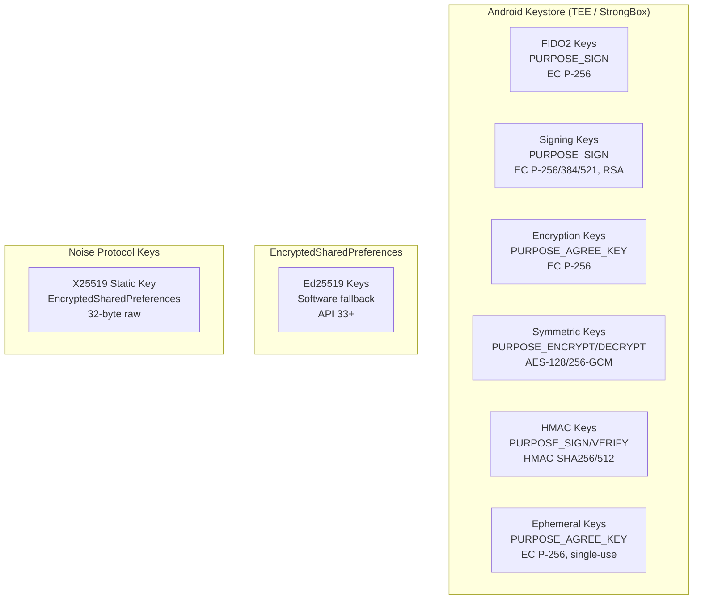
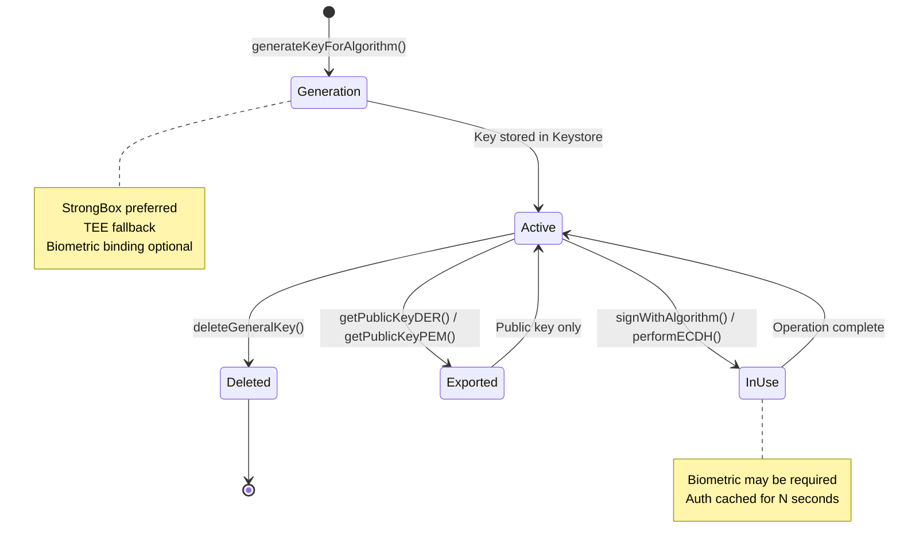
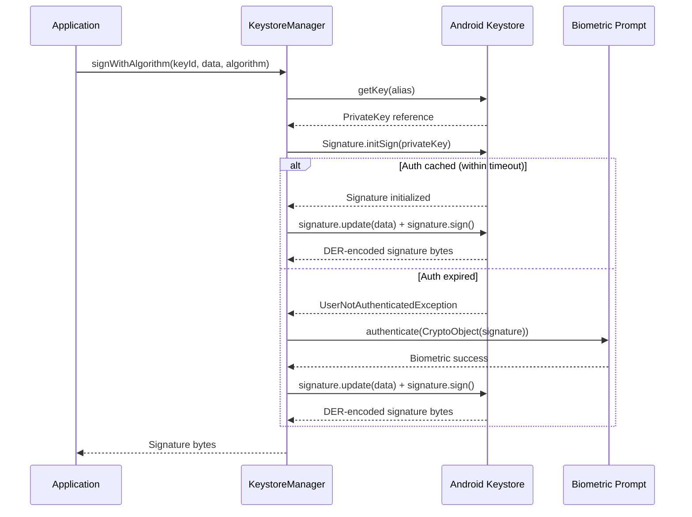
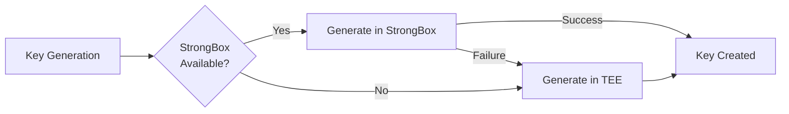
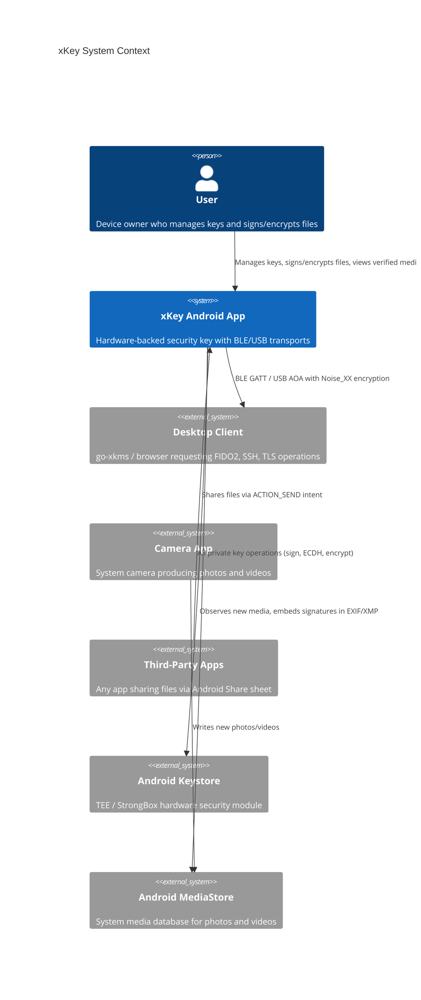
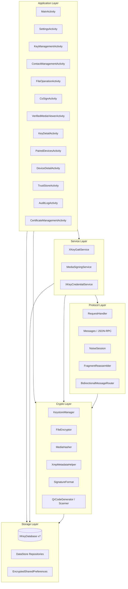
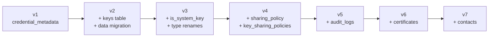

# Hardware-backed keys architecture

> **Status: REFERENCE** · Last verified: 2026-10-09
> As-built description of xKey's hardware-backed key hierarchy and signing flows, and of the application architecture, component map and data model that serve it.

This document describes the hardware-backed cryptography system in xKey, including
the key hierarchy, supported algorithms, key lifecycle, signing flows, and the
ECIES file encryption scheme.

## Design Principle

All asymmetric private key operations execute inside Android Keystore, which
delegates to TEE (Trusted Execution Environment) or StrongBox (dedicated secure
element) hardware. Private keys never leave the secure boundary. Derived
symmetric keys (e.g., from ECDH) are used in software only after the
hardware-protected key agreement step.

## Key Hierarchy



## Supported Algorithms

### Asymmetric Signing

| Algorithm | Curve / Size | JCA Algorithm | Key Purpose |
|-----------|-------------|---------------|-------------|
| ES256 | EC P-256 (secp256r1) | SHA256withECDSA | `PURPOSE_SIGN` |
| ES384 | EC P-384 (secp384r1) | SHA384withECDSA | `PURPOSE_SIGN` |
| ES512 | EC P-521 (secp521r1) | SHA512withECDSA | `PURPOSE_SIGN` |
| RS256 | RSA 2048 | SHA256withRSA | `PURPOSE_SIGN` |
| RS384 | RSA 3072 | SHA384withRSA | `PURPOSE_SIGN` |
| RS512 | RSA 4096 | SHA512withRSA | `PURPOSE_SIGN` |
| Ed25519 | Curve25519 | Ed25519 (JCE) | Software only |

### Symmetric Encryption

| Algorithm | Key Size | Mode | Key Purpose |
|-----------|----------|------|-------------|
| AES-128-GCM | 128-bit | GCM (NoPadding) | `PURPOSE_ENCRYPT \| PURPOSE_DECRYPT` |
| AES-256-GCM | 256-bit | GCM (NoPadding) | `PURPOSE_ENCRYPT \| PURPOSE_DECRYPT` |

### HMAC

| Algorithm | Output Size | Key Purpose |
|-----------|-------------|-------------|
| HMAC-SHA256 | 32 bytes | `PURPOSE_SIGN \| PURPOSE_VERIFY` |
| HMAC-SHA512 | 64 bytes | `PURPOSE_SIGN \| PURPOSE_VERIFY` |

### Key Agreement

| Algorithm | Curve | Key Purpose |
|-----------|-------|-------------|
| ECDH | EC P-256 | `PURPOSE_AGREE_KEY` |

## Key Lifecycle



## Authentication Duration

Keys support three authentication modes controlled by `authDurationSeconds`:

| Value | Behavior |
|-------|----------|
| `< 0` | No authentication required (key always usable) |
| `0` | Per-operation authentication (biometric every time) |
| `> 0` | Authentication cached for N seconds after biometric |

The default is 5 seconds, which prevents double-prompts during rapid sequential
requests (e.g., Chrome conditional UI discovery followed by actual authentication).

## Signing Flow



## Key Purpose Reference

| Key Type | Purpose Flags | Operations |
|----------|---------------|------------|
| FIDO2 credential | `PURPOSE_SIGN` | WebAuthn registration/authentication |
| Signing key | `PURPOSE_SIGN` | File signing, media signing, co-signing |
| Encryption key | `PURPOSE_AGREE_KEY` | ECDH for file encryption/decryption |
| Ephemeral key | `PURPOSE_AGREE_KEY` | Single-use ECDH, deleted after use |
| AES symmetric | `PURPOSE_ENCRYPT \| PURPOSE_DECRYPT` | Direct AES-GCM encryption |
| RSA key | `PURPOSE_SIGN \| PURPOSE_DECRYPT` | Signing and RSA-OAEP decryption |
| HMAC key | `PURPOSE_SIGN \| PURPOSE_VERIFY` | Message authentication codes |

## StrongBox vs TEE

xKey prefers StrongBox when available, falling back to TEE. StrongBox provides
a dedicated secure element isolated from the main processor, offering stronger
protection against physical and side-channel attacks.



Detection is performed via `PackageManager.FEATURE_STRONGBOX_KEYSTORE` on API 28+.

## Ed25519 Software Fallback

Android Keystore does not support Ed25519 keys. When an Ed25519 key is requested
(API 33+), xKey generates it using the JCE `Ed25519` provider and stores the
private key in `EncryptedSharedPreferences` (AES-256-GCM encrypted by a Keystore
master key). This provides at-rest encryption but not the same hardware isolation
as Keystore-backed keys.

## HKDF Key Derivation

File encryption uses HKDF-SHA256 (via Bouncy Castle) to derive the AES-256 key
from the ECDH shared secret:

```
IKM  = ECDH shared secret (32 bytes from P-256)
Salt = random 32 bytes (stored in .xkeyenc header)
Info = "xkey-file-encryption-v1" (UTF-8)
OKM  = 32 bytes (AES-256 key)
```

## Alias Conventions

Keys in Android Keystore use the following alias prefixes:

| Prefix | Usage |
|--------|-------|
| `xkey_credential_` | FIDO2 credential keys |
| `xkey_key_` | General-purpose keys (signing, encryption, HMAC) |
| `xkey_attest_` | Ephemeral attestation keys (deleted after use) |
| `ephemeral_` | Ephemeral ECDH keys for file encryption (deleted after use) |

This document describes the high-level architecture of the xKey Android application,
a hardware-backed security key that provides FIDO2/WebAuthn authentication, file
cryptography, media signing, and multi-party attestation over BLE and USB transports.

## System Context

xKey operates as a security key on an Android device, communicating with desktop
clients over BLE or USB to perform cryptographic operations. All private key
material remains inside Android Keystore (TEE/StrongBox) and never leaves the
secure hardware boundary.



## Layered Architecture

The application is organized into five layers. Each layer depends only on
layers below it.



## Application Layer

All activities use programmatic Material 3 UI built via `PremiumCardFactory`.
There are no traditional XML layout files for the main screens.

| Activity | Purpose |
|----------|---------|
| `MainActivity` | Home screen with BLE toggle, key summary, recent audit activity |
| `SettingsActivity` | Biometric policy, media signing, connectivity, device trust |
| `KeyManagementActivity` | List, create, and delete cryptographic keys |
| `KeyDetailActivity` | View key properties, export public key, manage sharing policy |
| `ContactManagementActivity` | Import, export, and manage recipient public keys |
| `FileOperationActivity` | Sign, verify, encrypt, decrypt files received via Share sheet |
| `CoSignActivity` | Multi-party co-signing via QR or BLE exchange |
| `VerifiedMediaViewerActivity` | Display media with signature verification badges |
| `PairedDevicesActivity` | List paired BLE/USB devices |
| `DeviceDetailActivity` | View device details and attestation status |
| `TrustStoreActivity` | Manage trusted CA certificates |
| `AuditLogActivity` | Browse security audit log |
| `CertificateManagementActivity` | Manage X.509 certificates issued by the local CA |

## Crypto Layer

| Component | Responsibility |
|-----------|---------------|
| `KeystoreManager` | All Android Keystore operations: key generation, signing, ECDH, AES-GCM, HMAC |
| `FileEncryptor` | Hardware-backed ECIES encryption/decryption for `.xkeyenc` files |
| `MediaHasher` | Streaming SHA-256 hash computation via `DigestInputStream` |
| `XmpMetadataHelper` | Read/write `ContentAuthenticityData` in EXIF, XMP, or sidecar files |
| `SignatureFormat` | `ContentAuthenticityData` and `SignatureEntry` data model with JSON serialization |
| `QrCodeGenerator` | QR code bitmap generation via ZXing |
| `QrCodeScannerHelper` | QR scanning via ML Kit + CameraX |

## Storage Layer

### Room Database (XKeyDatabase v7)

SQLite database `xkey_credentials.db` with six entities:

- `keys` -- unified key metadata for all key types
- `credential_metadata` -- legacy FIDO2 credential table
- `key_sharing_policies` -- per-key, per-peer sharing rules
- `audit_logs` -- comprehensive security event log
- `certificates` -- X.509 certificates issued by the local CA
- `contacts` -- recipient public keys for encryption and verification

### DataStore Repositories

Preference-based settings stored via Jetpack DataStore:

| Repository | Settings |
|------------|----------|
| `BiometricSettingsRepository` | Auth mode, UV policy, session duration |
| `BootstrapSettingsRepository` | Auto-bootstrap, bootstrap methods |
| `TrustedComputingSettingsRepository` | IDevID verification, attestation |
| `UsbHsmSettingsRepository` | Native USB, ADB TCP, port config |
| `MediaSigningSettingsRepository` | Auto-sign toggle, key selection, photo/video |
| `CredentialProviderSettingsRepository` | Passkey provider enable/disable |
| `PairedDeviceRepository` | Trusted device records with attestation state |

### EncryptedSharedPreferences

- Noise_XX static key pair (X25519)
- Ed25519 software-backed private keys (Keystore does not support Ed25519)

## Package Structure

```
com.automatethethings.xkey
  /audit          AuditLog, AuditLogger, AuditLogDao, AuditLogEntity
  /auth           BiometricHelper, SessionAuthManager, BiometricActivityLauncher
  /ble            XKeyGattService, GattServer, Advertiser, NoiseSession, FragmentReassembler
  /bootstrap      BootstrapClient, BootstrapSettings
  /ca             AndroidCA, CertificateEntity, CertificateDao, CertificateProfile
  /credential     XKeyCredentialService, CreateCredentialHandler, GetCredentialHandler
  /crypto         KeystoreManager, FileEncryptor, BiometricHelper, CborEncoder
  /keychain       KeychainService, LocalKeychainService, CertificateStore
  /media          MediaSigningService, MediaHasher, XmpMetadataHelper, SignatureFormat
  /protocol       RequestHandler, Messages, AttestationHelper
  /qr             QrCodeGenerator, QrCodeScannerHelper
  /remote         RemoteKeyClient, BidirectionalMessageRouter, RemoteKeySyncManager
  /settings       BiometricSettings, BootstrapSettings, MediaSigningSettings, ...
  /storage        XKeyDatabase, KeyEntity, ContactEntity, CredentialMetadataEntity, ...
  /truststore     TrustStoreRepository, CABundleFetcher, IDevIDVerifier
  /ui             All Activity classes, PremiumCardFactory, UIHelpers
  /usb            UsbAccessoryServer, TcpHsmServer, UsbHsmSettings
  /util           JsonExtensions
```

## Build Configuration

| Property | Value |
|----------|-------|
| `minSdk` | 28 (Android 9 Pie) |
| `targetSdk` | 34 (Android 14) |
| Database | Room v7 (`xkey_credentials.db`) |
| License | AGPL-3.0 / Commercial dual license |
| Package | `com.automatethethings.xkey` |

This document maps how all components in xKey communicate with each other,
including activity-to-service bindings, service-to-crypto calls, database
access patterns, and inter-process communication.

## Full Component Communication Map

```mermaid
graph TB
    subgraph Activities["Activities"]
        MA[MainActivity]
        SA[SettingsActivity]
        KMA[KeyManagementActivity]
        CMA[ContactManagementActivity]
        FOA[FileOperationActivity]
        CSA[CoSignActivity]
        VMA[VerifiedMediaViewerActivity]
        PDA[PairedDevicesActivity]
        ALA[AuditLogActivity]
    end

    subgraph Services["Services"]
        GATT[XKeyGattService]
        MSS[MediaSigningService]
        CRED[XKeyCredentialService]
    end

    subgraph Protocol["Protocol"]
        RH[RequestHandler]
        BMR[BidirectionalMessageRouter]
        NS[NoiseSession]
        FR[FragmentReassembler]
    end

    subgraph Crypto["Crypto"]
        KM[KeystoreManager]
        FE[FileEncryptor]
        MH[MediaHasher]
        XMP[XmpMetadataHelper]
    end

    subgraph Storage["Storage"]
        DB[(XKeyDatabase)]
        DS[DataStore]
        AL[AuditLogger]
    end

    subgraph External["External"]
        KS[Android Keystore]
        MSDB[MediaStore]
        BIO[BiometricPrompt]
    end

    %% Activity -> Service bindings
    MA -->|bindService / startService| GATT
    SA -->|startService / stopService| MSS
    MA -->|observe StateFlow| GATT

    %% Activity -> Crypto
    FOA --> KM
    FOA --> FE
    FOA --> MH
    FOA --> XMP
    CSA --> KM
    CSA --> MH
    VMA --> MH
    VMA --> XMP
    KMA --> KM

    %% Activity -> Storage
    FOA --> DB
    CSA --> DB
    VMA --> DB
    KMA --> DB
    CMA --> DB
    ALA --> DB
    PDA --> DS

    %% Activity -> AuditLogger
    FOA --> AL
    CSA --> AL
    CMA --> AL

    %% Service -> Protocol
    GATT --> RH
    GATT --> BMR
    GATT --> NS
    GATT --> FR

    %% Service -> Crypto
    GATT --> KM
    MSS --> KM
    MSS --> MH
    MSS --> XMP
    CRED --> KM

    %% Service -> Storage
    GATT --> DS
    MSS --> DB
    MSS --> DS
    CRED --> DB

    %% Protocol -> Crypto
    RH --> KM

    %% Crypto -> External
    KM --> KS
    KM --> BIO
    FE --> KM

    %% Service -> External
    MSS --> MSDB

    %% Service -> AuditLogger
    GATT --> AL
    MSS --> AL
    RH --> AL
```



## Service to KeystoreManager

All services access `KeystoreManager` for cryptographic operations:

| Service | Operations Used |
|---------|----------------|
| `XKeyGattService` | `sign()`, `signWithAlgorithm()`, `generateKeyForAlgorithm()`, `deleteKey()`, `getPublicKeyDER()`, `performECDH()`, `symmetricEncrypt()`, `symmetricDecrypt()`, `computeHMAC()` |
| `MediaSigningService` | `signWithAlgorithm()`, `getPublicKeyDER()` |
| `XKeyCredentialService` | `generateKey()`, `sign()`, `getCOSEPublicKey()` |

`KeystoreManager` is instantiated per-service (not shared) since it holds only
a `KeyStore` reference and is lightweight.

## Service to Room Database

| Service | DAOs Used | Operations |
|---------|-----------|------------|
| `XKeyGattService` | `KeyDao` | List keys, get key by ID, update use count |
| `MediaSigningService` | `KeyDao` | Get signing key by ID |
| `XKeyCredentialService` | `CredentialMetadataDao`, `KeyDao` | CRUD for credentials |

The database singleton is obtained via `XKeyDatabase.getInstance(context)`.

## Shared Singletons

| Singleton | Access Pattern | Thread Safety |
|-----------|---------------|---------------|
| `XKeyDatabase` | `getInstance(context)` with `AtomicReference` | Thread-safe (Room) |
| `AuditLogger` | Static methods, `SupervisorJob + Dispatchers.IO` | Async, thread-safe |
| DataStore repositories | Per-component instantiation | Thread-safe (DataStore) |
| `KeystoreManager` | Per-component instantiation | Thread-safe (Keystore is thread-safe) |

> **Status: REFERENCE** · Last verified: 2026-08-10
> As-built description of the xKey Room schema. STALE: the migration table stops at v7; `XKeyDatabase.kt` is at version 11. Read the code for v8-v11.

This document describes the Room database schema, migration history, DataStore
repositories, and indexing strategy used by the xKey Android application.

## Entity-Relationship Diagram

```mermaid
erDiagram
    KeyEntity {
        long id PK
        string key_id UK
        string key_type
        string algorithm
        string label
        blob public_key_der
        blob public_key_cose
        int key_size_bits
        boolean strongbox_backed
        boolean biometric_required
        int auth_duration_seconds
        boolean exportable
        boolean shareable
        string sharing_policy
        string source
        string remote_backend
        long use_count
        long created_at
        long last_used_at
        string rp_id
        string rp_name
        string user_id
        string user_name
        string user_display_name
        boolean is_discoverable
        long sign_count
        boolean is_system_key
    }

    CredentialMetadataEntity {
        long id PK
        string credential_id UK
        string rp_id
        string rp_name
        string user_id
        string user_name
        string user_display_name
        blob public_key_cose
        boolean is_discoverable
        long sign_count
        long created_at
        long last_used_at
    }

    KeySharingPolicy {
        string key_id PK_FK
        string peer_public_key_hex PK
        boolean allowed
        long created_at
    }

    AuditLogEntity {
        long id PK
        long timestamp
        string operation_type
        string key_id
        string key_label
        string key_type
        string device_id
        string device_name
        boolean success
        string error_message
        string details
        long duration_ms
    }

    CertificateEntity {
        long id PK
        string serial_number UK
        string subject_dn
        string issuer_dn
        long not_before
        long not_after
        string profile
        string fingerprint
        string certificate_pem
        string chain_pem
        string key_id
        string device_id
        boolean revoked
        long revoked_at
        int revoked_reason
        boolean is_ca
        long created_at
    }

    ContactEntity {
        long id PK
        string name
        blob public_key_der
        string public_key_fingerprint UK
        string algorithm
        long imported_at
        string source
        string notes
    }

    KeyEntity ||--o{ KeySharingPolicy : "has sharing policies"
    KeyEntity ||--o{ AuditLogEntity : "referenced in audit"
    KeyEntity ||--o{ CertificateEntity : "associated certificate"
    ContactEntity ||--o{ AuditLogEntity : "contact operations logged"
```

## Entity Details

### KeyEntity (`keys`)

Unified key metadata table for all key types managed by xKey. Actual
cryptographic key material remains in Android Keystore; this table stores
metadata, usage tracking, and policy configuration.

**Key types**: `fido2`, `tls`, `signing`, `encryption`, `secret`, `hmac`, `ca`, `attestation`

**Sources**: `local`, `remote_ble`, `remote_usb`, `xkmsd`

**Sharing policies**: `PRIVATE` (default), `ALL_PEERS`, `SELECTED_PEERS`

## Migration History



| Migration | Changes |
|-----------|---------|
| v1 -> v2 | Created unified `keys` table. Migrated `credential_metadata` rows into `keys` with `key_type = 'fido2'`. Added indices on `key_id`, `key_type`, `algorithm`, `source`, `rp_id`. |
| v2 -> v3 | Added `is_system_key` column (default `0`). Renamed `key_type` values: `ssh` -> `signing`, `symmetric` -> `secret`. Marked framework keys as system keys. |
| v3 -> v4 | Added `sharing_policy` column (default `PRIVATE`). Created `key_sharing_policies` table with composite PK and foreign key to `keys.key_id`. Migrated `shareable = true` to `ALL_PEERS`. |
| v4 -> v5 | Created `audit_logs` table with indices on `timestamp`, `operation_type`, `key_id`, `key_type`, `device_id`, `success`. |
| v5 -> v6 | Created `certificates` table with indices on `serial_number` (unique), `profile`, `key_id`, `revoked`, `not_after`, `is_ca`, `fingerprint`. |
| v6 -> v7 | Created `contacts` table with unique index on `public_key_fingerprint` and indices on `name` and `algorithm`. |

## Index Strategy

### keys

| Index | Columns | Unique | Purpose |
|-------|---------|--------|---------|
| `index_keys_key_id` | `key_id` | Yes | Primary lookup by key identifier |
| `index_keys_key_type` | `key_type` | No | Filter by key type (signing, encryption, etc.) |
| `index_keys_algorithm` | `algorithm` | No | Filter by algorithm (ES256, RS256, etc.) |
| `index_keys_source` | `source` | No | Filter by origin (local, remote_ble, etc.) |
| `index_keys_rp_id` | `rp_id` | No | FIDO2 credential lookup by relying party |

## DataStore Repositories

| Repository | File | Key Settings |
|------------|------|--------------|
| `BiometricSettingsRepository` | `biometric_settings` | Auth mode, UV policy, attestation policy, session duration |
| `BootstrapSettingsRepository` | `bootstrap_settings` | Auto-bootstrap enable, bootstrap methods |
| `TrustedComputingSettingsRepository` | `trusted_computing_settings` | IDevID verification, remote attestation |
| `UsbHsmSettingsRepository` | `usb_hsm_settings` | Native USB enable, ADB TCP enable, port config |
| `MediaSigningSettingsRepository` | `media_signing_settings` | Auto-sign enable, signing key ID, photo/video toggles |
| `CredentialProviderSettingsRepository` | `credential_provider_settings` | Passkey provider enable/disable |
| `PairedDeviceRepository` | `paired_devices` | Device name, public key, attestation state, trust level |

## Database Access Pattern

The database uses a singleton pattern with `AtomicReference` and double-checked
locking. DAOs return `Flow<List<T>>` for reactive UI updates where needed
(e.g., `AuditLogDao.observeRecent(5)` for the home screen).

```kotlin
val database = XKeyDatabase.getInstance(context)
val keyDao = database.keyDao()
val contactDao = database.contactDao()
val auditLogDao = database.auditLogDao()
```

## Type Converters

| Converter | Type | Storage |
|-----------|------|---------|
| `AuditOperationTypeConverter` | `AuditOperationType` enum | String (enum name) |

## local.setKeyPolicy

`local.setKeyPolicy` sets whether a key can be shared with peers.

| Param | Type | Meaning |
|-------|------|---------|
| `keyId` | string, required | The key to change |
| `shareable` | boolean, optional | `true` opens the key to every peer (`ALL_PEERS`), `false` makes it `PRIVATE`; absent changes nothing |

The result is `{"updated": true}`.

Widening needs the owner's approval. A request with `shareable: true` on a key
whose policy is not already `ALL_PEERS` would let any paired peer pass the
sharing check in `local.shareSymmetric`, so the phone first requires a
confirmed peer for the session, then shows a biometric prompt that names the
key (its label, else its id). The policy is stored only when the owner
approves. Narrowing (`shareable: false`), an absent `shareable` and a key
already `ALL_PEERS` need no prompt.

Every stored policy change is written to the audit log as
`KEY_SHARING_CHANGED`, with the old and new policy.

| Error | When |
|-------|------|
| `INVALID_PARAMS` | Params or `keyId` missing |
| `KEY_NOT_FOUND` | No key with that `keyId` |
| `OPERATION_DENIED` | Widening on a session with no confirmed peer |
| `BIOMETRIC_FAILED` | Widening with no biometric prompt available, or the owner cancels or fails it; the stored policy is unchanged |
