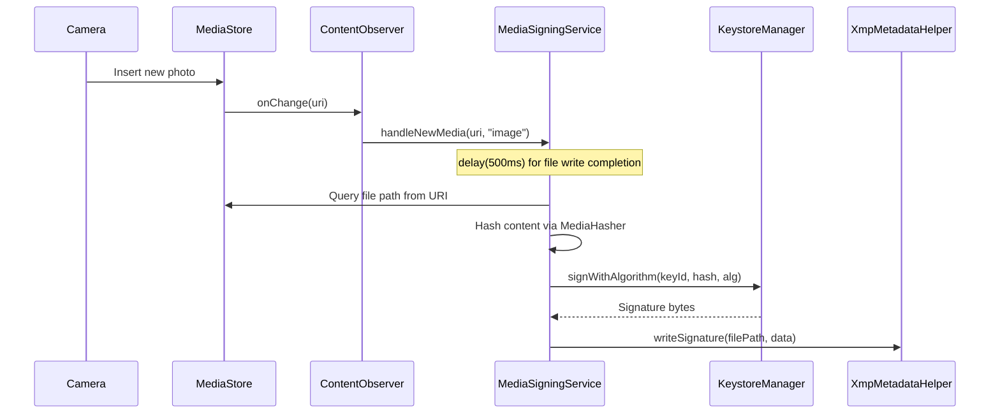
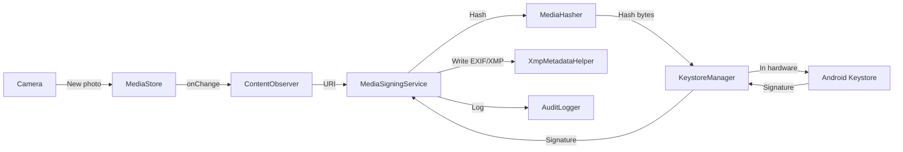
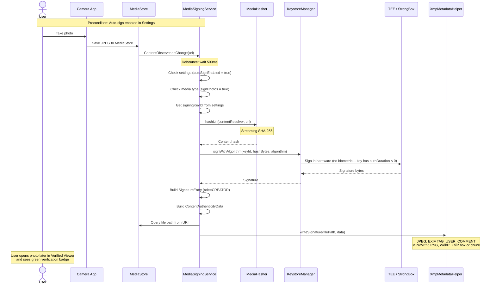

# Media signing architecture

> **Status: REFERENCE** · Last verified: 2026-11-12
> As-built description of how `MediaSigningService` fits into xKey and the auto-sign flow.

## Service Layer

### MediaSigningService

Foreground service that monitors `MediaStore` via `ContentObserver` for new
photos and videos. When new media is detected, it computes a SHA-256 hash,
signs it with the configured key via `KeystoreManager.signWithAlgorithm()`,
and embeds the signature in the file using `XmpMetadataHelper`: EXIF
`UserComment` for JPEG, an XMP box or chunk for MP4/MOV, PNG and WebP
(`XmpContainers`). HEIC, MKV, unknown types, a file the embed refuses and one
above the embed bound (`XmpMetadataHelper.maxEmbedBytes`, hashed by streaming)
get a `<name>.xkeysig` sidecar, and readers fall back to a sidecar, so files
signed before embedding still verify. Embedded writes go through a unique,
exclusively created staging file, serialized per path. See
[engineering.md](engineering.md#mp4--mov-png-webp-embedded-xmp).

- Foreground service type: `dataSync`
- Notification channel: `media_signing_channel`
- Controlled by `MediaSigningSettings.autoSignEnabled`

## Activity to Service Communication

### SettingsActivity to MediaSigningService

| Mechanism | Direction | Purpose |
|-----------|-----------|---------|
| `startForegroundService()` | Activity -> Service | Start auto-signing |
| `stopService()` | Activity -> Service | Stop auto-signing |
| `MediaSigningSettingsRepository` | Shared | Settings read by both |

## MediaSigningService to ContentObserver

## Data Flow: Auto-Sign Media

## Auto-Sign a Photo

The user takes a photo with the system camera. The `MediaSigningService`
detects the new media and automatically signs it in the background.

