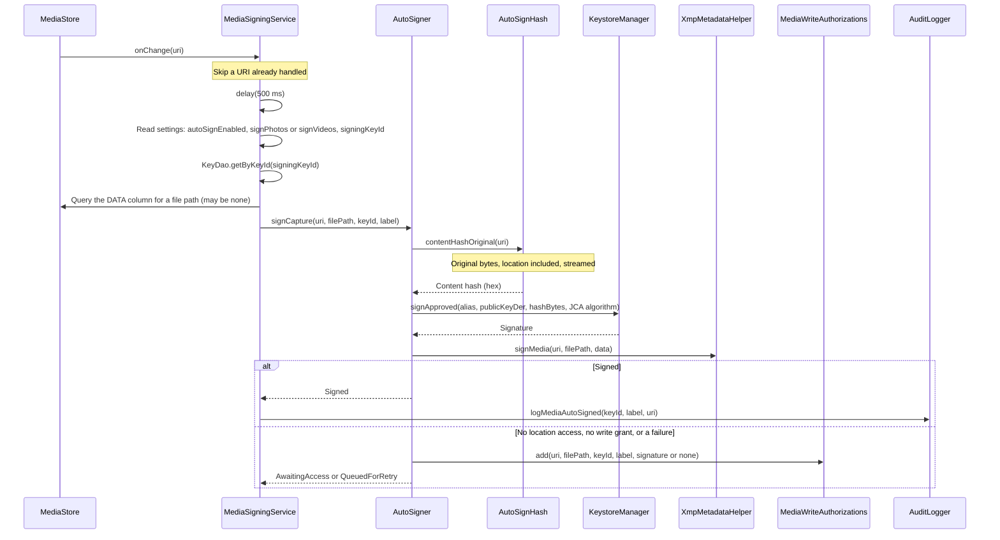

# Media signing architecture

> **Status: REFERENCE** · Last verified: 2026-11-25
> How `MediaSigningService` signs new photos and videos as they appear in `MediaStore`.

## Parts

| Part | Where | Job |
|------|-------|-----|
| `MediaSigningService` | `media/` | Foreground service that watches `MediaStore` and signs new items |
| `AutoSigner` | `media/MediaSigningService.kt` | Hashes, signs and writes one capture, or queues it |
| `AutoSignHash` | `media/MediaSigningService.kt` | The content hash the service signs, over the original, with a size limit for JPEG |
| `MediaHasher` | `media/` | Streamed SHA-256 hashes and the one JPEG check (`isJpeg`) |
| `MediaPublisher` | `media/` | Original and cancellable reads of user content, granted writes |
| `KeystoreManager.signApproved` | `crypto/` | Signs under the general key alias, checking the public key first |
| `XmpMetadataHelper.signMedia` | `media/` | EXIF for JPEG, embedded XMP for MP4/MOV/PNG/WebP, a sidecar otherwise |
| `MediaWriteAuthorizations` | `media/` | The queue of captures waiting for access or a retry |
| `MediaSigningSettingsRepository` | `settings/MediaSigningSettings.kt` | DataStore settings read by the service and the settings screen |
| `AuditLogger` | `audit/` | `MEDIA_AUTO_SIGNED` on success, a failed key use when a JPEG is too large |

## Starting and stopping

The "Auto-Sign Media" switch in the Media Signing section of `SettingsActivity`
saves `autoSignEnabled` and then starts the service with
`startForegroundService` or stops it with `stopService`. Nothing else starts
the service: there is no boot receiver for it, so after a reboot it stays off
until the switch is turned on again, even though the setting is still on.

On each `onStartCommand` the service:

1. Calls `startForeground` with type `dataSync` (passed explicitly on API 34
   and later).
2. Releases any wake lock and content observers left from an earlier start,
   so a second start does not leave two sets of observers.
3. Takes a partial wake lock with a 10-minute limit. It is not renewed.
4. Registers content observers on `MediaStore.Images.Media.EXTERNAL_CONTENT_URI`
   and `MediaStore.Video.Media.EXTERNAL_CONTENT_URI`, including descendants.
5. Returns `START_STICKY`.

`onDestroy` unregisters the observers, releases the wake lock and cancels
every signing job still running.

## Signing one item

The service returns without signing, and without an audit entry, when:

- auto-sign is off, or the item's type (photo or video) is switched off;
- no signing key is set, or the key's row is gone.

A capture is signed through its content URI, so it needs no file path.
`AutoSigner.signCapture` queues it in `MediaWriteAuthorizations` instead of
signing it when:

- its original cannot be read yet (no `ACCESS_MEDIA_LOCATION`). It is queued
  unsigned and nothing is hashed;
- another app (the camera) owns it and xKey has no write grant. It is queued
  with its signature, and the user is asked for write access;
- hashing, signing or writing fails (a busy keystore or provider, memory
  running out). It is queued unsigned for a retry.

The queue is the only retry. It hashes and signs a queued capture again from
its original, and it publishes a kept signature only if the media still has
that content hash. The service marks each handled URI as done, so a later
change event for it starts no second job.

A JPEG over 32 MiB is refused. The service logs a failed `media_auto_sign`
key use in the audit log and marks the URI as done.

The key signs with no prompt. `signApproved` checks that the public key under
the alias is the one it just read and holds the alias gate while it signs;
see [co-signing](../co-signing/architecture.md). A key that needs user
authentication for each use cannot sign from the background, so such a key
leaves new media unsigned.

## Reading user content

Reads of user content go through `MediaPublisher`. `openOriginal` reads the
original bytes of a `MediaStore` item, never its location-redacted view.
`openContentRead` is the one cancellable read: it opens an asset descriptor
(`openAssetFileDescriptor` with the `CancellationSignal`). A provider that
serves part of a file is then read from that part's start offset, for its
declared length.

One JPEG check is used everywhere: `MediaHasher.isJpeg`. Content counts as a
JPEG when its MIME type says so. It also counts when its type is missing or
`application/octet-stream` and its first bytes are `FF D8 FF`. The signer's
hash, the path writer, the in-band reads and the file screens all use this
check, so they agree on which hash and which storage a file gets.

## Where the signature goes

| Content | Storage |
|---------|---------|
| JPEG | EXIF `UserComment` = `XKEY_SIG:` + JSON |
| MP4, MOV, PNG, WebP | An embedded XMP packet (box or chunk), written streaming at any size |
| HEIC, MKV, other types, or a container that refuses the packet | A `.xkeysig` JSON sidecar |

Media xKey owns is written by path. The write holds a lock for that path and
goes through a staging file that is created exclusively.

Media another app owns is written only through its content URI, and only
after the user grants write access. xKey copies the original out, checks it
against the signed content hash, signs it and writes it back. Its sidecar is a
file xKey owns under `Documents/xKey/`, never one beside the capture, because
the grant does not cover that.

Readers fall back to the legacy sidecar beside the file, so media signed
before embedding still verifies.

The content hash stays valid after the write:

- JPEG: the canonical hash, which leaves out the `APPn` and `COM` segments.
- MP4, MOV, PNG and WebP: the hash leaves out xKey's XMP packet.
- Anything else: the whole-file hash, which a sidecar leaves untouched.
