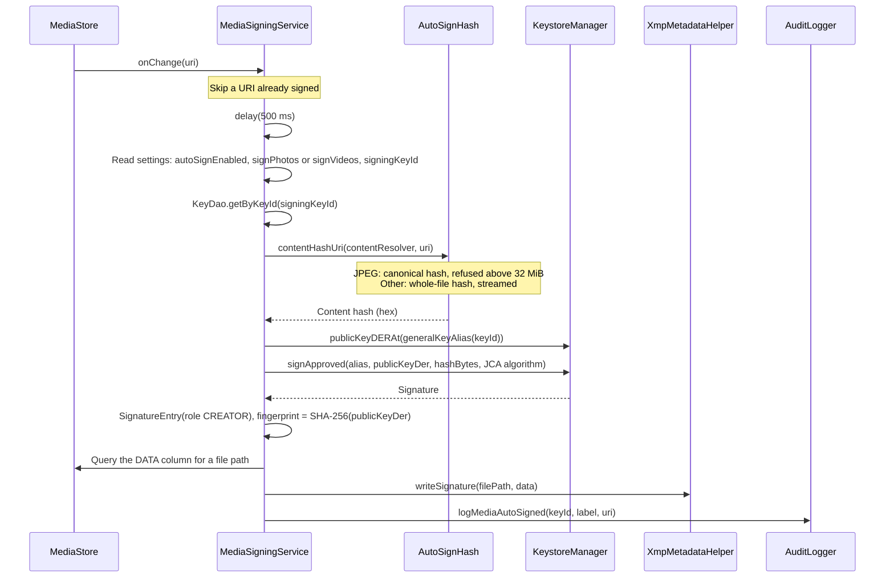

# Media signing architecture

> **Status: REFERENCE** · Last verified: 2026-11-23
> How `MediaSigningService` signs new photos and videos as they appear in `MediaStore`.

## Parts

| Part | Where | Job |
|------|-------|-----|
| `MediaSigningService` | `media/` | Foreground service that watches `MediaStore` and signs new items |
| `AutoSignHash` | `media/MediaSigningService.kt` | The content hash the service signs, with a size limit for JPEG |
| `MediaHasher` | `media/` | SHA-256 hashes: canonical for JPEG, whole-file for anything else |
| `KeystoreManager.signApproved` | `crypto/` | Signs under the general key alias, checking the public key first |
| `XmpMetadataHelper.writeSignature` | `media/` | EXIF `UserComment` for a JPEG, a `<path>.xkeysig` sidecar for anything else |
| `MediaSigningSettingsRepository` | `settings/MediaSigningSettings.kt` | DataStore settings read by the service and the settings screen |
| `AuditLogger` | `audit/` | `MEDIA_AUTO_SIGNED` on success, a failed key use when a JPEG is too large |

## Starting and stopping

The "Auto-Sign Media" switch in the Media Signing section of `SettingsActivity`
saves `autoSignEnabled` and then starts the service with
`startForegroundService` or stops it with `stopService`. Nothing else starts
the service: there is no boot receiver for it, so after a reboot it stays off
until the switch is turned on again, even though the setting is still on.

On each `onStartCommand` the service:

1. Calls `startForeground` with type `dataSync` (passed explicitly on API 34
   and later).
2. Releases any wake lock and content observers left from an earlier start,
   so a second start does not leave two sets of observers.
3. Takes a partial wake lock with a 10-minute limit. It is not renewed.
4. Registers content observers on `MediaStore.Images.Media.EXTERNAL_CONTENT_URI`
   and `MediaStore.Video.Media.EXTERNAL_CONTENT_URI`, including descendants.
5. Returns `START_STICKY`.

`onDestroy` unregisters the observers, releases the wake lock and cancels
every signing job still running.

## Signing one item

The service returns without signing, and without an audit entry, when:

- auto-sign is off, or the item's type (photo or video) is switched off;
- no signing key is set, or the key's row is gone;
- `MediaStore` gives no file path for the URI. The URI is not marked as
  done, so a later change event for it tries again.

A JPEG over 32 MiB is refused. The service logs a failed
`media_auto_sign` key use in the audit log and marks the URI as done. Any
other exception, a missing Keystore key included, is written to logcat and
the item stays unsigned.

The key signs with no prompt. `signApproved` checks that the public key under
the alias is the one it just read and holds the alias gate while it signs;
see [co-signing](../co-signing/architecture.md). A key that needs user
authentication for each use cannot sign from the background, so such a key
leaves new media unsigned.

## Where the signature goes

`XmpMetadataHelper.writeSignature` picks the storage from the file path's
extension:

| Extension | Storage |
|-----------|---------|
| `.jpg`, `.jpeg` | EXIF `UserComment` = `XKEY_SIG:` + JSON, written with `ExifInterface.saveAttributes` |
| Anything else (PNG, WebP, HEIC, MP4, MOV, MKV and others) | A `<path>.xkeysig` JSON file next to the media |

The hash the service stores is the one each place can be checked against
later. For a JPEG it is the canonical hash, which skips the `APPn` and `COM`
segments, so writing the EXIF block does not change it. For anything else it
is the whole-file hash, which the sidecar leaves untouched.

Both are written through a plain file path, so the service needs write access
to the file the camera app created.
