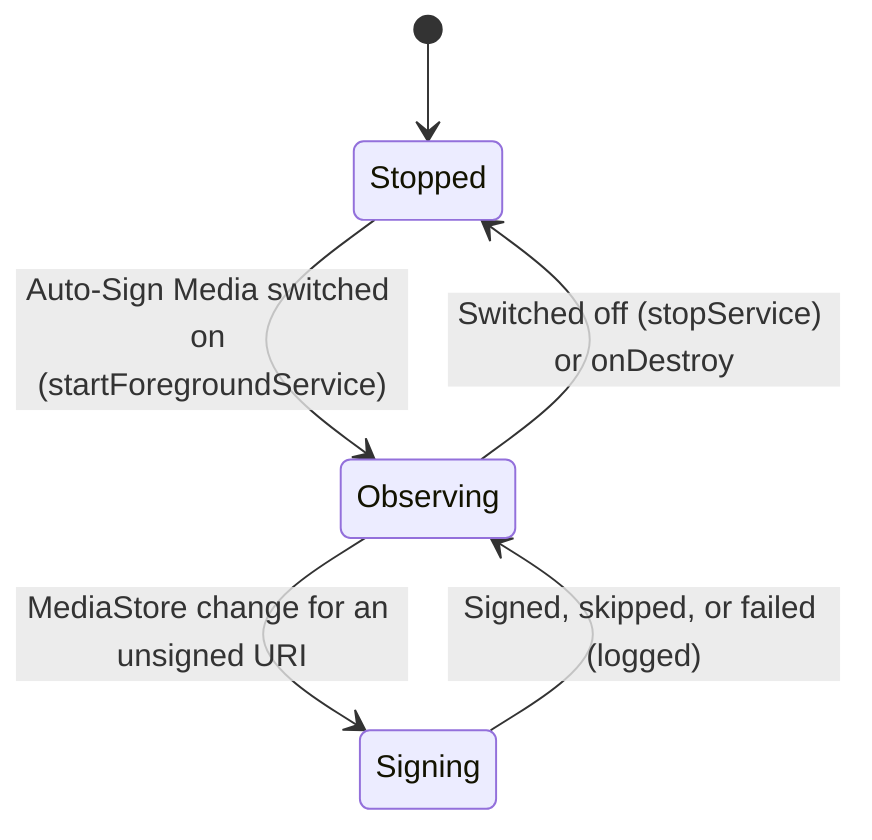

# Media auto-signing

> **Status: REFERENCE** · Last verified: 2026-11-23
> Engineering reference for `MediaSigningService`: lifecycle, hashing, storage format, settings, manifest entries and limits.

The flow is in [architecture.md](architecture.md).

## Lifecycle



The service uses `CoroutineScope(SupervisorJob() + Dispatchers.IO)`. Each
change event starts its own job, so several captures in a burst are hashed
and signed at the same time. `onDestroy` cancels all of them.

## Change events

| Detail | Value |
|--------|-------|
| Observed URIs | `MediaStore.Images.Media.EXTERNAL_CONTENT_URI`, `MediaStore.Video.Media.EXTERNAL_CONTENT_URI`, with descendants |
| Wait before hashing | 500 ms (`SIGN_DELAY_MS`), so the camera can finish writing |
| Duplicate guard | `processedUris`, a concurrent in-memory set of URI strings |
| Set size | When it passes 1000 entries, 500 are removed in iteration order. The set is hash-based, so these are not the oldest |

The set lives in memory only. A restarted service can sign a URI again if
`MediaStore` reports a change for it.

## Hashing

`AutoSignHash.contentHashUri` takes the MIME type from the content resolver:

| MIME type | Hash |
|-----------|------|
| `image/jpeg` or `image/jpg` | `MediaHasher.hashCanonical`: SHA-256 with the `APPn` and `COM` segments left out. The file is read into memory, up to 32 MiB (`MAX_CANONICAL_JPEG_BYTES`); a larger one throws `TooLargeException` |
| Anything else | `MediaHasher.hashUri`: SHA-256 of the whole file, streamed |

The service turns the hex hash into bytes and signs those bytes with the JCA
algorithm for the key (`KeystoreManager.jcaSignatureAlgorithm`), so the
signature covers the SHA-256 of the content hash. Verification in the app
does the same.

## Signature block

The service writes one `ContentAuthenticityData` with one entry:

```json
{
    "version": 1,
    "contentHash": "e3b0c44298fc1c149afbf4c8996fb92427ae41e4649b934ca495991b7852b855",
    "hashAlgorithm": "SHA-256",
    "signatures": [
        {
            "keyFingerprint": "a1b2c3d4e5f67890abcdef1234567890abcdef1234567890abcdef1234567890",
            "signerName": "Camera key",
            "algorithm": "ES256",
            "value": "MEUCIQDxE9vVU3r7KnYm+B8r8r5w...",
            "timestamp": "2026-11-23T14:30:00Z",
            "role": "CREATOR"
        }
    ]
}
```

| Field | Value from the service |
|-------|------------------------|
| `contentHash` | The hash above, in hex |
| `keyFingerprint` | SHA-256 of the public key DER under the general key alias |
| `signerName` | The key's label |
| `algorithm` | The key's algorithm from its `KeyDao` row |
| `value` | Base64 signature, no line wrap |
| `timestamp` | `Instant.now()` in ISO 8601 |
| `role` | `CREATOR` |

The full field list is in
[file operations](../file-operations/engineering.md#xkeysig-json-format).
Co-signatures added later go in the same `signatures` array; see
[co-signing](../co-signing/engineering.md).

## Storage

`XmpMetadataHelper` decides by the file path's extension, not by MIME type.

| Extension | Write | Read (`readSignature`) |
|-----------|-------|------------------------|
| `.jpg`, `.jpeg` | `ExifInterface` `TAG_USER_COMMENT` = `XKEY_SIG:` + JSON, then `saveAttributes()` | EXIF first, then the sidecar |
| Anything else | `<path>.xkeysig`, the JSON alone | Sidecar only |

`readSignatureFromUri` reads only the EXIF block of a JPEG. It never looks
for a sidecar, because a content URI has no path to put `.xkeysig` after.
The [viewer](../verified-media-viewer/architecture.md#finding-the-signature-block)
looks for the sidecar itself, which works only for a `file://` URI or a
document URI. File operations ask the user to pick the `.xkeysig` file.

The `XKEY_SIG:` prefix marks the comment as xKey's. A comment without it is
ignored, and writing a signature replaces whatever comment the photo had.

## Settings

`MediaSigningSettingsRepository` stores these in the DataStore file
`media_signing_settings`:

| Setting | Key | Default |
|---------|-----|---------|
| `autoSignEnabled` | `auto_sign_enabled` | `false` |
| `signingKeyId` | `signing_key_id` | none |
| `signPhotos` | `sign_photos` | `true` |
| `signVideos` | `sign_videos` | `true` |

Turning `autoSignEnabled` on or off writes a settings-changed audit entry
(`mediaAutoSign`). The other three are saved without one.

The settings screen section, built in `SettingsActivity`, has the Auto-Sign
Media switch, a Signing Key spinner, and Sign Photos and Sign Videos
switches. The spinner and the two switches show only while auto-sign is on.
The spinner lists keys whose type is `signing` or `fido2`. A FIDO2 credential
is stored under its credential alias, not the general key alias the service
signs with, so choosing one leaves every new item unsigned.

## Manifest entries

```xml
<uses-permission android:name="android.permission.READ_MEDIA_IMAGES" />
<uses-permission android:name="android.permission.READ_MEDIA_VIDEO" />
<uses-permission android:name="android.permission.READ_EXTERNAL_STORAGE"
    android:maxSdkVersion="32" />
<uses-permission android:name="android.permission.FOREGROUND_SERVICE_DATA_SYNC" />

<service
    android:name=".media.MediaSigningService"
    android:foregroundServiceType="dataSync"
    android:exported="false" />
```

The app declares the media permissions but has no code that asks the user for
them at run time.

## Notification

| Property | Value |
|----------|-------|
| Notification ID | 2002 |
| Channel ID | `media_signing_channel` |
| Channel name | "xKey Media Signing" |
| Channel importance | Low |
| Title | "Media Signing Active" |
| Text | "Auto-signing new photos and videos" |
| Ongoing | Yes |
| Tap | Opens the app's launcher activity |

## Audit events

| Event | When |
|-------|------|
| `MEDIA_AUTO_SIGNED` (`logMediaAutoSigned(keyId, label, uri)`) | After the signature is written |
| Failed key use, operation `media_auto_sign` (`logKeyUsed`) | A JPEG is over 32 MiB |
| Settings changed, `mediaAutoSign` | The Auto-Sign Media switch changes |
