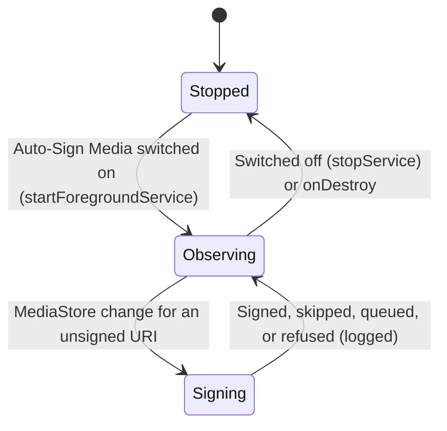

# Media auto-signing

> **Status: REFERENCE** · Last verified: 2026-11-25
> Engineering reference for `MediaSigningService`: lifecycle, hashing, storage format, settings, manifest entries and limits.

The flow is in [architecture.md](architecture.md).

## Lifecycle



The service uses `CoroutineScope(SupervisorJob() + Dispatchers.IO)`. Every
signing job starts through one gate (`MediaJobGate.forSigning`). The gate runs
at most one job per URI at a time and bounds the memory of all the jobs
together. Several captures in a burst can still sign at the same time.
`onDestroy` cancels all of them.

## Change events

| Detail | Value |
|--------|-------|
| Observed URIs | `MediaStore.Images.Media.EXTERNAL_CONTENT_URI`, `MediaStore.Video.Media.EXTERNAL_CONTENT_URI`, with descendants |
| Wait before hashing | 500 ms (`SIGN_DELAY_MS`), so the camera can finish writing |
| Duplicate guard | `processedUris`, a thread-safe `RecentUris` of handled URIs: signed, queued or refused |
| Set size | 1000 (`RecentUris.DEFAULT_BOUND`); past that, the least recently added URI is dropped |

The set lives in memory only. A restarted service can handle a URI again if
`MediaStore` reports a change for it. An exception outside `signCapture`
leaves the URI unmarked, so a later change event tries again.

## Retry queue

`AutoSigner.signCapture` returns `Signed`, `AwaitingAccess` or
`QueuedForRetry`. Only a JPEG that is too large throws
(`AutoSignHash.TooLargeException`). Every queued capture becomes a
`PendingMediaWrite` in `MediaWriteAuthorizations`, and the user is notified
(`notifyPending`):

| Cause | Queued with |
|-------|-------------|
| No location access, so the original cannot be read | No signature |
| Another app owns the capture and xKey has no write grant | The signature |
| A failure to hash, sign or write, including `OutOfMemoryError` | No signature |

An entry without a signature is hashed and signed again from its original
when the queue runs it. Before a kept signature is written, the writer checks
that the media still has its content hash; if the media changed it throws
`SourceChangedException` and publishes nothing.

## Hashing

`AutoSignHash.contentHashOriginal` hashes the original of a `MediaStore` item
(`MediaPublisher.openOriginal`), never the location-redacted view. If a
granted write of the capture was interrupted, it puts that write back first
(`MediaPublisher.recoverInterruptedWrite`), so it never hashes part-written
bytes. `contentHashOf` opens the item once and reads its head to pick the
type:

| Content | Hash |
|---------|------|
| JPEG: `image/jpeg` or `image/jpg`, or no type / `application/octet-stream` with an `FF D8 FF` head (`MediaHasher.isJpeg`) | Canonical SHA-256 with the `APPn` and `COM` segments left out, streamed from a private snapshot. Above 32 MiB (`MAX_CANONICAL_JPEG_BYTES`) it throws `TooLargeException`, because the writer holds a JPEG in memory to embed |
| MP4, MOV, PNG, WebP (`XmpContainers.formatOf`) | Canonical SHA-256 without xKey's XMP packet, streamed from a private snapshot |
| Anything else | SHA-256 of the whole file, streamed in one read |

No capture is held in memory to hash it. The size check and the hash read the
same snapshot, never two reads of media that could change between them.
`AutoSignHash.contentHashFile` computes the same hash over a file that is
already copied out; co-signing uses it.

The signer turns the hex hash into bytes and signs those bytes with the JCA
algorithm for the key (`KeystoreManager.jcaSignatureAlgorithm`). That
algorithm hashes the content-hash bytes again with its own digest before
signing: SHA-256 for ES256 and RS256, SHA-384 for ES384 and RS384, SHA-512 for
ES512 and RS512. No other algorithm signs; an Ed25519 key is refused.
Verification in the app (`SignatureVerifier`) uses the same mapping.

## Signature block

The service writes one `ContentAuthenticityData` with one entry:

```json
{
    "version": 1,
    "contentHash": "e3b0c44298fc1c149afbf4c8996fb92427ae41e4649b934ca495991b7852b855",
    "hashAlgorithm": "SHA-256",
    "signatures": [
        {
            "keyFingerprint": "a1b2c3d4e5f67890abcdef1234567890abcdef1234567890abcdef1234567890",
            "signerName": "Camera key",
            "algorithm": "ES256",
            "value": "MEUCIQDxE9vVU3r7KnYm+B8r8r5w...",
            "timestamp": "2026-11-23T14:30:00Z",
            "role": "CREATOR"
        }
    ]
}
```

| Field | Value from the service |
|-------|------------------------|
| `contentHash` | The hash above, in hex |
| `keyFingerprint` | SHA-256 of the public key DER under the general key alias |
| `signerName` | The key's label |
| `algorithm` | The key's algorithm from its `KeyDao` row |
| `value` | Base64 signature, no line wrap |
| `timestamp` | `Instant.now()` in ISO 8601 |
| `role` | `CREATOR` |

The full field list is in
[file operations](../file-operations/engineering.md#xkeysig-json-format).
Co-signatures added later go in the same `signatures` array; see
[co-signing](../co-signing/engineering.md).

## Storage

`XmpMetadataHelper.signMedia` is the auto-signer's only write. It picks the
storage by content type, using the same JPEG check as the hash:

| Content | Write |
|---------|-------|
| JPEG | `ExifInterface` `TAG_USER_COMMENT` = `XKEY_SIG:` + JSON |
| MP4, MOV, PNG, WebP | An XMP packet in a box or chunk (`XmpContainers`), written streaming at any size |
| HEIC, MKV, other types, or a container that refuses the packet | A `.xkeysig` sidecar, the JSON alone |

| Who owns the media | How it is written |
|--------------------|-------------------|
| xKey, with a file path | By path, under a per-path lock, through a staging file that is created exclusively. A sidecar goes beside the file |
| Another app, with a write grant | The original is copied to a staging file and checked against the signed hash, then the signature is added and the file is written back through its URI (`MediaPublisher.writeGranted`). A sidecar is a file xKey owns under `Documents/xKey/` |
| Another app, no grant | Nothing is written: `NeedsWriteAuthorization`, and the capture is queued |

Readers look for the signature in the media first, then in a sidecar.
`readSidecar` reads the owned sidecar under `Documents/xKey/` when there is
one, otherwise the legacy one beside the file, so media signed before
embedding still verifies. `readSignatureFromUri` reads an in-band signature
only (EXIF or XMP): a content URI has no sidecar beside it. App code reads
source media through its Context overload, which reads the original.

The `XKEY_SIG:` prefix marks the comment as xKey's. A comment without it is
ignored, and writing a signature replaces whatever comment the photo had.

## Settings

`MediaSigningSettingsRepository` stores these in the DataStore file
`media_signing_settings`:

| Setting | Key | Default |
|---------|-----|---------|
| `autoSignEnabled` | `auto_sign_enabled` | `false` |
| `signingKeyId` | `signing_key_id` | none |
| `signPhotos` | `sign_photos` | `true` |
| `signVideos` | `sign_videos` | `true` |

Turning `autoSignEnabled` on or off writes a settings-changed audit entry
(`mediaAutoSign`). The other three are saved without one.

The settings screen section, built in `SettingsActivity`, has the Auto-Sign
Media switch, a Signing Key spinner, and Sign Photos and Sign Videos
switches. The spinner and the two switches show only while auto-sign is on.
The spinner lists keys whose type is `signing` or `fido2`. A FIDO2 credential
is stored under its credential alias, not the general key alias the service
signs with, so choosing one leaves every new item unsigned.

## Manifest entries

```xml
<uses-permission android:name="android.permission.READ_MEDIA_IMAGES" />
<uses-permission android:name="android.permission.READ_MEDIA_VIDEO" />
<uses-permission android:name="android.permission.ACCESS_MEDIA_LOCATION" />
<uses-permission android:name="android.permission.READ_EXTERNAL_STORAGE"
    android:maxSdkVersion="32" />
<uses-permission android:name="android.permission.FOREGROUND_SERVICE_DATA_SYNC" />

<service
    android:name=".media.MediaSigningService"
    android:foregroundServiceType="dataSync"
    android:exported="false" />
```

`MediaLocationAccess` asks for `ACCESS_MEDIA_LOCATION`, without which no
original can be read and a capture waits in the queue. Turning auto-signing
on asks for `POST_NOTIFICATIONS`, which the queue's write-access notification
needs. If that is refused, the settings entry is still a way to reach the
queue.

## Notification

| Property | Value |
|----------|-------|
| Notification ID | 2002 |
| Channel ID | `media_signing_channel` |
| Channel name | "xKey Media Signing" |
| Channel importance | Low |
| Title | "Media Signing Active" |
| Text | "Auto-signing new photos and videos" |
| Ongoing | Yes |
| Tap | Opens the app's launcher activity |

## Audit events

| Event | When |
|-------|------|
| `MEDIA_AUTO_SIGNED` (`logMediaAutoSigned(keyId, label, uri)`) | After the signature is written |
| Failed key use, operation `media_auto_sign` (`logKeyUsed`) | A JPEG is over 32 MiB |
| Settings changed, `mediaAutoSign` | The Auto-Sign Media switch changes |
