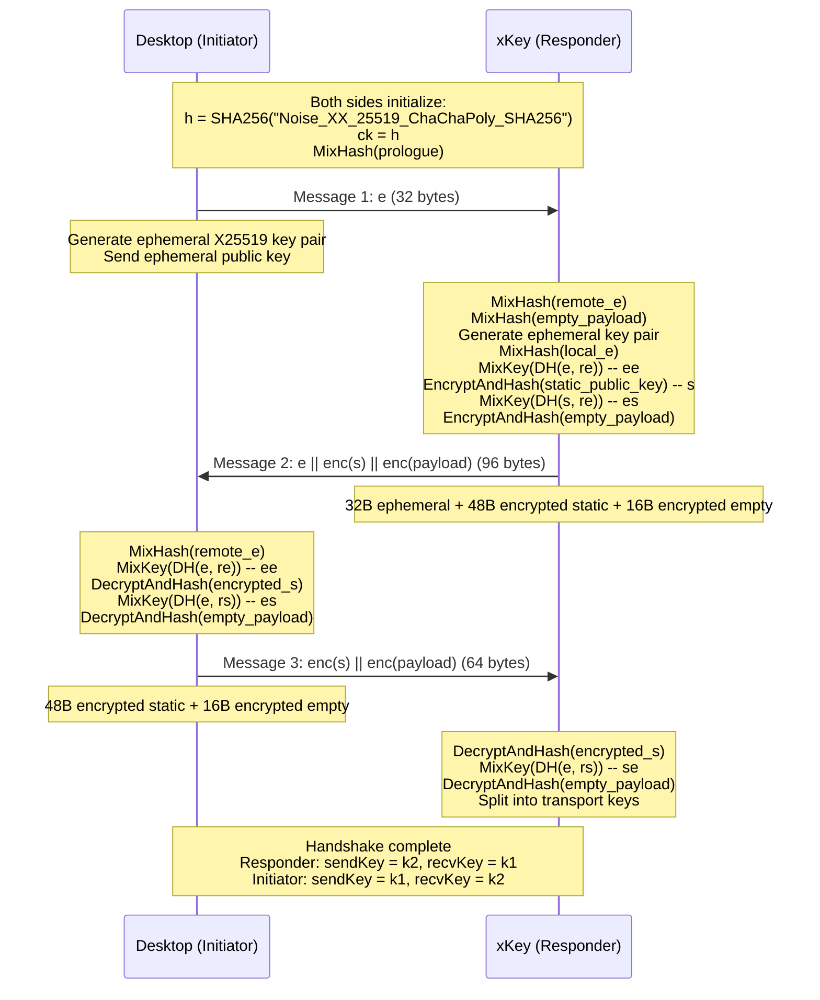
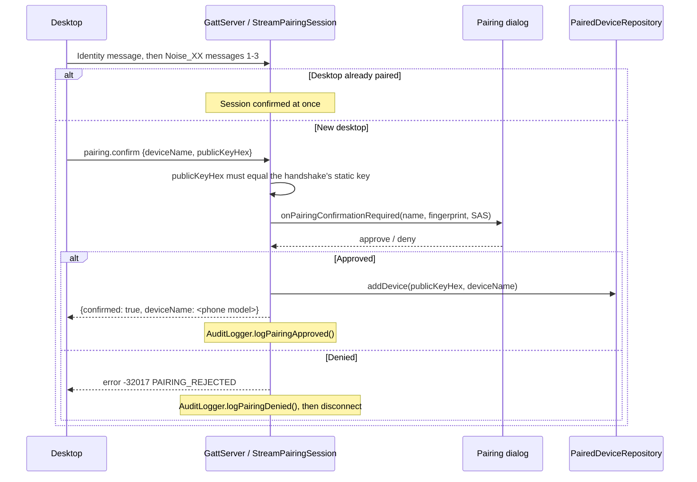

# Noise pairing architecture

> **Status: REFERENCE** · Last verified: 2026-11-23
> How xKey runs the Noise_XX handshake, frames its JSON-RPC messages and pairs with a desktop. The wire contract lives in `go-xkms/xkey/pkg/pairing`.

The same responder code runs on every transport. BLE drives it from
`ble/GattServer.kt`; USB and TCP drive it from
`transport/StreamPairingSession.kt`. Both use `ble/NoiseSession.kt` for the
cryptography and `protocol/Handler.kt` (`RequestHandler`) for the methods.
Paths in this document are relative to
`app/src/main/kotlin/com/automatethethings/xkey/`.

## Identity exchange

Before the handshake the desktop sends a 33-byte identity message: a version
byte `0x01` followed by its 32-byte X25519 static public key. The phone looks
the key up in `PairedDeviceRepository`.

- If the desktop is paired and the record holds a 32-byte `deviceFingerprint`
  (the SHA-256 of the phone's own attested leaf SPKI, captured at pairing),
  the phone answers `0x01` followed by that fingerprint. Both sides then set
  the Noise prologue to
  `SHA256(desktop_public_key || fingerprint || "xkey-v1")`.
- Otherwise the phone answers the single byte `0x00` and the prologue stays
  empty.

A first message that is not 33 bytes, or does not start with `0x01`, is
treated as handshake message 1 with an empty prologue. Older desktops that
skip the identity step still connect.

## Handshake

xKey is the Noise responder; the desktop is the initiator. The protocol name
is `Noise_XX_25519_ChaChaPoly_SHA256`:

| Component | Algorithm |
|-----------|-----------|
| Key exchange | X25519 |
| AEAD | ChaCha20-Poly1305 |
| Hash | SHA-256 |
| Pattern | XX (both static keys travel encrypted) |



### Static key storage

The phone generates its X25519 static key pair once and keeps it in the
`EncryptedSharedPreferences` file `xkey_noise_keys` (values AES-256-GCM,
names AES-256-SIV, under an Android Keystore master key). The private and
public keys are stored as base64 of the raw 32 bytes. `NoiseSession` also
reads an older PKCS#8 / X.509 encoding and strips it to the raw key. The
desktop keeps its own static key; go-xkms decides where.

### Transport encryption

After message 3 every frame is ChaCha20-Poly1305 under the split keys. The
responder sends with `k2` and receives with `k1`.

Each direction has its own 64-bit counter starting at 0. The 96-bit nonce is
four zero bytes followed by the counter in little-endian:

```
[4 bytes: 0x00000000] [8 bytes: little-endian counter]
```

As in the Noise framework's DecryptWithAd, the receive counter moves only
when a frame decrypts. A frame that fails authentication is dropped and the
next genuine frame still decrypts. The counter value 2^64-1 is reserved: a
session whose send or receive counter reaches it throws `NoiseException`
instead of encrypting or decrypting.

## Pairing confirmation

A completed handshake proves the desktop holds its static key. It does not
make the desktop trusted. That is the job of `pairing.confirm`.



The rules the code enforces:

- The peer's identity comes from the Noise transcript, never from the
  request. A `pairing.confirm` whose `publicKeyHex` differs from the
  handshake's static key is refused with `-32017` and logged as
  `public_key_mismatch`.
- The dialog shows the short authentication string, the `NNNN-NNNN-NNNN`
  code the desktop prints during `xkey device pair`
  (`AttestTranscript.shortAuthString` over the session's channel binding).
  The user approves only when the two codes match. With no session to derive
  the code from, or no dialog to ask, pairing is refused.
- Until the session is confirmed, every request is answered with `-32025`
  `PAIRING_REQUIRED` ("send pairing.confirm first").
- An approval that arrives after the session was revoked or replaced is
  ignored and records nothing.

Paired desktops are listed in `ui/PairedDevicesActivity.kt`; one desktop's
details, including unpairing, are in `ui/DeviceDetailActivity.kt`.

## Message format

Requests and responses are JSON-RPC 2.0 style objects:

```json
{
    "id": 1,
    "generation": 7,
    "method": "local.sign",
    "params": { ... }
}
```

```json
{ "id": 1, "generation": 7, "result": { ... } }
```

```json
{ "id": 1, "generation": 7, "error": { "code": -32001, "message": "Key not found" } }
```

`generation` is the desktop's uint64 request generation. The phone copies it
into the response and never interprets it; see
[request-generation-echo](../request-generation-echo/architecture.md).

### Methods

`RequestHandler` holds the method table. The base, unprefixed methods are
`ping`, `getInfo`, `generateKey`, `sign`, `loadKey`, `deleteKey` and
`listKeys`. The `local.*` key methods are:

| Method | Description | Main parameters |
|--------|-------------|-----------------|
| `local.generateKey` | Generate a key (Keystore, or software when `exportable`) | `keyId`, `algorithm`, `keyType` (derived from `algorithm` when absent), `requireUserVerification`, `preferStrongBox`, `shareable`, `exportable` |
| `local.sign` | Sign data | `keyId`, `data` (base64), optional `algorithm` |
| `local.getPublicKey` | Public key as DER, PEM or SSH | `keyId`, `format` |
| `local.getKeyInfo` | Metadata for one key | `keyId` |
| `local.deleteKey` | Delete a key | `keyId` |
| `local.listKeys` | List managed keys | none |
| `local.setKeyPolicy` | Change a key's sharing policy; widening to all peers needs approval on the phone | `keyId`, `shareable` |
| `local.symmetricEncrypt` | AES-GCM encrypt | `keyId`, `data`, `aad` |
| `local.symmetricDecrypt` | AES-GCM decrypt | `keyId`, `data`, `aad` |
| `local.ecdh` | ECDH key agreement | `keyId`, `peerPublicKey` |
| `local.hmac` | HMAC | `keyId`, `data` |
| `local.decrypt` | RSA-OAEP decrypt | `keyId`, `ciphertext` |
| `local.getCapabilities` | Device capabilities | none |
| `local.attestKey` | Key attestation | `keyId`, `nonce` |
| `local.attestDevice` | Device attestation | `nonce` |
| `local.verifyUser` | Ask the user to verify on the phone | see [user-verification](../user-verification/) |

`local.generateKey` returns `keyId`, `publicKeyDer` (omitted for symmetric
and software keys), optional `publicKeyCose`, `algorithm`, `keySizeBits` and
a `securityLevel` of `software`, `strongbox` or `tee`.

The table also routes the OATH, PIN, PIV, FIDO2, sync, backup, key-sharing,
co-signing and device-enrollment families. Their own docs cover them. The
four TCG TPM methods (`local.getTCGCSRIDevID`, `local.activateCredential`,
`local.getAttestationQuote`, `local.getIAKPublicKey`) are answered with a
plain refusal, because a phone has no TPM. An unknown method gets `-32601`.

### Error codes

`ErrorCodes` in `protocol/Messages.kt` holds the codes. The JSON-RPC ones are
`-32700` parse error, `-32600` invalid request, `-32601` method not found,
`-32602` invalid params and `-32603` internal error. The xKey ones used most
on this path:

| Code | Name |
|------|------|
| -32001 | `KEY_NOT_FOUND` |
| -32002 | `USER_CANCELLED` |
| -32003 | `BIOMETRIC_FAILED` |
| -32005 | `BIOMETRIC_LOCKOUT` |
| -32006 | `KEY_GENERATION_FAILED` |
| -32007 | `SIGNING_FAILED` |
| -32011 | `STRONGBOX_UNAVAILABLE` |
| -32017 | `PAIRING_REJECTED` |
| -32025 | `PAIRING_REQUIRED` |
| -32035 | `FEATURE_UNAVAILABLE` |

## Components

| Component | File | Responsibility |
|-----------|------|----------------|
| `NoiseSession` | `ble/NoiseSession.kt` | Noise_XX handshake, static key storage, transport encryption |
| `GattServer` | `ble/GattServer.kt` | BLE responder: identity exchange, handshake, `pairing.confirm` |
| `StreamPairingSession` | `transport/StreamPairingSession.kt` | The same responder for USB and TCP |
| `RequestHandler` | `protocol/Handler.kt` | Method table and error mapping |
| `MethodNames`, `ErrorCodes` | `protocol/Messages.kt` | Method names, request and response types, error codes |
| `FragmentReassembler` | `ble/FragmentReassembler.kt` | Splits and rebuilds messages for the BLE MTU |
| `BidirectionalMessageRouter` | `remote/BidirectionalMessageRouter.kt` | Sends `remote.*` requests to the desktop and matches their responses |
| `PairedDeviceRepository` | `settings/PairedDeviceRepository.kt` | Paired desktops and their fingerprints |
