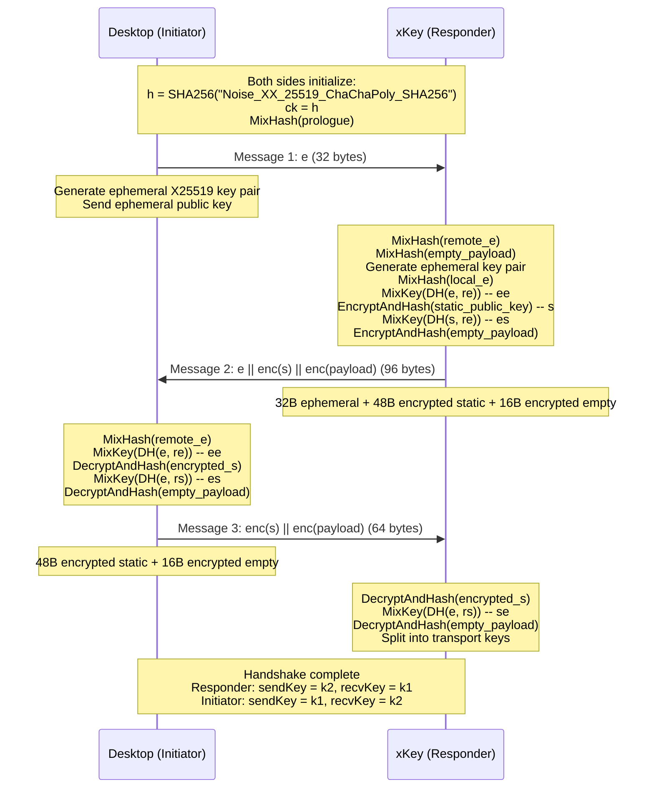
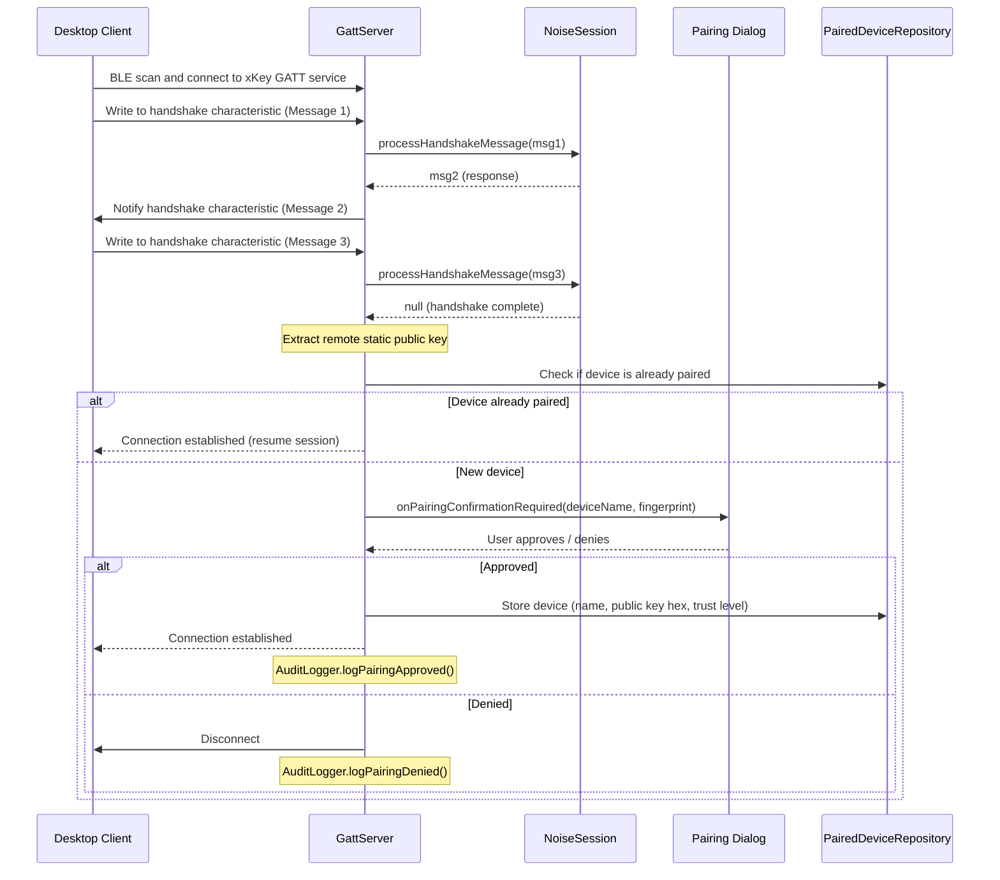

# Noise pairing architecture

> **Status: REFERENCE** · Last verified: 2026-10-09
> As-built description of xKey's Noise_XX pairing, its JSON-RPC message surface and the pairing flow. The wire contract is `go-xkms/xkey/pkg/pairing`.

## Noise_XX Handshake

xKey acts as the Noise **responder** (the desktop client is the initiator).
The handshake establishes mutual authentication and derives transport keys.

### Protocol: `Noise_XX_25519_ChaChaPoly_SHA256`

- **Key exchange**: X25519 (Curve25519 ECDH)
- **Symmetric cipher**: ChaCha20-Poly1305 (AEAD)
- **Hash**: SHA-256
- **Pattern**: XX (both sides transmit static keys, encrypted)

### Handshake Sequence



### Static Key Storage

Both sides persist their X25519 static key pair across sessions:

- **xKey (Android)**: Stored in `EncryptedSharedPreferences` (AES-256-GCM encrypted
  by Android Keystore master key). Raw 32-byte format.
- **Desktop**: Stored by go-xkms in the local keychain.

### Prologue Binding

The prologue is mixed into the handshake hash before any messages are exchanged.
It must match on both sides for the handshake to succeed. xKey uses the prologue
to bind the handshake to expected device fingerprints for trusted device pairing.

### Noise Protocol

| Component | Algorithm |
|-----------|-----------|
| Key exchange | X25519 (Curve25519) |
| Symmetric cipher | ChaCha20-Poly1305 |
| Hash | SHA-256 |
| Pattern | Noise_XX |

## Message Types

All application messages use a JSON-RPC style format:

```json
{
    "id": 1,
    "generation": 7,
    "method": "local.sign",
    "params": { ... }
}
```

`generation` is the initiator's uint64 request generation (go-xkms#128). The
phone never computes or checks it; it copies it verbatim into the response.

### Local Methods (handled by xKey)

Messages prefixed with `local.*` are processed by the phone's `RequestHandler`.

| Method | Description | Key Parameters |
|--------|-------------|----------------|
| `local.generateKey` | Generate a key (Keystore, or software when `exportable`) | `keyId`, `keyType`, `algorithm`, `requireUserVerification`, `preferStrongBox`, `exportable` |
| `local.sign` | Sign data with a key | `keyId`, `data` (base64), `algorithm` (optional override) |
| `local.getPublicKey` | Get public key (DER/PEM/SSH) | `keyId`, `format` |
| `local.deleteKey` | Delete a key | `keyId` |
| `local.listKeys` | List all managed keys | (none) |
| `local.symmetricEncrypt` | AES-GCM encrypt | `keyId`, `data`, `aad` |
| `local.symmetricDecrypt` | AES-GCM decrypt | `keyId`, `data`, `aad` |
| `local.ecdh` | ECDH key agreement | `keyId`, `peerPublicKey` |
| `local.hmac` | HMAC computation | `keyId`, `data` |
| `local.decrypt` | RSA-OAEP decrypt | `keyId`, `ciphertext` |
| `local.getCapabilities` | Device capabilities | (none) |
| `local.attestKey` | Key attestation | `keyId`, `nonce` |
| `local.attestDevice` | Device attestation | `nonce` |

`local.generateKey` returns `keyId`, `publicKeyDer` (omitted for symmetric and
software keys), optional `publicKeyCose`, `algorithm`, `keySizeBits`, and a
`securityLevel` of `software`, `strongbox`, or `tee`.

> Note: This document covers the original BLE method set. The full, authoritative
> wire contract — including the `local.*`/`remote.*` OATH, PIV, sync, backup, and
> key-sharing families, transports (BLE / USB-AOA / TCP), and framing — is in
> `go-xkms/xkey/pkg/pairing` and the platform contract doc
> `automatethethings/software/docs/03-sdk-integration-contracts.md`.

## Response Format

```json
{
    "id": 1,
    "generation": 7,
    "result": { ... }
}
```

Error response:

```json
{
    "id": 1,
    "generation": 7,
    "error": {
        "code": -32000,
        "message": "Key not found"
    }
}
```

Every response to a request, success or error, carries that request's
`generation` beside `id`, written as the same JSON number digit for digit,
including values above 2^63 − 1. A request without `generation` gets a
response without it. A request that does not parse is answered with `id` 0
and still echoes its `generation` when the top-level member can be read
before the parse fails.

## Pairing Flow



## Transport Encryption

After the Noise_XX handshake completes, all messages are encrypted with
ChaCha20-Poly1305 using the derived transport keys:

- **Responder (xKey)**: sends with `k2`, receives with `k1`
- **Initiator (Desktop)**: sends with `k1`, receives with `k2`

Each direction maintains an independent 64-bit nonce counter, starting at 0
and incrementing with each message. As in the Noise framework's
DecryptWithAd, the receive counter advances only when a frame decrypts: a
frame that fails authentication is dropped and leaves the counter where it
was, so the next genuine frame still decrypts. The counter value 2^64-1 is
reserved: a session whose send or receive counter reaches it refuses to
encrypt or decrypt with a `NoiseException`.
The 96-bit ChaCha20 nonce is formed as:

```
[4 bytes: 0x00000000] [8 bytes: little-endian counter]
```

## Protocol Layer

The protocol layer implements the communication stack between xKey and
desktop clients.

| Component | Responsibility |
|-----------|---------------|
| `RequestHandler` | Dispatches JSON-RPC requests to appropriate handlers |
| `Messages` | Request/Response data classes with JSON serialization |
| `NoiseSession` | Noise_XX_25519_ChaChaPoly_SHA256 encrypted channel |
| `FragmentReassembler` | Splits and reassembles messages for BLE MTU limits |
| `BidirectionalMessageRouter` | Routes `remote.*` requests to desktop, `local.*` to phone |
