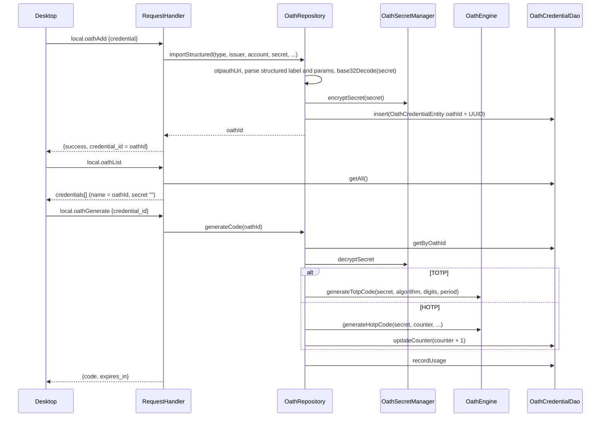

# OATH architecture

> **Status: REFERENCE** · Last verified: 2026-11-23
> As-built description of the phone's OATH (TOTP/HOTP) credentials: the `local.oath*` and `remote.oath*` wire methods, the code engine and how secrets are stored.

## Summary

The phone holds OATH credentials in the Room table behind
`OathCredentialDao` (`OathCredentialEntity`). Each shared secret is encrypted
at rest by `OathSecretManager` with an AES-256-GCM key in the Android Keystore.
`OathEngine` computes HOTP (RFC 4226) and TOTP (RFC 6238) codes with SHA1,
SHA256 or SHA512 and 6, 7 or 8 digits. `OathRepository` ties them together:
it imports `otpauth://` URIs, generates codes (advancing the HOTP counter) and
records use.

The desktop drives this through `local.oathAdd`, `local.oathGenerate`,
`local.oathList` and `local.oathRemove`. On the phone, `OathActivity` lists the
credentials with their current codes. A credential is added by scanning an
`otpauth://` QR code (`QrScannerActivity`) or by typing it in
(`AddOathDialog`).

The phone can also copy one of its credentials to the paired desktop and ask
the desktop for that copy's code, through `remote.oathAdd` and
`remote.oathGenerate` from the credential's long-press menu. `local.syncOATH`
(`handleSyncOATH`) replicates credentials both ways; it belongs to
[store sync](../store-sync/architecture.md) and is not covered here.

## Components

| Component | File | Role |
|-----------|------|------|
| `RequestHandler` (`handleOathList`, `handleOathGenerate`, `handleOathAdd`, `handleOathRemove`) | `app/src/main/kotlin/com/automatethethings/xkey/protocol/Handler.kt` | Wire handlers; each builds its own `OathRepository(db.oathCredentialDao(), OathSecretManager())` or uses the DAO directly |
| `OathRepository`, `OathCredentialWithCode` | `app/src/main/kotlin/com/automatethethings/xkey/oath/OathRepository.kt` | `addCredential` (new random UUID `oathId`), `importStructured` (app-held fields), `importFromUri` (external URIs), `otpauthUri`, `generateCode`, `observeAll`, `deleteCredential`, `getCredentialsForSync`; RFC 4648 Base32 decoding |
| `OathEngine` | `app/src/main/kotlin/com/automatethethings/xkey/oath/OathEngine.kt` | `generateHotpCode`, `generateTotpCode`; stateless |
| `OathSecretManager` | `app/src/main/kotlin/com/automatethethings/xkey/oath/OathSecretManager.kt` | `encryptSecret` / `decryptSecret`: Keystore AES-256-GCM, output `IV(12) || ciphertext || tag` |
| `OathCredentialEntity`, `OathCredentialDao` | `app/src/main/kotlin/com/automatethethings/xkey/oath/OathCredentialEntity.kt`, `OathCredentialDao.kt` | Row: `oathId`, `oathType`, `algorithm`, `digits`, `periodSeconds`, `counter`, `issuer`, `accountName`, `secretEncrypted`, `source`; DAO `getAll`, `getByOathId`, `getByIssuer`, `getBySource`, `count`, `observeCount`, `updateCounter`, `recordUsage`, `deleteByOathId` |
| `parseOathLabel`, `parseStructuredOathLabel` | `app/src/main/kotlin/com/automatethethings/xkey/oath/OathLabel.kt` | Split an `otpauth://` label into issuer and account |
| `OathActivity`, `OathAdapter` (`OathRowLayout`), `AddOathDialog`, `QrScannerActivity` | `app/src/main/kotlin/com/automatethethings/xkey/ui/` | On-phone screens: the list with live codes, manual entry, QR import |
| `OathCodeClipboard` | `app/src/main/kotlin/com/automatethethings/xkey/ui/OathCodeClipboard.kt` | The one copy path: sensitive clip, HOTP through `generateCode` |
| `OathListMenu` | `app/src/main/kotlin/com/automatethethings/xkey/ui/OathListMenu.kt` | Long-press menu entries and index-to-action mapping |
| `OathCredentialDetailActivity`, `OathCredentialDetailViewModel` | `app/src/main/kotlin/com/automatethethings/xkey/ui/` | Details screen; state without the secret, injectable clock |
| `OathDesktopActions`, `PrefsDesktopOathLinks` | `app/src/main/kotlin/com/automatethethings/xkey/ui/OathActivity.kt` | The long-press menu's desktop entries; remembers, per desktop, the id the desktop gave each copied credential (SharedPreferences `oath_desktop_links`, ids only) |
| `RemoteOathClient` | `app/src/main/kotlin/com/automatethethings/xkey/remote/RemoteOathClient.kt` | `remote.oathAdd` and `remote.oathGenerate`; builds the add request without putting the Base32 secret in a `String`, and zeroes the secret and the encoded body after sending |
| `AuditLogger` (`logOathCodeGenerated`, `logOathCredentialCreated`, `logOathCredentialDeleted`) | `app/src/main/kotlin/com/automatethethings/xkey/audit/AuditLogger.kt` | Audit records |

## Wire methods served

| Method | Constant | Params | Result |
|--------|----------|--------|--------|
| `local.oathList` | `MethodNames.LOCAL_OATH_LIST` | none | `credentials[]`: `name` (the stored `oathId`), `issuer`, `account_name`, `secret` (always `""`), `type` (lower case), `algorithm`, `digits`, `period`, `counter` |
| `local.oathGenerate` | `LOCAL_OATH_GENERATE` | `credential_id` (an `oathId`) | `code`, `expires_in` (seconds left in the TOTP window; 0 for HOTP) |
| `local.oathAdd` | `LOCAL_OATH_ADD` | `credential` {`name`, `account_name`, `secret` (Base32), `issuer`, `type` (default `totp`), `algorithm` (`SHA1`), `digits` (6), `period` (30), `counter` (HOTP, 0)} | `success: true`, `credential_id` |
| `local.oathRemove` | `LOCAL_OATH_REMOVE` | `credential_id` | `deleted: true`, or `deleted: false` when no credential has that id |

## Wire methods sent

| Method | Constant | Params | Result |
|--------|----------|--------|--------|
| `remote.oathAdd` | `REMOTE_OATH_ADD` | `credential` with the same fields as `local.oathAdd`; `name` is the phone's `oathId` | `credential_id`, the desktop's id for its copy |
| `remote.oathGenerate` | `REMOTE_OATH_GENERATE` | `credential_id` (the desktop's id) | `code`, `expires_in` |

The wire shapes follow go-xkms `pkg/pairing/protocol_oath.go`. Replies are type
checked strictly; an off-shape reply throws `ProtocolException`. The "desktop
code" entry appears only for a credential this phone has already copied to the
connected desktop.

`OathRepository` has two import paths:

- `importStructured(type, issuer, accountName, secret, ...)` is the one path
  for a credential the app holds as separate fields: `local.oathAdd`,
  `SyncEngine.mergeOath` and manual entry (`OathActivity`). It builds an
  `otpauth://<type>/<issuer>:<account>?secret=...` URI with `otpauthUri`
  (oath/OathRepository.kt), every value percent-encoded (RFC 3986, a space as
  `%20`) and `counter` written for HOTP only, and reads the label back with
  `parseStructuredOathLabel`: only the literal `:` it wrote separates the
  issuer from the account, so an issuerless account `host:user` is stored
  whole.
- `importFromUri(uri)` is for a URI from outside the app (a scanned QR
  code). Its label also splits on an encoded `%3A` (`parseOathLabel`), as
  third-party generators write the separator. No app-built URI goes here.

`local.oathAdd` imports through `importStructured`, which stores the
credential under a new random UUID, and returns that UUID as
`credential_id`. It is the `name` field
`local.oathList` returns and the `credential_id` `local.oathGenerate` and
`local.oathRemove` accept.

## Main flow

## Phone screens

**List row.** `OathRowLayout` measures the code column (code and countdown)
first and gives the issuer and account what is left. The code is one line and
never ellipsized; the account wraps to two lines, then ellipsizes. When less
than `OathAdapter.MIN_INFO_WIDTH_DP` (96dp) would be left beside the code, as
on a narrow outer display or at a large font scale, the code moves below the
issuer and account. Only if the code is wider than the whole row is its text
size reduced to fit. The row mirrors for right-to-left layouts.

**Tap and copy.** A tap on a row, the long-press Copy and the details screen's
Copy all go through `OathCodeClipboard`. The clip is marked sensitive
(`ClipDescription.EXTRA_IS_SENSITIVE`, API 33+). A TOTP copy copies the code on
screen and changes nothing. An HOTP copy calls `OathRepository.generateCode`,
which copies the code at the stored counter, advances the counter and records
the use, so every HOTP copy is a fresh code.

**Long-press menu.** `OathListMenu` lists Copy, Delete and Details, followed by
the desktop entries (copy to the desktop, show the desktop's code) that the
connected desktop offers. Delete asks for confirmation; Cancel keeps the credential.

**Details screen.** Details opens `OathCredentialDetailActivity` (not
exported, parent `OathActivity`) for one `oathId`. Each second its view model
reads the credential and shows issuer, account, type, algorithm, digits,
period (TOTP) or counter (HOTP), created, last used, use count, source, the
remote device id when set, how the secret is stored, the current code and, for
TOTP, the seconds left. The view model decrypts the secret only to compute
the code and zeroes it afterwards; its state carries no secret. The screen
closes if the credential is deleted while it is open.

**The secret is never shown.** No screen has a field or button that reveals
the shared secret, raw or base32.

## Errors and refusals

| Condition | Result |
|-----------|--------|
| Missing params, `credential`, `credential_id`, or any of `name` / `account_name` / `secret` | `INVALID_PARAMS` |
| `local.oathGenerate` for an unknown id (`NoSuchElementException`) | `INVALID_PARAMS` ("Credential not found") |
| Bad type, missing or invalid Base32 secret, other import failure | `INTERNAL_ERROR` ("Failed to add: ...") |
| `local.oathRemove` for an unknown id | Success, `deleted: false`; nothing is audited |
| List, generate or remove failure | `INTERNAL_ERROR` |

The `local.oath*` handlers do not check a PIN or prompt the user. Secrets are
never returned by `local.oathList`; `local.syncOATH` does return decrypted
secrets (see its handler documentation).

## Tests

- Unit (`app/src/test`): `OathEngineTest`, `OathEngineRfcVectorTest` (RFC 4226 / RFC 6238 vectors, the basis for codes matching the desktop's), `OathCredentialEntityTest`, `OathLabelTest`, `OathManualEntryUriTest`, `OathRepositoryImportPathTest`, `OathAddHandlerTest`, `PinOathHandlerErrorsTest`, `RemoteOathClientTest`, `OathAdapterTest`, `OathAdapterLayoutTest` (320dp row at font scale 1 and 2), `OathCodeClipboardTest`, `OathListMenuTest`, `OathCredentialDetailViewModelTest`, `OathDesktopActionsTest`.
- Instrumented (`app/src/androidTest`): `OathRepositoryTest`, `OathSecretManagerTest`, `OathImportIntegrityTest`, `OathActivityUiTest`, `OathCredentialDetailActivityTest`, `OathFlowTest`, `OathManualEntryFlowTest`, `AddOathDialogFlowTest`.

## Related features

- [PIN](../pin/architecture.md)
- [PIV](../piv/architecture.md)
- [Audit log](../audit-log/architecture.md)
- [Store sync](../store-sync/architecture.md): `local.syncOATH`.
- [Noise pairing](../noise-pairing/architecture.md): the channel synced and copied secrets cross.
