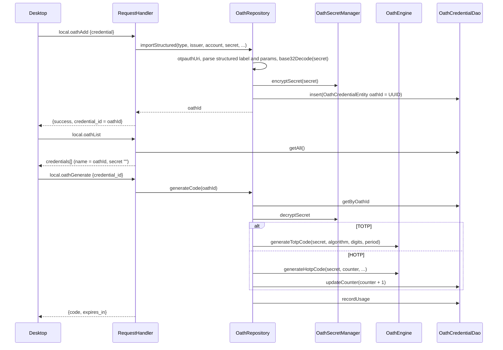

# OATH architecture

> **Status: REFERENCE** · Last verified: 2026-11-12
> As-built description of the phone's OATH (TOTP/HOTP) credentials: the `local.oath*` wire family, the code engine, and how secrets are stored.

## Summary

The phone holds OATH credentials in the Room table behind
`OathCredentialDao` (`OathCredentialEntity`). Each shared secret is encrypted
at rest by `OathSecretManager` with an AES-256-GCM key in the Android Keystore.
`OathEngine` computes HOTP (RFC 4226) and TOTP (RFC 6238) codes with SHA1,
SHA256 or SHA512 and 6, 7 or 8 digits. `OathRepository` ties them together:
it imports `otpauth://` URIs, generates codes (advancing the HOTP counter) and
records use.

The desktop drives this through `local.oathAdd`, `local.oathGenerate`,
`local.oathList` and `local.oathRemove`. On the phone, `OathActivity`,
`OathAdapter` and `AddOathDialog` show the codes and add credentials.
`local.syncOATH` (`handleSyncOATH`) replicates credentials both ways and is
covered by the sync feature, not here.

## Components

| Component | File | Role |
|-----------|------|------|
| `RequestHandler` (`handleOathList`, `handleOathGenerate`, `handleOathAdd`, `handleOathRemove`) | `app/src/main/kotlin/com/automatethethings/xkey/protocol/Handler.kt` | Wire handlers; each builds its own `OathRepository(db.oathCredentialDao(), OathSecretManager())` or uses the DAO directly |
| `OathRepository`, `OathCredentialWithCode` | `app/src/main/kotlin/com/automatethethings/xkey/oath/OathRepository.kt` | `addCredential` (new random UUID `oathId`), `importStructured` (app-held fields), `importFromUri` (external URIs), `otpauthUri`, `generateCode`, `observeAll`, `deleteCredential`, `getCredentialsForSync`; RFC 4648 Base32 decoding |
| `OathEngine` | `app/src/main/kotlin/com/automatethethings/xkey/oath/OathEngine.kt` | `generateHotpCode`, `generateTotpCode`; stateless |
| `OathSecretManager` | `app/src/main/kotlin/com/automatethethings/xkey/oath/OathSecretManager.kt` | `encryptSecret` / `decryptSecret`: Keystore AES-256-GCM, output `IV(12) || ciphertext || tag` |
| `OathCredentialEntity`, `OathCredentialDao` | `app/src/main/kotlin/com/automatethethings/xkey/oath/OathCredentialEntity.kt`, `OathCredentialDao.kt` | Row: `oathId`, `oathType`, `algorithm`, `digits`, `periodSeconds`, `counter`, `issuer`, `accountName`, `secretEncrypted`, `source`; DAO `getAll`, `getByOathId`, `updateCounter`, `recordUsage`, `deleteByOathId` |
| `OathActivity`, `OathAdapter`, `AddOathDialog` | `app/src/main/kotlin/com/automatethethings/xkey/ui/` | On-phone screens |
| `AuditLogger` (`logOathCodeGenerated`, `logOathCredentialCreated`, `logOathCredentialDeleted`) | `app/src/main/kotlin/com/automatethethings/xkey/audit/AuditLogger.kt` | Audit records |

## Wire methods served

| Method | Constant | Params | Result |
|--------|----------|--------|--------|
| `local.oathList` | `MethodNames.LOCAL_OATH_LIST` | none | `credentials[]`: `name` (the stored `oathId`), `issuer`, `account_name`, `secret` (always `""`), `type` (lower case), `algorithm`, `digits`, `period`, `counter` |
| `local.oathGenerate` | `LOCAL_OATH_GENERATE` | `credential_id` (an `oathId`) | `code`, `expires_in` (seconds left in the TOTP window; 0 for HOTP) |
| `local.oathAdd` | `LOCAL_OATH_ADD` | `credential` {`name`, `account_name`, `secret` (Base32), `issuer`, `type` (default `totp`), `algorithm` (`SHA1`), `digits` (6), `period` (30), `counter` (HOTP, 0)} | `success: true`, `credential_id` |
| `local.oathRemove` | `LOCAL_OATH_REMOVE` | `credential_id` | `deleted: true` |

`OathRepository` has two import paths:

- `importStructured(type, issuer, accountName, secret, ...)` is the one path
  for a credential the app holds as separate fields: `local.oathAdd`,
  `SyncEngine.mergeOath` and manual entry (`OathActivity`). It builds an
  `otpauth://<type>/<issuer>:<account>?secret=...` URI with `otpauthUri`
  (oath/OathRepository.kt), every value percent-encoded (RFC 3986, a space as
  `%20`) and `counter` written for HOTP only, and reads the label back with
  `parseStructuredOathLabel`: only the literal `:` it wrote separates the
  issuer from the account, so an issuerless account `host:user` is stored
  whole.
- `importFromUri(uri)` is for a URI from outside the app (a scanned QR
  code). Its label also splits on an encoded `%3A` (`parseOathLabel`), as
  third-party generators write the separator. No app-built URI goes here.

`local.oathAdd` imports through `importStructured`, which stores the
credential under a new random UUID, and returns that UUID as
`credential_id`. It is the `name` field
`local.oathList` returns and the `credential_id` `local.oathGenerate` and
`local.oathRemove` accept.

## Main flow

## Errors and refusals

| Condition | Result |
|-----------|--------|
| Missing params, `credential`, `credential_id`, or any of `name` / `account_name` / `secret` | `INVALID_PARAMS` |
| `local.oathGenerate` for an unknown id (`NoSuchElementException`) | `INVALID_PARAMS` ("Credential not found") |
| Bad type, missing or invalid Base32 secret, other import failure | `INTERNAL_ERROR` ("Failed to add: ...") |
| `local.oathRemove` for an unknown id | Success, `deleted: true` (the DAO delete is a no-op) |
| List or generate failure | `INTERNAL_ERROR` |

The `local.oath*` handlers do not check a PIN or prompt the user. Secrets are
never returned by `local.oathList`; `local.syncOATH` does return decrypted
secrets (see its handler documentation).

## Tests

- Unit (`app/src/test`): `OathEngineTest`, `OathEngineRfcVectorTest` (RFC 4226 / RFC 6238 vectors, the basis for codes matching the desktop's), `OathCredentialEntityTest`, `OathAdapterTest`.
- Instrumented (`app/src/androidTest`): `OathRepositoryTest`, `OathSecretManagerTest`, `OathImportIntegrityTest`, `OathActivityUiTest`, `OathFlowTest`, `OathManualEntryFlowTest`, `AddOathDialogFlowTest`.

## Related features

- [PIN](../pin/architecture.md)
- [PIV](../piv/architecture.md)
- [Audit log](../audit-log/architecture.md)
- [Noise pairing](../noise-pairing/architecture.md) — the channel `local.syncOATH` secrets cross.
