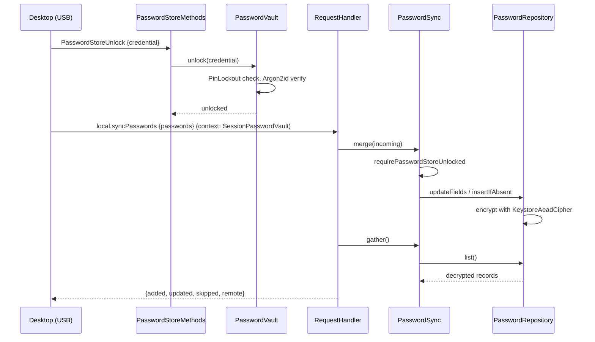

# Password vault architecture

> **Status: REFERENCE** · Last verified: 2026-11-12
> As-built description of the phone's password store, the vault lock in front of it, and its sync with the desktop.

## Summary

The phone keeps passwords in the Room table `passwords`. `PasswordRepository`
encrypts each password value with an Android Keystore key
(`KeystoreAeadCipher`, alias `xkey_password_encryption_key`) before it is
written and decrypts it on read. That key is not derived from any vault factor.

`PasswordVault` adds a lock. Once a factor is enrolled, the store is locked
until a credential for an enrolled factor unlocks it; before any enrollment the
store is open. The unlocked state is in memory only, per `PasswordVault`
instance, so each new USB session starts locked.

The store syncs with the desktop through `local.syncPasswords` and
`remote.syncPasswords` (see [store-sync](../store-sync/architecture.md)), via
`PasswordSync`, which checks the lock before it reads or writes anything. The
USB `Password*` methods are described in
[password-vault-rpcs](../password-vault-rpcs/engineering.md).

## Components

| Class | File | Role |
|-------|------|------|
| `PasswordEntity` | `app/src/main/kotlin/com/automatethethings/xkey/password/PasswordEntity.kt` | Room entity, table `passwords`; `DEFAULT_TENANT` |
| `PasswordDao` | `app/src/main/kotlin/com/automatethethings/xkey/password/PasswordDao.kt` | Queries: `insert`, `insertIfAbsent`, `update`, `updateFieldsIfUnchanged`, `getAll`, `getByPasswordId`, `getForListing`, `deleteByPasswordId`, `count` and others |
| `PasswordRepository`, `PasswordRecord`, `PasswordPatch` | `app/src/main/kotlin/com/automatethethings/xkey/password/PasswordRepository.kt` | Encrypting repository: `list`, `listWithoutSecrets`, `get`, `upsert`, `insertIfAbsent`, `updateFields`, `delete`; `PasswordUpdateConflictException` |
| `PasswordEntryLimit`, `PasswordEntryTooLargeException` | `app/src/main/kotlin/com/automatethethings/xkey/password/PasswordEntryLimit.kt` | Every write is held to `MAX_ENTRY_SIZE`, so go-xkms can read each entry back |
| `PasswordVault` | `app/src/main/kotlin/com/automatethethings/xkey/password/PasswordVault.kt` | `isInitialized`, `isUnlocked`, `isLocked`, `unlock`, `lock`, `enrollPassphrase` |
| `PasswordVaultFactorStore`, `FilePasswordVaultFactorStore` | same file | Enrolled factors in `filesDir/password_vault/factors.json` (`PasswordVault.FACTOR_DIR`), written through a temporary file and a rename |
| `PasswordVaultFactorRecord` | same file | One factor: id, factor type, label, salt, Argon2id verifier |
| `Argon2PassphraseHasher`, `PassphraseHasher` | same file | Argon2id, 64 MiB, 3 iterations, 4 lanes, 32-byte output |
| `VaultUnlockAttemptStore`, `PinSettingsVaultUnlockAttemptStore` | same file | Persisted failed-unlock counter, held to the PIN's `maxPinAttempts` and `lockoutDurationSeconds` |
| `SessionPasswordVault` | same file | Coroutine-context element naming the session's vault for code below the transport |
| `requirePasswordStoreUnlocked` | same file | The lock check used by every path without a vault of its own |
| `PasswordVaultCredential` | `app/src/main/kotlin/com/automatethethings/xkey/password/PasswordVaultCredential.kt` | Credential types `Passphrase`, `Passkey`, `Key` |
| `PasswordSync` | `app/src/main/kotlin/com/automatethethings/xkey/sync/PasswordSync.kt` | Sync gather and merge behind the lock |
| `PasswordStoreMethods` | `app/src/main/kotlin/com/automatethethings/xkey/usb/PasswordStoreMethods.kt` | USB `Password*` methods; `routingContext()` adds `SessionPasswordVault` to every USB request |
| `XKeyGattService` | `app/src/main/kotlin/com/automatethethings/xkey/ble/XKeyGattService.kt` | Builds one `PasswordVault` per USB accessory session |
| `PasswordManagementActivity` | `app/src/main/kotlin/com/automatethethings/xkey/ui/PasswordManagementActivity.kt` | On-phone list, add, edit and delete through `PasswordRepository` |

## Wire methods and entry points

- `local.syncPasswords` (desktop to phone) and `remote.syncPasswords` (phone to
  desktop): see [store-sync](../store-sync/architecture.md).
- USB only, through `PasswordStoreMethods`: `PasswordAdd`, `PasswordGet`,
  `PasswordList`, `PasswordUpdate`, `PasswordDelete`, `PasswordStoreUnlock`,
  `PasswordStoreLock`, `PasswordStoreStatus`, `PasswordGenerate`.
- Android: `PasswordManagementActivity`.

`enrollPassphrase` has no caller on main: its own comment says it is not
reachable over any transport yet. Only the passphrase factor can match; a
`Passkey` or `Key` credential is parsed but always rejected.

## The lock check

`requirePasswordStoreUnlocked(factors)` decides whether the store is locked:

- With a `SessionPasswordVault` in the coroutine context (a USB request), the
  store is locked exactly when that vault `isLocked()`.
- Without one (BLE, TCP, or a phone-initiated sync), the store is locked as soon
  as any factor is enrolled, because no credential can have unlocked it.
- With no factor enrolled, the store is open.

Nothing is hashed for the check.

## Main flow

## Sync rules

- `gather()` leaves out entries with a non-default tenant, sharing or an
  expiry, because `SyncPassword` cannot carry them; it logs only how many.
- `merge()` skips entries without an id or password. An existing entry is
  patched in place (`updateFields`) and keeps its tenant, sharing and expiry;
  a new one is added only while no entry has its id (`insertIfAbsent`), as a
  personal entry with no expiry in the default tenant.
- An entry too large for go-xkms (`PasswordEntryTooLargeException`) or one that
  keeps changing locally (`PasswordUpdateConflictException`) is counted as
  skipped and nothing is written for it.

## Errors and refusals

| Exception | Meaning |
|-----------|---------|
| `PasswordStoreLockedException` | The store is locked. `local.syncPasswords` answers `ErrorCodes.PASSWORD_STORE_LOCKED` (-32040); `RemoteSyncClient.syncAll()` skips the password leg |
| `PasswordVaultFactorsUnreadableException` | The factor file exists but cannot be read; never taken as "no factor", so every gate stays shut |
| `VaultNotInitializedException` | `unlock` or `lock` with no factor enrolled |
| `VaultCredentialRejectedException` | No enrolled factor matched; the failure is counted. Carries no detail |
| `VaultUnlockLockedOutException` | Too many failed unlocks; refused without checking the credential until the PIN lockout ends |
| `VaultCredentialInvalidException` | A malformed credential, or an empty passphrase to `enrollPassphrase` |

A successful unlock clears the failure counter. `lock()` withdraws access
before it reads the factors, so a lock that throws never leaves the store open.

## Tests

| Test class | Covers |
|------------|--------|
| `PasswordVaultTest` (`app/src/test/.../password/`) | Unlock, lock, enrollment, lockout |
| `PinSettingsVaultUnlockAttemptStoreTest` (`app/src/test/.../password/`) | Persisted unlock counter |
| `PasswordRepositoryTest`, `PasswordRepositoryPolicyTest`, `PasswordRepositoryUpdateTest`, `PasswordEntityTest` (`app/src/test/.../password/`) | Repository, policy fields, updates, entity |
| `PasswordSyncTest` (`app/src/test/.../sync/`) | Sync gather and merge behind the lock |
| `PasswordStoreMethodsTest`, `UsbWireContractTest` (`app/src/test/.../usb/`) | USB `Password*` methods |
| `PasswordDaoTest` (`app/src/androidTest/.../password/`) | Room queries |
| `SyncEngineTest` (`app/src/androidTest/.../sync/`) | Password sync on a device database |
| `PasswordManagementActivityUiTest`, `PasswordManagementFlowTest` (`app/src/androidTest/.../ui/`) | On-phone password screens |

## Related features

- [store-sync](../store-sync/architecture.md): the sync engine the password leg belongs to
- [password-vault-rpcs](../password-vault-rpcs/engineering.md): the USB `Password*` contract
- [remote-backup-password](../remote-backup-password/architecture.md): a desktop backup can include the passwords
