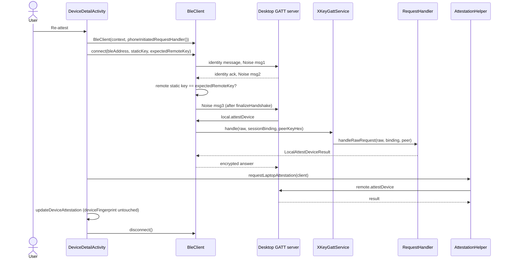

# Phone-initiated pairing sessions architecture

> **Status: REFERENCE** · Last verified: 2026-11-12
> As-built description of the sessions the phone opens to a desktop over BLE, and how the phone answers the desktop's `local.attestDevice` on them.

## Summary

Normally the desktop connects to the phone (BLE GATT server, TCP, USB). The
phone can also dial out: `BleClient` is a BLE central that connects to a
desktop's xKey GATT service and runs the Noise XX handshake as **initiator**.
The desktop sends `local.attestDevice` as soon as it reads Noise message 3 and
drops a session that cannot answer it. `BleClient` therefore answers inbound
requests through a `PhoneInitiatedRequestHandler`, which `XKeyGattService`
backs with the same `RequestHandler` every transport uses, bound to this
session's Noise keys. Only `local.attestDevice` is served on such a session.

The one caller on main is device re-attestation in `DeviceDetailActivity`:
when the desktop is not already connected and its BLE address is known, the
phone opens a session, asks the desktop `remote.attestDevice` through
`AttestationHelper`, records the result, and disconnects.

## Components

| Component | File | Role |
|-----------|------|------|
| `BleClient` | `app/src/main/kotlin/com/automatethethings/xkey/ble/BleClient.kt` | BLE central: `connect(address, localStaticKey, expectedRemoteKey)`, `sendRequest`, `disconnect`; `performHandshake` sends the identity message, Noise msg1, checks the remote static key from msg2 against `expectedRemoteKey`, then `finalizeHandshake` and msg3 under `writeMutex`; `dispatchInboundRequest` answers the desktop's requests |
| `NoiseInitiatorSession` | same file | Initiator Noise state: `createIdentityMessage`, `processIdentityAck`, `createHandshakeMessage1`, `processHandshakeMessage2`, `createHandshakeMessage3`, `finalizeHandshake`, `getRemoteStaticKey` |
| `PhoneInitiatedRequestHandler` | same file | `handle(request, binding, peerPublicKeyHex)` |
| `BleClientException` | same file | Connection and handshake failures |
| `NoiseInitiatorSession.sessionBinding` | `app/src/main/kotlin/com/automatethethings/xkey/ble/SessionBindings.kt` | The static keys and prologue `local.attestDevice` binds to |
| `XKeyGattService.phoneInitiatedRequestHandler` | `app/src/main/kotlin/com/automatethethings/xkey/ble/XKeyGattService.kt` | Wraps `RequestHandler.handleRawRequest(request, binding, peerPublicKeyHex)`; null until the handler exists |
| `RequestHandler.handleRawRequest` (3-argument form) | `app/src/main/kotlin/com/automatethethings/xkey/protocol/Handler.kt` | Runs the request under a `CallerSession` with `served = false`, so attestation reads this session's binding and peer |
| `DeviceDetailActivity.requestReattest` / `initiatePhoneConnection` | `app/src/main/kotlin/com/automatethethings/xkey/ui/DeviceDetailActivity.kt` | The re-attest entry point that opens the session |
| `AttestationHelper.requestLaptopAttestation` | `app/src/main/kotlin/com/automatethethings/xkey/protocol/AttestationHelper.kt` | Sends `remote.attestDevice` over the open `BleClient` |

## Wire methods and Android entry points

- Entry point: the re-attest action on a paired device's detail screen
  (`DeviceDetailActivity.requestReattest`). If that desktop is the one already
  connected to the phone's GATT server, the phone attests over that session
  instead; with no BLE address it shows instructions.
- Served to the desktop: `local.attestDevice` only (see
  [device-attestation](../device-attestation/architecture.md)).
- Sent by the phone in the re-attest flow: `remote.attestDevice`.

## Main flow

## Errors and refusals

- Any method other than `local.attestDevice`: `ErrorCodes.METHOD_NOT_FOUND`
  (-32601), "is not served on a phone-initiated session".
- No handler (the service's `RequestHandler` does not exist yet):
  `METHOD_NOT_FOUND`, "This phone cannot attest on this session".
- The handler throws: `ErrorCodes.INTERNAL_ERROR` (-32603).
- A remote static key in msg2 that differs from the paired key:
  `BleClientException("Remote key mismatch - possible MITM attack")` before
  msg3 is sent. A handshake past its timeout: `BleClientException("Handshake timed out")`.
- A session with no authenticated peer key makes attestation fail with
  `ATTESTATION_FAILED` (see device-attestation).
- A disconnect cancels an inbound request that is still running, including one
  waiting on the user.
- The SAS dialog (`XKeyGattService.onPairingConfirmationRequired` with a
  `shortAuthString`) is raised from `pairing.confirm` on sessions the phone
  accepts (`GattServer`, `StreamPairingSession`). No SAS display was found in
  `BleClient` or its caller.

## Tests

- JVM: `BleClientPhoneInitiatedAttestTest` with `BleClientHarness`
  (`app/src/test/kotlin/com/automatethethings/xkey/ble/`);
  `AttestationHelperTest`, `AttestationPolicyCallerPeerTest`
  (`app/src/test/kotlin/com/automatethethings/xkey/protocol/`).

## Related features

- [device-attestation](../device-attestation/architecture.md): the `local.attestDevice` prover.
- [request-generation-echo](../request-generation-echo/architecture.md): the refusals carry the request's `generation`.
- [usb-transport](../usb-transport/architecture.md) and [tcp-pairing](../tcp-pairing/architecture.md): the sessions the phone accepts, where the SAS is shown.
