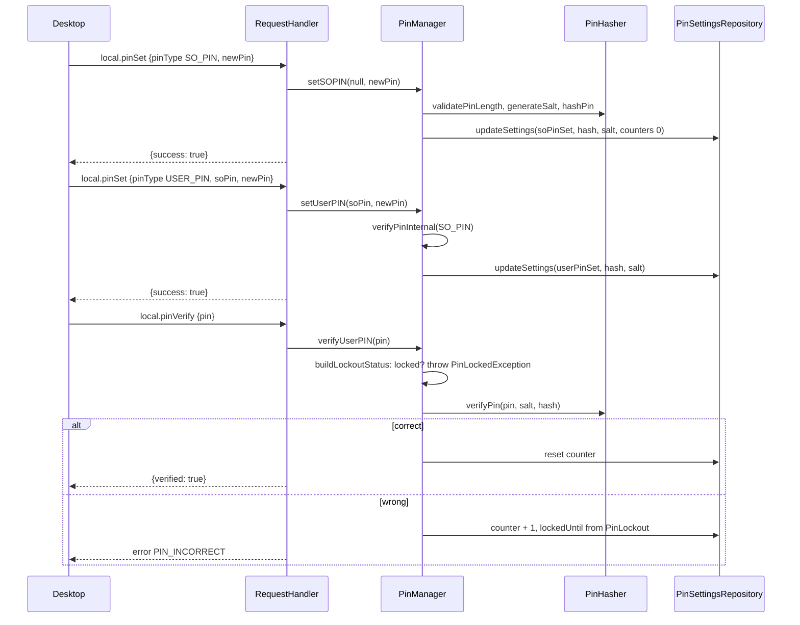

# PIN architecture

> **Status: REFERENCE** · Last verified: 2026-11-12
> As-built description of the phone's SO PIN and User PIN: the `local.pin*` wire family, hashing, lockout and storage.

## Summary

The phone keeps two PINs on the PKCS#11 model: a Security Officer PIN
(`PinType.SO_PIN`), set first, and a User PIN (`PinType.USER_PIN`), which only
the SO PIN can provision. Each PIN is stored as an Argon2id hash with its own
salt, and each has its own failed-attempt counter and lockout. The SO PIN can
clear the User PIN's lockout. The desktop drives this through the
`local.pin*` methods; on the phone, `PinManagementActivity` uses the same
`PinManager`.

All transports share one `RequestHandler`, built in `XKeyGattService` with a
`PinManager(PinSettingsRepository(this))`, and handed to the BLE
(`GattServer`), TCP (`TcpHsmServer`) and USB (`UsbAccessoryServer`) servers.
A `RequestHandler` built without a `PinManager` answers every `local.pin*`
call with `FEATURE_UNAVAILABLE`.

## Components

| Component | File | Role |
|-----------|------|------|
| `RequestHandler` (`handlePinStatus`, `handlePinVerify`, `handlePinSet`, `handlePinChange`, `handlePinResetLockout`) | `app/src/main/kotlin/com/automatethethings/xkey/protocol/Handler.kt` | Wire handlers; map `PinManager` exceptions to error codes |
| `PinManager`, `PinType`, `LockoutStatus`, `PinException`, `PinLockedException` | `app/src/main/kotlin/com/automatethethings/xkey/pin/PinManager.kt` | PIN lifecycle and lockout; every read-modify-write runs under one process-wide `pinStateMutex`, shared by all `PinManager` instances |
| `PinHasher` | `app/src/main/kotlin/com/automatethethings/xkey/pin/PinHasher.kt` | Argon2id (Signal `org.signal.argon2`): 64 MiB, 3 iterations, 4 lanes, 32-byte hash, 16-byte salt; PIN length 6 to 63 (`MIN_PIN_LENGTH`, `MAX_PIN_LENGTH`) |
| `PinLockout` | `app/src/main/kotlin/com/automatethethings/xkey/pin/PinLockout.kt` | One lockout rule (also used by the password vault): once the consecutive failure count reaches `maxAttempts`, each failure locks for `lockoutDurationSeconds`; only a success clears the count |
| `PinSettingsData`, `PinSettingsRepository` | `app/src/main/kotlin/com/automatethethings/xkey/settings/PinSettings.kt` | Jetpack DataStore persistence of the hashes and salts (Base64, `NO_WRAP`), attempt counters and lock times (epoch ms, so a lockout survives a restart); defaults `maxPinAttempts = 5`, `lockoutDurationSeconds = 300` |
| `PinManagementActivity` | `app/src/main/kotlin/com/automatethethings/xkey/ui/PinManagementActivity.kt` | On-phone PIN screen over its own `PinManager` |
| `AuditLogger` (`logPinSet`, `logPinChanged`, `logPinVerificationSuccess`, `logPinVerificationFailed`, `logPinLockoutReset`) | `app/src/main/kotlin/com/automatethethings/xkey/audit/AuditLogger.kt` | Audit records for every PIN event |

## Wire methods served

| Method | Constant | Params | Result |
|--------|----------|--------|--------|
| `local.pinStatus` | `MethodNames.LOCAL_PIN_STATUS` | none | `soPinSet`, `userPinSet`, `initialized`, `soLocked`, `userLocked` |
| `local.pinVerify` | `LOCAL_PIN_VERIFY` | `pin`, `pinType` (`USER_PIN` default, or `SO_PIN`) | `verified: true` |
| `local.pinSet` | `LOCAL_PIN_SET` | `pinType`, `newPin`; `currentPin` for an SO PIN that is already set; `soPin` for `USER_PIN` | `success: true` |
| `local.pinChange` | `LOCAL_PIN_CHANGE` | `pinType`, `currentPin`, `newPin` | `success: true` |
| `local.pinResetLockout` | `LOCAL_PIN_RESET_LOCKOUT` | `soPin` | `success: true` (clears the User PIN counter and lock) |

## Main flow

## Errors and refusals

| Condition | Error code |
|-----------|------------|
| Handler built without a `PinManager` | `FEATURE_UNAVAILABLE` ("PIN support is not available on this transport") |
| Missing params, missing `newPin` / `currentPin`, unknown `pinType` | `INVALID_PARAMS` |
| Empty `pin` on verify; missing `soPin` on User PIN set or reset | `PIN_REQUIRED` |
| Wrong PIN, PIN not set, SO PIN already set without `currentPin` (`PinException`) | `PIN_INCORRECT` |
| Locked PIN on verify | `PIN_LOCKED` with `lockoutUntil` and `failedAttempts` in the error data |
| Locked PIN on change | `PIN_LOCKED` |
| Locked SO PIN on set or reset lockout | `INTERNAL_ERROR`: `handlePinSet` and `handlePinResetLockout` catch `PinException` but not `PinLockedException`, which falls to the generic branch |
| New PIN outside 6 to 63 characters (`IllegalArgumentException` from `PinHasher.validatePinLength`) | `INTERNAL_ERROR` |

## Tests

- Unit (`app/src/test`): `PinManagerTest`, `PinHasherTest`, `PinSettingsDataTest`, `ProtocolConstantsTest`.
- Instrumented (`app/src/androidTest`): `PinHasherInstrumentedTest`, `RequestHandlerPinAndDataFamilyTest`, `RequestHandlerErrorPathTest`, `ProtocolIntegrationTest`, `PinManagementActivityUiTest`, `PinManagementFlowTest`.

## Related features

- [PIV](../piv/architecture.md) — the other smart-card style family served next to it.
- [User verification](../user-verification/architecture.md)
- [Audit log](../audit-log/)
- [Password vault RPCs](../password-vault-rpcs/) — shares the `PinLockout` rule for the vault passphrase.
