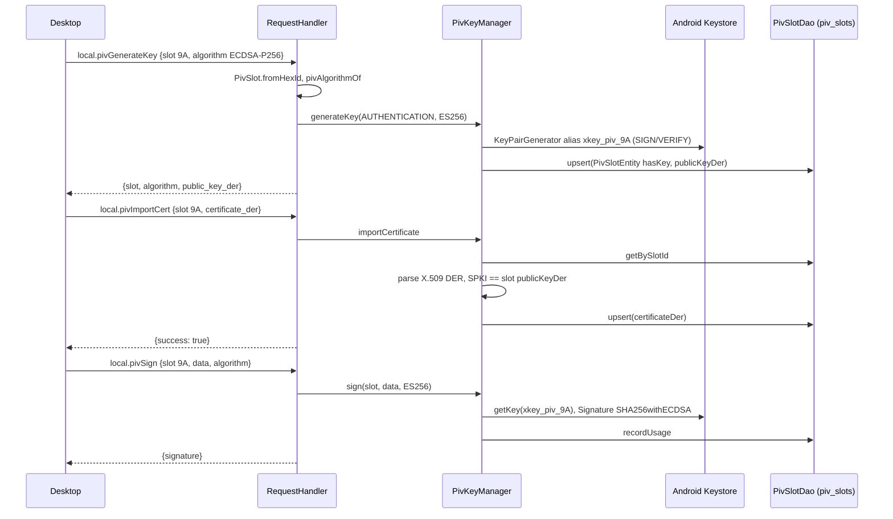

# PIV architecture

> **Status: REFERENCE** · Last verified: 2026-11-12
> As-built description of the phone's PIV slots: the `local.piv*` wire family, the Keystore keys behind each slot, and the `piv_slots` table.

## Summary

The phone emulates PIV smart-card slots. Each slot (`PivSlot`: the primary
slots 9A, 9C, 9D, 9E, F9 and the retired slots 82 to 95) can hold one
Android Keystore key pair under the alias `xkey_piv_<hexId>`, plus an optional
imported X.509 certificate. Metadata (algorithm, public key DER, certificate,
created / last-used time, use count) lives in the Room table `piv_slots`
(`PivSlotEntity`, `PivSlotDao`). Keys are ECDSA P-256, ECDSA P-384 or RSA 2048
(`PivAlgorithm`).

The desktop drives the slots through `local.piv*`. All transports share the
one `RequestHandler` built in `XKeyGattService` with
`PivKeyManager(XKeyDatabase.getInstance(this).pivSlotDao())`, used by the BLE
(`GattServer`), TCP (`TcpHsmServer`) and USB (`UsbAccessoryServer`) servers.
On the phone, `PivActivity` and `PivSlotDetailActivity` use their own
`PivKeyManager`.

`MethodNames` also defines `remote.pivListSlots`, `remote.pivSign` and
`remote.pivGetCert`, but no code in `app/src/main` sends them; only
`PivHandlerTest` and `ProtocolConstantsTest` reference those constants.

## Components

| Component | File | Role |
|-----------|------|------|
| `RequestHandler` (`handlePivListSlots`, `handlePivGenerateKey`, `handlePivImportCert`, `handlePivSign`, `handlePivGetCert`, `pivSlotId`, `pivAlgorithmOf`) | `app/src/main/kotlin/com/automatethethings/xkey/protocol/Handler.kt` | Wire handlers; accept go-xkms field and algorithm spellings alongside the older Android ones |
| `PivKeyManager`, `PivSlotInfo` | `app/src/main/kotlin/com/automatethethings/xkey/piv/PivKeyManager.kt` | `generateKey`, `importCertificate`, `listSlots`, `sign`, `getCertificate`, `getPublicKey`, `deleteKey`; audit via `AuditLogger.logKeyCreated` and `AuditLogger.logSigningRequest` |
| `PivSlot`, `PivAlgorithm` | `app/src/main/kotlin/com/automatethethings/xkey/piv/PivSlot.kt` | Slot ids, labels, `keystoreAlias`, `isPrimarySlot`, `fromHexId` (case-insensitive); algorithms `ES256`, `ES384`, `RS2048` |
| `PivSlotEntity`, `PivSlotDao` | `app/src/main/kotlin/com/automatethethings/xkey/piv/PivSlotEntity.kt`, `PivSlotDao.kt` | Room table `piv_slots`; `upsert`, `getBySlotId`, `getAll`, `recordUsage`, `deleteBySlotId`, observers for the UI |
| `PivActivity`, `PivSlotDetailActivity` | `app/src/main/kotlin/com/automatethethings/xkey/ui/` | On-phone slot list and slot detail screens |

## Wire methods served

| Method | Constant | Params | Result |
|--------|----------|--------|--------|
| `local.pivListSlots` | `MethodNames.LOCAL_PIV_LIST_SLOTS` | none | `slots[]`: `slot`/`slotId`, `label`, `description`, `has_key`/`hasKey`, `has_certificate`/`hasCertificate`, `algorithm`, `public_key_der`/`publicKey`, `createdAt`, `lastUsedAt`, `useCount`. Only slots with a `piv_slots` row are listed |
| `local.pivGenerateKey` | `LOCAL_PIV_GENERATE_KEY` | `slot` (or `slotId`), `algorithm` (default `ES256`) | `slot`, `algorithm`, `has_key`, `public_key_der` (SPKI, base64). Overwrites a key already in the slot |
| `local.pivImportCert` | `LOCAL_PIV_IMPORT_CERT` | `slot`, `certificate_der` (or `certificate`), base64 | `success: true`. The bytes must be exactly one DER X.509 certificate whose SubjectPublicKeyInfo equals the slot key's public key; a refusal stores nothing and an earlier certificate stays |
| `local.pivSign` | `LOCAL_PIV_SIGN` | `slot`, `data` (base64), `algorithm` (default `ES256`) | `signature` (base64). `ES256` signs with `SHA256withECDSA`, `ES384` with `SHA384withECDSA`, `RS2048` with `SHA256withRSA`; the signature algorithm comes from the request, not from the slot's stored algorithm |
| `local.pivGetCert` | `LOCAL_PIV_GET_CERT` | `slot` | `certificate_der`/`certificate`: the imported certificate, else the Keystore's self-signed certificate for the alias |

Accepted algorithm names: the enum names (`ES256`, `ES384`, `RS2048`) and
`ECDSA-P256`, `EC-P256`, `P256`, `ECDSA-P384`, `EC-P384`, `P384`, `RSA-2048`,
`RSA2048` (case and `_`/`-` folded).

## Main flow

## Errors and refusals

| Condition | Error code |
|-----------|------------|
| Handler built without a `PivKeyManager` | `FEATURE_UNAVAILABLE` ("PIV support is not available on this transport") |
| Missing params, missing certificate or data | `INVALID_PARAMS` |
| Unknown slot id | `PIV_INVALID_SLOT` |
| Unknown algorithm name | `INVALID_ALGORITHM` |
| Key generation throws | `KEY_GENERATION_FAILED` |
| Signing throws (including no key in the slot) | `PIV_SIGN_FAILED` |
| `local.pivGetCert` on a slot with no certificate | `PIV_SLOT_NOT_FOUND` |
| `local.pivImportCert`: certificate not base64, not one DER certificate, or for another key | `INVALID_PARAMS` (nothing stored) |
| `local.pivImportCert` into a slot with no key | `PIV_SLOT_NOT_FOUND` |
| Any other import failure, list or get-cert failure | `INTERNAL_ERROR` |

The `local.piv*` handlers do not check a PIN or prompt the user; no PIN or
user-verification gate was found in these handlers or in `PivKeyManager`.

## Tests

- Unit (`app/src/test`): `PivKeyManagerTest`, `PivSlotTest`, `PivSlotEntityTest`, `PivHandlerTest`, `ProtocolConstantsTest`.
- Instrumented (`app/src/androidTest`): `PivSlotDaoTest`, `PivActivityUiTest`, `PivFlowTest`, `PivSlotDetailActivityUiTest`, `PivSlotDetailFlowTest`.

## Related features

- [PIN](../pin/architecture.md) — the other smart-card style family on the same handler.
- [Hardware-backed keys](../hardware-backed-keys/architecture.md) — the general Keystore key path.
- [Certificate authority](../certificate-authority/)
- [Audit log](../audit-log/architecture.md)
