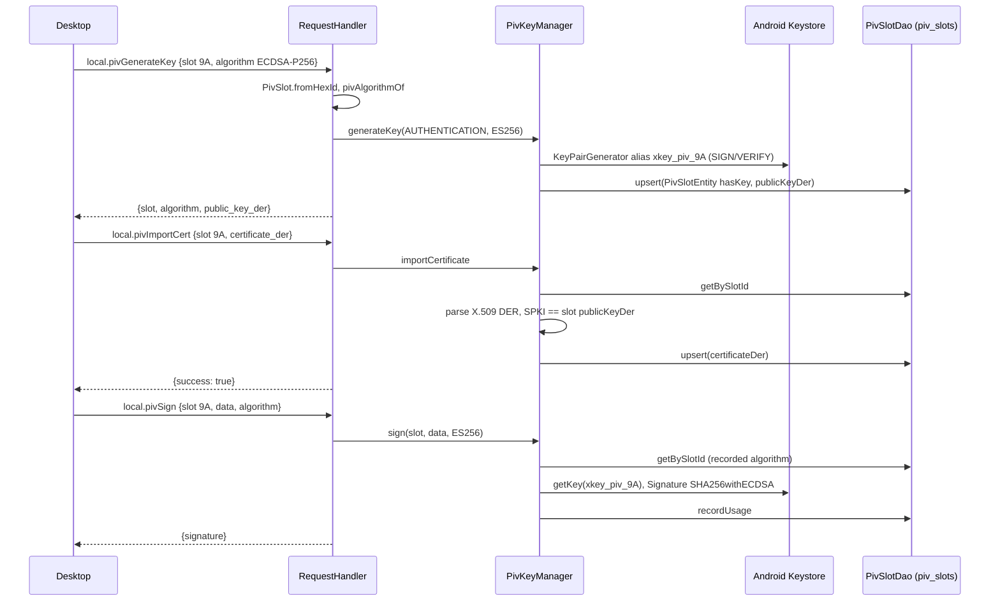

# PIV architecture

> **Status: REFERENCE** · Last verified: 2026-11-23
> As-built description of the phone's PIV slots: the `local.piv*` wire family, the Keystore keys behind each slot, and the `piv_slots` table.

## Summary

The phone emulates PIV smart-card slots. Each slot (`PivSlot`: the primary
slots 9A, 9C, 9D, 9E, F9 and the retired slots 82 to 95) can hold one
Android Keystore key pair under the alias `xkey_piv_<hexId>`, plus an optional
imported X.509 certificate. Metadata (algorithm, public key DER, certificate,
created / last-used time, use count) lives in the Room table `piv_slots`
(`PivSlotEntity`, `PivSlotDao`). Keys are ECDSA P-256, ECDSA P-384, RSA 2048,
Ed25519 or X25519 (`PivAlgorithm`).

The desktop drives the slots through `local.piv*`. All transports share the
one `RequestHandler` built in `XKeyGattService` with
`PivKeyManager(XKeyDatabase.getInstance(this).pivSlotDao())`, used by the BLE
(`GattServer`), TCP (`TcpHsmServer`) and USB (`UsbAccessoryServer`) servers.
On the phone, `PivActivity` and `PivSlotDetailActivity` use their own
`PivKeyManager`.

`MethodNames` also defines `remote.pivListSlots`, `remote.pivSign` and
`remote.pivGetCert`, but no code in `app/src/main` sends them; only
`PivHandlerTest` and `ProtocolConstantsTest` reference those constants.

## Components

| Component | File | Role |
|-----------|------|------|
| `RequestHandler` (`handlePivListSlots`, `handlePivGenerateKey`, `handlePivImportCert`, `handlePivSign`, `handlePivGetCert`, `pivSlotId`, `pivAlgorithmOf`) | `app/src/main/kotlin/com/automatethethings/xkey/protocol/Handler.kt` | Wire handlers; accept go-xkms field and algorithm spellings alongside the older Android ones |
| `PivKeyManager`, `PivSlotInfo`, `PivAlgorithmUnavailableException`, `PivAlgorithmMismatchException` | `app/src/main/kotlin/com/automatethethings/xkey/piv/PivKeyManager.kt` | `generateKey`, `importCertificate`, `listSlots`, `sign`, `agree`, `getCertificate`, `getPublicKey`, `deleteKey`; audit via `AuditLogger.logKeyCreated`, `AuditLogger.logSigningRequest`, `AuditLogger.logKeyUsed` (operation `key agreement`) and, after a stored import, `AuditLogger.logPivCertImported` (slot and subject) |
| `PivSlot`, `PivAlgorithm` | `app/src/main/kotlin/com/automatethethings/xkey/piv/PivSlot.kt` | Slot ids, labels, `keystoreAlias`, `isPrimarySlot`, `fromHexId` (case-insensitive); algorithms `ES256`, `ES384`, `RS2048`, `ED25519`, `X25519` with `pivAlgorithmId`, `canSign`, `canAgree`, `minSdk`, `isAvailableOn`, `fromPivAlgorithmId`, `fromStoredName` |
| `PivPublicKeyEncoding` | `app/src/main/kotlin/com/automatethethings/xkey/piv/PivPublicKeyEncoding.kt` | The PIV tag 0x86 public key value from a SubjectPublicKeyInfo (raw 32 bytes for Ed25519/X25519, `04 || X || Y` for P-256/P-384); builds the X25519/Ed25519 SPKI from a raw key |
| `PivSlotEntity`, `PivSlotDao` | `app/src/main/kotlin/com/automatethethings/xkey/piv/PivSlotEntity.kt`, `PivSlotDao.kt` | Room table `piv_slots`; `upsert`, `getBySlotId`, `getAll`, `recordUsage`, `deleteBySlotId`, observers for the UI |
| `PivActivity`, `PivSlotDetailActivity` | `app/src/main/kotlin/com/automatethethings/xkey/ui/` | On-phone slot list and slot detail screens |

## Algorithms

| `PivAlgorithm` | PIV id | Keystore key | Purposes | Sign | Minimum API |
|----------------|--------|--------------|----------|------|-------------|
| `ES256` | `0x11` | EC P-256 | SIGN, VERIFY | `SHA256withECDSA` | 28 |
| `ES384` | `0x14` | EC P-384 | SIGN, VERIFY | `SHA384withECDSA` | 28 |
| `RS2048` | `0x07` | RSA 2048, PKCS1 | SIGN, VERIFY | `SHA256withRSA` | 28 |
| `ED25519` | `0xE0` | EC `ed25519`, `DIGEST_NONE` | SIGN, VERIFY | `Ed25519` over the raw message | 33 |
| `X25519` | `0xE1` | EC `x25519` | AGREE_KEY | none: cannot sign | 33 |

`piv_slots.algorithm` stores the enum name, so the names never change.

### Curve 25519 keys: secure hardware only

The Android Keystore makes Ed25519 and X25519 keys from Android 13 (API 33),
in the TEE only (StrongBox does not support them, and they are never requested
there). `PivKeyManager` never falls back to a software key:

1. Below API 33 `generateKey` throws `PivAlgorithmUnavailableException`
   ("<algorithm> PIV keys need Android 13 secure hardware: ...") before the
   slot lock is taken; the slot's alias and row are untouched.
2. A Keystore that cannot create the curve fails the generator; that is
   reported as the same exception and the slot keeps its key.
3. After generation, inside `SharePermissionLedger.revoking` and before the
   row upsert, the key's security level is read from its `KeyInfo`
   (`KeystoreManager.securityLevelOf`). Anything but TEE or StrongBox,
   including an unreadable level, removes the new key and the slot's row and
   throws the same exception.

`sign(slot, data, algorithm = null)` uses the slot's recorded algorithm; a
caller-supplied algorithm that differs is refused with
`PivAlgorithmMismatchException`, and an X25519 slot is refused with
"X25519 keys cannot sign". `agree(slot, peerPublicKeyRaw32)` runs X25519
(`KeyAgreement` `XDH`) with an X25519 slot key; a peer key that is not
32 bytes or is all zeros, a slot whose key is not X25519, and an all-zero
shared secret are refused. `getCertificate` returns null for an X25519 slot
without an imported certificate: the Keystore's placeholder certificate for a
key that cannot sign carries no valid signature.

## Wire methods served

| Method | Constant | Params | Result |
|--------|----------|--------|--------|
| `local.pivListSlots` | `MethodNames.LOCAL_PIV_LIST_SLOTS` | none | `slots[]`: `slot`/`slotId`, `label`, `description`, `has_key`/`hasKey`, `has_certificate`/`hasCertificate`, `algorithm`, `public_key_der`/`publicKey`, `createdAt`, `lastUsedAt`, `useCount`. Only slots with a `piv_slots` row are listed |
| `local.pivGenerateKey` | `LOCAL_PIV_GENERATE_KEY` | `slot` (or `slotId`), `algorithm` (default `ES256`) | `slot`, `algorithm`, `has_key`, `public_key_der` (SPKI, base64). Overwrites a key already in the slot |
| `local.pivImportCert` | `LOCAL_PIV_IMPORT_CERT` | `slot`, `certificate_der` (or `certificate`), base64 | `success: true`. The bytes must be exactly one DER X.509 certificate whose SubjectPublicKeyInfo equals the slot key's public key; a refusal stores nothing and an earlier certificate stays |
| `local.pivSign` | `LOCAL_PIV_SIGN` | `slot`, `data` (base64), `algorithm` (default `ES256`) | `signature` (base64), signed with the slot's recorded algorithm; a request algorithm other than the slot's fails |
| `local.pivGetCert` | `LOCAL_PIV_GET_CERT` | `slot` | `certificate_der`/`certificate`: the imported certificate, else the Keystore's self-signed certificate for the alias (none for an X25519 slot) |

Accepted algorithm names: the enum names (`ES256`, `ES384`, `RS2048`) and
`ECDSA-P256`, `EC-P256`, `P256`, `ECDSA-P384`, `EC-P384`, `P384`, `RSA-2048`,
`RSA2048` (case and `_`/`-` folded).

The handlers do not yet accept the curve 25519 names or PIV ids, nor answer
`algorithm_id` and `public_key_raw`; `PivHandlerTest` pins that contract
(Ed25519 `0xE0`, X25519 `0xE1`, `FEATURE_UNAVAILABLE` for an unavailable
algorithm, `INVALID_ALGORITHM` "X25519 keys cannot sign").

## Main flow

## Errors and refusals

| Condition | Error code |
|-----------|------------|
| Handler built without a `PivKeyManager` | `FEATURE_UNAVAILABLE` ("PIV support is not available on this transport") |
| Missing params, missing certificate or data | `INVALID_PARAMS` |
| Unknown slot id | `PIV_INVALID_SLOT` |
| Unknown algorithm name | `INVALID_ALGORITHM` |
| Key generation throws | `KEY_GENERATION_FAILED` |
| Signing throws (including no key in the slot) | `PIV_SIGN_FAILED` |
| `local.pivGetCert` on a slot with no certificate | `PIV_SLOT_NOT_FOUND` |
| `local.pivImportCert`: certificate not base64, not one DER certificate, or for another key | `INVALID_PARAMS` (nothing stored) |
| `local.pivImportCert` into a slot with no key | `PIV_SLOT_NOT_FOUND` |
| Any other import failure, list or get-cert failure | `INTERNAL_ERROR` |

The `local.piv*` handlers do not check a PIN or prompt the user; no PIN or
user-verification gate was found in these handlers or in `PivKeyManager`.

## Tests

- Unit (`app/src/test`): `PivKeyManagerTest`, `PivSlotTest`, `PivPublicKeyEncodingTest`, `PivSlotEntityTest`, `PivHandlerTest`, `ProtocolConstantsTest`.
- Instrumented (`app/src/androidTest`): `PivSlotDaoTest`, `PivCurve25519KeystoreTest` (real Keystore, Bouncy Castle checks, skipped without Android 13 secure hardware), `PivActivityUiTest`, `PivFlowTest`, `PivSlotDetailActivityUiTest`, `PivSlotDetailFlowTest`.

## Related features

- [PIN](../pin/architecture.md) — the other smart-card style family on the same handler.
- [Hardware-backed keys](../hardware-backed-keys/architecture.md) — the general Keystore key path.
- [Certificate authority](../certificate-authority/)
- [Audit log](../audit-log/architecture.md)
