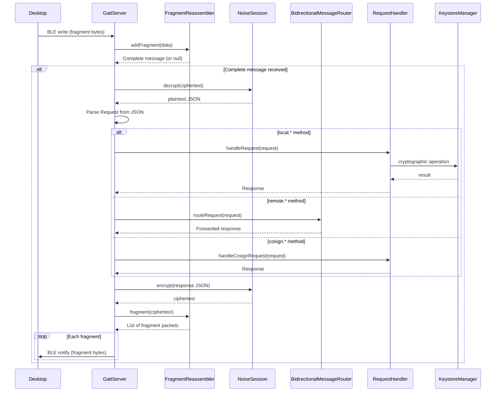
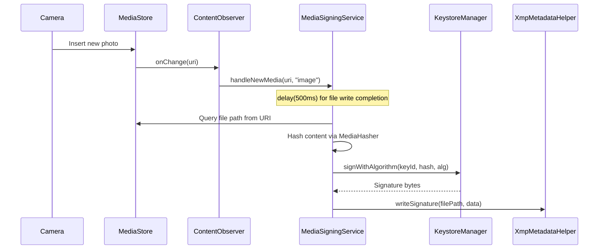
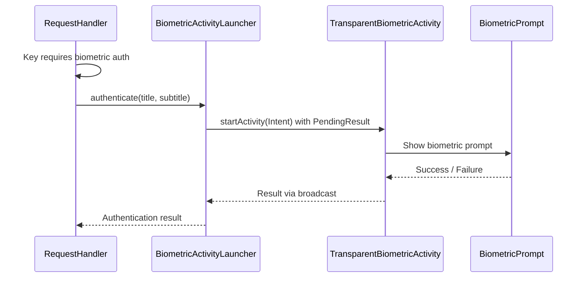
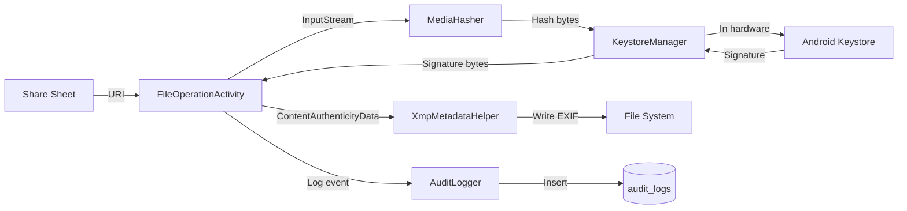
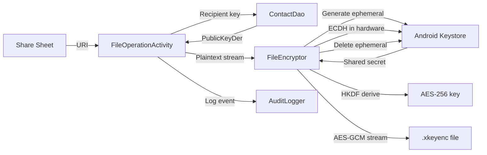
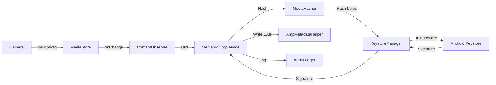
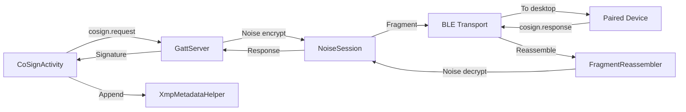

# Component Communication

> **Status: REFERENCE** · Last verified: 2026-10-09
> As-built map of how xKey components communicate.

This document maps how all components in xKey communicate with each other,
including activity-to-service bindings, service-to-crypto calls, database
access patterns, and inter-process communication.

## Full Component Communication Map

```mermaid
graph TB
    subgraph Activities["Activities"]
        MA[MainActivity]
        SA[SettingsActivity]
        KMA[KeyManagementActivity]
        CMA[ContactManagementActivity]
        FOA[FileOperationActivity]
        CSA[CoSignActivity]
        VMA[VerifiedMediaViewerActivity]
        PDA[PairedDevicesActivity]
        ALA[AuditLogActivity]
    end

    subgraph Services["Services"]
        GATT[XKeyGattService]
        MSS[MediaSigningService]
        CRED[XKeyCredentialService]
    end

    subgraph Protocol["Protocol"]
        RH[RequestHandler]
        BMR[BidirectionalMessageRouter]
        NS[NoiseSession]
        FR[FragmentReassembler]
    end

    subgraph Crypto["Crypto"]
        KM[KeystoreManager]
        FE[FileEncryptor]
        MH[MediaHasher]
        XMP[XmpMetadataHelper]
    end

    subgraph Storage["Storage"]
        DB[(XKeyDatabase)]
        DS[DataStore]
        AL[AuditLogger]
    end

    subgraph External["External"]
        KS[Android Keystore]
        MSDB[MediaStore]
        BIO[BiometricPrompt]
    end

    %% Activity -> Service bindings
    MA -->|bindService / startService| GATT
    SA -->|startService / stopService| MSS
    MA -->|observe StateFlow| GATT

    %% Activity -> Crypto
    FOA --> KM
    FOA --> FE
    FOA --> MH
    FOA --> XMP
    CSA --> KM
    CSA --> MH
    VMA --> MH
    VMA --> XMP
    KMA --> KM

    %% Activity -> Storage
    FOA --> DB
    CSA --> DB
    VMA --> DB
    KMA --> DB
    CMA --> DB
    ALA --> DB
    PDA --> DS

    %% Activity -> AuditLogger
    FOA --> AL
    CSA --> AL
    CMA --> AL

    %% Service -> Protocol
    GATT --> RH
    GATT --> BMR
    GATT --> NS
    GATT --> FR

    %% Service -> Crypto
    GATT --> KM
    MSS --> KM
    MSS --> MH
    MSS --> XMP
    CRED --> KM

    %% Service -> Storage
    GATT --> DS
    MSS --> DB
    MSS --> DS
    CRED --> DB

    %% Protocol -> Crypto
    RH --> KM

    %% Crypto -> External
    KM --> KS
    KM --> BIO
    FE --> KM

    %% Service -> External
    MSS --> MSDB

    %% Service -> AuditLogger
    GATT --> AL
    MSS --> AL
    RH --> AL
```



## Activity to Service Communication

### MainActivity to XKeyGattService

| Mechanism | Direction | Purpose |
|-----------|-----------|---------|
| `bindService()` | Activity -> Service | Get `LocalBinder` reference |
| `startService(ACTION_START_ADVERTISING)` | Activity -> Service | Start BLE advertising |
| `startService(ACTION_STOP_ADVERTISING)` | Activity -> Service | Stop BLE advertising |
| `StateFlow<ServiceState>` | Service -> Activity | Observe service state changes |
| `setActivity(activity)` | Activity -> Service | Provide activity for biometric prompts |

```kotlin
// Binding
val connection = object : ServiceConnection {
    override fun onServiceConnected(name: ComponentName, service: IBinder) {
        val binder = service as XKeyGattService.LocalBinder
        gattService = binder.getService()
        gattService.setActivity(this@MainActivity)
    }
}
bindService(intent, connection, BIND_AUTO_CREATE)

// State observation
lifecycleScope.launch {
    gattService.serviceState.collect { state ->
        updateUI(state)
    }
}
```

### SettingsActivity to MediaSigningService

| Mechanism | Direction | Purpose |
|-----------|-----------|---------|
| `startForegroundService()` | Activity -> Service | Start auto-signing |
| `stopService()` | Activity -> Service | Stop auto-signing |
| `MediaSigningSettingsRepository` | Shared | Settings read by both |

## Service to KeystoreManager

All services access `KeystoreManager` for cryptographic operations:

| Service | Operations Used |
|---------|----------------|
| `XKeyGattService` | `sign()`, `signWithAlgorithm()`, `generateKeyForAlgorithm()`, `deleteKey()`, `getPublicKeyDER()`, `performECDH()`, `symmetricEncrypt()`, `symmetricDecrypt()`, `computeHMAC()` |
| `MediaSigningService` | `signWithAlgorithm()`, `getPublicKeyDER()` |
| `XKeyCredentialService` | `generateKey()`, `sign()`, `getCOSEPublicKey()` |

`KeystoreManager` is instantiated per-service (not shared) since it holds only
a `KeyStore` reference and is lightweight.

## Service to Room Database

| Service | DAOs Used | Operations |
|---------|-----------|------------|
| `XKeyGattService` | `KeyDao` | List keys, get key by ID, update use count |
| `MediaSigningService` | `KeyDao` | Get signing key by ID |
| `XKeyCredentialService` | `CredentialMetadataDao`, `KeyDao` | CRUD for credentials |

The database singleton is obtained via `XKeyDatabase.getInstance(context)`.

## BLE Protocol Communication Stack



## MediaSigningService to ContentObserver



## Inter-Process Communication

### XKeyGattService to TransparentBiometricActivity

When the BLE service needs biometric authentication and no activity is in the
foreground, it uses `BiometricActivityLauncher` to start a transparent overlay
activity:



## Data Flow: Sign a File



## Data Flow: Encrypt a File



## Data Flow: Auto-Sign Media



## Data Flow: Co-Sign via BLE



## Shared Singletons

| Singleton | Access Pattern | Thread Safety |
|-----------|---------------|---------------|
| `XKeyDatabase` | `getInstance(context)` with `AtomicReference` | Thread-safe (Room) |
| `AuditLogger` | Static methods, `SupervisorJob + Dispatchers.IO` | Async, thread-safe |
| DataStore repositories | Per-component instantiation | Thread-safe (DataStore) |
| `KeystoreManager` | Per-component instantiation | Thread-safe (Keystore is thread-safe) |
