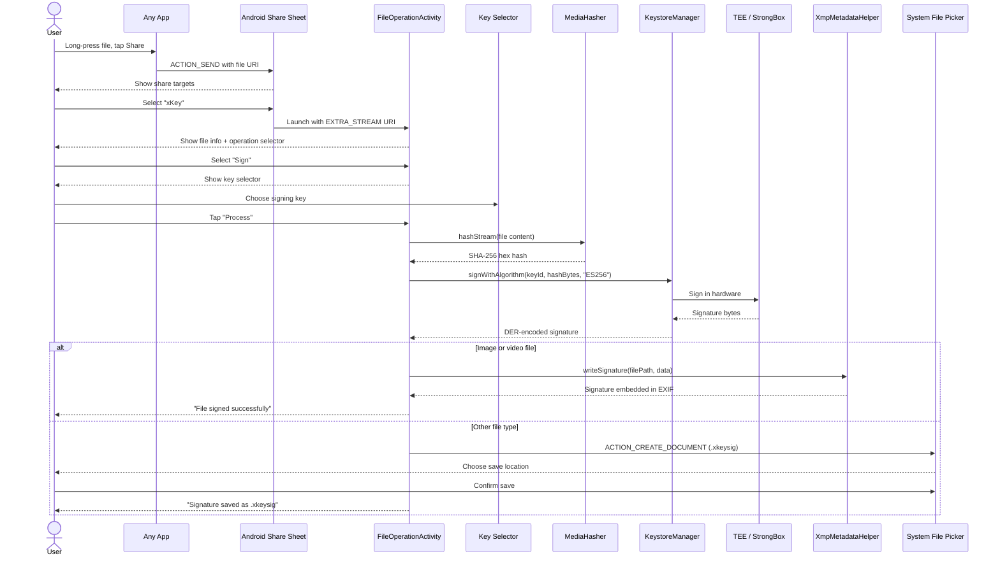
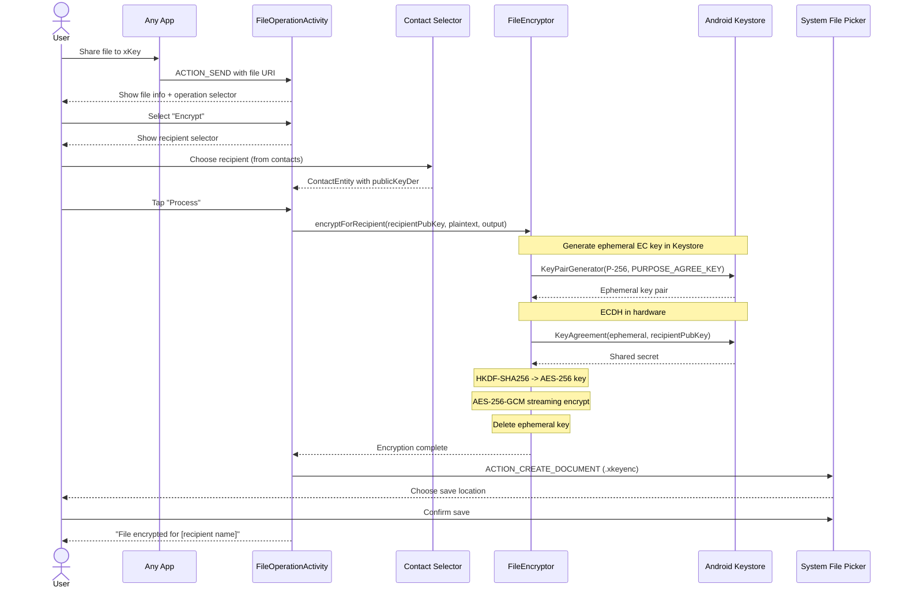
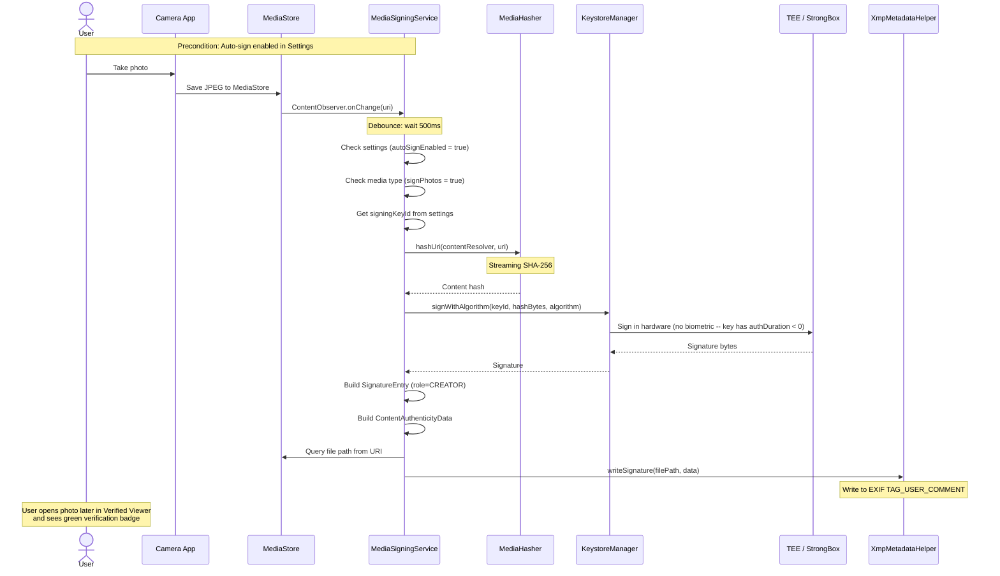
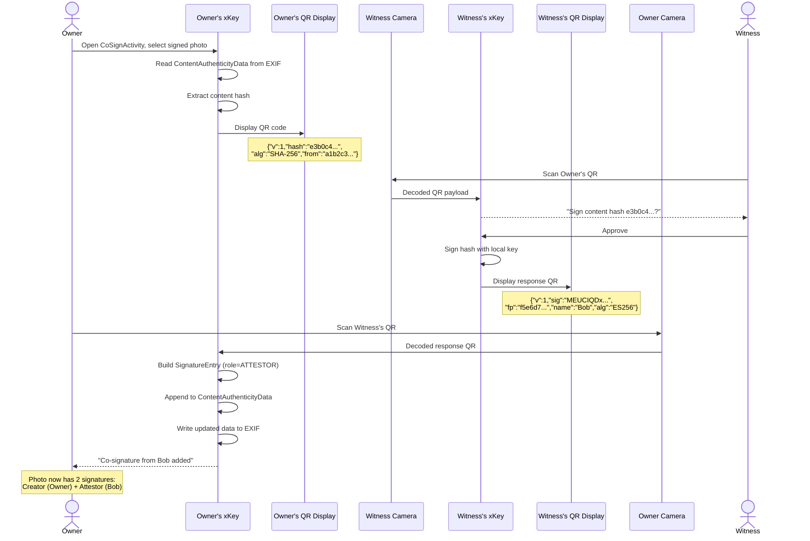
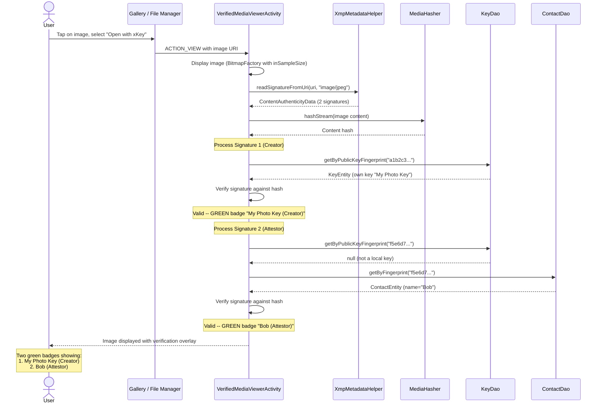
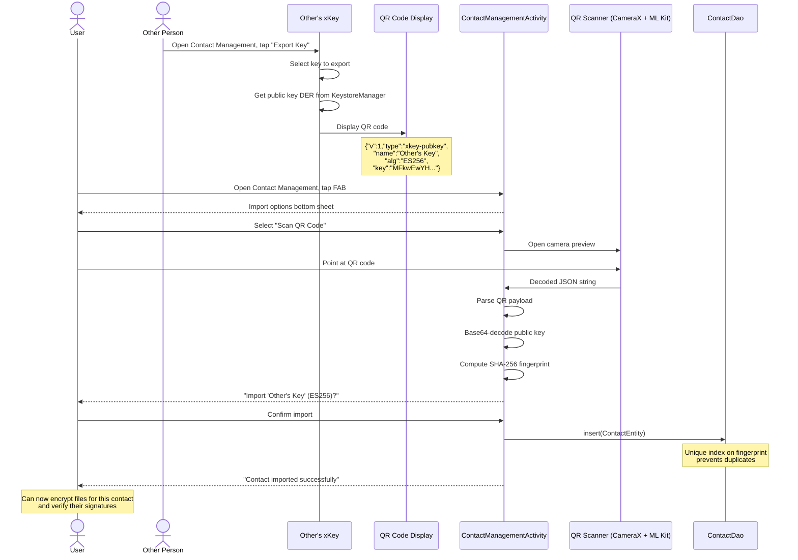
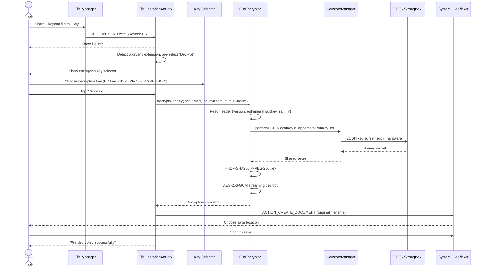

# User Flows

This document provides end-to-end user flow diagrams for the major operations
in xKey, from user intent through system interaction to final result.

## Sign a File via Share Sheet

A user shares a document from any app (e.g., a file manager, email client,
or browser) and signs it with their xKey key.

## Encrypt a File for a Recipient

A user encrypts a file so that only a specific recipient (whose public key
is stored as a contact) can decrypt it.

## Auto-Sign a Photo

The user takes a photo with the system camera. The `MediaSigningService`
detects the new media and automatically signs it in the background.

## Co-Sign a Photo via QR

Two people are at the same location. The photo owner wants the witness to
co-sign the photo to attest they were both present.

## View Verified Media

A user opens a signed image to verify its authenticity and see who signed it.

## Import a Contact via QR

A user scans another person's QR code to import their public key as a contact,
enabling file encryption and signature verification for that person.

## Decrypt a File

A user receives an encrypted `.xkeyenc` file and decrypts it using their
encryption key.

