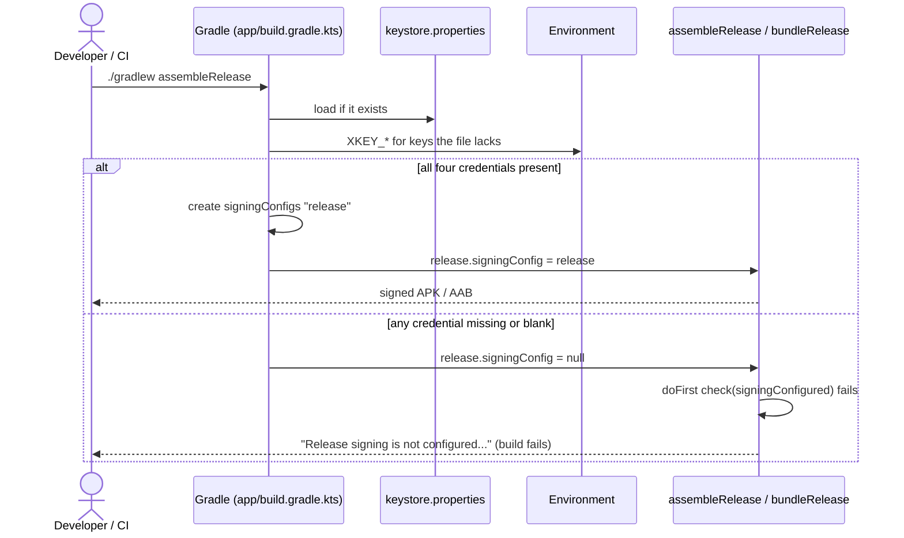

# Release signing architecture

> **Status: REFERENCE** · Last verified: 2026-11-12
> As-built description of how `assembleRelease` and `bundleRelease` are signed from credentials kept outside version control.

## Summary

The release build type takes its signing config from four credentials read at
Gradle configuration time: first from `keystore.properties` at the repository
root, otherwise from environment variables. When any of the four is missing or
blank, no `release` signing config is created, and a `doFirst` check makes
`assembleRelease` and `bundleRelease` fail with a message naming both sources,
instead of emitting an `-unsigned.apk` that looks like a successful build.

## Components

| Element | File | Role |
|---------|------|------|
| `releaseSigningCredentials` (script value) | `app/build.gradle.kts` | Resolves `storeFile`, `storePassword`, `keyAlias`, `keyPassword`; null unless all four are set |
| `signingConfigs { create("release") }` | `app/build.gradle.kts` | Created only when the credentials resolved; `storeFile` resolved relative to the repository root |
| `buildTypes.release.signingConfig` | `app/build.gradle.kts` | `signingConfigs.findByName("release")`, null when unconfigured |
| Release task guard (`tasks.matching { assembleRelease / bundleRelease }`) | `app/build.gradle.kts` | `doFirst { check(signingConfigured) }`; the Boolean is captured at configuration time so the configuration cache can serialize the task |
| `keystore.properties`, `*.jks` entries | `.gitignore` | Keep the credentials file and keystores out of version control |
| `**/*.jks` entry | `.dockerignore` | Keeps keystores out of Docker build contexts |
| Release signing section | `README.md` | Operator instructions |
| `release-check` target | `Makefile`, `scripts/release-check.sh` | Builds `assembleRelease` with a throwaway keystore under `build/release-check/` and checks `apksigner verify --print-certs` reports that one certificate |

## Android entry points served

This feature has no wire methods or app entry points; it serves the Gradle
tasks `assembleRelease` and `bundleRelease`.

| Credential | `keystore.properties` key | Environment variable |
|------------|---------------------------|----------------------|
| Keystore path | `storeFile` | `XKEY_KEYSTORE_FILE` |
| Keystore password | `storePassword` | `XKEY_KEYSTORE_PASSWORD` |
| Key alias | `keyAlias` | `XKEY_KEY_ALIAS` |
| Key password | `keyPassword` | `XKEY_KEY_PASSWORD` |

Each credential is taken from the file when present and non-blank, otherwise
from the environment, so the two sources can be mixed per key; the file wins
where both are set.

## Main flow

## Errors and refusals

| Condition | Outcome |
|-----------|---------|
| Any of the four credentials missing or blank in both sources | `assembleRelease` / `bundleRelease` fail in `doFirst` with "Release signing is not configured. Create keystore.properties at the repository root ... or set XKEY_KEYSTORE_FILE, XKEY_KEYSTORE_PASSWORD, XKEY_KEY_ALIAS and XKEY_KEY_PASSWORD in the environment." |
| Debug builds and other tasks | Unaffected; the guard matches only the two release task names |
| Wrong password or alias, missing keystore file | Left to the Android Gradle Plugin's own signing errors; no project-specific handling |

## Tests

`make release-check` (`scripts/release-check.sh`) makes a one-day PKCS12
keystore with a random password in `build/release-check/` (ignored by
`/build/*`, deleted when the script exits), exports the four `XKEY_*`
variables for it, and runs `assembleRelease`. It then runs
`apksigner verify --print-certs` (build-tools `ANDROID_BUILD_TOOLS` from
`scripts/tool-pins.sh` under `ANDROID_HOME`, or `APKSIGNER=`) and fails
unless the APK has exactly one signer whose certificate SHA-256 digest is
the throwaway certificate's. It refuses to run while `keystore.properties`
exists, since the file would override the throwaway key.
`RELEASE_CHECK_OMIT=<one XKEY_* name>` leaves that variable unset, so the
release guard's refusal can be seen: the target then fails.

No CI workflow on main runs the target, `assembleRelease` or
`bundleRelease`, or sets the `XKEY_*` variables. `bundleRelease` is not
verified.

## Related features

None: release signing is build configuration and shares no code with the app's
features.
