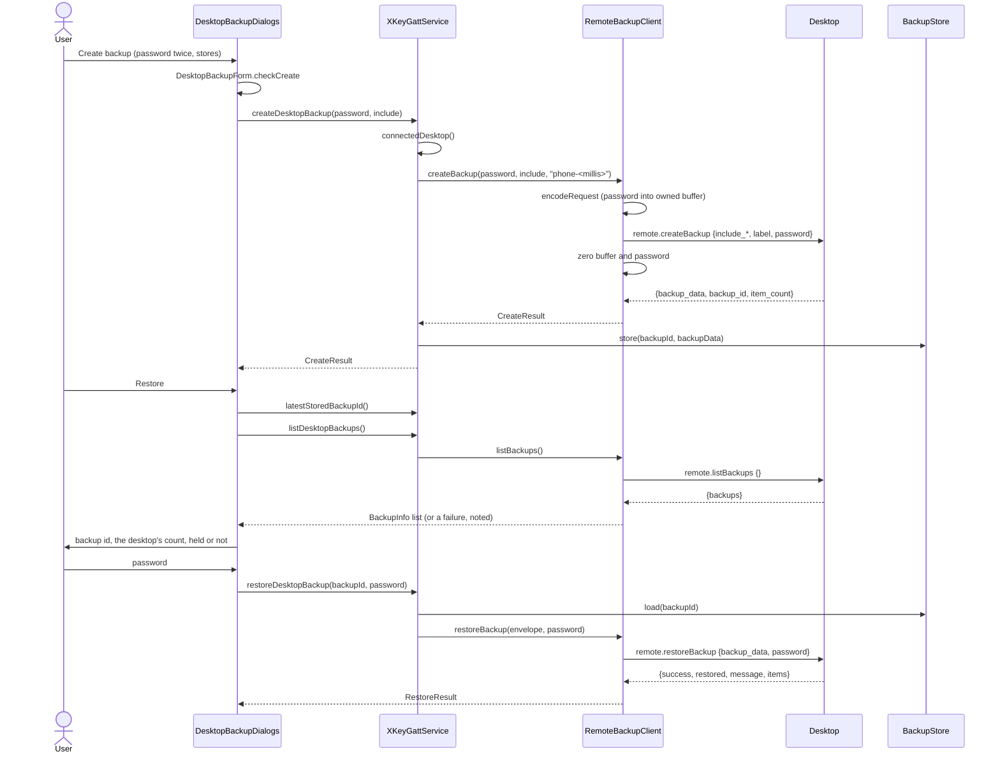

# Remote backup password architecture

> **Status: REFERENCE** · Last verified: 2026-11-12
> As-built description of the phone-initiated desktop backup and restore, which send the required backup password.

## Summary

The phone can ask the paired desktop to create an encrypted backup of chosen
stores (`remote.createBackup`) or to restore one (`remote.restoreBackup`), and
lists the backups the desktop holds (`remote.listBackups`) before a restore.
Create and restore carry a `password` field, which the desktop requires: the desktop
derives the backup key from it and returns the encrypted envelope, which the
phone keeps in `BackupStore` as an opaque blob (see
[desktop-backup-store](../desktop-backup-store/architecture.md)).

The password is never turned into a `String`. `RemoteBackupClient` writes it as
a JSON string straight into a request buffer it owns, and zeroes that buffer
and the caller's `CharArray` before each call returns, on success, error,
timeout or cancellation. Request parameters are not logged. `remote.listBackups`
carries no password.

## Components

| Class | File | Role |
|-------|------|------|
| `RemoteBackupClient` | `app/src/main/kotlin/com/automatethethings/xkey/remote/RemoteBackupClient.kt` | `createBackup`, `restoreBackup`, `listBackups`; `encodeRequest` builds the request bytes with the password; types `Include`, `CreateResult`, `RestoreItem`, `RestoreResult`, `BackupInfo` |
| `RemoteBackupErrorCodes` | same file | The desktop's error codes for these replies |
| `RemoteBackupException` | same file | Typed failures; `fromError` maps a reply code to one |
| `XKeyGattService` | `app/src/main/kotlin/com/automatethethings/xkey/ble/XKeyGattService.kt` | `createDesktopBackup` and `restoreDesktopBackup` pick the active transport, call the client, and store or load the envelope in `BackupStore`; both zero the password. `listDesktopBackups` calls `listBackups` |
| `DesktopBackupDialogs` | `app/src/main/kotlin/com/automatethethings/xkey/ui/DesktopBackupDialogs.kt` | The create and restore dialogs, opened from `MainActivity` |
| `DesktopBackupForm` | `app/src/main/kotlin/com/automatethethings/xkey/ui/DesktopBackupForm.kt` | View-free form logic: `checkCreate`, `checkRestore`, `errorMessage`, `findLatest`, `listDesktop`, `listingNote`, `canRetry`, `itemLabel` |

## Wire methods

Sent by the phone; method names are `MethodNames.REMOTE_CREATE_BACKUP`,
`MethodNames.REMOTE_RESTORE_BACKUP` and `MethodNames.REMOTE_LIST_BACKUPS`. The
wire contract is go-xkms `pkg/pairingproto/protocol_backup.go` at tag
`xkey/v0.64.2-alpha`.

| Method | Params | Result read |
|--------|--------|-------------|
| `remote.createBackup` | `include_trust_store`, `include_oath`, `include_passwords`, `include_ca`, `label` (when not empty), `password` | `backup_data` (base64 of the envelope), `backup_id`, `item_count` |
| `remote.restoreBackup` | `backup_data` (base64), `password` | `success`, `restored`, `message`, `items` (each `item`, `restored`, `quarantined`, `skipped`, `errors`) |
| `remote.listBackups` | none (`{}`, no password) | `backups` (each `backup_id`, `created_at`, `label` when set, `size` in bytes); `null` read as no backups |

`XKeyGattService.createDesktopBackup` sends the label `phone-<unix millis>`
and stores the envelope under the `backup_id` the desktop returns. The dialog
offers the trust store, OATH and passwords; it never sets `include_ca`.

Before the restore dialog opens, the phone lists the desktop's backups and
says how many there are and whether the chosen backup is one of them.
`remote.restoreBackup` takes `backup_data`, not an id, so the listing informs
the user; it does not pick what is restored, which is always the phone's
stored envelope. A listing failure is said in the dialog and does not block
the restore.

## Main flow

## Errors and refusals

Refused on the phone, before anything is sent:

- `RemoteBackupException.EmptyPassword`: the password is empty.
- `RemoteBackupException.NothingSelected`: `createBackup` with no store selected.
- `IllegalStateException` from `XKeyGattService`: no desktop connected, or no
  stored backup under the id.

Desktop error replies, mapped by `RemoteBackupException.fromError`:

| Code | `RemoteBackupErrorCodes` | Exception |
|------|--------------------------|-----------|
| -32602 | `INVALID_PARAMS` (includes a missing or empty password) | `InvalidParams` |
| -32020 | `BACKUP_FAILED` | `CreationFailed` |
| -32021 | `RESTORE_FAILED` (wrong password or damaged envelope; not told apart) | `WrongPasswordOrDamaged` |
| -32035 | `BACKUP_NOT_CONFIGURED` | `NotConfigured` |
| -32038 | `APPROVAL_REQUIRED` (exporting OATH or passwords needs desktop approval) | `ApprovalRequired` |
| other | | `Other` |

No reply within `requestTimeoutMs` (60 s by default) gives `TimedOut`; an empty
result, a missing or non-base64 `backup_data`, or an `items` value that is not
a list of objects gives `MalformedReply`. These are the desktop's codes, not the
phone's own `ErrorCodes`. In the dialog, only `WrongPasswordOrDamaged` offers a
retry (`DesktopBackupForm.canRetry`).

## Tests

| Test class | Covers |
|------------|--------|
| `RemoteBackupClientTest` (`app/src/test/.../remote/`) | Exact request fields, envelope decoding, `remote.listBackups` params and `BackupInfo` parsing, malformed replies, no request when nothing is selected, error code mapping |
| `RemoteClientInteropTest` (`app/src/test/.../remote/`) | Backup request ids never collide with the key and sync clients'; replies resolve only their own request |
| `DesktopBackupFormTest` (`app/src/test/.../ui/`) | Form checks and messages; the desktop listing and its note |
| `StreamResponseDrainTest` (`app/src/test/.../transport/`) | A reply on the send path `RemoteBackupClient` uses settles the pending request |

## Related features

- [desktop-backup-store](../desktop-backup-store/architecture.md): where the returned envelope is kept
- [store-sync](../store-sync/architecture.md): the other phone-initiated exchange, over the same transport
- [password-vault](../password-vault/architecture.md): the password store a backup can include
