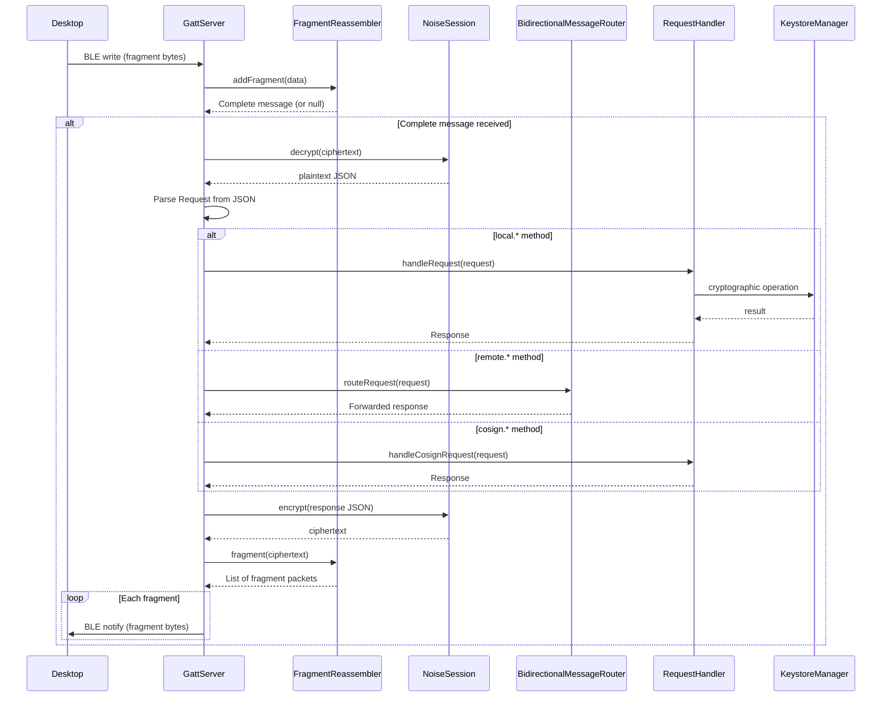

# Remote key access architecture

> **Status: REFERENCE** · Last verified: 2026-10-09
> As-built description of how xKey forwards `remote.*` requests to the desktop.

## Message Types

### Remote Methods (forwarded to desktop)

Messages prefixed with `remote.*` are forwarded through the
`BidirectionalMessageRouter` to the connected desktop client.

| Method | Description |
|--------|-------------|
| `remote.listKeys` | List keys on the desktop keychain |
| `remote.sign` | Request signing from desktop key |
| `remote.getPublicKey` | Get desktop public key |
| `remote.attestDevice` | Request device attestation from desktop |

## Desktop keys screen

`ui/DesktopKeysActivity` shows the keys the paired desktop's xkmsd backends
hold. It is opened from the Desktop keys button on the device detail screen,
which shows only while that device's desktop session is up
(`XKeyGattService.remoteKeyClient()` returns a client only then, one cached
client per active router). The state logic is the view-free
`ui/DesktopKeysController`, tested on the JVM with a fake client.

| Step | Requests sent |
|------|---------------|
| Open the screen | `remote.listBackends` |
| Choose a backend | `remote.listKeys` |
| Choose a key | `remote.getKeyInfo`, `remote.getPublicKey` |
| Sign and verify a test message | `remote.sign`, then `remote.verify` with the algorithm the desktop signed with |
| Attest this key | `remote.attestKey` with a fresh 32-byte nonce |

The sign test is offered for backends that sign, attestation for backends
that attest. A failed request keeps the previous screen and shows a typed
error (no session, key not found, denied, unsupported, attestation failed,
other desktop error, link failure) with Retry. The screen adds no wire
method: it only calls `RemoteKeyClient`.

## BLE Protocol Communication Stack

