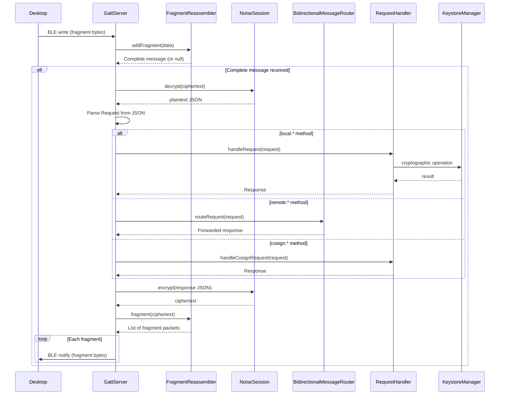

# Remote key access architecture

> **Status: REFERENCE** · Last verified: 2026-11-12
> As-built description of how xKey forwards `remote.*` requests to the desktop.

## Message Types

### Remote Methods (forwarded to desktop)

Messages prefixed with `remote.*` are forwarded through the
`BidirectionalMessageRouter` to the connected desktop client.

| Method | Description |
|--------|-------------|
| `remote.listKeys` | List keys on the desktop keychain |
| `remote.sign` | Request signing from desktop key |
| `remote.getPublicKey` | Get desktop public key |
| `remote.attestDevice` | Request device attestation from desktop |
| `remote.sharePublicKey` | Send a phone key's public half (and certificate) for the desktop to import |
| `remote.shareSymmetric` | Send symmetric key material for the desktop to import (client only; see [key sharing](../key-sharing/architecture.md#sending-keys-to-the-paired-desktop)) |
| `remote.importSharedKey` | Ask the desktop to export one of its keys to the phone |

The three sharing methods are sent by `remote/RemoteShareClient.kt`, with
params and results as go-xkms `pkg/pairingproto` `RemoteSharePublicKey*`,
`RemoteShareSymmetric*` and `RemoteImportSharedKey*` (xkey/v0.64.2-alpha).
`[]byte` fields, the PEM fields included, travel as base64 strings. A reply
with a missing field or a wrong type is rejected.

## BLE Protocol Communication Stack

