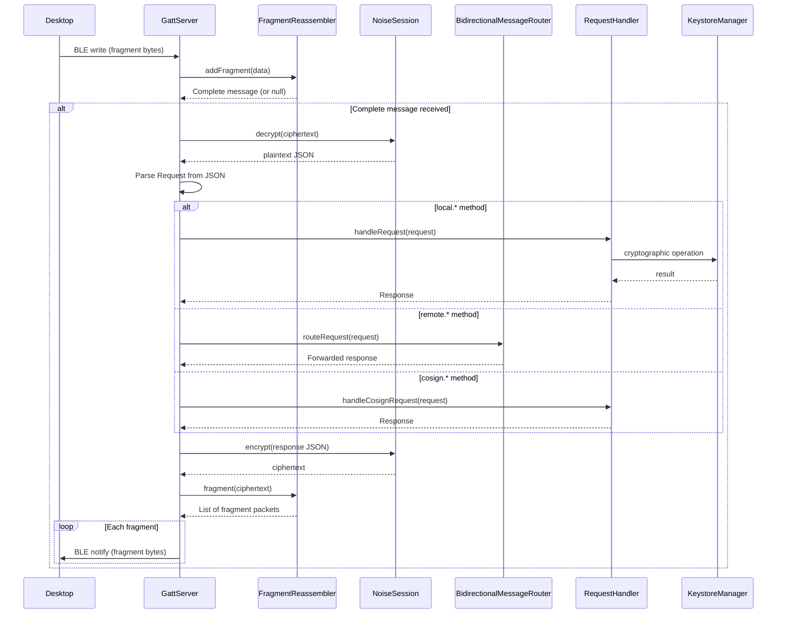

# Remote key access architecture

> **Status: REFERENCE** · Last verified: 2026-10-09
> As-built description of how xKey forwards `remote.*` requests to the desktop.

## Message Types

### Remote Methods (forwarded to desktop)

Messages prefixed with `remote.*` are forwarded through the
`BidirectionalMessageRouter` to the connected desktop client.

| Method | Description |
|--------|-------------|
| `remote.listKeys` | List keys on the desktop keychain |
| `remote.sign` | Request signing from desktop key |
| `remote.getPublicKey` | Get desktop public key |
| `remote.attestDevice` | Request device attestation from desktop |
| `remote.pivListSlots` | List the desktop's PIV slots (`backend` optional) |
| `remote.pivGetCert` | Get the DER certificate in one desktop PIV slot |
| `remote.pivSign` | Sign base64 `data` with one desktop PIV slot key |

### Desktop PIV slots

`RemoteKeyClient.pivListSlots`, `pivGetCert` and `pivSign` send the three
`remote.piv*` methods with the params and results of go-xkms
`pkg/pairingproto/protocol_piv.go`. Byte fields (`data`, `signature`,
`certificate_der`) are standard base64. A reply with a missing or mistyped
field raises `ProtocolException` with `PARSE_ERROR`.

The PIV screen lists the paired desktop's slots read-only below the phone's
own. With no desktop connected, or when the desktop errors, the section stays
hidden and the phone's slots show as before. A desktop slot's detail view
fetches its certificate with `remote.pivGetCert` (`PIV_SLOT_NOT_FOUND` means
no certificate), and its "sign test" action sends `remote.pivSign`.

## BLE Protocol Communication Stack

