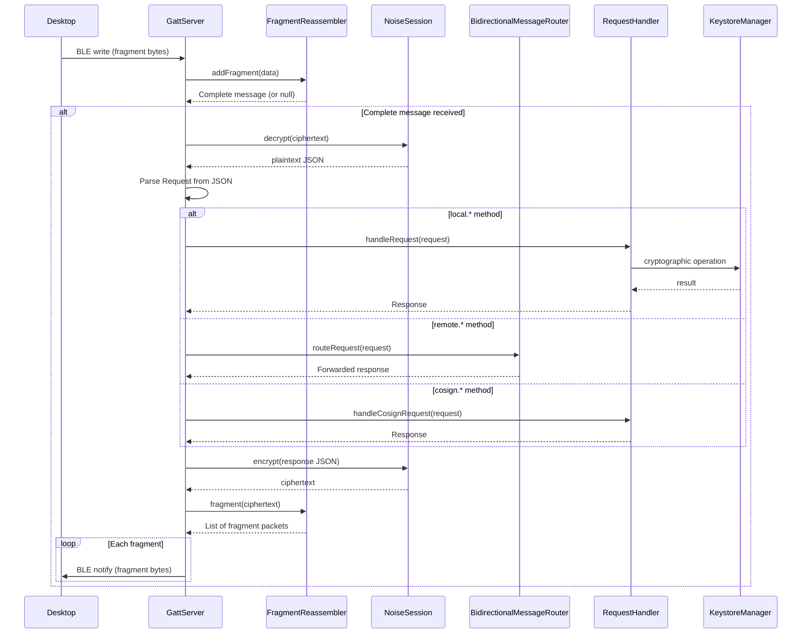

# Remote key access architecture

> **Status: REFERENCE** · Last verified: 2026-11-13
> As-built description of how xKey forwards `remote.*` requests to the desktop.

## Message Types

### Remote Methods (forwarded to desktop)

Messages prefixed with `remote.*` are forwarded through the
`BidirectionalMessageRouter` to the connected desktop client.

| Method | Description |
|--------|-------------|
| `remote.listKeys` | List keys on the desktop keychain |
| `remote.sign` | Request signing from desktop key |
| `remote.getPublicKey` | Get desktop public key |
| `remote.attestDevice` | Request device attestation from desktop |
| `remote.oathAdd` | Store a phone OATH credential on the desktop (`RemoteOathClient.oathAdd`) |
| `remote.oathGenerate` | Get the current code and expiry of a desktop-stored OATH credential (`RemoteOathClient.oathGenerate`) |
| `remote.pivListSlots` | List the desktop's PIV slots (`backend` optional) |
| `remote.pivGetCert` | Get the DER certificate in one desktop PIV slot |
| `remote.pivSign` | Sign base64 `data` with one desktop PIV slot key |

### OATH methods

`RemoteOathClient` sends both methods to the desktop it was built from (see
[Session binding](#session-binding)). Shapes follow go-xkms `pkg/pairing/protocol_oath.go` at `xkey/v0.64.2-alpha`:

| Method | Params | Result |
|--------|--------|--------|
| `remote.oathAdd` | `{"credential": {name, issuer?, account_name?, secret (Base32), type ("totp"/"hotp"), algorithm?, digits?, period?, counter?}}` | `{success, credential_id, message?}` |
| `remote.oathGenerate` | `{"credential_id"}` | `{code, expires_in?}` (seconds, TOTP only) |

- Request IDs come from one counter shared by all `RemoteOathClient`
  instances, starting above 5,000,000 (key 1M, sync 2M, enrollment 3M,
  backup 4M).
- The oathAdd body is built by hand so the secret never becomes a String;
  the caller's secret chars are zeroed once encoded and the body as soon as
  it is sent, before the reply is awaited.
- Replies are type checked: `success` must be a boolean, `credential_id` a
  non-empty string, `code` a digit string and `expires_in` a non-negative
  integer. `success: false` or anything off-shape throws `ProtocolException`.
- The OATH screen offers "Copy to desktop" and, once a credential has a
  desktop copy, "Show desktop code". The phone keeps only the oathId to
  `credential_id` link (SharedPreferences `oath_desktop_links`). With no
  desktop connected neither entry shows and nothing is sent.

### Session binding

Every outbound `remote.*` client (`RemoteKeyClient`, `RemoteSyncClient`,
`RemoteBackupClient`, `RemoteOathClient`) is built from a `ConnectedDesktop`,
never from a transport. `XKeyGattService.connectedDesktop()` is the only
source; it asks BLE, then TCP, then USB.

| Transport | Hands out a desktop when | The desktop's sender |
|-----------|--------------------------|----------------------|
| BLE (`GattServer`) | the Noise session is established and current | encrypts on that session for that device; fails with `IOException` once the session or device is replaced or ended |
| TCP (`TcpHsmServer`) | `TcpHsmState.Connected` | writes on that `StreamPairingSession` connection; fails once it ends or another connection is installed |
| USB (`UsbAccessoryServer`) | `UsbAccessoryState.Connected` | as TCP |

- `peerKeyHex` is the static key the handshake authenticated; OATH desktop
  links are keyed by it.
- A sender never re-resolves the transport's current session at send time,
  so a request built for desktop A never reaches desktop B, even when B
  replaces A between the lookup and the send.
- Clients take only a `ConnectedDesktop`, whose sender is a `SessionSender`
  that only the transports make; `ConnectedDesktopBindingTest` fails if a
  client or the service takes or hands out any other sender.
- `XKeyGattService.remoteKeyClient()` and `desktopSession` share one
  `RemoteKeyClient` per desktop session (`DesktopSessionTracker`), built from
  `connectedDesktop()`; another desktop, or none, drops it.

### Desktop PIV slots

`RemoteKeyClient.pivListSlots`, `pivGetCert` and `pivSign` send the three
`remote.piv*` methods with the params and results of go-xkms
`pkg/pairingproto/protocol_piv.go`. Byte fields (`data`, `signature`,
`certificate_der`) are standard base64. A reply with a missing or mistyped
field raises `ProtocolException` with `PARSE_ERROR`.

The PIV screen lists the paired desktop's slots read-only below the phone's
own. With no desktop connected, or when the desktop errors, the section stays
hidden and the phone's slots show as before. A desktop slot's detail view
fetches its certificate with `remote.pivGetCert` (`PIV_SLOT_NOT_FOUND` means
no certificate), and its "sign test" action sends `remote.pivSign`.

## BLE Protocol Communication Stack

