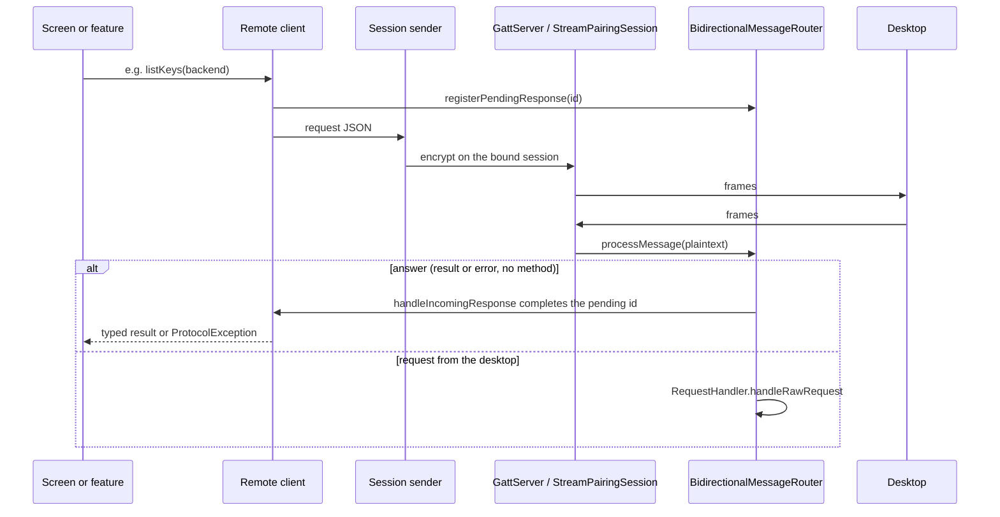

# Remote key access architecture

> **Status: REFERENCE** · Last verified: 2026-11-23
> How xKey sends `remote.*` requests to the paired desktop and matches the answers.

The phone sends `remote.*` requests to the desktop on the session the desktop
opened. The desktop answers on the same session. Inbound plaintext goes
through `BidirectionalMessageRouter.processMessage`: a message with `result`
or `error` and no `method` is an answer to one of the phone's requests and is
matched to it by id; anything else is a request for `RequestHandler`. Paths
below are relative to `app/src/main/kotlin/com/automatethethings/xkey/`.

## Methods the phone sends

`protocol/Messages.kt` names them in `MethodNames`. Each client lives in
`remote/` and draws request ids from its own range.

| Client | Id range from | Methods |
|--------|---------------|---------|
| `RemoteKeyClient` | 1,000,000 | `remote.listBackends`, `remote.listKeys`, `remote.getPublicKey`, `remote.getKeyInfo`, `remote.generateKey`, `remote.deleteKey`, `remote.sign`, `remote.verify`, `remote.encrypt`, `remote.decrypt`, `remote.deriveKey`, `remote.attestKey`, `remote.attestDevice`, `remote.pivListSlots`, `remote.pivGetCert`, `remote.pivSign` |
| `RemoteSyncClient` | 2,000,000 | `remote.syncTrustStore`, `remote.syncOATH`, `remote.syncPasswords`, `remote.syncStatus` (see [store-sync](../store-sync/architecture.md)) |
| `GattServer` enrollment | 3,000,000 | `remote.getTCGCSRIDevID`, `remote.activateCredential`, `remote.getAttestationQuote`, `remote.storeEnrollmentCerts` |
| `RemoteBackupClient` | 4,000,000 | `remote.createBackup`, `remote.restoreBackup`, `remote.listBackups` (see [desktop-backup-store](../desktop-backup-store/architecture.md)) |
| `RemoteOathClient` | 5,000,000 | `remote.oathAdd`, `remote.oathGenerate` |
| `RemoteShareClient` | 6,000,000 | `remote.sharePublicKey`, `remote.shareSymmetric`, `remote.importSharedKey` (see [key sharing](../key-sharing/architecture.md#sending-keys-to-the-paired-desktop)) |

`MethodNames` also defines `remote.syncAll`; no client sends it.

The three sharing methods are sent by `remote/RemoteShareClient.kt`, with
params and results as go-xkms `pkg/pairingproto` `RemoteSharePublicKey*`,
`RemoteShareSymmetric*` and `RemoteImportSharedKey*` (xkey/v0.64.2-alpha).
`[]byte` fields, the PEM fields included, travel as base64 strings. A reply
with a missing field or a wrong type is rejected.

### OATH methods

`RemoteOathClient` sends both methods to the desktop it was built from (see
[Session binding](#session-binding)). Shapes follow go-xkms `pkg/pairing/protocol_oath.go` at `xkey/v0.64.2-alpha`:

| Method | Params | Result |
|--------|--------|--------|
| `remote.oathAdd` | `{"credential": {name, issuer?, account_name?, secret (Base32), type ("totp"/"hotp"), algorithm?, digits?, period?, counter?}}` | `{success, credential_id, message?}` |
| `remote.oathGenerate` | `{"credential_id"}` | `{code, expires_in?}` (seconds, TOTP only) |

- Request ids come from one counter shared by all `RemoteOathClient`
  instances, starting at 5,000,000.
- The oathAdd body is built by hand so the secret never becomes a String;
  the caller's secret chars are zeroed once encoded and the body as soon as
  it is sent, before the reply is awaited.
- Replies are type checked: `success` must be a boolean, `credential_id` a
  non-empty string, `code` a digit string and `expires_in` a non-negative
  integer. `success: false` or anything off-shape throws `ProtocolException`.
- The OATH screen offers "Copy to desktop" and, once a credential has a
  desktop copy, "Show desktop code". The phone keeps only the oathId to
  `credential_id` link (SharedPreferences `oath_desktop_links`). With no
  desktop connected neither entry shows and nothing is sent.

### Session binding

The outbound clients (`RemoteKeyClient`, `RemoteSyncClient`,
`RemoteBackupClient`, `RemoteOathClient`) are built from a `ConnectedDesktop`,
never from a transport. `XKeyGattService.connectedDesktop()` is the only
source; it asks BLE, then TCP, then USB.

| Transport | Hands out a desktop when | The desktop's sender |
|-----------|--------------------------|----------------------|
| BLE (`GattServer`) | the Noise session is established and current | encrypts on that session for that device; fails with `IOException` once the session or device is replaced or ended |
| TCP (`TcpHsmServer`) | `TcpHsmState.Connected` | writes on that `StreamPairingSession` connection; fails once it ends or another connection is installed |
| USB (`UsbAccessoryServer`) | `UsbAccessoryState.Connected` | as TCP |

- `peerKeyHex` is the static key the handshake authenticated; OATH desktop
  links are keyed by it.
- A sender never re-resolves the transport's current session at send time,
  so a request built for desktop A never reaches desktop B, even when B
  replaces A between the lookup and the send.
- Clients take only a `ConnectedDesktop`, whose sender is a `SessionSender`
  that only the transports make; `ConnectedDesktopBindingTest` fails if a
  client or the service takes or hands out any other sender.
- `XKeyGattService.remoteKeyClient()`, `desktopSession()` and device
  attestation go through `DesktopSessions`, whose transports are the
  `connectedDesktop()` of each server: one `RemoteKeyClient` per router, and
  once the peer is confirmed, bound to the `ConfirmedConnection` it was
  confirmed on.
- A bound sender also carries the scoped send: `confirmedConnection()`
  answers only its own connection's confirmed peer, and
  `sendEncryptedMessageOn(c)` refuses with `ConnectionChangedException`
  unless `c` is that connection and it is still current and confirmed for
  the same peer, checked again at the admission that consumes the nonce.
  `RemoteShareClient` (key sharing) sends only that way.

## Desktop keys screen

`ui/DesktopKeysActivity` shows the keys the paired desktop's xkmsd backends
hold. It is opened from the Desktop keys button on the device detail screen,
which shows only while that device's desktop session is up
(`XKeyGattService.remoteKeyClient()` returns a client only then, one cached
client per active router). The state logic is the view-free
`ui/DesktopKeysController`, tested on the JVM with a fake client.

| Step | Requests sent |
|------|---------------|
| Open the screen | `remote.listBackends` |
| Choose a backend | `remote.listKeys` |
| Choose a key | `remote.getKeyInfo`, `remote.getPublicKey` |
| Sign and verify a test message | `remote.sign`, then `remote.verify` with the algorithm the desktop signed with |
| Attest this key | `remote.attestKey` with a fresh 32-byte nonce |

The sign test is offered for backends that sign, attestation for backends
that attest. A failed request keeps the previous screen and shows a typed
error (no session, key not found, denied, unsupported, attestation failed,
other desktop error, link failure) with Retry. The screen adds no wire
method: it only calls `RemoteKeyClient`.

## Desktop PIV slots

`RemoteKeyClient.pivListSlots`, `pivGetCert` and `pivSign` send the three
`remote.piv*` methods with the params and results of go-xkms
`pkg/pairingproto/protocol_piv.go`. Byte fields (`data`, `signature`,
`certificate_der`) are standard base64. A reply with a missing or mistyped
field raises `ProtocolException` with `PARSE_ERROR`.

The PIV screen lists the paired desktop's slots read-only below the phone's
own. With no desktop connected, or when the desktop errors, the section stays
hidden and the phone's slots show as before. A desktop slot's detail view
fetches its certificate with `remote.pivGetCert` (`PIV_SLOT_NOT_FOUND` means
no certificate), and its "sign test" action sends `remote.pivSign`. The section follows
`XKeyGattService.desktopSession`, which publishes the same client
`remoteKeyClient()` returns: bound to the connection its peer was confirmed on.

## Request and answer flow

A client waits up to its request timeout for the answer: 30 seconds, or 60
for `RemoteBackupClient`. When a session ends, `cancelAllPending` answers
every waiting request with `INTERNAL_ERROR` "Connection lost".
